---
title: "基础知识-抗体序列 Annotation Engine"
description: "梳理抗体序列分析四层框架、经典 IgG 重轻链与 Fab/Fc 功能分区、CDR/FR 编号体系、二硫键与多链拓扑推断，以及 CDR Hotspot 与 Fc 工程开发风险分析。"
category: 生物制药
date: 2026-11-20
readTime: 22 分钟
icon: 🧬
featured: false
draft: false
---

## 1. 抗体序列分析的四层问题

在抗体与融合蛋白研发中，序列分析系统需要逐层回答以下四个核心问题：


| 分析层次                           | 核心问题            | 关键概念与输出                                                       |
| ------------------------------ | --------------- | ------------------------------------------------------------- |
| **Sequence Annotation** 识别序列   | 每个氨基酸属于什么区域？    | `VH`、`VL`、`CH`、`CL`、`CDR`、`FR`、`Hinge`、`Linker`、`Tag`         |
| **Sequence Alignment** 比较序列    | 相对于参考抗体发生了什么变化？ | Germline 亚型、Mutation（突变）、EU Numbering、Fc Engineering          |
| **Disulfide Inference** 推断结构连接 | 哪些区域应通过二硫键连接？   | Cysteine 配对、Intra-chain（链内）、Inter-chain（链间）                   |
| **Molecular Topology** 推断分子组装  | 多条蛋白链如何组成完整分子？  | Chain Pairing（链配对）、Stoichiometry（化学计量）、Mab / BsAb / Fc-fusion |

其中最底层的基石是 **Sequence Annotation Engine（序列注释引擎）**：

> **核心问题**：一条氨基酸序列里，哪些位置是 `VH`、`VL`，哪些是 `CH`、`CL`，哪些是 `Linker`、`Tag` 或未知片段？`CDR`、`FR` 的边界在哪？

引擎输出的本质是对输入序列做**结构域与功能区分段注释**（domain + region + 起止坐标），而不是只做一次性的粗粒度 BLAST 比对。抗体分析系统不仅要识别氨基酸字符，还要理解各区域之间的生物学关系。（注释任务类似NLP 中的命名实体识别，HMM，CRF， BiLSTM ）

---

## 2. 经典 IgG 抗体的结构组成

### 2.1 四链 Y 形结构与重链 / 轻链分区

经典 IgG 抗体呈对称的 **Y 字形结构**，主要由四条多肽链组成：

- **两条重链**（Heavy Chain，HC）
- **两条轻链**（Light Chain，LC）

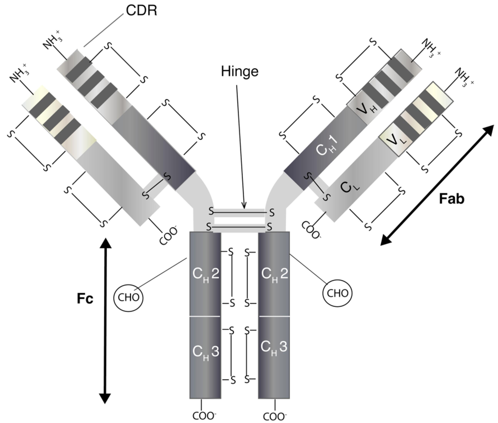

<p align="center"><em>图 1：经典 IgG 结构域划分与常见抗体工程</em></p>

**每条重链（HC）从 N 端到 C 端通常包含：**

| 区域 | 英文全称 | 主要功能 |
|------|----------|----------|
| **VH** | Heavy Variable | 重链可变区，参与抗原识别 |
| **CH1** | Heavy Constant 1 | 重链恒定区 1，构成 Fab 结构支撑 |
| **Hinge** | Hinge Region（铰链区） | 连接 CH1 与 CH2，提供空间柔性与链间二硫键连接 |
| **CH2** | Heavy Constant 2 | 重链恒定区 2，介导 Fc 效应功能、含保守糖基化位点 |
| **CH3** | Heavy Constant 3 | 重链恒定区 3，介导 Fc 同源二聚及分子稳定性 |

**每条轻链（LC）从 N 端到 C 端通常包含：**

| 区域 | 英文全称 | 主要功能 |
|------|----------|----------|
| **VL** | Light Variable | 轻链可变区，参与抗原识别 |
| **CL** | Light Constant | 轻链恒定区，与 CH1 配对稳定 Fab 结构 |

> **协同识别**：`VH + VL` 共同组成一个抗原结合位点——两者并非独立发挥作用的识别单元，而在空间上协同折叠形成抗原结合界面。

### 2.2 功能片段：Fab 与 Fc

按酶切与功能分工，完整 IgG 常划分为两大功能模块：

| 功能模块 | 全称 | 包含结构域 | 核心生物学功能 |
|----------|------|------------|----------------|
| **Fab** | Fragment antigen-binding | `VH`、`CH1`、`VL`、`CL` | 特异性识别并结合目标抗原 |
| **Fc** | Fragment crystallizable | 两条重链的 `CH2`、`CH3`（含 Hinge 下游） | 参与 FcγR 受体结合、ADCC 等免疫效应功能、FcRn 介导的循环半衰期调节，以及维持抗体整体稳定性 |

### 2.3 天然 IgG 重链层级（N 端 → C 端）

理想化天然重链的一维序列层级关系如下：

```text
N 端
 │
 ├── VH（FR1 → CDR1 → FR2 → CDR2 → FR3 → CDR3 → FR4）
 ├── CH1
 ├── Hinge
 ├── CH2
 └── CH3
 │
C 端
```

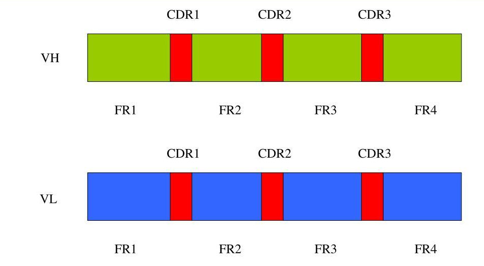

<p align="center"><em>图 2：天然 IgG 重链中可变区（含 FR/CDR）、铰链区与恒定区的层级关系。</em></p>

---

## 3. 可变区细化：V 区、CDR、FR 与编号体系

### 3.1 FR 与 CDR 的交替排列

**V 区（Variable Region，含 VH 与 VL**负责识别抗原，其内部由高度保守的骨架区与高变环区交替组成：

```text
FR1 ──▶ CDR1 ──▶ FR2 ──▶ CDR2 ──▶ FR3 ──▶ CDR3 ──▶ FR4
```

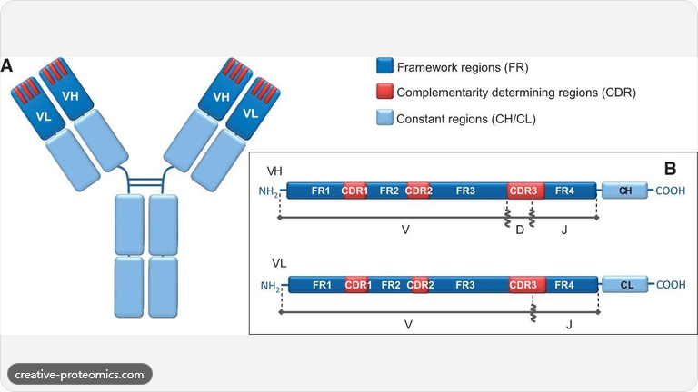

<p align="center"><em>图 3：可变区（V 区）、恒定区（C 区）以及 CDR 环与 FR 骨架的空间对应关系。</em></p>

| 类型 | 英文全称 | 生物学作用 | 结构类比 |
|------|----------|------------|----------|
| **FR（1–4）** | Framework Region | 维持可变区 β-折叠桶状基本结构，托举高变环 | 稳定骨架 |
| **CDR（1–3）** | Complementarity Determining Region | 形成互补决定环，直接参与抗原表位结合 | 识别界面 |

其中 **CDR3**（尤其是重链 HCDR3）跨越 V-D-J 重排连接区，通常具有最高的序列与长度多样性，是决定抗原识别特异性的最关键区域。

### 3.2 抗体编号体系（Numbering Schemes）

**CDR 的具体起止边界取决于所采用的编号体系**，常见体系包括 **Kabat**、**Chothia**、**IMGT**、**AHo**（以及联合方案如 North / Contact）等。同一条序列在不同编号体系下切出的 CDR 区间可能存在数个残基的差异：

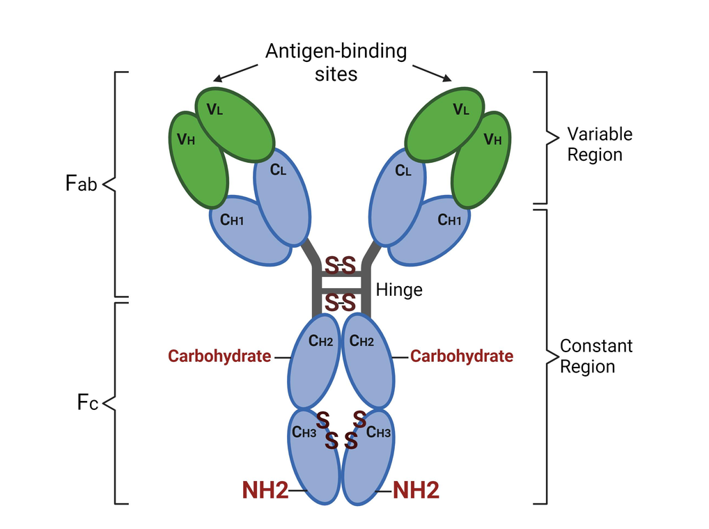

<p align="center"><em>图 4：不同抗体编号体系对 FR 与 CDR 边界划分的差异示意。</em></p>

> **工程约束**：序列注释引擎必须明确声明当前使用的编号方案，或支持多方案切换，以保证下游突变比对与申报资料口径一致。

---

## 4. Sequence Annotation Engine（序列注释引擎）

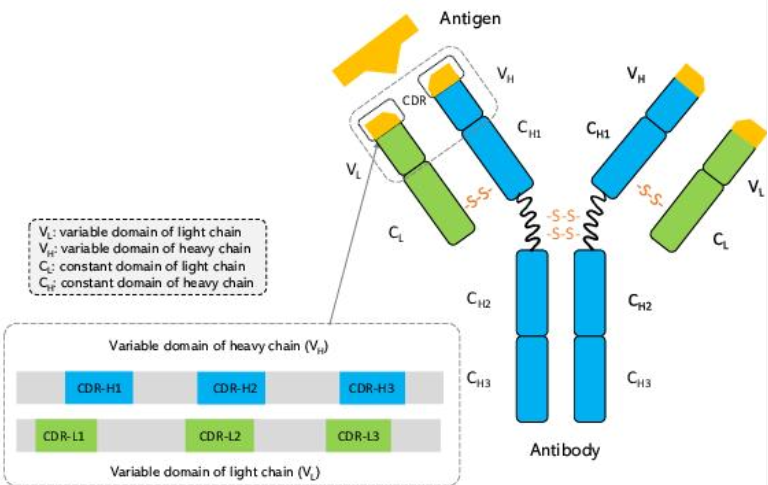

<p align="center"><em>图 5：Sequence Annotation Engine 对单条输入序列执行多区域分段与 CDR/FR 边界标注。</em></p>

概念层面的标准处理流水线：

1. **序列输入**：接收单条或多条氨基酸序列（FASTA 或纯文本）。
2. **结构域粗分（Domain Segmentation）**：识别并定位 `VH`、`VL`、`CH1–CH3`、`CL`、`Hinge`、`Linker`、`Tag`、融合蛋白段及未知区段。
3. **可变区细化（Sub-region Numbering）**：在已识别的 `VH` / `VL` 内对齐参考编号体系，精准切出 `FR1–FR4` 与 `CDR1–CDR3`。
4. **结构化输出**：生成有序区间坐标表与可视化图谱，供下游种系比对、二硫键推断、多链拓扑组装及 LIMS / 注册台账使用。

---

## 5. 真实工程序列：为什么不能假设完整天然 IgG

在实际生物药研发与蛋白工程中，输入序列**往往不是**标准的天然四链 IgG

| 工程分子场景 | 典型序列特征 |
|--------------|--------------|
| **单域或片段表达** | 仅含 `VH`（如 VHH 纳米抗体）、仅 `VL`，或 Fab 截短链 |
| **单链抗体（scFv）** | 人工串联为 `VH — Linker — VL`（或 `VL — Linker — VH`） |
| **双特异性 / 多特异性抗体** | 单条链上串联多套 `VH`/`VL`，或含异源配对改造（如 Knob-in-Hole、CrossMab） |
| **亲和纯化与检测标签** | N 端或 C 端带有 `His-tag`、`Flag-tag`、`Strep-tag`、信号肽等短肽 |
| **Fc / 细胞因子融合蛋白** | 抗体片段与受体胞外域、细胞因子、酶或毒素拼接 |
| **人工设计 Linker** | 如 `(G4S)n`、`EAAAK` 等柔性或刚性连接肽，长度与序列高度可变 |

因此，注释算法**绝不能硬编码位置假设**（例如假定 `N 端 = VH → CH1 → Hinge → CH2 → CH3`），而必须结合同源 Profile HMM、种系比对、序列基序（motif）与补集规则**逐段独立识别**，并将未命中区域显式标记为 `Linker`、`Tag` 或 `Unknown`。

---

## 6. 引擎设计要点与延伸阅读

### 核心设计原则

- **分域优先于切 CDR**：先稳健框定 `VH` / `VL` 完整边界，再在可变区内部做编号对齐与 CDR/FR 切分。
- **原生支持非天然拓扑**：兼容 scFv、串联双抗、Fc 融合蛋白与截短片段等任意域排列顺序。
- **显式剥离 Linker 与 Tag**：避免人工连接肽或纯化标签被误吸收入首尾的 `FR1` / `FR4`。
- **可复现、可审计**：输出精确的 1-based/0-based 起止坐标、参考库版本与编号体系，便于序列变更比对与申报核查。

### 延伸方向

- **主流注释与数据库工具**：`ANARCI`（HMM 种系编号）、`HMMER`、`abYsis`、`SAbDab` / `IMGT` 参考库。
- **多源融合实现细节**：关于如何将 `ANARCI + HMMER + BLASTp + 启发式 Motif` 融合为生产级注释流水线

## Sequence Annotation

输入一条完整蛋白质序列：拆成有生物学意义的片段。

**原始序列**

一条连续的氨基酸序列

QVQLVESGGGLVQPGGSLRLSCAASGFTF...

↓

**分区结果**

**VH** **CH1** **Hinge** **CH2** **CH3**

示意：实际区域及顺序取决于链类型和具体序列。

它本质上是一个**序列片段识别与坐标注释问题**。

### 常用序列注释工具对比

单一工具难以覆盖完整工程序列的所有片段，实际注释引擎通常将以下四类工具组合使用：

| 工具 / 方法 | 核心原理 | 擅长解决什么 |
|-------------|----------|--------------|
| **ANARCI** | HMM Profile 匹配及编号 | 可变区（`VH` / `VL`）识别、链型判定、标准残基编号 |
| **HMMER** | Profile HMM（隐马尔可夫模型） | `FR` 框架区与恒定区（`CH` / `CL`）结构域边界识别 |
| **BLASTp** | 局部序列相似性搜索 | 同源片段比对、Hinge / Fc 亚型及融合蛋白参考序列检索 |
| **Motif** | 固定序列模式 / 正则匹配 | 人工 `Linker`、纯化标签（Tag）及特殊功能基序识别 |

### 多工具结果如何融合？

不同工具的命中区间可能存在重叠、偏移甚至冲突，因此需要设计统一的**区间融合策略**：


1. **设置优先级**：根据各工具在特定结构域上的可信度划分优先顺序。
2. **比较重叠比例**：计算不同工具命中区间的覆盖度与交并比。
3. **判断边界偏差**：对齐并校正首尾残基的起止偏移。
4. **冲突区间裁决**：按得分、长度与规则消解互斥标注。
5. **未知片段兜底**：将任何模型均无法确定的残基补集标记为 `U`（Unknown）。

最终输出无重叠、连续覆盖全长的统一 **Region Annotation**。

### 核心算法与工程概念速查

| 英文术语 | 中文名称 | 在注释引擎中的作用 |
|----------|----------|--------------------|
| **Sequence Alignment** | 序列比对 | 评估查询序列与种系/参考库之间的局部或全局相似性 |
| **HMM** | 隐马尔可夫模型 | 建模生物序列状态转移概率的基础统计模型 |
| **Profile HMM** | 序列家族概率模型 | 刻画保守结构域（如 `V` 区、`CH`/`CL`）多位点保守性与插入缺失分布 |
| **Motif Matching** | 模式匹配 | 识别 `Linker`、纯化标签（Tag）或特定短肽基序 |
| **Interval Merge** | 区间合并 | 处理多源命中坐标的去重、拼接、重叠比较与补集计算 |
| **Rule Engine** | 规则引擎 | 执行优先级排序、边界微调与冲突区间裁决逻辑 |

## Sequence Alignment：精细重比对与突变识别

在上一节 **Region Annotation** 之后，第二层问题是：**这条序列相对参考抗体发生了什么变化？** 这是序列层的精准注释，不是 3D 结构叠合。

### 要回答什么

| 维度 | 典型问题 | 工程用途 |
|------|----------|----------|
| **Germline 归属** | 可变区最接近哪条胚系基因（如 `IGHV3-23`）？ | 人源化评估、免疫原性粗判、序列注册 |
| **点突变** | 相对参考在哪些位点发生了替换？ | CDR 优化记录、可开发性 hotspot |
| **Indel** | FR / CL 等保守区是否存在插入或缺失？ | 序列合法性检查、表达风险 |
| **Fc 工程** | 恒定区相对野生型有哪些突变？ | LALA、YTE、Knob-Hole 等命名与 ADCC 检索 |
| **编号对齐** | 突变落在哪套编号坐标上？ | 与文献、专利、申报资料口径一致 |

### 输入 / 输出（概念）

| | 内容 |
|---|------|
| **输入** | 已分区的区段图（含 `VH`/`VL`、`FR1–4`/`CDR1–3`、`CH`/`CL` 坐标） |
| **输出** | 各 `FR`/恒定区与参考序列的比对结果；可变区 **germline subtype**；恒定区 **EU 风格突变表**（位点、参考氨基酸、实际氨基酸） |

### Germline 是什么？为何不能「照搬」参考序列

**Germline（种系/胚系）序列**是免疫球蛋白基因座中、尚未经过 B 细胞成熟重组与突变的**参考模板**（如人源 `IGHV`、`IGKV`、`IGLV` 各家族成员）。抗体在发育中会经历：

1. **V(D)J 重组**：从基因库中组合出功能性可变区；
2. **体细胞高频突变（SHM）**：在抗原刺激下可变区进一步多样化；
3. **人工改造**：人源化、亲和力成熟、Fc 工程等叠加突变。

因此，实验或药物序列**通常不是**某一条 Germline 的逐字复制，而是「最接近某 germline + 一堆差异」。比对的目标是**定量描述差异**，而非断言唯一生物学来源。

> **注意**：与某条 Germline 相似度最高，**不能**单独证明亲本克隆或真实发育路径；只能作为序列登记与相似性分析的工程参照。

### 比对算法选型

在已按结构域切好的片段上，常对 `FR1–3` 等区段向两侧略延伸后做**全局比对**，以便逐位扫描替换与 gap。实现上可采用 **[Parasail](https://github.com/jeffdaily/parasail)**（高性能序列比对库），配合 **BLOSUM62** 替换矩阵。

**BLOSUM62**：根据天然蛋白家族中氨基酸共现频率统计得到的**替换评分矩阵**——保守替换（如 Leu↔Ile）得分较高，性质悬殊的替换得分低甚至为负，从而引导动态规划找到更「生物学合理」的最优比对路径。

| 算法 | 类型 | 特点 | 典型应用 |
|------|------|------|----------|
| **Needleman–Wunsch** | 全局比对 | 强制两序列首尾对齐，全长参与计分 | 等长或整体对应的 `FR`、恒定区逐位 diff |
| **Smith–Waterman** | 局部比对 | 只保留得分最高的局部片段 | 在长序列中找短同源块、`BLAST` 式 hit |
| **Semi-global** | 半全局 | 一端自由延伸、另一端对齐 | 一条为另一条的局部延伸或截短链 |

**亚型选择（可变区）**：对 `FR1–3` 分别与多条 germline 参考比对并打分，按总分与种属优先级（常见为**人源优先**）选出唯一或最可信的 germline 亚型；再汇总可变区与恒定区的突变列表。

### EU Numbering（Fc 恒定区编号）

抗体药物文献与 Fc 工程命名（如 LALA、YTE、LS、Knob/Hole）普遍采用 **EU numbering**（源自 Edelman 等人对人 IgG1 的编号惯例），与 Kabat / IMGT 在可变区上的编号**并行存在**：可变区常用 IMGT/Kabat，**Fc 突变表与业界沟通常用 EU 位点**。

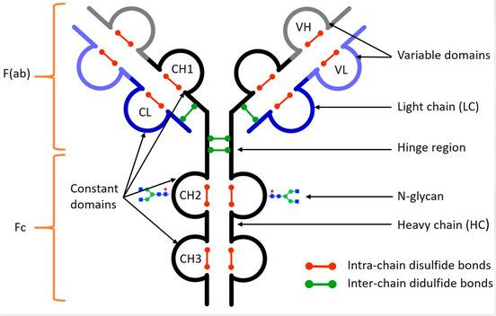

<p align="center"><em>图 6：Fc 区 EU 编号示意，用于恒定区突变 calling 与工程别名对照。</em></p>

恒定区与 `CH`/`CL` 野生型参考序列全局比对后，将 diff 映射为 **EU 位点 + 参考残基 → 突变残基**，即可对接 Fc 工程词典与 ADCC 文献检索模块（详见 [算法模块学习笔记 · 二、精细重比对](./study.md)）。

### 局限

- 参考库未收录的罕见等位基因会被迫贴近「最近邻」germline，突变 calling 带**系统性偏差**。
- 仅序列层比对，不推断结构可容性或表达水平。

## Disulfide Inference：二硫键推断

在完成序列分区与精细比对后，第三层问题是：**一条或多条链中的所有半胱氨酸（Cys，C），哪些形成链内二硫键？哪些形成链间二硫键？哪些是游离未配对的？**

### 化学基础

蛋白质中的半胱氨酸（Cysteine，C）侧链含有特殊的活性巯基（thiol group）：

$$
-\mathrm{CH_2}-\mathrm{SH}
$$

在氧化性环境（如内质网腔）中，两个空间邻近的半胱氨酸巯基脱氢氧化，形成共价的**二硫键（Disulfide Bond）**：

$$
2\,\mathrm{R-SH} \longrightarrow \mathrm{R-S-S-R} + 2\,\mathrm{H^+} + 2\,\mathrm{e^-}
$$

二硫键是抗体维持三维折叠稳定性和四链共价组装的关键“分子铆钉”。

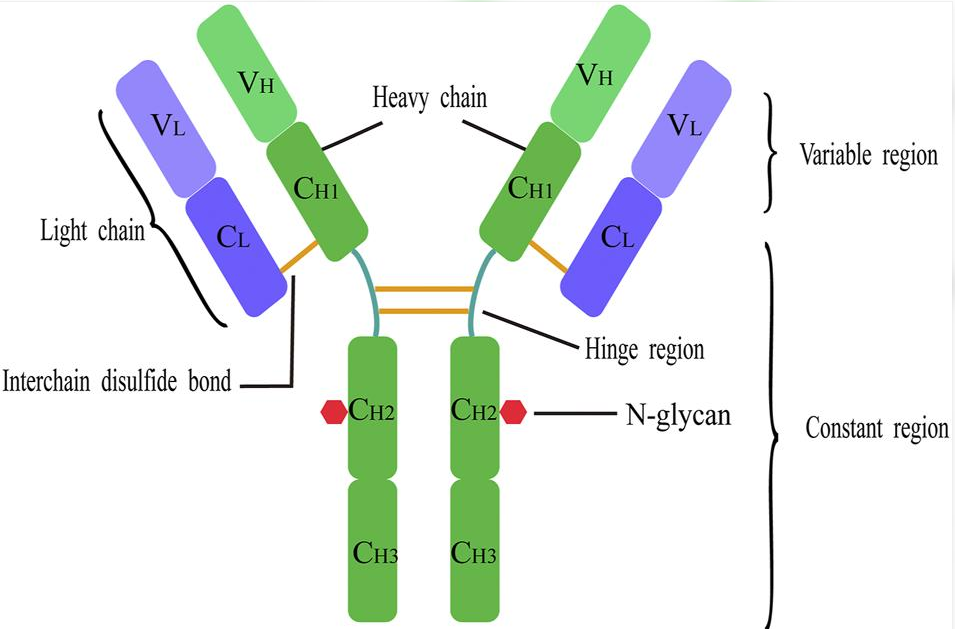

<p align="center"><em>图 7：经典 IgG 抗体的链内二硫键（稳定各免疫球蛋白结构域）与链间二硫键（连接 HC–LC 与 HC–HC）分布示意。</em></p>

### 两类二硫键与经典分布

按连接范围，抗体二硫键分为两类：

| 类型 | 英文 | 生物学作用 | 典型位置 |
|------|------|------------|----------|
| **链内二硫键** | Intra-chain | 锁紧单个免疫球蛋白折叠（Ig-fold）的 β-折叠双层结构 | 每个 `VH`、`VL`、`CH1`、`CH2`、`CH3`、`CL` 内部各 1 对高度保守的经典二硫键（如可变区 IMGT 编号 **C23–C104**） |
| **链间二硫键** | Inter-chain | 将重链与轻链、两条重链共价连接为完整四链分子 | **HC–LC 之间**（`CL` C 端 Cys 与重链配对）；**HC–HC 之间**（两条重链的 `Hinge` 核心区配对） |

> **以经典人源 IgG1 为例**：完整四链分子通常共含 **16 对二硫键**——其中 **12 对链内二硫键**（每条重链 4 个结构域 × 2 + 每条轻链 2 个结构域 × 2）和 **4 对链间二硫键**（2 对 HC–LC + 2 对 Hinge 区 HC–HC）。

### 不同 IgG 亚型的链间二硫键差异

实际工程中，**人源 IgG1–IgG4 的链内二硫键高度保守，但链间二硫键数量与连接位点存在明显亚型差异**：

| 亚型 | HC–HC 链间（Hinge 区） | HC–LC 连接位点（重链侧） | 工程与 CMC 关注点 |
|------|------------------------|--------------------------|---------------------|
| **IgG1** | 2 对 | Hinge 上端（EU C220） | 结构最经典、链间连接稳定，治疗性单抗最常用模板 |
| **IgG2** | 4 对 | CH1 上端（EU C131） | 易发生天然二硫键异构（IgG2-A / A/B / B 异构体） |
| **IgG3** | 最多（常见 11 对） | CH1 上端（EU C131） | 铰链区极长，易受蛋白酶解，成药性应用较少 |
| **IgG4** | 2 对 | CH1 上端（EU C131） | 易发生链间→链内重排与 **Fab-arm exchange**；工程上常引入 **S228P** 突变稳定铰链区 |

### 游离半胱氨酸与非经典二硫键（CMC 风险）

并非所有半胱氨酸都会按经典模板完美配对，注释系统显式检出**未配对（游离）Cys** 具有重要价值：

- **CDR 区引入的额外 Cys**：偶数个可能形成额外的非经典链内环（部分羊驼 VHH、牛源抗体或长 HCDR3 中常见）；奇数个则留下游离巯基。
- **游离巯基风险**：容易引发分子间错配交联（聚体/二聚体）、半胱氨酸化（cysteinylation）或谷胱甘肽化修饰，影响纯度、均一性与货架期稳定性。
- **定向工程设计**：部分定点偶联 **ADC**（如 THIOMAB）会刻意引入游离 Cys 作为载荷偶联位点；此类位点需在注释中准确标记，避免与天然骨架 Cys 混淆。

### 算法与工程实现（规则 + 表驱动）

| | 内容 |
|---|------|
| **输入** | 已分区的区段图（含链类型、结构域边界、物种/亚型）+ 氨基酸序列 |
| **输出** | 每个 `C` 的配对状态（`intra` / `inter` / `unpaired`）及配对目标位点 |

核心推断步骤（不依赖 3D 折叠）：

1. **表驱动定位（Template Lookup）**：根据链类型（`VH`/`VK`/`VL`）、结构域（`CH1`/`CH2`/`CH3`/`CL`）与物种，查经典保守配对位点表（源于 IMGT / 文献与内部整理）。
2. **Hinge 核心规则**：依据识别出的 IgG 亚型，将 `Hinge core` 中的保守 `C` 标记为链间配对候选。
3. **局部容错窗口**：若表定位坐标处因插入/缺失或边界微偏不是 `C`，则在邻近小窗口内搜索最近邻 `C` 兜底对齐。
4. **约束下游拓扑**：推断出的链间二硫键连接关系直接传递给下一层的 **Molecular Topology** 模块，作为“哪些结构域必须共价相连”的强约束。

### 局限

- **不做能量最小化或 3D 几何判定**：仅基于序列规则与已知模板推断“表观应配对关系”。
- **难以覆盖非经典重排**：如 IgG2 异构、二硫键错配（scrambling）、复杂多特异性改造或化学定点偶联分子，往往超出经典 IgG 模板范围，需结合质谱（肽图/非还原酶切）等实验表征验证。

## Molecular Topology：多链拓扑推断与分子形式分类

在前三层（序列分区、精细比对、二硫键推断）的基础上，第四层要回答的是多链场景下的核心问题：**给定多条蛋白链及每条链的拷贝数（化学计量，Stoichiometry），它们如何组装成一个完整的抗体或融合蛋白分子？最终属于哪种分子形式？**

### 输入 / 输出

| | 内容 |
|---|------|
| **输入** | 多链区段图（每条链已完成分区、突变/工程标签识别与二硫键候选推断）+ 可选链拷贝数比例 |
| **输出** | 最优分子拓扑图（链间配对与二硫键连接）、分子形式标签（`Mab` / `BsAb` / `Fc-fusion` / `Nanobody` / `Others`）、简易卡通拓扑示意（非 3D 结构） |

---

### 1. 什么是分子拓扑？—— Graph Modeling（图建模）

这里的**拓扑（Topology）不是三维空间中的全原子坐标，而是描述结构域级别的连接与组装关系**：

- 哪些结构域属于同一条多肽链？
- 哪些结构域之间相互配对（如 `VH–VL`、`CH1–CL`、`CH3–CH3`）？
- 哪些结构域通过二硫键共价相连？
- 组装后共有几个 Fab、是否含完整 Fc？
- 是否存在缺链、多余游离链或链错配？

在算法上，这是一个典型的 **图建模（Graph Modeling）** 问题，将每个结构域抽象为节点，将结构域之间的生物化学关系抽象为带语义的边：

#### 节点（Node）

每个节点代表一个已注释的结构域或功能区段（例如 `VH_1`、`CH1_1`、`Hinge_1`、`CH2_1`、`CH3_1`、`VL_1`、`CL_1` 等），节点上挂载上游模块产出的关键属性：

- 所属链 ID 与区域类型（`V` / `C` / `H` / `L` / `P` 等）
- 氨基酸序列与净电荷粗分类（正 / 负 / 中性，用于电荷互补评估）
- Fc / Fab 工程改造突变标签（如 `Knob`、`Hole`、`CrossMab` 等）
- 候选链间二硫键位点及潜在配对列表

#### 边（Edge）与语义区分

必须显式区分不同类型的边，避免把序列连续、共价键与非共价相互作用混为一谈：

| 边类型 | 英文 | 生物学含义 | 典型示例 |
|--------|------|------------|----------|
| **序列连接** | `Sequential` | 同一条多肽链上相邻结构域的肽键串联 | `VH_1 — CH1_1 — Hinge_1 — CH2_1 — CH3_1` |
| **二硫键连接** | `Disulfide` | 半胱氨酸之间形成的共价二硫键（强连接约束） | `CH1_1 — CL_1`、`Hinge_1 — Hinge_2` |
| **结构域关联** | `Domain Association` | 结构域之间依赖疏水/氢键/静电形成的非共价稳定配对 | `CH3_1 — CH3_2`、`VH_1 — VL_1` |
| **功能配对** | `Functional Pairing` | 协同构成完整功能单元的组合关系 | `(VH_1 + VL_1 + CH1_1 + CL_1)` → 完整 Fab |

```mermaid
flowchart TB
  subgraph LC1["轻链 LC1"]
    VL1[VL_1] --- CL1[CL_1]
  end
  subgraph HC1["重链 HC1 · Knob"]
    VH1[VH_1] --- CH1_1[CH1_1] --- H1[Hinge_1] --- CH2_1[CH2_1] --- CH3_1["CH3_1 · Knob"]
  end
  subgraph HC2["重链 HC2 · Hole"]
    VH2[VH_2] --- CH1_2[CH1_2] --- H2[Hinge_2] --- CH2_2[CH2_2] --- CH3_2["CH3_2 · Hole"]
  end
  subgraph LC2["轻链 LC2"]
    VL2[VL_2] --- CL2[CL_2]
  end

  VL1 -.-|Domain Association| VH1
  CL1 ===|Disulfide| CH1_1
  H1 ===|Disulfide| H2
  CH3_1 -.-|Knob-Hole Pairing| CH3_2
  CH1_2 ===|Disulfide| CL2
  VH2 -.-|Domain Association| VL2
```

---

### 2. 为什么要做组合搜索？（链错配问题）

以典型的非对称双特异性抗体输入（两条不同重链 + 两条不同轻链：`HC1`、`HC2`、`LC1`、`LC2`）为例，系统必须决策：

- `HC1` 应该配 `LC1` 还是 `LC2`？`HC2` 同理；
- 两条重链是否倾向异源二聚（`HC1–HC2`），还是会发生同源错配（`HC1–HC1`、`HC2–HC2`）？
- 是否存在结构域缺失或未能配对的孤立链？

在无工程约束的自由共表达中，2 种重链 + 2 种轻链理论上可产生多达 **10 种组装产物**（其中仅 1 种是目标双抗，其余均为错配副产物）。随着候选链数和拷贝数增加，配对矩阵的组合空间呈指数级膨胀，因此必须引入**领域先验约束**来剪枝搜索空间。

---

### 3. 核心生物学约束与工程改造标签

在枚举/递归构造“区域–区域”配对矩阵时，算法依据抗体生物化学常识施加以下约束：

| 约束类型                      | 生物学与工程含义                                             |
| ------------------------- | ---------------------------------------------------- |
| `VH–VL`                   | 协同组成 Fab 可变区抗原结合界面（相邻匹配，避免跨臂交叉错乱）                    |
| `CH1–CL`                  | 组成 Fab 恒定区配对，并通常伴随链间二硫键连接                            |
| `CH2–CH2` **/** `CH3–CH3` | 构成 Fc 区域的二聚界面（`CH3–CH3` 承担主要非共价驱动力）                  |
| `Hinge C–Hinge C`         | 两条重链铰链区半胱氨酸形成链间共价二硫键                                 |
| `Knob–Hole` **/ 电荷互补**    | Fc 端 CH3 异源二聚改造标签（奖励互补配对，重罚同源冲突）                     |
| **域互换 / 共同轻链**            | 如 `CrossMab`（CH1–CL 或 VH–VL 互换）或 `Common LC` 解决轻重链错配 |
| `Chain Stoichiometry`     | 根据用户指定的投料/化学计量比限制每种链在分子中的出现次数                        |
| **局部序列相似性**               | 辅助判断非标准域或融合段之间的局部配对兼容性                               |

#### 重点案例：Knob-in-Hole 与 CrossMab

普通 IgG 的两条重链完全相同，天然发生同源二聚；而双特异性抗体往往同时面临**重链异源配对**与**轻重链正确配对**两大难题：

1. **重链异源二聚——Knob-in-Hole（KiH）**：通过在一条重链的 `CH3` 界面引入大侧链突变（如经典 EU 位点 `T366Y` 或 `T366W`，称为 **Knob**），在另一条重链对应位置引入小侧链突变（如 `Y407T` 或 `T366S/L368A/Y407V`，称为 **Hole**），利用空间位阻促进 `Knob ↔ Hole` 互补配对，抑制 `Knob ↔ Knob` 与 `Hole ↔ Hole` 同源二聚。
2. **轻重链正确配对——CrossMab（如 $\mathrm{C_H1–C_L}$ Crossover）**：将其中一侧 Fab 的 `CH1` 与 `CL` 结构域互换，使该侧重链携带 `CL`、轻链携带 `CH1`，从而在结构域配对层面阻止轻链错配到另一条重链上。

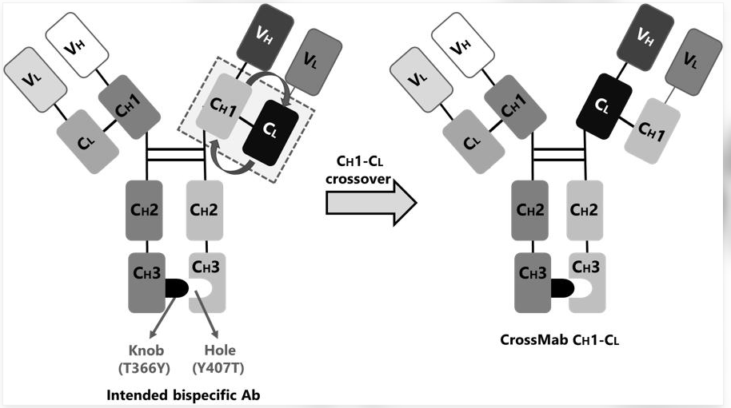

<p align="center"><em>图 8：双特异性抗体中通过 CH3 区 Knob-in-Hole（T366Y / Y407T）驱动重链异源二聚，并结合 CrossMab（CH1–CL 互换）防止轻重链错配的拓扑示意图。</em></p>

因此，拓扑引擎只需读取上游识别出的 `Knob` / `Hole` 突变标签及域排列顺序（如 `VH–CL` 搭配 `VL–CH1`），即可通过约束与打分自然还原复杂双抗组装。

---

### 4. 启发式打分与约束优化

对组合搜索生成的每个候选拓扑图 $G$，系统汇总各类惩罚项与奖励项进行定量比较。例如针对三种候选组装方式：

| 方案 | 组装结果描述 | 综合惩罚分 |
|------|--------------|------------|
| **方案 A** | `Knob–Hole` 正确互补，双侧 Fab 与 Fc 结构完整 | `0`（最优） |
| **方案 B** | 发生 `Knob–Knob` 重链同源错配 | `100` |
| **方案 C** | 一条轻链未能配对（游离链） | `200` |

定义目标打分函数（分数越低越优）：

$$
Score(G) = P_{\text{unpaired}} + P_{\text{mismatch}} + P_{\text{disconnected}} - R_{\text{valid}}
$$

其中：

- $P_{\text{unpaired}}$：**未配对惩罚**（应配对的 `CH1`/`CL`、`Hinge`、`VH`/`VL` 落单时施以高惩罚）；
- $P_{\text{mismatch}}$：**错误配对惩罚**（如双 `Knob`/双 `Hole` 冲突、同一对链上区域配对顺序错乱等）；
- $P_{\text{disconnected}}$：**不连通惩罚**（分子裂成多个互不相连的独立子图时施以极大惩罚）；
- $R_{\text{valid}}$：**合理配对奖励**（`Knob–Hole` 正确互补、界面电荷互补、满足经典二硫键与结构域配对约束时给予奖励）。

最优拓扑通过最小化目标函数选出：

$$
G^* = \arg\min_{G} Score(G)
$$

> **工程细节提醒**：并非所有真实生物药都必须构成“单一完全连通的二硫键共价图”（例如去除了铰链二硫键但靠 `CH3–CH3` 非共价二聚维持的分子，或 scFv 与非共价复合物）。因此连通性检查应区分**共价边（**`Disulfide`**）与非共价关联边（**`Domain Association`**）**，不能将两者混为一谈。

---

### 5. 分子形式分类（Format Classification）

在得到最优拓扑图 $G^*$ 后，统计图中的组件计数——包括 **Fab 数量、Fc 数量、不同抗原结合特异性（独特 VH/VL 组合）数量、单域抗体（VHH）及融合蛋白段（P）数量**——再结合显式规则将分子归类：

| 分子形式 | 典型拓扑特征 |
|----------|--------------|
| **Mab**（经典单抗） | 两条相同 `HC` + 两条相同 `LC`，含 2 个相同 Fab 与 1 个完整 Fc |
| **BsAb**（双特异性抗体） | 存在 **2 种不同的抗原结合特异性**（如不对称 KiH+CrossMab、DVD-Ig、IgG-scFv 等） |
| **Fc-fusion**（Fc 融合蛋白） | `Fc`（`CH2–CH3`）与非抗体功能蛋白段（受体胞外域、细胞因子、酶等）融合 |
| **Nanobody / VHH** | 存在重链单域可变区（如 VHH）且无传统配对轻链 |
| **scFv / Fragment** | 单链可变区（`VH–Linker–VL`）、独立 Fab 或截短片段 |
| **Others** | 非标准多特异性拓扑、缺链错配产物或无法归入上述规则的结构 |

> **关键判别原则**：**仅仅发现两条不同的重链，并不能直接证明它是双抗（BsAb）。** 例如某些分子仅在 Fc 端引入不对称突变（如不对称糖基化或单侧标签/载荷修饰），而两个 Fab 臂的 `VH`/`VL` 序列完全一致，此时它仍是单特异性抗体。分类必须综合**抗原结合域序列差异、链组成与最终拓扑配对关系**共同判定。

---

### 6. 要点与局限

- **本质是约束满足 + 领域启发式**：不依赖分子力场或 X 射线晶体结构，计算轻量，适合高通量序列注册、副产物组合枚举与可视化卡通图渲染。
- **局限**：对于高度对称的多价分子、含非标准人工 linker 的异型融合蛋白，或用户输入的链化学计量比例本身有误时，可能出现**多个等价最优解**或退化归类为 `Others`；输出结果只代表基于序列先验“最可信的组装假设”，复杂新分子仍需配合 SEC-MALS、Native MS 等理化表征确认。

---

## 开发风险与 Fc 工程（Developability & Fc Engineering）

前四层解决了“序列长什么样、相对参考变了什么、如何形成二硫键并组装成完整分子”；本节进一步从**序列结构分析走向药物开发属性（Developability）与效应功能工程分析**，对应实际研发中最常关注的三类下游检查：CDR 理化风险、Fc 工程命名识别与 ADCC 文献对照。

---

### 1. CDR Hotspot：序列理化风险识别

CDR 是直接参与抗原识别的关键环区。若 CDR 中存在化学性质不稳定的氨基酸组合，在表达纯化、制剂储存或体内循环期间发生化学降解，可能导致**结合亲和力下降、电荷异质性增加或稳定性变差**。

| 风险类别 | 典型序列 Motif | 化学变化与潜在影响 |
|----------|----------------|--------------------|
| **Asp 异构化** | `DG`、`DS`、`DD`、`DT`、`DH` | 天冬氨酸（Asp）环化形成琥珀酰亚胺中间体并异构化为 iso-Asp，改变局部主链构象 |
| **Asn 脱酰胺** | `NG`、`NS`、`NP`、`NN`、`NT`、`NR` | 天冬酰胺（Asn）脱去氨基转为 Asp / iso-Asp，产生酸性电荷变体 |
| **氨基酸氧化** | 单残基 `W`（Trp）、`M`（Met） | 色氨酸或甲硫氨酸氧化，可能直接削弱抗原结合界面或加速聚集 |
| **其他常见延伸检查** | `N-X-S/T`（X≠P）、未配对 `C`、`DP` | 潜在 CDR N-糖基化位点、游离巯基交联风险、酸性水解断裂位点 |

#### 算法实现

在上游切分出的每个 `CDR1–CDR3` 肽段上执行**滑动窗口扫描 / 正则子串匹配与计数**即可（纯 motif 规则，无需机器学习模型）。

> **重要提醒**：序列层面的 Hotspot 扫描**只是风险预警，不代表实验中一定会发生显著修饰**。某位点是否真正降解，还强烈取决于其在三维结构中的**溶剂暴露度（SASA）**、**局部环区柔性**，以及制剂 **pH、温度、光照、辅料配方** 等工艺条件，通常需配合强制降解实验与质谱（LC-MS 肽图）定量确认。

---

### 2. Fc 工程类型识别（词典覆盖匹配）

在精细比对阶段，系统已经输出恒定区相对野生型参考的 **EU 编号突变集合**。为了便于研发人员快速理解分子的功能设计意图，需要将散在的 EU 突变映射为业界通用的 **Fc 工程别名**。

| 工程名称 | 代表突变（EU 编号） | 主要设计目的 |
|----------|---------------------|--------------|
| **LALA** | `L234A / L235A` | 大幅削弱 FcγR 与 C1q 结合，降低 ADCC / CDC 效应功能（Silent Fc） |
| **LALA-PG** | `L234A / L235A / P329G` | 在 LALA 基础上进一步消除残余 FcγR 结合，实现更彻底的效应沉默 |
| **YTE** | `M252Y / S254T / T256E` | 增强酸性内体环境下的 **FcRn** 亲和力，显著延长体内循环半衰期 |
| **LS** | `M428L / N434S` | 增强 FcRn 结合并延长半衰期，同时尽量减少对热稳定性的负面影响 |
| **Knob-in-Hole** | `T366W`（Knob） / `T366S / L368A / Y407V`（Hole）等 | 通过 CH3 界面空间互补促进双抗异源重链配对 |
| **S228P（IgG4）** | `S228P` | 稳定 IgG4 铰链区，防止体内发生 Fab-arm exchange |
| **DE / DLE** | `S239D / I332E`（或加 `A330L`） | 增强 FcγRIIIa 结合，显著提升 ADCC 靶细胞杀伤能力 |

#### 算法要点：词典集合包含匹配 + 最长组合优先

1. **输入**：恒定区 EU 编号突变集合（如 `{L234A, L235A, P329G, M252Y, S254T, T256E}`）。
2. **集合包含匹配**：与预定义的 `突变组合 → 工程名` 词典逐项比对；当某工程所需的全部位点均出现在查询集合中，即判定命中。
3. **最长组合优先剥离**：优先匹配并剥离突变数更多的复合标签（例如先匹配 `LALA-PG` 而不是拆分成 `LALA` + 孤立 `P329G`），避免重复或碎片化命名。

**局限**：仅能命名词典内已知的经典工程组合；对于文献未收录的新颖突变组合，系统只保留原始 EU 突变列表而不强行归类。

---

### 3. ADCC 文献对照与变体检索

#### 生物学机制简介

**ADCC** 全称为 **Antibody-Dependent Cellular Cytotoxicity**（抗体依赖的细胞介导的细胞毒作用），是肿瘤靶向单抗发挥杀伤疗效的核心免疫效应机制之一：

1. 抗体通过 **Fab 段**特异性结合靶细胞表面的抗原决定基；
2. 自然杀伤细胞（**NK 细胞**）等效应细胞借助表面的 **FcγRIIIa（CD16）** 受体识别并结合靶细胞上抗体的 **Fc 段**；
3. 活化的 NK 细胞释放**穿孔素（Perforin）、颗粒酶（Granzyme）**等细胞毒性颗粒；
4. 诱导靶细胞发生裂解与**凋亡**。

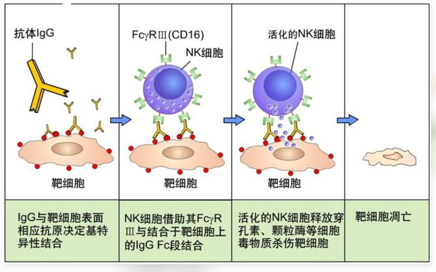

<p align="center"><em>图 9：ADCC 作用机制四步流程——IgG Fab 结合靶细胞抗原、NK 细胞经 FcγRIII（CD16）识别 Fc、释放穿孔素/颗粒酶并导致靶细胞凋亡。</em></p>

#### 检索与类比算法（非从头预测）

序列平台通常**不是**直接从氨基酸序列物理计算 ADCC 活性，而是基于已整理的 **Fc 变体实验数据库**执行**突变相似度检索与文献类比**：

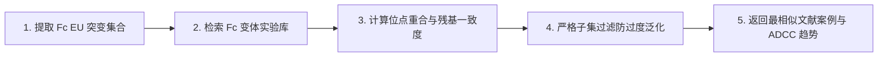

1. **获取突变集合**：读取上游恒定区比对产出的 Fc EU 突变列表。
2. **检索变体库**：遍历收录有实验效应值的已知 Fc 工程变体数据库（`突变组合 ↔ 相对 WT 效应值`）。
3. **计算混合相似度**：综合考量两部分——突变**位点是否重合** + 具体**替换氨基酸是否一致**（支持可调权重）。
4. **严格子集过滤（防过度泛化）**：要求候选库变体不能包含“查询序列里并不存在的额外突变位点”。
5. **效应映射**：取最相似实验案例的相对活性，按相对野生型（`1.0`）的阈值映射为 `increase` / `decrease` / `no change`。

> **为什么需要子集过滤？举例说明**  
> 假设查询序列的 Fc 突变为 `{S239D, I332E}`，而数据库中存在一条记录为 `{S239D, I332E, M428L}`。虽然前两个位点完全一致，但如果系统采用**严格子集匹配**，这条库记录就不能直接作为完全匹配结果——因为它额外多出了 `M428L`，额外突变可能引入协同或抵消效应，直接套用文献结论容易导致过度泛化。

#### 判读边界与局限

在解读 ADCC 检索结果时，必须严格区分以下三个层面：

| 层面 | 含义与注意事项 |
|------|----------------|
| **相似度高** | 仅表示查询分子与文献变体在 Fc 序列突变位点上工程相似 |
| **实验效果一致** | 突变效应可能受重链亚型背景与表位构象影响，仍需湿实验数据支持 |
| **ADCC 增强或降低** | 绝对幅度高度依赖具体实验体系（如 PBMC vs 报告基因法、靶细胞抗原密度、效应细胞 FcγRIIIa `V158/F158` 多态性，以及 **CH2 N297 糖型 / 去岩藻糖基化修饰**） |

---

## 参考资料

- [ANARCI 抗体结构注释工具科普](https://www.ben-air.cn/01.%E7%9F%A5%E8%AF%86-40.%E8%9B%8B%E7%99%BD%E5%B7%A5%E7%A8%8B-%E6%8A%97%E4%BD%93/%E6%8A%97%E4%BD%93-04.%E5%B7%A5%E5%85%B7-04.ANARCI-%E6%8A%97%E4%BD%93%E7%BB%93%E6%9E%84%E6%B3%A8%E9%87%8A%E5%B7%A5%E5%85%B7%E7%A7%91%E6%99%AE/)
- [抗体从头理性设计开源工具综述](https://www.ben-air.cn/01.%E7%9F%A5%E8%AF%86-40.%E8%9B%8B%E7%99%BD%E5%B7%A5%E7%A8%8B-%E6%8A%97%E4%BD%93/%E6%8A%97%E4%BD%93-04.%E5%B7%A5%E5%85%B7-02.%E6%8A%97%E4%BD%93%E4%BB%8E%E5%A4%B4%E7%90%86%E6%80%A7%E8%AE%BE%E8%AE%A1%E5%BC%80%E6%BA%90%E5%B7%A5%E5%85%B7%E7%BB%BC%E8%BF%B0/)
- [蛋白质工程基础 · Chapter 2（BetterEnzyme）](https://www.betterenzyme.com/book/chapter2.html)