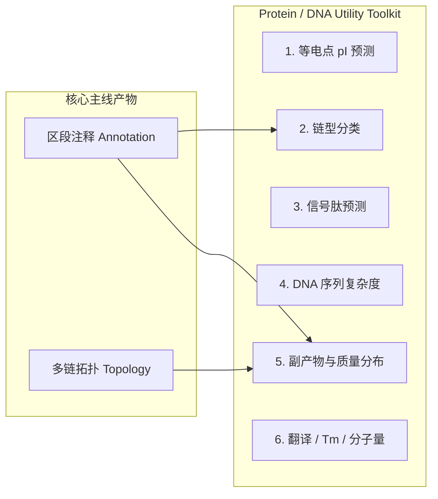

## 总览：工具箱在平台中的位置

在抗体与融合蛋白序列平台中，除了主线的**序列分区 → 精细比对 → 二硫键 → 多链拓扑**，实际研发与 CMC 工艺还需要一系列轻量的蛋白/核酸物性与工程评估工具：



- **独立支线**（pI、信号肽、DNA 复杂度、翻译/Tm/分子量）：直接消费蛋白或核酸序列，无需完整拓扑图；
- **弱依赖 / 衍生应用**（链型分类、副产物与质量分布）：复用上游 `Sequence Annotation` 与 `Molecular Topology` 引擎，服务于生产质控与质谱比对。

---

## 1. pI：等电点预测（多 pKa 表 + 集成回归）

### 1.1 什么是 pI，为什么必须计算？

**等电点（Isoelectric Point，pI）**是指蛋白质分子在溶液中净电荷为零时对应的 pH 值：

$$
\mathrm{NetCharge}(\mathrm{pH}) = 0
$$

- 当溶液 $\mathrm{pH} < \mathrm{pI}$ 时，质子化占优，蛋白质整体带**净正电**；
- 当溶液 $\mathrm{pH} > \mathrm{pI}$ 时，去质子化占优，蛋白质整体带**净负电**。

在生物药研发与 CMC 开发中，pI 是极为关键的理化属性，直接关联：

| 应用环节 | pI 的工程意义 |
|----------|---------------|
| **蛋白质溶解度** | 在 $\mathrm{pH} \approx \mathrm{pI}$ 时分子间静电排斥最弱，溶解度最低、最易沉淀 |
| **离子交换层析（IEX）** | 决定采用阳离子交换（CEX，$\mathrm{pH} < \mathrm{pI}$）还是阴离子交换（AEX，$\mathrm{pH} > \mathrm{pI}$）及洗脱条件 |
| **电荷异质性表征** | 作为 icIEF / cIEF（毛细管等电聚焦）主峰与酸碱峰归属的理论参考 |
| **聚集风险关联** | 极端低 pI 或局部电荷分布不均常与高浓度下粘度升高、自聚集倾向相关 |
| **制剂缓冲液设计** | 制剂 pH 通常需与分子 pI 保持足够间距（常见 $\ge 1\text{–}2$ 个 pH 单位）以保证胶体稳定性 |

### 1.2 核心算法实现

#### 第一步：统计可电离基团与净电荷求根

基于氨基酸序列统计所有可电离基团的数量：

| 电离类型 | 基团 / 残基 | 电荷状态（去质子化 / 质子化） |
|----------|-------------|-------------------------------|
| **酸性基团（负电贡献）** | `Asp (D)`、`Glu (E)`、`Cys (C)`、`Tyr (Y)`、`C 端羧基` | $0 \leftrightarrow -1$ |
| **碱性基团（正电贡献）** | `His (H)`、`Lys (K)`、`Arg (R)`、`N 端氨基` | $+1 \leftrightarrow 0$ |

给定一张 $\mathrm{p}K_a$ 参数表，利用 **Henderson–Hasselbalch 方程** 计算任意 $\mathrm{pH}$ 下的理论净电荷：

$$
\mathrm{NetCharge}(\mathrm{pH}) = \sum_{i \in \text{basic}} \frac{n_i}{1 + 10^{\mathrm{pH} - \mathrm{p}K_{a,i}}} - \sum_{j \in \text{acidic}} \frac{n_j}{1 + 10^{\mathrm{p}K_{a,j} - \mathrm{pH}}}
$$

由于 $\mathrm{NetCharge}(\mathrm{pH})$ 随 $\mathrm{pH}$ 单调递减，通过**二分法（Binary Search）**在 $[0, 14]$ 区间内即可快速收敛求得根 $\mathrm{pH}^*$：

$$
\mathrm{pH}^* \quad \text{s.t.} \quad \mathrm{NetCharge}(\mathrm{pH}^*) = 0
$$

#### 第二步：为什么使用 16 套 pKa 表 + 集成回归？

不同文献与参数体系（如 IPC 家族、EMBOSS、Bjellqvist、Lehninger、Sillero 等）对氨基酸微环境 $\mathrm{p}K_a$ 的估计存在差异，单一表格往往在不同类别蛋白上存在系统偏差。因此工程上常构造 **“多 pKa 理论特征 + 监督学习校正层”**：


> **核心思想**：集成回归模型学习的是 **“多套理论 pI 特征 → 真实实验 pI（如 cIEF 实测值）”之间的非线性校正映射**，而不是盲目押注某一张 pKa 表。

### 1.3 成熟化假设与工程局限

在拼接多链计算整分子 pI 时，对翻译后修饰（PTM）与成熟化加工的假设需要格外谨慎：

- **N 端焦谷氨酸化（Pyroglutamate）**：重链或轻链 N 端的 `Gln (Q)`（有时也含 `Glu (E)`）常环化为焦谷氨酸，本质上是**N 端游离氨基消失（失去一个正电荷位点）**，并非简单等价于把序列字符 `Q` 替换成普通 `E`；
- **C 端赖氨酸剪切（C-terminal Lys Clipping）**：CHO 细胞表达的 IgG 重链 C 端 `Lys (K)` 常被羧肽酶切去，但切除比例因工艺而异，不保证每条链 100% 发生；
- **二硫键与糖基化影响**：形成二硫键的 `Cys` 巯基已共价封闭，不再参与自由电离；若糖链末端带有带负电的**唾液酸（Sialic acid）**，还会进一步拉低实测 pI；
- **多链口径**：完整分子 pI 需按实际化学计量比例拼接各链（如 `2×HC + 2×LC`），并结合实验修饰状态解读。

---

## 2. 链型分类（Chain Type Classification）

链型分类属于典型的**确定性规则分类问题**，用于在多链输入或批量序列登记时，快速判断单条链在抗体分子语境下属于哪种角色。

| | 内容 |
|---|------|
| **输入** | 上游 `Sequence Annotation` 产出的单链区段注释（含可变区亚型前缀 `IGHV`/`IGKV`/`IGLV` 与恒定区 `CH1`/`CH2`/`CH3`/`CL`） |
| **输出** | 链类型标签：`HC`（重链）/ `LC`（轻链）/ `Fc`（Fc 片段）/ `Pr`（普通蛋白或融合体） |

### 典型判定逻辑

| 规则模式 | 判定结果 | 说明 |
|----------|----------|------|
| 含 `VH`（`IGHV`）且含 `CH1` 或 `CH2 + CH3` | **`HC`** | 标准重链或重链衍生链 |
| 含 `VL`（`IGKV` / `IGLV`）且含 `CL`（或仅轻链恒定区） | **`LC`** | Kappa / Lambda 轻链 |
| 含 `CH2 + CH3` 且几乎不含可变区 | **`Fc`** | 独立 Fc 链或 Fc 融合骨架 |
| 不满足上述抗体特征 | **`Pr`** | 普通非抗体蛋白或未识别链 |

核心伪代码示例：

```python
if has_VH and (has_CH1 or (has_CH2 and has_CH3)):
    chain_type = "HC"
elif has_VL and has_CL:
    chain_type = "LC"
elif has_CH2 and has_CH3 and not has_VH:
    chain_type = "Fc"
else:
    chain_type = "Pr"
```

> **工程边界**：真实生物药管线中常见**截断链、CrossMab（重链带 `CL`、轻链带 `CH1`）、scFv-Fc 与细胞因子融合链**，简单 `if-else` 规则必须结合上下文（同组其他链构成）与上游分区可信度综合判定，否则容易误判。

---

## 3. 信号肽预测（Signal Peptide Prediction）

### 3.1 生物学作用与三段结构

**信号肽（Signal Peptide，SP）**是一段位于分泌型蛋白（含抗体 HC/LC）**N 端**的短肽（真核生物通常长约 15–30 aa），在翻译过程中引导新生肽链进入内质网分泌途径，并在蛋白成熟分泌前由**信号肽酶（Signal Peptidase）**切除。

```text
N 端 ──[ N-region (+) ]──[ H-region (疏水核心) ]──[ C-region (切割基序) ]──✂──[ 成熟蛋白 N 端 ... ]
```

| 区域 | 结构特征 | 生物学作用 |
|------|----------|------------|
| **N-region** | 短片段，通常富含带正电氨基酸（`K`、`R`） | 与细胞膜磷脂负电荷相互作用，锚定信号肽方向 |
| **H-region** | 中心疏水核心区（富含 `L`、`I`、`V`、`A`、`F` 等） | 形成 α-螺旋插入内质网膜 / Sec 转运通道 |
| **C-region** | 偏极性、较小侧链氨基酸（常见 `(-3, -1)` 位点为小中性残基如 `A-X-A`） | 信号肽酶的识别与精确切割位点区域 |

### 3.2 工程封装与模型演进

与前面的规则模块不同，信号肽预测依赖**外部成熟序列模型（SignalP）**，平台主要负责调用封装与结果解析：

- **主要输出**：
  - 是否存在信号肽（SP 概率）；
  - 信号肽类型（真核 Sec/SPI，或原核多种分泌途径）；
  - 逐残基分值（如 **C-score** 原始切割分值、**S-score** 信号肽分值、**Y-score** 综合切割位点分值）及最可能的**切割位点坐标**。
- **版本选型建议**：
  - 传统流程常封装 **SignalP 4 / 5**（基于 HMM + 神经网络 / 深度卷积循环架构）；
  - 若新建平台，建议评估 **SignalP 6.0**（基于蛋白质语言模型 pLM，跨物种泛化与切割位点精度更高），同时注意其**物种模式参数（Eukarya / Gram+ / Gram-）**、学术/商业许可证约束及 GPU/CPU 运行环境。

> **为何对抗体分析重要？** 如果上游用户上传的序列不小心保留了 N 端信号肽而未切除，直接拿去算 **分子质量** 或 **pI** 会产生明显误差；先经 SignalP 检测并截除信号肽，是保证成熟抗体物性计算准确的前置步骤。

---

## 4. DNA 序列复杂度分析（DNA Sequence Complexity）

在抗体分子确定氨基酸序列并反向翻译/密码子优化为编码基因后，分析视角从蛋白质转向 **DNA 工程合成与克隆可行性**。

### 4.1 典型高风险序列模式

例如一条序列 `ATGCGATGCGATGCGATGC` 中连续出现 3 次以上 `ATGCG` 重复。在基因合成、PCR 扩增或质粒宿主扩增中，高重复或二级结构极易引发**引物错配、DNA 聚合酶滑移、同源重组缺失或合成失败**。

| 风险模式 | 中文名称 | 结构特征与示例 | 主要工程风险 |
|----------|----------|----------------|--------------|
| **Tandem Repeat** | 串联重复 | 相同单元首尾紧邻重复，如 `(ATGCG)n` | 聚合酶滑移导致片段插入/缺失 |
| **Direct Repeat** | 正向重复 | 同向相同片段间隔分布，`ABC...ABC` | 菌株传代中易发生同源重组丢段 |
| **Inverted Repeat** | 反向重复 | 两片段互为反向互补，`ATGC...GCAT` | 退火时折叠形成茎环，阻碍扩增与测序 |
| **Palindrome** | 回文序列 | 正读与反向互补完全一致，如 `GAATTC` | 形成十字形结构或引入意外限制性酶切位点 |
| **Hairpin Potential** | 潜在发夹结构 | 局部反向互补区稳定配对形成高 $T_m$ 茎环 | 显著降低基因合成拼接与 PCR 效率 |

*(注：实际基因合成质控通常还会同步检查极端 **GC 含量波动** 与长 **Homopolymer 单碱基连续重复**，如 `AAAAAAAA`。)*

### 4.2 核心字符串算法

以重复区间检测为例，典型实现流程如下：

1. **固定最短 `k-mer` 扫描**：滑动窗口遍历全长 DNA，用哈希表记录所有出现次数 $\ge 2$ 的 `k-mer` 起始坐标；
2. **区间合并与边界扩展**：将相邻或周期一致的命中位点合并为更长的 repeat 区间，并向左右延伸求**最长公共/一致子串**；
3. **反向互补扫描**：构造序列的反向互补串（Reverse Complement），利用匹配或局部比对识别反向重复、回文与发夹茎环势能。

**局限**：DNA 复杂度指标服务于**基因合成、克隆与表达载体构建**，与蛋白本身的可开发性无直接关系；同时仅凭复杂度阈值不能绝对断言某条序列能否合成成功，通常需结合合成商的具体规则核验。

---

## 5. 副产物与质量分布（Byproducts & Mass Distribution）

本模块是上游 **Sequence Annotation** 与 **Molecular Topology** 的综合衍生应用，在**双特异性抗体与多链复杂分子**的工艺开发及质谱（LC-MS）表征中尤为实用。

### 5.1 问题场景：双抗共表达中的副产物枚举

假设目标双抗由四条链组成：`HC1`、`HC2`、`LC1`、`LC2`。在细胞共表达过程中，除目标主产物外，还可能出现多种错配或残缺组装体：

- **重链同源二聚体**：`HC1 + HC1`、`HC2 + HC2`（配不同轻链组合）；
- **缺轻链 / 半抗体**：缺少 `LC1` 或缺少 `LC2`，或仅单条 `HC + LC` 组成的半分子；
- **轻重链错配**：`HC1` 错配了 `LC2`，或 `HC2` 错配了 `LC1`（Scrambling）；
- **游离单链或轻链二聚体**：如 `LC1 + LC1`。

### 5.2 算法流水线


1. **组合枚举**：根据用户给定的链集合及各链最大拷贝数（化学计量约束），用组合数学枚举所有候选链组合；
2. **注释与拓扑推断**：对每种候选组合调用主线分区与拓扑启发式，判断各链如何配对、能否形成合理的 Ig 样组装；
3. **理论分子式与分子量计算**：基于 20 种标准氨基酸的**元素组成矩阵（C、H、N、O、S 原子计数）**累加求分子式与精确分子量：
   - 形成肽键每连接 1 个残基脱去 1 分子 $\mathrm{H_2O}$（$-18.015\ \mathrm{Da}$）；
   - 每形成 1 对二硫键脱去 2 个氢原子（$-2.016\ \mathrm{Da}$）；
   - 可选叠加成熟化修正（N 端焦谷氨酸化 $-17.03\ \mathrm{Da}$、C 端去 Lys $-128.17\ \mathrm{Da}$、常见 N-糖型如 `G0F` 增量等）；
4. **分类与质控对照**：将结果标记为主产物 / 各类副产物，输出理论质量分布表，直接用于辅助 **完整蛋白质量谱（Intact Mass LC-MS）** 的峰归属。

> **关键工程提醒**：**投料链比例（质粒转染比）并不直接等于最终产物的副产物丰度比例。** 枚举清单反映的是“理论可能存在哪些组装体及其精确分子量”；实际表达占比还深刻受制于各链转录/翻译效率、内质网组装动力学、链间亲和力、分泌筛选机制以及下游 Protein A / 离子交换纯化工艺的去除效果。

---

## 6. 其它基础序列工具

平台通常还会内置若干经典、确定性的生信单点计算器，便于在序列设计与分子克隆阶段一站式使用：

| 工具 | 输入 | 输出 | 算法本质 |
|------|------|------|----------|
| **DNA Translation** | DNA / RNA 序列 | 蛋白质氨基酸序列 | 按标准遗传密码子表与开放阅读框（ORF）规则查表翻译（支持六框翻译与终止密码子检查） |
| **DNA Tm（退火温度）** | 引物 / 短 DNA 片段 | 解链温度 $T_m\ (^\circ\mathrm{C})$ | 邻近二核苷酸热力学模型（Nearest-Neighbor，如 SantaLucia 参数）配合单价/二价盐离子浓度校正 |
| **Molecular Weight** | 蛋白质序列 | 理论分子量（Da / kDa） | 标准氨基酸平均质量或单同位素质量累加，扣除脱水及二硫键脱氢修正 |
| **Extinction Coefficient（常用补充）** | 蛋白质序列 | 280 nm 摩尔消光系数 $\varepsilon_{280}$ | 基于 `Trp (W)`、`Tyr (Y)` 与二硫键（胱氨酸 `C–C`）数量按 Pace 公式估算，用于 UV280 浓度测定 |
| **Sequence Repeat** | DNA 序列 | 重复与回文坐标区间 | k-mer 哈希、滑动窗口与最长公共子串等字符串算法 |

---

## 速查：实用工具箱算法属性总表

| 模块 | 输入对象 | 核心算法 | 是否使用 ML | 是否依赖上游主线 |
|------|----------|----------|-------------|------------------|
| **等电点 pI** | 蛋白多链序列 | 16 套 pKa 二分求根 + 集成回归 | 是（回归校正层） | 否（可选链比例） |
| **链型分类** | 单链注释结果 | 确定性规则引擎 | 否 | 是（依赖分区） |
| **信号肽预测** | 蛋白 N 端序列 | 外部模型（SignalP 4/5/6） | 是（外部模型） | 否 |
| **DNA 复杂度** | 编码 DNA 序列 | k-mer / 滑动窗口 / 字符串匹配 | 否 | 否 |
| **副产物与质量分布** | 多链集合 + 化学计量 | 组合枚举 + 拓扑启发式 + 元素矩阵 | 部分 / 否 | 是（依赖分区与拓扑） |
| **翻译 / Tm / 分子量** | DNA 或蛋白序列 | 密码子表 / 热力学公式 / 原子质量累加 | 否 | 否 |
