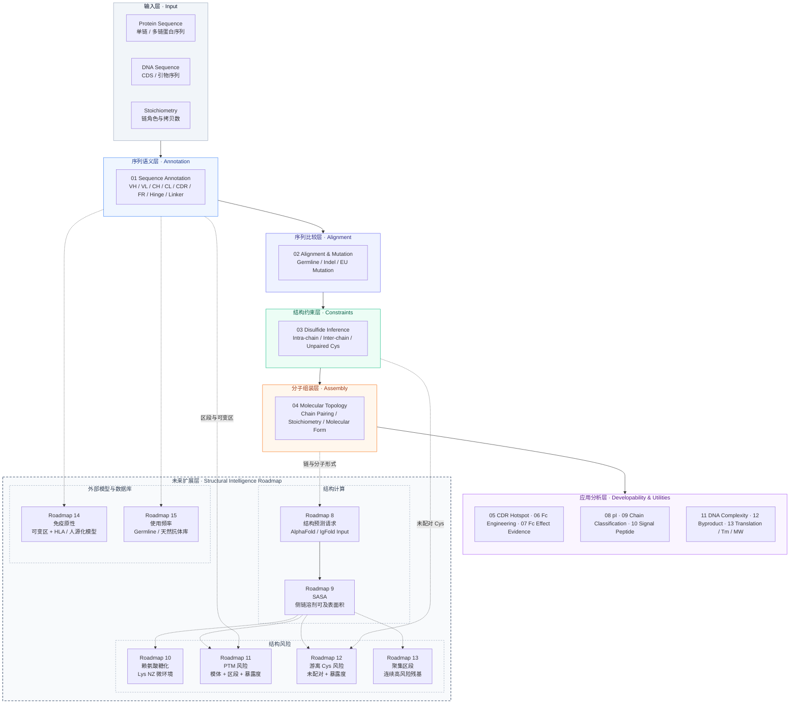
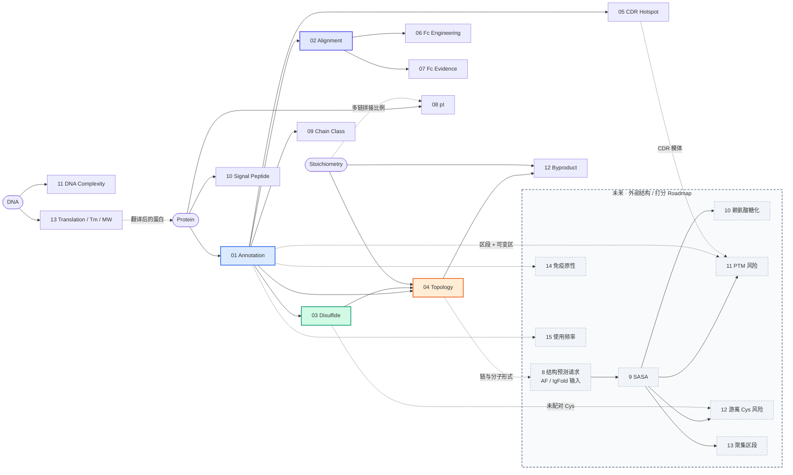

> **系列笔记**：[设计概念与分类术语](./Antibody_design_basics.md) · [核心四层与 Fc 工程](./AntibodyKnowledge1.md) · [蛋白/DNA 工具箱](./AntibodyKnowledge2.md) · [Trastuzumab 案例](./Trastuzumab.md) · [字段级速查](./study.md)

抗体分析不是一个单独算法，而是由多类任务组成的有向依赖图

> 输入规范化 → 序列分区 → 编号与参考比对 → 二硫键与拓扑 → 可开发性与物性 → 结构增强 → 证据和质量控制

---

## 1. 算法要回答什么

一套完整的抗体分析流程至少需要回答六类问题：

| 层次 | 核心问题 |
|------|----------|
| 输入层 | 输入是蛋白还是 DNA？包含几条链？每条链有几个拷贝？ |
| 序列语义层 | VH、VL、CH、CL、CDR、FR、Hinge、Linker 在哪里？ |
| 序列比较层 | 最接近哪个 Germline？相对参考有哪些替换、插入和缺失？ |
| 结构约束层 | Cys 如何配对？哪些是链内、链间或未配对？ |
| 分子组装层 | 哪些链组成完整分子？分子形式和化学计量是什么？ |
| 应用分析层 | 有哪些 PTM、物性、Fc 功能、聚集和免疫原性风险？ |

算法输出不能只有结论，还应包含：

- 对应链与残基位置；
- 使用的编号体系；
- 参考序列或规则；
- 方法版本和证据；
- 置信度、警告和适用边界。

---

## 2. 六层核心架构与 Roadmap 扩展层



实线表示六层核心算法的主要依赖，虚线表示未来扩展能力所需的数据输入。Roadmap 8–15 尚需逐步完善，不应与现有模块 08–13 混用：前者是**未来流水线步骤**，后者是**当前通用算法模块编号**。

六层不是严格串行关系。例如 pI 可以直接从蛋白序列计算，DNA Complexity 不依赖抗体拓扑；但二硫键、Fc 工程和 CDR 风险必须依赖可靠的残基分区与编号。未来结构增强层同样不能绕过 Annotation：

- 结构预测请求需要链 ID、链序列、拷贝数和分子形式；
- SASA 是糖化、PTM、游离 Cys 和聚集风险的共同结构特征；
- PTM 需要同时使用序列模体、功能区段和暴露度；
- 免疫原性与使用频率以可变区和 Germline 注释为输入；
- 所有结构残基必须映射回统一 `residue_id`。

---

## 3. 核心四层主线

### 3.1 Sequence Annotation

目标是把一条连续序列转换为具有生物学含义的区段。

常用方法：

- **ANARCI**：变量区识别和 IMGT、Kabat 等编号；
- **Profile HMM**：识别恒定区或结构域；
- **参考序列比对**：确认亚型、轻链类型和边界；
- **Motif / 正则规则**：识别 Hinge、Linker、Tag 等工程片段；
- **局部比对**：识别已知融合蛋白或功能片段。

多种方法的区间可能重叠，需要统一裁决：

1. 将所有候选转换为相同的 1-based 或 0-based 坐标；
2. 按证据强度、覆盖度、identity 和区段合法性排序；
3. 合并一致区间；
4. 对冲突区间保留候选和置信度；
5. 将无法解释的部分标记为 Unknown，而不是强行归类。

### 3.2 Alignment and Mutation

注释完成后，根据区段选择不同参考：

- VH/VL 对 Germline V 基因；
- CH/CL 对物种、亚型和轻链类型参考；
- Fc 工程突变映射到 EU 编号；
- 插入和缺失保留 alignment event，而不是只输出替换位点。

主要输出：

- Germline 候选及得分；
- 恒定区亚型和 identity；
- substitution、insertion、deletion；
- 原始位置、IMGT/Kabat/EU 位置之间的映射；
- Fc 区突变集合。

### 3.3 Disulfide Inference

序列只能推断二硫键，不能证明真实化学连接。典型流程：

1. 找出全部 Cys；
2. 根据区段和编号定位保守 Cys；
3. 应用 VH/VL/CH/CL 域内配对规则；
4. 应用 HC–LC 和 Hinge 链间规则；
5. 标记 unmatched 和 unpaired Cys；
6. 输出规则来源、置信度和实验验证建议。

IgG1、IgG2、IgG3、IgG4 的铰链和链间二硫键不同，不能共用一张固定配对表。

### 3.4 Molecular Topology

拓扑分析将“链”提升为“完整分子”：

- 链角色和拷贝数；
- HC–HC、HC–LC 或其它链间连接；
- Fab、IgG、Fc-fusion、scFv、VHH、双抗等分子形式；
- Knob-in-Hole、CrossMab 等工程标签；
- 无法唯一确定时的多个候选拓扑。

拓扑评分可以综合：

$$
\mathrm{Score}
=P_{\mathrm{unpaired}}
+P_{\mathrm{mismatch}}
+P_{\mathrm{disconnected}}
-R_{\mathrm{valid}}
$$

其中惩罚项表示游离链、错误配对和不连通结构，奖励项表示满足已知化学计量、二硫键和工程规则。分数只能用于候选排序，不能代替实验或构建体说明。

---

## 4. 数据依赖 DAG

实线：当前六层核心模块（01–13）的执行依赖。虚线：Roadmap 8–15 未来扩展所需的上游数据（**非现行模块编号**）。



| 依赖类型 | 含义 |
|----------|------|
| Protein / DNA / Stoichiometry → 01–13 | 现行算法输入与触发条件 |
| 01 → 02/03/05/09 | 注释结果是多数下游模块的唯一语义来源 |
| 02 → 06/07 | Fc 工程命名与文献证据依赖 EU 突变集合 |
| 01 + 03 + Stoichiometry → 04 → 12 | 多链拓扑与理论副产物枚举 |
| 虚线 → Roadmap 8–15 | 规划中的结构增强；需结构坐标或外部模型，且残基须映射回 `residue_id` |

最重要的依赖是：**01 Sequence Annotation 是共享语义底座**。如果区段和编号错误，突变、二硫键、Fc 工程、CDR hotspot、拓扑以及未来的 PTM / 免疫原性分析都会一起偏移。

---

## 5. 九个应用分析模块

| 模块 | 主要输入 | 核心任务 | 关键限制 |
|------|----------|----------|----------|
| **05 CDR Hotspot** | CDR 序列与位置 | 扫描脱酰胺、异构化、氧化 motif | motif 不等于实际修饰率 |
| **06 Fc Engineering** | EU 突变集合 | 匹配 LALA、YTE、LS、KiH 等签名 | 标签不等于功能已经验证 |
| **07 Fc Effect Evidence** | Fc 突变集合 | 检索 FcγR、C1q、ADCC/CDC 相关证据 | 文献趋势不等于效力预测 |
| **08 pI Prediction** | 蛋白序列、拷贝数 | 根据 pKa 模型求净电荷为零的 pH | 糖型和末端加工会影响实测值 |
| **09 Chain Classification** | 结构域组合 | 分类 HC、LC、Fc、Protein 等 | 特殊格式需要独立规则 |
| **10 Signal Peptide** | N 端序列 | 预测信号肽和切割位置 | 必须声明使用模型或启发式方法 |
| **11 DNA Complexity** | DNA/CDS | 检测重复、回文、发夹和同聚物 | 不直接说明表达一定失败 |
| **12 Byproduct Analysis** | 链、拷贝数、拓扑 | 枚举错配组合和理论分子量 | 组合数不等于真实丰度 |
| **13 Translation / Tm / MW** | DNA 或蛋白序列 | 翻译、引物 Tm、MW、$\varepsilon_{280}$ | 需要明确成熟化和修饰假设 |

---

## 6. 一条分析流水线

### 6.1 序列主线

```text
序列
  │
  ├─ 1  section       区段识别（ANARCI + HMM + 参考比对 + motif）
  ├─ 2  realign       对 Germline / 恒定区参考重比对，写出突变
  ├─ 3  find_cys      将 Cys 归为链内、链间或未配对
  │
  ├─ 4  拓扑与卡通图   链配对、拷贝数、二硫键表和分子形式
  ├─ 5  序列校验       FR 和恒定区的插入、缺失与异常保守位点
  ├─ 6  Fc 工程命名    LALA、YTE、LS、Knob/Hole 等
  └─ 7  Fc 功能证据    对 Fc 受体、ADCC 和 CDC 影响的证据解释
```

### 6.2 结构增强主线

```text
外部结构 / 打分
  │
  ├─ 8   结构预测请求   组装 AlphaFold / IgFold 输入
  ├─ 9   SASA          计算侧链溶剂可及表面积
  ├─ 10  赖氨酸糖化    分析 Lys NZ 周边微环境
  ├─ 11  PTM 风险      序列模体 + 区段 + 暴露度
  ├─ 12  游离 Cys 风险  未配对状态 + 暴露度
  ├─ 13  聚集区段       将连续高风险残基合并成区段
  ├─ 14  免疫原性       可变区 + HLA / 人源化外部模型
  └─ 15  使用频率       Germline 和天然抗体库频率
```

步骤 8–15 依赖预测结构、实验结构或外部数据库，不能包装成纯 FASTA 结论。结构结果还必须映射回统一残基坐标，才能与序列模块联动。

---

## 7. 统一数据对象

### 7.1 Residue

```text
Residue
├── residue_id
├── chain_id
├── sequence_position
├── amino_acid
├── domain / subregion
├── imgt_position
├── kabat_position
├── eu_position
├── confidence
└── evidence_refs[]
```

### 7.2 Finding

```text
Finding
├── finding_type
├── residue_ids[]
├── severity / direction
├── method
├── rule_version
├── reference_version
├── evidence[]
├── confidence
└── limitations[]
```

统一对象的意义是：所有模块共享同一条链、同一个残基和同一套证据，不在每个模块内部重复换算位置。

---

## 8. 输出与质量控制

每个模块至少应输出：

| 字段 | 作用 |
|------|------|
| `status` | 成功、部分成功、不适用、跳过或失败 |
| `method` | 使用的算法或规则 |
| `algorithm_version` | 算法版本 |
| `results` | 标准化结果 |
| `evidence` | 参考序列、数据库、文献或结构 |
| `warnings` | 可继续使用但需要注意的问题 |
| `limitations` | 方法不能说明什么 |
| `error` | 稳定错误码和失败阶段 |

需要避免三类常见错误：

1. **空结果与未运行混淆**：没有 hotspot 不等于模块未执行。
2. **规则推断与实验事实混淆**：二硫键、ADCC、PTM 必须标明证据等级。
3. **编号体系混用**：原始位置、IMGT、Kabat、EU 不可直接互换。

---

## 9. Benchmark 设计

| 层级 | 测试目标 | 推荐样本 |
|------|----------|----------|
| Level 1 · Golden | 正常抗体的基础结果必须稳定 | Trastuzumab、Rituximab、Adalimumab |
| Level 2 · Diversity | 亚型和分子形式覆盖 | IgG2、IgG4、Fab、VHH、scFv、双抗、ADC |
| Level 3 · Edge Cases | 插入、缺失、异常 Cys、极端 CDR3 | 天然特殊序列和标注合成序列 |

推荐指标：

- Chain Classification：Accuracy、Precision、Recall、F1；
- Domain/CDR：残基级 Precision、Recall、F1 和边界准确率；
- Numbering：位点与插入编号准确率；
- Cysteine Pairing：Pair Precision、Pair Recall、F1；
- PTM：AUROC、AUPRC、F1；
- 结构预测：RMSD、TM-score、lDDT。

PTM、糖基化和二硫键的最终 Ground Truth 应优先来自实验数据；序列 motif 或规则配对只能作为计算参考。

---

## 10. 推荐实施顺序

| 阶段 | 优先能力 | 完成标准 |
|------|----------|----------|
| Phase 1 | Annotation + Residue Mapping | 区段、编号和证据统一 |
| Phase 2 | Alignment + Disulfide | 突变和 Cys 均可追溯 |
| Phase 3 | Topology + Classification | 常规与特殊分子形式可区分 |
| Phase 4 | Hotspot、Fc、pI、Signal、DNA | 各模块明确方法与限制 |
| Phase 5 | 结构增强 | SASA、聚集、免疫原性映射回 residue_id |
| Phase 6 | Benchmark | Golden、Diversity、Edge Case 自动回归 |

整个体系最重要的不是模块数量，而是三条原则：

1. **统一语义**：全平台共享链、区段、残基和编号映射；
2. **证据分级**：实验、计算、规则和文献结论不能混为一谈；
3. **结果可追溯**：每个判断都能回到输入、算法版本、参考数据和适用边界。
