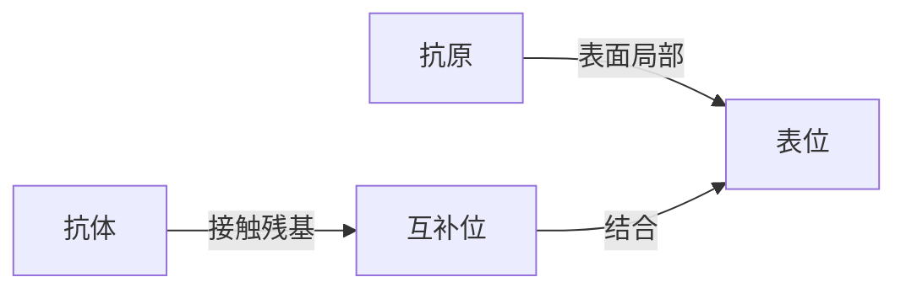
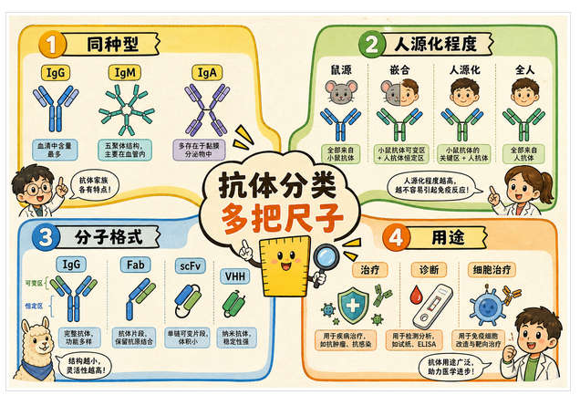
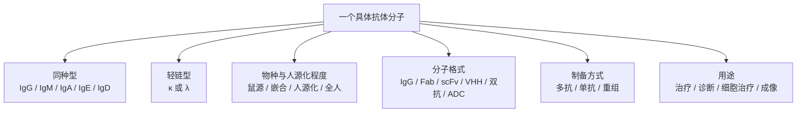

> **系列笔记**：[算法总览](./Antibody_algorithm_overview.md) · [序列注释与 Fc 工程](./AntibodyKnowledge1.md) · [蛋白/DNA 工具箱](./AntibodyKnowledge2.md) · [Trastuzumab 案例](./Trastuzumab.md)

这篇是抗体算法笔记前面的概念层。后面的注释、比对、二硫键和拓扑，都假定读者已经能分清 VH、Fab、scFv、VHH 和人源化分别指什么。读完应能把口头里的这些词，落到具体的链、结构域和分类标准上。

正式文献里抗体多称免疫球蛋白（Immunoglobulin，Ig）。日常讨论里两者多数场合可以互换；写到同种型、Fc 效应或半衰期时，用 Ig 更不容易和「任意能结合抗原的蛋白」混在一起。

---

## 1. 设计先认清四个对象

抗体设计的起点不是一条序列，而是一次识别关系：哪个分子被认，认的是它表面的哪一块，谁去认，以及抗体上哪一组残基真正接触它。

| 对象 | 定义 | 设计时要问清的事 |
|------|------|------------------|
| 抗原（antigen） | 被识别的分子，可以是可溶蛋白、毒素或膜蛋白 | 可溶还是膜蛋白；有没有可用结构或表位信息 |
| 表位（epitope） | 抗原上被抗体接触的局部表面 | 线性表位还是构象表位；是否已知、是否保守 |
| 抗体（antibody / Ig） | 识别该表位的免疫球蛋白 | 要完整分子、片段，还是单域 |
| 互补位（paratope） | 抗体上直接接触表位的残基集合 | 主要落在哪些 CDR；骨架是否也参与接触 |

互补位的主体通常是六条互补决定区（CDR）环，但接触并不严格等于「六条 CDR 的全部残基」。骨架区（FR）偶尔也提供接触或决定环的朝向。所以注释系统标出 CDR 边界，只是定位互补位的起点，不是互补位本身。

设计要同时满足四件事：认得准（特异性）、绑得住（亲和力）、分子能被表达和纯化（可开发性）、在预定场景里发挥功能（中和、效应或仅作为结合模块）。

---

## 2. 默认分子：IgG

血清中最常见、也是治疗性抗体默认骨架的是 IgG。把它想成对称的 Y 形四链分子，化学计量记为 H₂L₂：两条重链（Heavy chain，H）和两条轻链（Light chain，L）。

### 2.1 从 N 端到 C 端的结构域

| 链 | 结构域顺序 | 各段职责 |
|----|------------|----------|
| 重链 | VH → CH1 → Hinge → CH2 → CH3 | VH 参与识别；CH1 支撑抗原结合臂；铰链提供柔性和链间二硫键；CH2/CH3 组成 Fc |
| 轻链 | VL → CL | VL 与 VH 配对形成识别核心；CL 与 CH1 配对稳定 Fab |

VH / VL 是重链、轻链可变域，CH / CL 是恒定域。同一套字母在不同格式里会缺掉后面若干恒定域，所以看到「这条链有 VH」不能默认它是完整 IgG。

### 2.2 从业者每天在切的三块

| 术语 | 含有的结构域 | 直觉 |
|------|----------------|------|
| Fab | 一条臂：VH–CH1 + VL–CL | 抗原结合片段，单价 |
| Fc | 两条重链的茎部；人 IgG 主要是 CH2–CH3 | 半衰期、Fc 受体和效应功能 |
| Fv | 只有 VH + VL | 最小识别核心，本身没有恒定区稳定配对 |
| CDR | VH、VL 上各 3 条高变环，共 H1–H3、L1–L3 | 互补位的主要来源 |
| FR | CDR 之间相对保守的骨架 | 维持折叠，并约束 CDR 的空间几何 |

酶切和工程切法不是一回事。木瓜蛋白酶在铰链二硫键的 N 端一侧切开，典型产物是两个 Fab 加一个 Fc。胃蛋白酶在铰链二硫键的 C 端一侧切开，两条臂仍由铰链连着，得到 F(ab′)₂。scFv 和 VHH 不是这两种酶的直接产物：前者是把 Fv 用连接肽焊成一条链，后者来自天然重链抗体的可变域。

IgG 有两个 Fab，是双价分子。一个结合位点与一个表位的结合强度叫亲和力（affinity）；两个（或多个）位点同时抓住同一抗原或邻近表位时，表观结合会更不容易脱落，这叫亲和力增强（avidity）。价数变了，功能实验里的表观强度会变，不能把片段药的 EC₅₀ 直接当成 IgG 的 K_D。

结构域边界、编号和二硫键怎么落到序列上，见 [序列注释与 Fc 工程](./AntibodyKnowledge1.md)。

---

## 3. 单域抗体是另一种格式

单域抗体（single-domain antibody，sdAb）不是「普通抗体少了结构数据」，而是结合核心不同：常规 IgG 靠 VH + VL 配对识别抗原，sdAb 靠一个可变域独立折叠并结合抗原。

| | 常规抗体（人、鼠等 IgG） | 单域抗体 |
|--|--------------------------|----------|
| 结合核心 | VH + VL | 单个可变域 |
| 典型大小 | 完整 IgG 约 150 kDa | VHH 约 12–15 kDa |
| 常见来源 | 四链抗体 | 骆驼科重链抗体的 VHH；软骨鱼等的 VNAR |
| 工程含义 | 要处理链配对 | 无轻链，便于串联成多价或双特异性模块 |

VHH（variable domain of the heavy-chain-only antibody）是骆驼科天然重链抗体的可变区，药物和工程语境里常称纳米抗体（nanobody）。sdAb 是上位概念；口语里的「纳米抗体」多特指 VHH，不自动包括鲨鱼 VNAR。

展示文库里 sdAb 序列很多、共晶复合物相对少，所以计算工作更常做纯序列亲和力预测。那是数据分布，不是 sdAb 的定义。定义只看一件事：离开配对轻链之后，这个域还能不能稳定结合抗原。

---

## 4. 分类要用多把尺子

同一个分子可以同时带好几类标签。IgG4、κ 轻链、人源化、双特异性、重组单克隆，描述的是不同维度，不能放进同一棵互斥的树。

<em>图 1：同种型、人源化程度、分子格式和用途可以同时贴在同一个分子上。图中是示意；IgD、IgE、轻链型和制备方式见下文。</em>

### 4.1 同种型：重链恒定区决定血清行为

分类标准是重链恒定区的基因和序列类型。它决定分子形态、受体结合和效应功能，不决定这条抗体认哪个表位。

| 类别 | 常见形态 | 使用直觉 |
|------|----------|----------|
| IgM | 常为五聚体 | 初次应答早，补体激活强；完整五聚体很少直接当药 |
| IgD | 单体 | 主要在 B 细胞表面，血清中少 |
| IgG | 单体 Y 形 | 治疗性抗体的默认类别，半衰期长 |
| IgA | 单体或二聚体 | 黏膜免疫；分泌型带分泌片 |
| IgE | 单体 | 过敏和寄生虫应答；也是抗过敏药物的相关靶点背景 |

人 IgG 再分 IgG1、IgG2、IgG3、IgG4。差异主要在铰链长度、链间二硫键布局和 Fcγ 受体、补体结合能力。需要杀伤或清除时常用 IgG1；希望阻断靶点、尽量减弱效应功能时，会考虑 IgG4 或做 Fc 沉默突变。选亚类是成药决策，不是注释完成后的附注。Fc 工程的序列含义见 [算法总览](./Antibody_algorithm_overview.md) 的应用分析层。

### 4.2 轻链型：κ 或 λ

轻链恒定区要么是 κ（kappa），要么是 λ（lambda）。天然抗体分子上两条轻链型别一致。设计时先选定一种，不要在同一分子里混型。注释输出里的链型，应和恒定区基因一致，不能只看可变区胚系名字。

### 4.3 物种来源和人源化程度

这把尺子量的是序列有多接近人抗体，目的是降低免疫原性，也就是药物诱发抗药抗体的倾向。

| 标签 | 序列组成 | 国际非专利药名中的常见词干 |
|------|----------|------------------------------|
| 鼠源（murine） | 可变区和恒定区都主要来自鼠 | `-o-` |
| 嵌合（chimeric） | 鼠可变区 + 人恒定区 | `-xi-` |
| 人源化（humanized） | 人骨架上移植异源 CDR，并回补必要的骨架残基 | `-zu-` |
| 全人（fully human） | 可变区来自人抗体库、转基因动物或人 B 细胞 | `-u-` |

词干是命名习惯，用来帮助读药名，不能代替序列证据。叫 humanized 的分子仍可能保留对折叠或亲和力关键的非人骨架残基；叫 fully human 也不等于免疫原性等于零。人源化在算法上依赖编号体系和胚系比对：先声明 Kabat、Chothia 或 IMGT，再谈 CDR 移植边界。

### 4.4 分子格式：留下哪些域、几条链、几个价

| 格式 | 相对完整 IgG 保留什么 | 价 | 典型用途 |
|------|------------------------|----|----------|
| 完整 IgG | VH、VL、CH1、CL、铰链、CH2、CH3，H₂L₂ | 2 | 治疗默认；要半衰期和可选的 Fc 效应 |
| Fab | 单臂 VH–CH1 + VL–CL | 1 | 诊断、片段药物、去掉 Fc 效应 |
| F(ab′)₂ | 两臂加部分铰链 | 2 | 保留双价，不要 Fc |
| scFv | VH 与 VL 由连接肽连成一条链 | 1 | 易作为模块；CAR-T 和双抗的常见结合域 |
| VHH / sdAb | 单个可变域 | 1 | 体积小、易串联；适合隐蔽表位和成像 |

在这些骨架上还可以再加功能，格式名字会叠加：

| 扩展 | 多出来的是什么 |
|------|----------------|
| 双特异性（bispecific） | 同一分子上的第二个、针对不同表位的互补位 |
| ADC | 接头和毒素载荷；抗体骨架仍常保留完整 Fc |
| CAR 结合域 | 把 scFv 或 VHH 接上跨膜和胞内信号域；这已经是细胞工程 |

格式直接决定下游算法的输入假设：几条链、每条链几个拷贝、有没有 Linker、Fc 是否存在、未配对半胱氨酸是否来自铰链截断。这些是 [算法总览](./Antibody_algorithm_overview.md) 里输入层和分子组装层要消费的标签，不应只写在项目备注里。

### 4.5 制备方式

| 类型 | 标准 | 后果 |
|------|------|------|
| 多克隆（polyclonal） | 许多 B 细胞克隆的混合物 | 能覆盖多个表位，批间差异大 |
| 单克隆（monoclonal，mAb） | 单一克隆，序列均一 | 药物和定量检测的主流 |
| 重组抗体（recombinant） | 已知序列在宿主中表达 | 才能做人源化、换格式、换亚类 |

杂交瘤、噬菌体或酵母展示、单 B 细胞测序和计算设计，是取得单克隆序列的不同产线。对序列分析来说，它们的差别主要在起点质量和伴随数据：展示克隆常是片段，单 B 细胞可能带重轻链配对，计算设计序列则没有免疫来源。

### 4.6 用途决定成功标准

| 场景 | 常见格式 | 优先看的指标 |
|------|----------|----------------|
| 治疗 | IgG、双抗、ADC | 亲和力、特异性、PK、免疫原性、表达与聚集 |
| 诊断和试剂 | IgG、多抗、标记 Fab | 效价、批间一致、交叉反应 |
| 细胞治疗模块 | scFv、VHH | 表达、稳定性、膜上折叠 |
| 成像探针 | 片段、sdAb | 组织穿透和清除速度 |

---

## 5. 术语按任务分组

### 5.1 结合与功能

| 术语 | 它度量的事 |
|------|------------|
| 亲和力（affinity） | 单个结合位点与表位的结合强度 |
| K_D | 解离平衡常数，越小越紧 |
| k_on / k_off | 结合速率和解离速率 |
| 亲和力增强（avidity） | 多价同时结合带来的表观变紧 |
| 特异性（specificity） | 认准目标、少认无关分子 |
| 交叉反应（cross-reactivity） | 结合同源蛋白或跨物种对应靶点 |
| 中和（neutralization） | 结合之后阻断病原、毒素或受体功能 |
| 效应功能（effector function） | Fc 触发的 ADCC、CDC、ADCP 等清除机制 |
| 半衰期 / FcRn | IgG 经 FcRn 再循环后在血中停留的时间 |

### 5.2 从发现到候选

| 术语 | 在流程中的位置 |
|------|----------------|
| 免疫（immunization） | 用抗原刺激动物产生应答 |
| 杂交瘤（hybridoma） | B 细胞与骨髓瘤融合，经典单抗来源 |
| 展示文库（display library） | 把片段展示在噬菌体或酵母表面 |
| 淘选（panning） | 结合、洗涤、洗脱，多轮富集 |
| 命中（hit）/ 先导（lead） | 初筛阳性，以及优化后准备推进的候选 |
| 亲和力成熟（affinity maturation） | 用突变和筛选把结合做紧；体内对应过程是体细胞超突变 |
| 人源化（humanization） | 降低异源序列带来的免疫原性 |
| 可开发性（developability） | 表达、聚集、粘度、稳定性、化学降解是否适合生产和制剂 |
| PK / PD | 药代动力学 / 药效学 |

### 5.3 序列和结构行话

| 术语 | 和计算分析的关系 |
|------|------------------|
| 胚系（germline） | 未经历超突变的 V、D、J 模板；突变注释的参考 |
| V(D)J 重排 | 组装可变区基因、产生组合多样性 |
| 体细胞超突变（SHM） | 应答过程中的点突变，是天然亲和力成熟 |
| 编号（numbering） | Kabat、Chothia、IMGT 等；不声明体系，CDR 边界无法对照 |
| 注释（annotation） | 标出链型、FR/CDR、恒定区和胚系 |
| 对接（docking） | 预测抗体–抗原复合物的空间姿势 |
| 表位作图（epitope mapping） | 用实验或计算确定结合落在抗原的哪一块 |

---

## 6. 四组容易混的词

| 不要并成一个词 | 差别 |
|----------------|------|
| 亲和力 vs 效价（titer） | 亲和力是结合强度。效价通常是血清或试剂稀释到仍有信号时的稀释度，混有浓度和多克隆组成 |
| K_D vs EC₅₀ | K_D 描述结合平衡。EC₅₀ 是功能曲线的半效应浓度，受价数、细胞体系和读出方式影响 |
| 特异性 vs 选择性 | 特异性强调不认无关分子。选择性强调在一组相似靶点中偏向哪一个；口语里常被混用 |
| 同种型 vs 分子格式 | IgG、IgM 是重链类别。scFv、VHH 是保留了哪些结构域的工程格式。人源化 IgG 和人源化 scFv 可以是同一可变区的两种格式 |

---

## 7. 动手前的五个问题

1. **靶点是什么。** 可溶蛋白还是膜蛋白，表位是否已知，要不要跨物种交叉。
2. **要不要 Fc。** 需要长半衰期或效应功能就倾向完整 IgG；只要结合、不要效应，考虑 Fab、F(ab′)₂、沉默 Fc、scFv 或 VHH。
3. **序列从哪来。** 免疫动物、展示库、已有临床抗体改造，还是计算设计。来源决定配对信息是否可靠。
4. **成功标准写在哪一层。** K_D、细胞功能、种属交叉、表达量、聚集和免疫原性不要合成一个「亲和力不错」。
5. **编号体系是否统一。** 团队先固定 IMGT 或 Kabat。人源化、CDR 移植和突变表都沿用同一套编号。

对应到本系列后续笔记：

| 问题落点 | 接着读 |
|----------|--------|
| 结构域、CDR、二硫键、Fc | [序列注释与 Fc 工程](./AntibodyKnowledge1.md) |
| 输入、比对、拓扑、可开发性如何串成流程 | [算法总览](./Antibody_algorithm_overview.md) |
| 蛋白性质、DNA 和翻译相关工具 | [蛋白/DNA 工具箱](./AntibodyKnowledge2.md) |
| 用一个已上市 IgG 走通全流程 | [Trastuzumab 案例](./Trastuzumab.md) |

---

## 8. 自测

1. 用一句话区分抗原、表位、抗体和互补位。
2. IgG 的 Fab 和 Fc 各由哪些结构域组成，各负责什么。
3. 为什么不能把「sdAb 共晶少」当成单域抗体的定义。
4. 人源化和 scFv 分别属于哪一把分类尺子。
5. 「噬菌体淘选之后做亲和力成熟」分别对应发现流程里的哪两步，输入序列通常是完整 IgG 还是片段。

---

## 小结

- 抗体是识别抗原表位的免疫球蛋白；互补位是抗体上的接触残基，主要但不全来自六条 CDR。
- 默认治疗分子是双价 IgG（H₂L₂）。Fab、Fc、Fv、scFv、VHH 是不同的结构域取舍，不是同一种分子的别名。
- 分类同时使用同种型、轻链型、人源化程度、分子格式、制备方式和用途。换一把尺子，标签就要换。
- 这些标签是后续注释和拓扑算法的输入约定：链数、拷贝数、编号体系和 Fc 是否存在，必须在进算法之前说清。

概念框架整理自 [Ben-air：抗体设计基础概念与分类术语](https://www.ben-air.cn/01.%E7%9F%A5%E8%AF%86-40.%E8%9B%8B%E7%99%BD%E5%B7%A5%E7%A8%8B-%E6%8A%97%E4%BD%93/%E6%8A%97%E4%BD%93-00.%E5%85%A5%E9%97%A8-01.%E6%8A%97%E4%BD%93%E8%AE%BE%E8%AE%A1%E5%9F%BA%E7%A1%80%E6%A6%82%E5%BF%B5%E4%B8%8E%E5%88%86%E7%B1%BB%E6%9C%AF%E8%AF%AD/)，并按本仓库的序列分析笔记重新组织。
