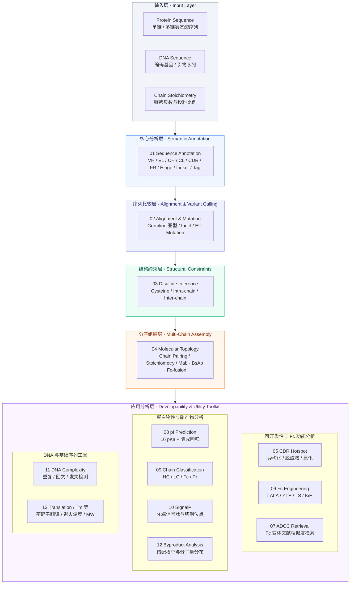
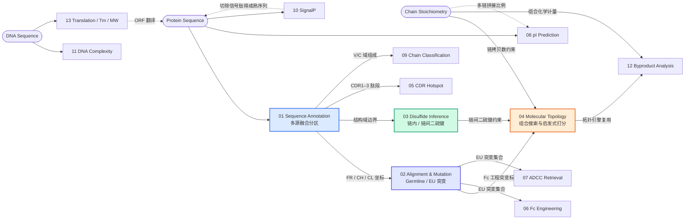
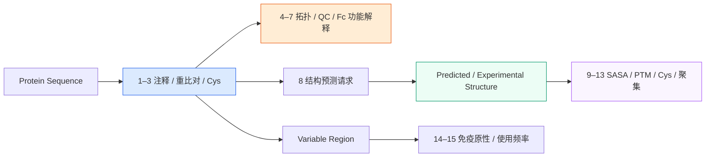

> **定位**：抗体/融合蛋白序列分析平台的**全景索引**。正文两张图分别是分层架构与数据依赖 DAG；下文速查表用于跳转到系列长文。  
> **系列笔记**：[上篇 · 核心四层与 Fc 工程](./AntibodyKnowledge1.md) · [下篇 · 蛋白/DNA 工具箱](./AntibodyKnowledge2.md) · [案例 · Trastuzumab](./Trastuzumab.md) · [模块速查](./study.md) · [基础索引](./antibody.md)

| 概念 | 含义 |
|------|------|
| **6 层** | 输入层 + 核心四层（01–04）+ 应用分析层 |
| **13 模块** | 01–04 主线；05–13 可开发性、物性与 DNA/序列工具 |
| **DAG** | 工程上多为有向无环图，不是严格单链串行 |

---

## 1. 六层全景架构（Layered Architecture）

自上而下，体系划分为 **6 个功能层**、**13 个算法模块**：



- **输入层**：蛋白序列、DNA 序列、链化学计量，三者可独立或组合进入后续模块。
- **核心四层**：语义注释 → 比对与突变 → 二硫键约束 → 多链拓扑，是抗体/融合蛋白的共享主线。
- **应用层**：依赖注释或比对结果的分析（05–07、09、12），以及可单独调用的序列工具（08、10、11、13）。

---

## 2. 数据依赖流（Data Dependency DAG）

执行时，13 个模块组成 **核心主线（01 → 02 → 03 → 04）**、**注释驱动支线（05 / 06 / 07 / 09 / 12）** 与 **独立工具（08 / 10 / 11 / 13）**：



> **依赖要点**
>
> - **01** 是共享语义底座，直接影响 02、03、05、09，并间接影响 04、06、07、12。
> - **10 SignalP**、**13 Translation** 可作为前置：把带信号肽前体或 DNA ORF 规范为成熟蛋白序列后再进主线。
> - **04** 与 **12** 通常在**多链 + 明确化学计量**时才有意义；单链 FASTA 不应强行触发拓扑与副产物枚举。

---

## 3. 工程流水线：序列主线与外部结构分析

前两节按平台能力划分 **13 个算法模块**；本节换成一次分析任务的执行视角，将流程拆成 **15 个步骤**。两套编号用途不同：前者是产品模块编号，后者是流水线步骤编号，不应直接一一对应。

### 3.1 序列分析主线

```text
序列
  │
  ├─ 1  section       区段识别（ANARCI + HMM + BLAST + 正则）
  ├─ 2  realign       对照种系参考收紧边界，写出 Fc 突变
  ├─ 3  find_cys      每个 Cys 归为链内 / 链间 / 未配对
  │
  ├─ 4  拓扑与卡通图   配对关系、拷贝数、二硫键表、游离 Cys
  ├─ 5  序列校验       FR 和恒定区相对参考的插入、缺失
  ├─ 6  Fc 工程名      LALA、YTE、Knob/Hole 等
  └─ 7  ADCC / CDC    解释突变对 Fc 受体和补体相关功能的影响
```

步骤 1–7 以序列和参考库为主。`section`、`realign`、`find_cys` 是工程阶段名，不是新的生物学术语；在报告中宜同时给出规范名称。

| 步骤 | 规范名称 | 主要输入 | 核心输出 |
|------|----------|----------|----------|
| 1 | Section Annotation | 成熟蛋白序列、HMM/参考库 | VH/VL/CH/CL、CDR/FR、Hinge/Linker 边界与证据 |
| 2 | Reference Realignment | 区段结果、Germline、IgG 亚型参考 | 收紧后的边界、插入/缺失、EU 位点与 Fc 突变 |
| 3 | Cysteine Assignment | 注释序列、亚型规则 | 链内、链间、未配对 Cys 及置信度 |
| 4 | Molecular Topology | 多链序列、拷贝数、二硫键约束 | 候选配对、化学计量、二硫键表与卡通图 |
| 5 | Sequence Validation | FR/恒定区参考、比对结果 | 插入、缺失、缺失保守位点和异常残基 |
| 6 | Fc Engineering Naming | EU 突变集合、工程词典 | LALA、YTE、LS、Knob/Hole 等标签 |
| 7 | ADCC / CDC Interpretation | Fc 标签、亚型、文献/实验数据库 | 对 FcγR、C1q、ADCC/CDC 的方向性解释与证据 |

> **边界**：序列可以识别“存在某种工程突变”，但不能单独证明 ADCC 或 CDC 的实际强弱。步骤 7 应输出文献或实验依据、适用亚型和不确定性，不能把规则匹配写成效力结论。

### 3.2 外部结构与评分主线

```text
外部结构 / 打分
  │
  ├─ 8   结构预测请求   只组装 AlphaFold 或 IgFold 的输入
  ├─ 9   SASA          计算侧链溶剂可及表面积
  ├─ 10  赖氨酸糖化    检查 Lys NZ 周边微环境与潜在催化残基
  ├─ 11  PTM 风险      序列模体 + 区段 + 暴露度 → 风险评语
  ├─ 12  游离 Cys 风险  暴露的未配对 Cys 可能增加聚集或错配风险
  ├─ 13  聚集区段       将连续高分残基合并成风险区段
  ├─ 14  免疫原性       抽取可变区，提交并解读外部免疫原性/人源化结果
  └─ 15  使用频率       抽取可变区，解读种系与天然库使用频率
```

步骤 8–15 不应伪装成纯 FASTA 结论：8 只负责构建外部模型请求；9–13 依赖预测或实验结构；14–15 依赖外部模型、天然抗体库和版本化参考数据。

| 步骤 | 主要依赖 | 输出与限制 |
|------|----------|------------|
| 8 · 结构预测请求 | 链序列、链 ID、化学计量、模型约束 | 生成 AlphaFold/IgFold 输入和任务清单，不把“请求成功”当成结构可靠 |
| 9 · SASA | 三维结构、探针半径、残基映射 | 残基/侧链暴露度；需记录结构来源和模型置信度 |
| 10 · 赖氨酸糖化 | Lys NZ 坐标、邻域残基、SASA | 候选位点与微环境解释；这是风险筛查，不等于实际糖化 |
| 11 · PTM 风险 | 序列模体、CDR/FR 区段、SASA | 综合风险等级、触发规则和证据 |
| 12 · 游离 Cys 风险 | 步骤 3 未配对 Cys、SASA | 暴露且未配对的 Cys 风险；聚集倾向仍需实验验证 |
| 13 · 聚集区段 | 残基级聚集分数、结构暴露度 | 连续高分区段及阈值，不用单个高分残基代替区段 |
| 14 · 免疫原性 | 可变区、HLA/人源化外部工具 | 外部评分、潜在表位及适用人群；不直接等同临床免疫原性 |
| 15 · 使用频率 | V(D)J 注释、Germline/天然库 | 基因、等位基因和 CDR3 使用频率；结论受物种、组织和数据库偏倚影响 |

### 3.3 最小数据流



---

## 4. 模块速查与笔记导航

| 层级 | 编号与模块 | 核心关注 | 直接上游 | 详解 |
|------|------------|----------|----------|------|
| 核心分析层 | **01 Sequence Annotation** | VH/VL/CH/CL、CDR/FR、Hinge/Linker/Tag | Protein | [上篇](./AntibodyKnowledge1.md) |
| 序列比较层 | **02 Alignment & Mutation** | Germline、Indel、EU 突变 | 01 | [上篇](./AntibodyKnowledge1.md) |
| 结构约束层 | **03 Disulfide Inference** | 链内/链间 Cys、游离态 | 01 | [上篇](./AntibodyKnowledge1.md) |
| 分子组装层 | **04 Molecular Topology** | 配对组合、BsAb 打分、分子形式 | 01+02+03+Stoichiometry | [上篇](./AntibodyKnowledge1.md) |
| 应用分析层 | **05 CDR Hotspot** | 异构化、脱酰胺、氧化热点 | 01 | [上篇 · Fc 与开发风险](./AntibodyKnowledge1.md) |
| 应用分析层 | **06 Fc Engineering** | LALA / YTE / LS / KiH 等词典匹配 | 02 | [上篇 · Fc 与开发风险](./AntibodyKnowledge1.md) |
| 应用分析层 | **07 ADCC Retrieval** | Fc 变体文献相似度、子集过滤 | 02 | [上篇 · Fc 与开发风险](./AntibodyKnowledge1.md) |
| 应用分析层 | **08 pI Prediction** | 多 pKa 与回归集成 | Protein (+ Stoichiometry) | [下篇](./AntibodyKnowledge2.md) |
| 应用分析层 | **09 Chain Classification** | HC / LC / Fc / Pr | 01 | [下篇](./AntibodyKnowledge2.md) |
| 应用分析层 | **10 SignalP** | 信号肽与切割位点 | Protein | [下篇](./AntibodyKnowledge2.md) |
| 应用分析层 | **11 DNA Complexity** | 重复、回文、发夹 | DNA | [下篇](./AntibodyKnowledge2.md) |
| 应用分析层 | **12 Byproduct Analysis** | 错配组合、理论 MW 分布 | 01+04+Stoichiometry | [下篇](./AntibodyKnowledge2.md) |
| 应用分析层 | **13 Translation / Tm 等** | 翻译、$T_m$、MW、$\varepsilon_{280}$ | DNA / Protein | [下篇](./AntibodyKnowledge2.md) |

**标准练习分子**：[Trastuzumab](./Trastuzumab.md) 覆盖 01–04 与部分 05–08；多链与 ADC 案例见该文第 15–20 节矩阵。

---

## 5. 系统设计原则

1. **统一语义**：链 ID、区段、残基坐标、编号体系（原始位点、IMGT、Kabat、EU）在全平台共用一套映射，各模块只读不写重复坐标。
2. **模块解耦**：pI、DNA $T_m$、SignalP 等工具不强依赖 04 拓扑结果；需要多链拼接时显式传入 Stoichiometry，而不是隐式猜测。
3. **结果可追溯**：每条结论附带证据来源、参考库版本、规则版本与置信度，便于审计与回归对比。

### 5.1 高风险场景

| 问题 | 为什么重要 | 建议 |
|------|------------|------|
| 编号混用 | 原始位点、IMGT、Kabat、EU 不可直接对表 | 建立统一 **Residue Mapping** |
| 多源注释冲突 | ANARCI、HMMER、BLASTp 边界可能不一致 | 固定区间裁决与优先级策略 |
| 二硫键可信度 | 规则推断 ≠ 质谱证实 | 标注 **确定 / 推测 / 未知** |
| 拓扑多解 | 相近分数对应多种 H–L 配对 | 输出候选列表与约束满足情况 |
| 副产物丰度 | 组合枚举 ≠ 实际比例 | 需要实验或工艺数据校准 |

### 5.2 统一残基对象（Residue Mapping）

不要让每个模块自行换算位点。同一残基应挂载多种坐标，例如：

```text
Original sequence position = 250
IMGT position              = 105
EU position                = 252
```

推荐在平台层维护结构化对象，供 02、03、05、06 复用：

```text
Residue
  ├── chain_id
  ├── sequence_position
  ├── region_id
  ├── imgt_position
  ├── kabat_position
  └── eu_position
```

### 5.3 拓扑输出：多候选而非单答案

双抗、多特异性抗体常无法由规则唯一确定配对。输出宜包含：

- 最优与次优候选拓扑及打分；
- 二硫键、化学计量、Knob-in-Hole 等关键约束是否满足；
- 无法配对的链或游离 Cys；
- 证据摘要与置信度。

示意（分数仅说明“多解”概念，非真实打分）：

```text
Candidate 1: HC1–HC2 / LC1–HC1 / LC2–HC2   Score: 10
Candidate 2: HC1–HC2 / LC1–HC2 / LC2–HC1   Score: 15
```

非典型构建体上，**Candidate 2 分数更高仍可能是错拓扑**——需要与实验或构建体说明书交叉验证。

---

## 6. 阅读顺序建议

| 步骤 | 内容 | 文档 |
|------|------|------|
| 1 | 弄清四层主线与 Fc/拓扑 | [AntibodyKnowledge1](./AntibodyKnowledge1.md) |
| 2 | 弄清工具模块与 DNA 侧能力 | [AntibodyKnowledge2](./AntibodyKnowledge2.md) |
| 3 | 用 Trastuzumab 跑通 01–04 练习 | [Trastuzumab](./Trastuzumab.md) |
| 4 | 对照本页 DAG 做集成与依赖测试 | 本文 §2 |
| 5 | 字段级规则与参数速查 | [study](./study.md) |