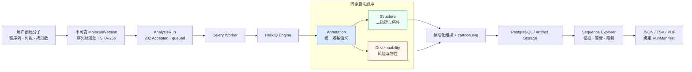
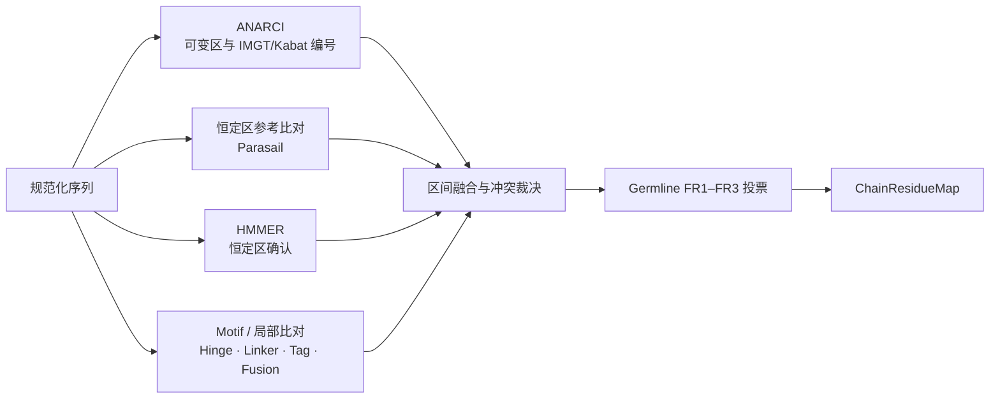
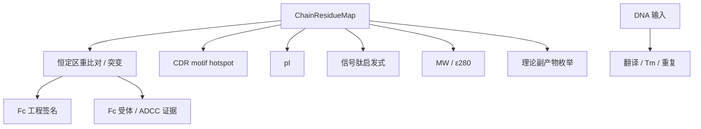

> **定位**：本文是最终产品 **HelixIQ**（项目目录：`A:\17-workspace\HelixIQ`）的算法设计总览。设计资料提供算法原理，产品代码、运行契约和金标准测试决定“当前实际能做什么”。  
> **配套资料**：[算法原理上篇](./AntibodyKnowledge1.md) · [工具箱下篇](./AntibodyKnowledge2.md) · [Trastuzumab 金标准案例](./Trastuzumab.md) · [字段级速查](./study.md)

HelixIQ 首版不是“输入 FASTA 后给一个答案”的脚本，而是一条可审计的研发链路：

> 创建分子 → 冻结序列版本 → 发起异步分析 → 查看 Sequence / Structure / Developability → 检查证据与限制 → 导出绑定运行版本的报告

---

## 1. 先统一三套视图

文档中最容易混淆的是“13 个能力”“3 个引擎模块”和“15 步设想”。它们不是同一层级。

| 视图 | 数量 | 用途 | 当前状态 |
|------|------|------|----------|
| 产品能力目录 | 13 | 用户选择和理解具体分析能力 | 前端已有 13 个能力槽位 |
| 物理执行模块 | 3 | 引擎编排、状态聚合和错误隔离 | `annotation → structure → developability` |
| 结构增强流水线 | 15 步中的 8–15 | SASA、聚集、免疫原性等后续增强 | 尚未接入 HelixIQ |

因此，产品文档必须同时回答两件事：

1. 用户选中的 13 项能力，最后由哪个物理模块执行？
2. 某个结果是已验证计算、规则推断、文献证据，还是尚未实现的路线？

---

## 2. 产品端到端流程



关键工程边界：

- 前端不计算科学指标，只展示 API 结果。
- FastAPI 路由只创建运行，不在请求线程执行 ANARCI/HMMER。
- Worker 通过稳定 Python API 调用算法引擎。
- 算法引擎不感知用户、项目、HTTP 或界面状态。
- 每次运行冻结输入摘要、参数、引擎版本、参考数据摘要和外部工具版本。

---

## 3. 算法输入与预检

### 3.1 输入契约

```text
AnalysisRequest
├── molecule_version_id
├── molecule_name
├── species
├── chains[]
│   ├── chain_id
│   ├── role: heavy | light | protein | auto
│   ├── copies: 1..20
│   └── sequence
├── enabled_modules[]
└── parameters
```

### 3.2 进入引擎前必须确定

| 检查 | 处理 |
|------|------|
| 空链、非法字符、重复链 ID | 拒绝创建有效分析请求 |
| 链角色未知 | 允许 `auto`，但在结果中保留不确定性 |
| 拷贝数缺失 | 默认 1；完整 IgG 应由用户显式提供 2×HC + 2×LC |
| 物种非 Human | 当前返回 `unsupported_reference`，不回退到人源参考 |
| 蛋白与 DNA 混用 | 根据字符集决定 DNA 工具是否适用，不能把蛋白当 CDS |
| 序列或拷贝数变更 | 创建新的 MoleculeVersion，不覆盖旧版本 |

当前经过验证的参考范围是 **Human IgG1、IgG2、IgG3、IgG4、Kappa、Lambda**。这表示参考数据可用，不表示所有亚型和特殊格式都已有同等强度的 golden validation。

---

## 4. 核心算法流程

### 4.1 第一阶段：Annotation——建立统一语义

`annotation` 是关键模块，也是整个分析的单点依赖。它失败后，Structure 和 Developability 都必须跳过，不能返回伪成功。



核心输出：

- VH、VL、CH1–CH3、CL、Hinge、CDR1–3、FR1–4、Linker、Tag、Fusion；
- 原始序列位置、IMGT、Kabat、EU 等映射；
- 恒定区亚型、germline 候选及比对证据；
- 每条链的 warnings、reference ID 和工具版本。

> 设计资料曾写成“ANARCI + HMM + BLAST + 正则”。HelixIQ 当前实际采用 **ANARCI + HMMER + Parasail/局部比对 + motif**，不能在产品说明中宣称运行了 BLAST。

### 4.2 统一残基对象（Residue Mapping）

所有下游模块必须引用同一个 `residue_id`，不得自行重算位置：

```text
Residue
├── residue_id
├── chain_id
├── sequence_position
├── amino_acid
├── domain / subregion
├── imgt_position
├── kabat_position
├── eu_position
├── confidence
└── evidence_refs[]
```

这样，突变、二硫键、hotspot、卡通图和报告才能指向同一残基。编号体系切换只改变显示，不改变底层身份。

### 4.3 第二阶段：Structure——规则约束下的分子组装

输入为 `ChainResidueMap + copies + disulfide rules`。

```text
ChainResidueMap
  ├─ 定位各结构域 Cys
  ├─ 应用域内二硫键规则
  ├─ 应用 HC–LC 和 Hinge 链间规则
  ├─ 标记 unmatched / unpaired Cys
  ├─ 根据链组成与拷贝数推断分子形式
  └─ 生成拓扑结果与 cartoon.svg
```

当前输出包括：

- 链内/链间二硫键及规则来源；
- 二硫键总数、未配对 Cys；
- 分子形式与拓扑；
- 基于结构域的 SVG 卡通图。

当前限制：

- 这是**基于序列和规则的推断**，不是质谱或实验结构；
- 不做能量最小化和几何验证；
- 卡通图不是三维结构模型；
- 当前拓扑实现主要返回单个启发式结果，复杂双抗的 Top-K 候选仍是后续增强项。

### 4.4 第三阶段：Developability——风险、物性与证据

Developability 复用 Annotation 的残基语义，并按用户选择写入具体 payload：



需要坚持的解释边界：

- pI 是 **16 套 pKa 结果的平均**，不是四个回归模型；
- Signal peptide 是**疏水核心启发式**，不是 SignalP；
- CDR hotspot 是 motif 命中，不是实际修饰率；
- MW 不包含糖基化；
- Fc/ADCC 是签名匹配和证据检索，不是实际效力预测；
- 副产物是理论组合与分子量，不是工艺中的真实丰度。

---

## 5. 13 项产品能力与真实落点

| # | 产品能力 | 物理模块 | 当前方法 | 当前成熟度与边界 |
|---|----------|----------|----------|------------------|
| 01 | Sequence Annotation | Annotation | ANARCI + HMMER + reference alignment | 核心能力；Trastuzumab golden 覆盖 |
| 02 | Alignment & Mutations | Developability | Parasail + 恒定区参考 | 已实现；输出插入、缺失和 Fc 区突变 |
| 03 | Disulfide Inference | Structure | 规则表配对 | 已实现；非实验测定 |
| 04 | Molecular Topology | Structure | 链组成 + 拷贝数启发式 | 已实现；复杂格式仍需 Top-K |
| 05 | CDR Liabilities | Developability | motif scanning | 已实现；只表示潜在风险 |
| 06 | Fc Engineering | Developability | 变体签名字典 | 引擎可运行；不等于工程建议 |
| 07 | ADCC Evidence | Developability | 文献/受体效应表匹配 | 引擎可运行；不预测 ADCC/CDC 数值 |
| 08 | Isoelectric Point | Developability | 16 pKa scales | golden 覆盖；无回归集成 |
| 09 | Chain Classification | Annotation | Rule + germline | 分类原语已存在，但尚未形成独立标准化输出 |
| 10 | Signal Peptide | Developability | hydrophobic-core heuristic | 可运行；不是 SignalP |
| 11 | DNA Complexity | Developability | CDS k-mer / repeats | 仅 DNA 输入适用 |
| 12 | Byproduct Enumeration | Developability | stoichiometry enumeration | 理论产物，不给丰度 |
| 13 | DNA Tools & Tm | Developability | translation + Tm | 仅 DNA 输入适用 |

此外，`molecular_weight` 和 `extinction` 当前作为 Developability 常驻输出，不对应单独的产品能力槽位。

### 5.1 能力选择到引擎模块的映射

```text
annotation
  ├── 01 sequence-annotation
  └── 09 chain-classification

structure
  ├── 03 disulfide-inference
  └── 04 molecular-topology

developability
  ├── 02 alignment-mutations
  ├── 05 cdr-liabilities
  ├── 06 fc-engineering
  ├── 07 adcc-evidence
  ├── 08 isoelectric-point
  ├── 10 signal-peptide
  ├── 11 dna-complexity
  ├── 12 byproduct-enumeration
  └── 13 dna-tools-tm
```

用户选择的是 capability slug；运行和状态聚合仍以三个物理模块为边界。未勾选、无数据、不适用和失败必须在界面中分开显示。

---

## 6. 模块状态、失败传播与结果契约

### 6.1 模块状态

| 状态 | 含义 |
|------|------|
| `success` | 模块完整运行并产生可信输出 |
| `partial_success` | 有可用结果，同时存在缺失或警告 |
| `skipped` | 未启用，或上游条件不满足 |
| `not_applicable` | 输入类型不适用，例如蛋白输入的 DNA 模块 |
| `failed` | 模块运行失败，并附稳定错误码 |

### 6.2 失败传播

```text
Annotation failed
  ├── Structure skipped
  ├── Developability skipped
  └── AnalysisRun failed

Structure failed
  ├── Annotation result retained
  ├── Developability may remain available
  └── AnalysisRun partial

Developability failed
  ├── Annotation / Structure retained
  └── AnalysisRun partial
```

### 6.3 标准模块输出

```text
ModuleResult
├── status
├── schema_version
├── module / method / algorithm_version
├── parameters
├── results[]
├── evidence[]
├── warnings[]
├── limitations[]
├── error
└── artifact_paths[]
```

三个基本规则：

1. 空数组表示“运行后无匹配”，不是“模块没有运行”。
2. 启发式结果必须在 `limitations` 中声明方法边界。
3. 错误不得包装成空的成功响应。

---

## 7. 可复现性与证据设计

每次运行生成 `RunManifest`，至少冻结：

- MoleculeVersion 与输入 digest；
- 链 ID、序列 digest、拷贝数；
- enabled modules 和 parameters digest；
- engine version 和容器 image digest；
- reference bundle version、各参考文件 SHA-256；
- ANARCI、HMMER 等外部工具版本。

每条科学结论应能回答：

| 问题 | 必需字段 |
|------|----------|
| 结论来自哪里？ | `source / method / reference_id` |
| 使用哪个版本？ | `algorithm_version / reference version` |
| 对应哪个残基？ | `residue_id` |
| 是计算、启发式还是文献证据？ | evidence type |
| 方法不能说明什么？ | `limitations[]` |
| 能否完全复现？ | RunManifest + Artifact checksum |

---

## 8. 当前产品与后续结构增强路线

下面的步骤属于合理的后续算法路线，但**不在当前 HelixIQ 实现中**：

```text
外部结构 / 打分
  │
  ├─ 8   结构预测请求   组装 AlphaFold / IgFold 输入
  ├─ 9   SASA          计算侧链溶剂可及表面积
  ├─ 10  赖氨酸糖化    分析 Lys NZ 周边微环境
  ├─ 11  PTM 风险      模体 + 区段 + 暴露度
  ├─ 12  游离 Cys 风险  未配对 + 暴露度
  ├─ 13  聚集区段       合并连续高风险残基
  ├─ 14  免疫原性       外部 HLA / 人源化模型
  └─ 15  使用频率       Germline / 天然库频率
```

推荐按三阶段接入：

| 阶段 | 新能力 | 前置条件 | 输出边界 |
|------|--------|----------|----------|
| Phase 2A | 结构任务与 SASA | 结构服务、结构—序列残基映射 | 预测结构必须携带置信度 |
| Phase 2B | PTM、游离 Cys、聚集 | SASA + residue-level score | 输出风险，不替代稳定性实验 |
| Phase 2C | 免疫原性、使用频率 | HLA 模型、版本化天然库 | 受人群与数据库偏倚影响 |

结构增强不能绕过 Annotation。预测结构中的残基必须回写到现有 `residue_id`，否则 Sequence、Structure 和 Developability 会形成三套不可互相追溯的坐标。

---

## 9. 科学验证与发布门禁

### 9.1 当前金标准

[Trastuzumab](./Trastuzumab.md) 是首个端到端 Golden Reference。当前产品回归至少固定：

- HC 450 aa、LC 214 aa；
- HC CDR3 `SRWGGDGFYAMDY`，LC CDR3 `QQHYTTPPT`；
- HC IgG1、LC Kappa，identity 1.0；
- HC germline IGHV3-66、LC germline IGKV1-12；
- 2:2 组装共 16 个二硫键、无游离 Cys；
- topology = `mab`；
- 平均 MW 约 145357.36 Da（不含糖基化）；
- pI 约 8.01（16 套 pKa 平均）。

### 9.2 三层 Benchmark

| 层级 | 目的 | 示例 |
|------|------|------|
| Level 1 · Golden | 防止核心结果漂移 | Trastuzumab、Rituximab、Adalimumab |
| Level 2 · Diversity | 亚型和分子形式 | IgG2/IgG4、Fab、VHH、scFv、双抗 |
| Level 3 · Edge Cases | 鲁棒性和失败处理 | 极端 CDR3、异常 Cys、插入/缺失、非典型 Linker |

### 9.3 发布门禁

任何科学结果变化必须记录：

1. 旧值和新值；
2. 算法或参考数据版本；
3. 变化原因；
4. 科学审查结论；
5. golden、模块测试和验收测试结果。

需要重点补强的测试：

- 09 Chain Classification 接入标准化输出；
- IgG2/IgG4 二硫键与铰链规则；
- κ/λ 轻链分类；
- 多链拓扑 Top-K 与错误配对；
- DNA 模块的 `not_applicable`；
- Fc/ADCC 证据库的版本和适用亚型。

---

## 10. 研发实施顺序

| 优先级 | 工作 | 完成标准 |
|--------|------|----------|
| P0 | Annotation + Residue Mapping | 任一结果都能回到唯一残基和证据 |
| P1 | Structure 规则层 | 二硫键、游离 Cys、拓扑、卡通图可追溯 |
| P2 | Developability | 风险、物性和 limitation 同时输出 |
| P3 | 13 项能力独立状态 | 每个 capability 能区分有结果、无匹配、不适用、失败 |
| P4 | Benchmark 扩展 | IgG1–4、κ/λ、Fab/VHH/scFv/双抗进入回归 |
| P5 | 结构增强 | 结构任务、SASA、聚集和免疫原性按版本接入 |

现阶段最重要的不是增加更多预测，而是先补齐三件事：

1. **单一残基真相**：全平台只认 `ChainResidueMap / residue_id`；
2. **能力状态诚实**：已实现、启发式、未验证、规划中必须分开；
3. **科学结果可复现**：任何报告都能还原输入、算法、参考数据和限制。

---

## 11. 系列文档分工

| 文档 | 角色 |
|------|------|
| 本文 | HelixIQ 产品算法架构、真实实现与路线 |
| [AntibodyKnowledge1](./AntibodyKnowledge1.md) | Annotation、Alignment、Disulfide、Topology、Fc 原理 |
| [AntibodyKnowledge2](./AntibodyKnowledge2.md) | pI、链分类、信号肽、DNA 与副产物工具 |
| [Trastuzumab](./Trastuzumab.md) | Golden Reference 与抗体学习矩阵 |
| [study](./study.md) | 字段、规则和实现速查；草案内容需以产品代码为准 |