> **定位**：生物药 + 序列结构 + CMC 质量属性的 **worked example**。  
---

## 1. 我为什么用 Trastuzumab 做标准案例

它的价值不仅在于治疗 HER2 阳性肿瘤，更在于几乎涵盖治疗性单克隆抗体需要理解的核心知识：

- 抗体的来源和人源化设计
- IgG1 抗体的分子结构
- Heavy Chain / Light Chain 序列
- VH / VL 和 CDR 识别
- 抗原与抗体的相互作用
- 二硫键和糖基化
- Fc 介导的免疫效应
- CHO 细胞表达和生物工艺
- 抗体药物的质量属性（CQA）
- 生物类似药的开发和质量比较

| 维度 | 说明 |
|------|------|
| 中文名称 | 曲妥珠单抗 |
| 商品名称 | Herceptin |
| 药物类别 | 治疗性单克隆抗体（mAb） |
| 抗体亚型 | 人源化 **IgG1κ** |
| 靶点 | **HER2 / ERBB2** |
| 原研企业 | Genentech / Roche |
| 链组成 | 2× 相同重链 + 2× 相同轻链 |
| 序列练习 | 完整 Fc，适合 **EU 编号**、Fc 工程与 **ADCC** 相关解读 |

曲妥珠单抗通过识别肿瘤细胞表面的 HER2 蛋白发挥作用，是 HER2 阳性乳腺癌治疗中的奠基性药物之一，也用于部分 HER2 阳性胃癌与胃食管结合部癌。常见生产宿主为 **CHO** 细胞；文末序列按氨基酸单字母码给出，便于导入注释引擎或比对工具。

---

## 2. HER2 靶点

### 2.1 HER2 是什么

- **全称**：Human Epidermal Growth Factor Receptor 2（人表皮生长因子受体 2）
- **基因名**：**ERBB2**
- **类型**：细胞膜受体酪氨酸激酶，属于 **ErbB** 受体家族

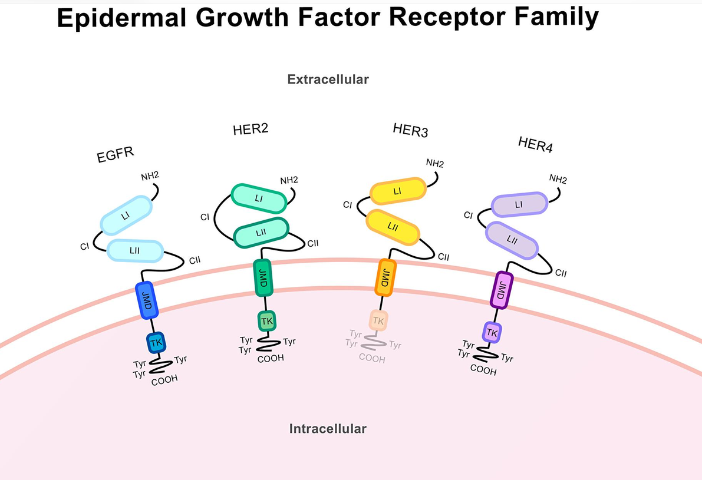

<p align="center"><em>图 1：HER2 靶点与抗体作用</em></p>

| 结构域 | 位置 | 功能 |
|--------|------|------|
| Extracellular Domain | 细胞外 | 参与受体相互作用（抗体主要结合区） |
| Transmembrane Domain | 细胞膜 | 锚定受体 |
| Intracellular Domain | 细胞内 | 酪氨酸激酶相关信号 |

HER2 在正常细胞中参与生长、分化与存活信号。部分肿瘤中 **ERBB2 扩增**或 **HER2 过表达**，使膜面 HER2 增多，增殖与存活信号增强。

> **机制提示**：Trastuzumab 并非直接“杀死 HER2”蛋白，而是通过结合 HER2，干预肿瘤细胞生长信号及肿瘤与免疫系统之间的生物学过程（如 Fc 介导效应等，详见上篇 Fc 章节）。

### 2.2 HER2 阳性是什么意思

HER2 阳性通常指肿瘤组织中 **蛋白表达** 和/或 **基因扩增** 达到判定阈值。

| 方法 | 说明 |
|------|------|
| **IHC** | 免疫组织化学，检测 HER2 蛋白 |
| **ISH** | 原位杂交，检测 ERBB2 基因扩增 |
| **FISH** | 荧光原位杂交（ISH 的一种） |

乳腺癌中：**IHC 3+** 常判为 HER2 阳性；**IHC 2+** 通常需结合 ISH 进一步确认。因此 **HER2** 是药物靶点，**HER2 阳性**是患者分层与用药决策的重要生物标志物。

### 2.3 研发与获批里程碑

| 时间 | 事件 |
|------|------|
| 1980s | HER2 与肿瘤发生发展的关系逐渐明确 |
| 1990s | 抗 HER2 抗体药物研发取得突破 |
| 1998 | 美国 FDA 批准 Trastuzumab 用于 HER2 阳性转移性乳腺癌 |
| 2006 | FDA 批准用于部分 HER2 阳性早期乳腺癌辅助治疗 |
| 2010 | FDA 批准用于部分 HER2 阳性胃癌 |

Trastuzumab 证明了：**抗体精准识别肿瘤细胞表面特定蛋白** 可实现具有临床价值的靶向治疗，并深刻影响了后续 mAb、双抗与 **ADC** 的研发范式。

---

## 3. 抗体形态与人源化

Trastuzumab 是典型的 **Humanized IgG1 Kappa Monoclonal Antibody**：

| 名称 | 含义 |
|------|------|
| Humanized | 人源化抗体 |
| IgG1 | 免疫球蛋白 G 第 1 亚型 |
| Kappa | 轻链为 κ 型 |
| Monoclonal | 单克隆抗体 |

早期治疗性抗体多来自小鼠；直接使用可能诱发 **HAMA**（Human Anti-Mouse Antibody）反应。人源化策略在保留识别能力的同时提高人源序列比例。

**Trastuzumab 设计要点：**

- 保留鼠源抗体中决定抗原识别的重要区域
- 将这些区域移植到人源抗体框架中
- 通过框架残基选择与优化，维持对 HER2 的结合能力

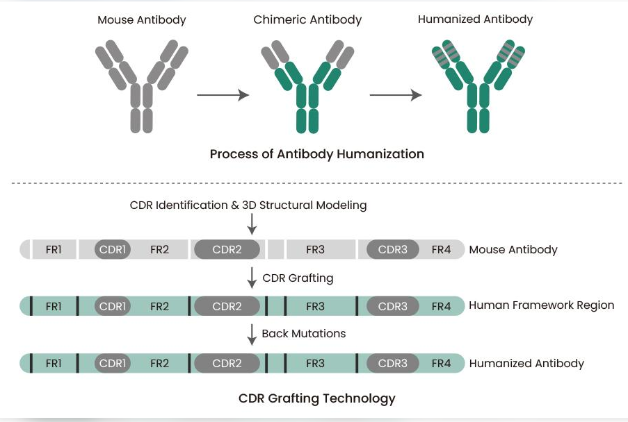

<p align="center"><em>图 2：人源化抗体总体设计思路。</em></p>

| 术语 | 说明 |
|------|------|
| **Framework Region（FR）** | 可变区中相对保守的框架，支撑结构 |
| **Complementarity Determining Region（CDR）** | 可变区中主导抗原识别的环区 |
| **CDR Grafting** | 将亲本 CDR 移植到人源 FR 上的经典人源化策略 |

Trastuzumab 的人源化并非简单粘贴三段 CDR，还包含 **框架残基挑选** 与 **亲和力/稳定性** 等工程化优化。

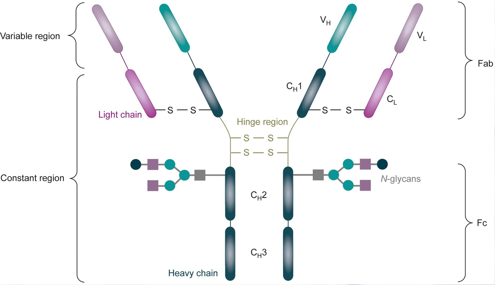

<p align="center"><em>图 3：VH/VL 上 CDR 与 FR 分区及 CDR Grafting 概念</em></p>


### 3.1 Fab 与 Fc

一分子完整的 Trastuzumab 包含两条相同的重链和两条相同的轻链，通过二硫键和非共价相互作用组成 Y 字形结构。

| 组成 | 数量 |
|------|------|
| Heavy Chain | 2 |
| Light Chain | 2 |
| Fab | 2 |
| Fc | 1 |

**Fab**（Fragment antigen-binding）负责识别 HER2，包含 `VH`、`VL`、`CH1`、`CL`。其中 VH 和 VL 共同构成抗原结合界面。

**Fc**（Fragment crystallizable）主要由两条重链的 `CH2`、`CH3` 组成，参与：

- Fcγ 受体结合
- ADCC
- FcRn 结合
- 抗体体内循环与半衰期调节

> **Fab** 决定靶点识别，**Fc** 决定很多免疫效应和药代相关性质。

---

## 4. 如何识别 HER2

### 4.1 结合表位：Domain IV

HER2 胞外区包含四个结构域：Domain I、Domain II、Domain III、Domain IV。

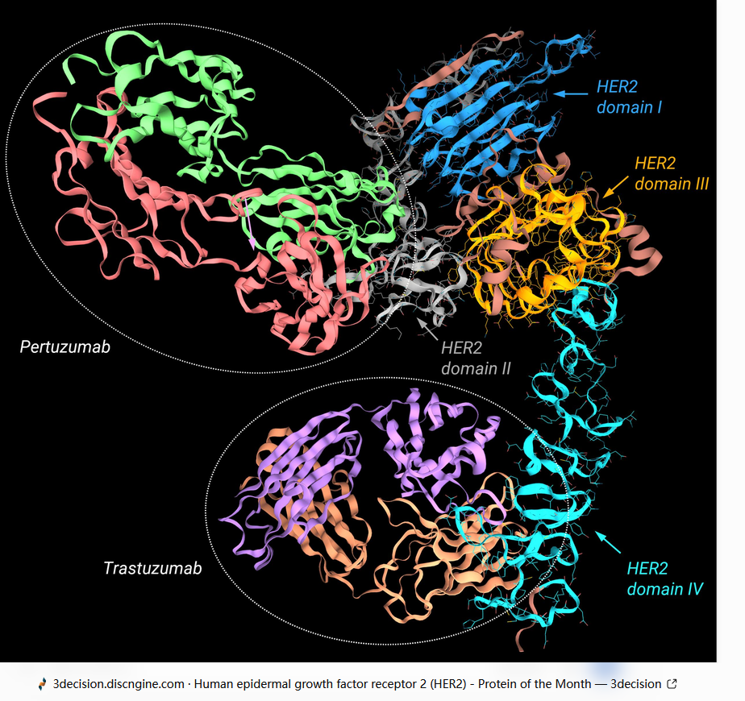

<p align="center"><em>图 4：HER2 胞外区与抗体结合区域</em></p>

Trastuzumab 主要结合 HER2 的 **Domain IV**，该位置靠近细胞膜。另一个常见 HER2 抗体 **Pertuzumab（帕妥珠单抗）** 主要结合 **Domain II**。两者靶点相同，表位不同。

| 对比 | Trastuzumab | Pertuzumab |
|------|-------------|------------|
| 靶点 | HER2 | HER2 |
| 结合区域 | Domain IV | Domain II |
| 主要机制 | HER2 信号调节、ADCC 等 | 干扰受体二聚化 |
| 抗体类型 | Humanized IgG1 | Humanized IgG1 |

因此，两种抗体可以从不同角度干预 HER2 相关信号。

### 4.2 结合的三个层次

**第一层：空间识别。** 抗体的 VH 和 VL 形成结合界面。六个 CDR 环共同参与抗原结合表面，但不同 CDR 的贡献并不相同。

**第二层：分子间相互作用。** 抗体与 HER2 通过多种非共价作用形成复合物：氢键、静电相互作用、疏水相互作用、范德华力。

**第三层：结合亲和力。** 通常用 \(K_D\) 描述：

$$
K_D=\frac{k_{\mathrm{off}}}{k_{\mathrm{on}}}
$$

- \(k_{\mathrm{on}}\)：结合速率常数
- \(k_{\mathrm{off}}\)：解离速率常数
- \(K_D\)：平衡解离常数

一般来说，\(K_D\) 越小，亲和力越高。

| 概念 | 含义 |
|------|------|
| **Affinity** | 单个结合位点的亲和力 |
| **Avidity** | 多个结合位点共同作用形成的整体结合强度 |

Trastuzumab 是二价抗体，具有两个抗原结合臂，因此在细胞表面可以体现多价结合效应。

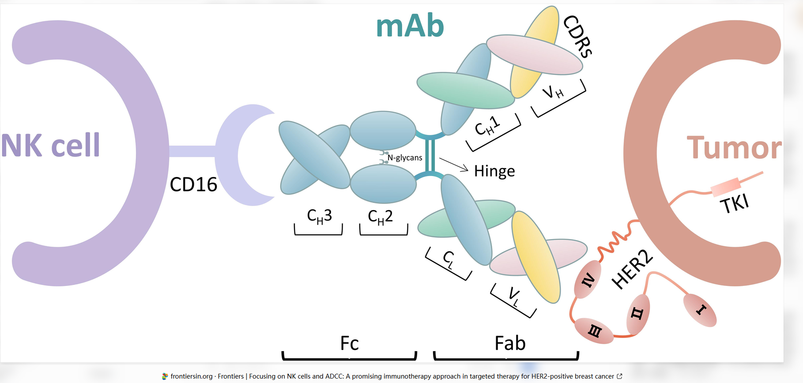

<p align="center"><em>图 5：二价结合与亲和力、亲合力</em></p>

### 4.3 主要作用机制

**机制一：影响 HER2 相关信号。** 结合 HER2 后，可以影响受体相关信号活动，抑制部分 HER2 高表达肿瘤细胞的增殖。

**机制二：ADCC**（Antibody-Dependent Cellular Cytotoxicity，抗体依赖的细胞介导的细胞毒性）。

1. Fab 结合肿瘤细胞表面的 HER2。
2. 抗体 Fc 暴露在细胞外侧。
3. NK 细胞表面的 FcγRIIIa（CD16a）识别抗体 Fc。
4. NK 细胞被激活。
5. NK 细胞释放穿孔素和颗粒酶等细胞毒性物质。
6. 促进肿瘤细胞死亡。

这说明 Fc 不仅是结构支撑，还具有重要的生物学功能。

**机制三：影响 HER2 胞外区域。** Trastuzumab 还可能影响 HER2 胞外结构域的剪切过程，进而影响某些 HER2 相关信号。

> 临床作用不能简单归结为阻断 HER2 二聚化。不同机制的贡献也会受到肿瘤细胞环境影响。FDA 药品说明书记载了其抑制 HER2 过表达肿瘤细胞增殖和介导 ADCC 的作用。

---

## 5. 氨基酸序列与结构域

### 5.1 链长

| 链 | 常见长度 | 说明 |
|----|----------|------|
| Heavy Chain | 449 或 450 aa | 取决于序列形式；C 端 Lys 是否保留是常见差异来源 |
| Light Chain | 214 aa | 成熟轻链 |

常见成熟链组合：

$$
2\times 449 + 2\times 214 = 1326
$$

若采用 450 aa 重链版本，总长度为 **1328 aa**。

### 5.2 重链分区

```text
Heavy Chain
├── VH
│   ├── FR1
│   ├── CDR-H1
│   ├── FR2
│   ├── CDR-H2
│   ├── FR3
│   ├── CDR-H3
│   └── FR4
├── CH1
├── Hinge
├── CH2
└── CH3
```

VH 不是简单地由三个 CDR 构成：

$$
\mathrm{VH} = \mathrm{FR1}+\mathrm{CDR1}+\mathrm{FR2}+\mathrm{CDR2}+\mathrm{FR3}+\mathrm{CDR3}+\mathrm{FR4}
$$

### 5.3 轻链分区

```text
Light Chain
├── VL
│   ├── FR1
│   ├── CDR-L1
│   ├── FR2
│   ├── CDR-L2
│   ├── FR3
│   ├── CDR-L3
│   └── FR4
└── CL
```

轻链可变区 VL 同样由 FR1–FR4 和 CDR-L1–L3 组成。

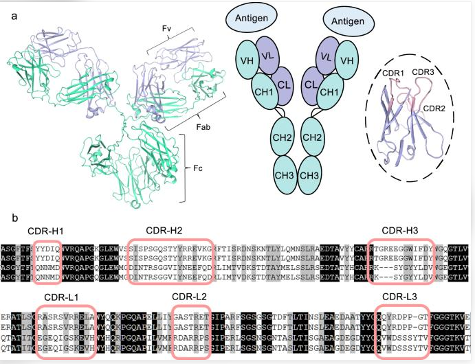

<p align="center"><em>图 6：VH / VL 上 FR 与 CDR 的线性分区。</em></p>

六个 CDR 可以理解为识别 HER2 的关键结构环，但要注意：

1. CDR 的定义不是唯一的。
2. 不同编号体系的 CDR 边界不同。
3. 线性序列相同，并不意味着一定具有完全相同的三维构象。

| 编号体系 | 特点 |
|----------|------|
| IMGT | 统一的免疫球蛋白编号体系 |
| Kabat | 经典抗体序列编号体系 |
| Chothia | 更强调结构和环区构象 |
| AHo | 结构导向的统一编号体系 |


---

## 6. 二硫键

### 6.1 Cysteine 与二硫键

Cysteine（半胱氨酸）是含硫氨基酸，单字母为 **C**。两个半胱氨酸的巯基氧化后形成二硫键：

$$
\mathrm{Cys\text{-}SH + HS\text{-}Cys \rightarrow Cys\text{-}S\text{-}S\text{-}Cys}
$$

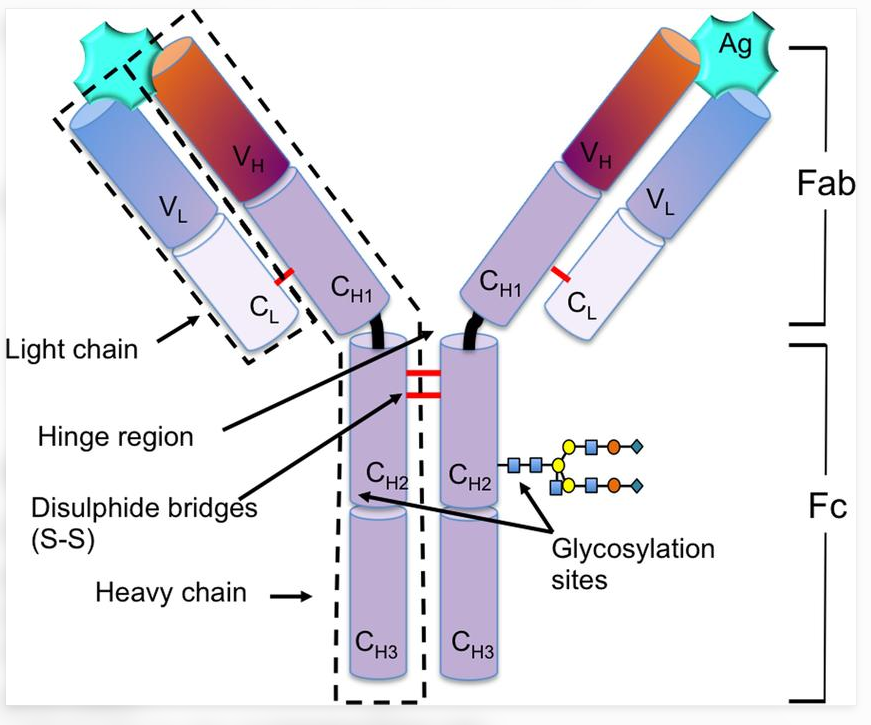

<p align="center"><em>图 7：巯基氧化形成二硫键。</em></p>

| 类型 | 英文 | 作用 |
|------|------|------|
| 链内二硫键 | Intrachain | 稳定免疫球蛋白结构域 |
| 链间二硫键 | Interchain | 连接不同多肽链 |

典型 IgG1 中：

- VH、VL、CH1、CL、CH2、CH3 等结构域各自具有链内二硫键。
- 重链之间存在铰链区二硫键。
- 重链与轻链之间存在链间二硫键。

对典型 IgG1 而言，通常可以观察到 **12 对链内**和 **4 对链间**二硫键。实际质量分析中，还要考虑错误配对、游离巯基以及工艺相关的二硫键异构体。

### 6.2 配对推断步骤

序列层面的 Cysteine Pairing 可以按下面步骤设计：

| 步骤 | 任务 |
|------|------|
| 1 | 找到所有 Cysteine |
| 2 | 根据序列注释定位结构域 |
| 3 | 建立典型 IgG1 配对规则 |
| 4 | 推断链内配对 |
| 5 | 推断链间配对 |
| 6 | 检测游离 Cysteine |
| 7 | 输出配对置信度 |

序列能够提供配对约束，但不能单独证明真实的二硫键连接关系。药物表征级别还需要结合：

- Non-reduced Peptide Mapping
- Reduced Peptide Mapping
- LC-MS/MS
- Free Thiol Assay

---

## 7. 糖基化

### 7.1 为什么会发生糖基化

Trastuzumab 是在哺乳动物细胞中表达的重组蛋白。合成、折叠和加工过程中会发生翻译后修饰（Post-Translational Modifications，PTMs）。其中，Fc 区的 **N-糖基化**是 IgG1 的重要结构特征，也是关键质量属性。

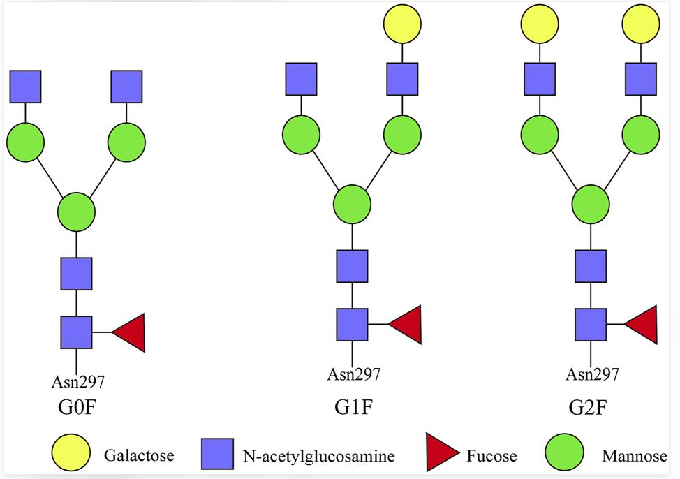

<p align="center"><em>图 8：IgG1 Fc N-糖基化位置。</em></p>

### 7.2 糖基化位点

重链具有经典的 Fc N-糖基化位点：**Asn300（序列编号）**，附近基序为：

```text
...QYNSTY...
     NST
```

**N-X-S/T** 是典型的 N-糖基化识别基序，其中 X 不能是 Proline。基序只表示潜在位点，不能单独证明实际发生了糖基化。

FDA 对相关 Trastuzumab 产品的质量审评资料记录了 Asn300 的高占有率。按常用 IgG **EU 编号**，该保守位点称为 **Asn297**。两种编号不能直接混用。

### 7.3 常见糖型

| 糖型 | 含义 |
|------|------|
| G0F | 无末端半乳糖、带核心岩藻糖 |
| G1F | 一个末端半乳糖、带核心岩藻糖 |
| G2F | 两个末端半乳糖、带核心岩藻糖 |

- G0 / G1 / G2 表示末端半乳糖数量。
- F 表示核心岩藻糖（Core Fucose）。

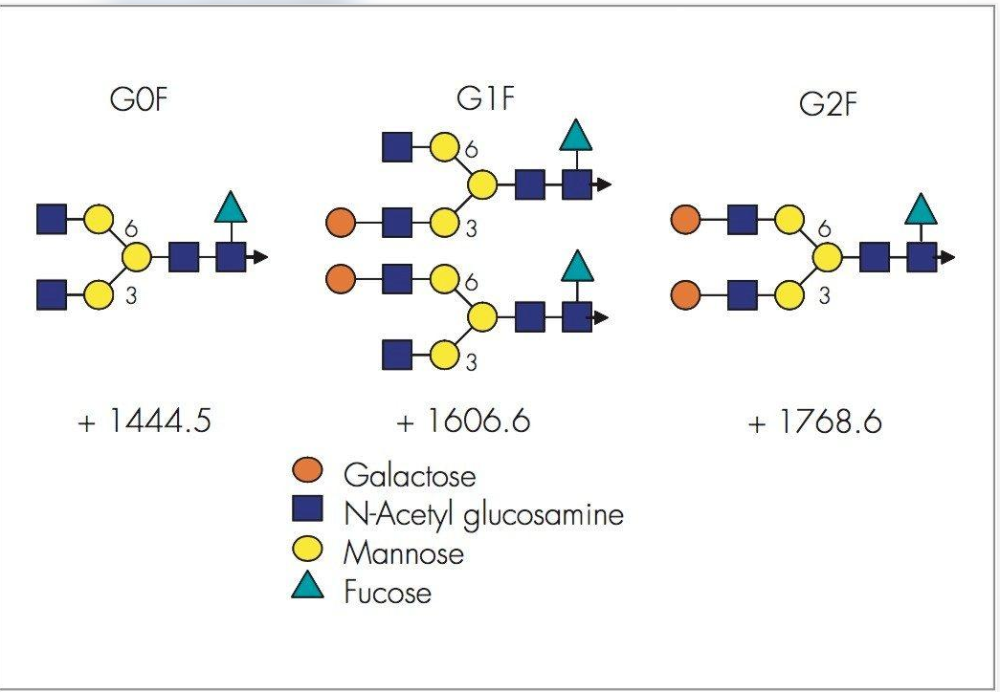

<p align="center"><em>图 9：常见 Fc N-糖型。</em></p>

Fc 糖链会影响 Fc 与 Fcγ 受体的相互作用，从而影响 ADCC 等免疫效应。例如，核心岩藻糖的变化可能显著影响 FcγRIIIa 结合和 ADCC 活性。糖基化不只是结构注释问题，它会影响药物的功能和质量。

---

## 8. 生产工艺（CMC）

从抗体结构转向生物药生产时，**CMC**（Chemistry, Manufacturing and Controls）

### 8.1 为什么使用 CHO 细胞

Trastuzumab 是重组人源化 IgG1，采用 **CHO**（Chinese Hamster Ovary，中国仓鼠卵巢）细胞表达。

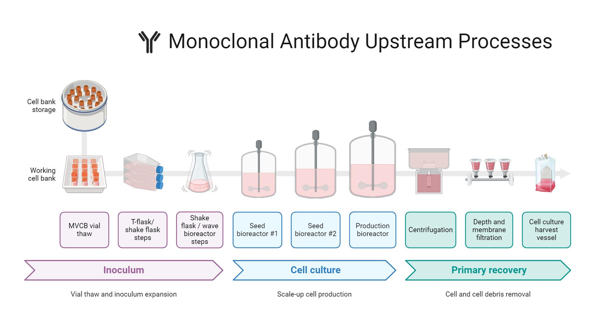

<p align="center"><em>图 10：CHO 表达与 CMC</em></p>

抗体是复杂的真核蛋白，需要正确折叠、二硫键形成、糖基化、分泌加工和高级结构组装。大肠杆菌难以同时满足这些要求；CHO 具备较成熟的哺乳动物细胞表达和工业化生产体系。

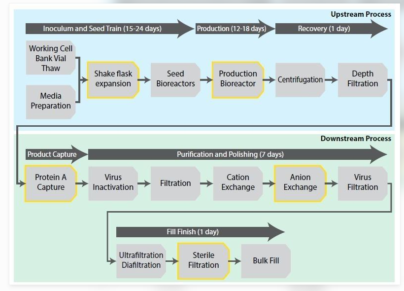

<p align="center"><em>图 11：CHO 与大肠杆菌表达体系对比。</em></p>

### 8.2 上游工艺

上游负责生产抗体。

| 步骤 | 工艺 | 目的 |
|------|------|------|
| 1 | Cell Bank | 建立细胞库 |
| 2 | Seed Train | 细胞扩增 |
| 3 | Bioreactor | 大规模细胞培养 |
| 4 | Harvest | 收获培养液 |
| 5 | Clarification | 去除细胞和细胞碎片 |

关键工艺参数包括：Temperature、pH、DO、RPM、Aeration、Glucose、Lactate、Osmolality、VCD、Viability。它们会影响细胞生长、抗体表达和产品质量。例如，DO（溶解氧）影响细胞代谢和生长；温度可能影响生长速率和抗体生产；培养液中的代谢产物也可能影响蛋白质修饰和质量。


### 8.3 下游工艺

下游负责从培养液中分离和纯化抗体。

| 步骤 | 技术 | 目的 |
|------|------|------|
| 1 | Protein A Chromatography | 捕获 IgG |
| 2 | Low pH Viral Inactivation | 病毒灭活 |
| 3 | Cation Exchange | 去除杂质、分离部分变体 |
| 4 | Anion Exchange | 去除部分杂质 |
| 5 | Virus Filtration | 病毒过滤 |
| 6 | UF/DF | 超滤和换液 |
| 7 | Formulation | 制剂配制 |
| 8 | Sterile Filtration | 无菌过滤 |

这是典型单抗工艺，不代表所有 Trastuzumab 商业生产线的具体顺序和参数。

### 8.4 从工艺参数到产品质量

$$
\mathrm{CPP} \rightarrow \mathrm{CQA}
$$

- **CPP**（Critical Process Parameter）：关键工艺参数
- **CQA**（Critical Quality Attribute）：关键质量属性

| 工艺参数 CPP | 可能影响的质量属性 CQA |
|--------------|------------------------|
| pH | 电荷异质性、聚集、糖型 |
| Temperature | 糖基化、聚集、产量 |
| DO | 细胞代谢、氧化相关变化 |
| Glucose | 代谢状态、糖基化相关特征 |
| Culture Duration | 糖型、修饰、杂质 |
| Harvest Time | 产品质量、细胞来源杂质 |

这些关系并不是一对一的，具体影响需要结合工艺数据和分析实验确认。

---

## 9. 质量分析

**CQA** 是可能影响药物安全性、有效性、纯度和稳定性的关键产品属性。Trastuzumab 的分析体系可以按下面几类建立：

| 类别 | 关注内容 |
|------|----------|
| Primary Structure | 氨基酸序列、序列完整性、末端变体 |
| Higher Order Structure | 二级、三级、四级结构 |
| Post-Translational Modification | 糖基化、氧化、脱酰胺 |
| Purity & Impurities | 聚集体、片段、工艺杂质 |
| Charge Variants | 酸性峰、主峰、碱性峰 |
| Biological Activity | HER2 结合、ADCC、效力 |

| 分析对象 | 常用技术 | 分析目的 |
|----------|----------|----------|
| 氨基酸序列 | LC-MS/MS | 序列覆盖与确认 |
| 完整分子量 | Intact Mass LC-MS | 分子量与质量异质性 |
| 二硫键 | Non-reduced Peptide Mapping | 二硫键配对 |
| 糖基化 | HILIC / LC-MS | 糖型和糖基化占有率 |
| 聚集体 | SEC-HPLC | 单体、二聚体和高分子量物质 |
| 电荷异质性 | CEX-HPLC / icIEF | 酸性峰和碱性峰 |
| 高级结构 | CD / FTIR / HDX-MS | 构象与结构特征 |
| HER2 结合 | SPR / BLI | 抗原结合能力 |
| ADCC | Cell-based Assay | 免疫效应功能 |

三个层次不能互相替代：

| 层次 | 要回答的问题 |
|------|----------------|
| Sequence Analysis | 氨基酸序列是什么？结构域在哪里？有哪些潜在风险位点？ |
| Structural Characterization | 实际折叠成什么结构？二硫键怎么连接？糖链是什么？ |
| Functional Characterization | 能否正确结合 HER2？能否发挥预期生物学功能？ |

---

## 10. 稳定性与分子变体

即使氨基酸序列相同，生产、储存和运输条件也可能产生不同分子变体，即 **Molecular Heterogeneity（分子异质性）**。

### 10.1 氧化（Oxidation）

常见的是 Methionine（M）氧化：\(M \rightarrow M(O)\)。可能影响局部结构、抗原结合（取决于位置）、Fc 相关功能和稳定性。靠近功能区域的氧化需要重点评估。

### 10.2 脱酰胺（Deamidation）

Asparagine（N）可能发生脱酰胺：\(\mathrm{Asn} \rightarrow \mathrm{Asp/isoAsp}\)。可能引起分子量、局部电荷、结构和结合活性变化。CDR 中的 Asn 值得重点关注，因为它可能影响抗原结合界面。

### 10.3 聚集（Aggregation）

抗体可能形成 Dimer、Oligomer 或 High Molecular Weight Species，影响稳定性、活性和免疫原性风险。通常用 **SEC-HPLC** 监测。

### 10.4 电荷异质性（Charge Heterogeneity）

| 变体 | 可能原因 |
|------|----------|
| Acidic | Deamidation、糖基化相关变化等 |
| Main | 主体分子形式 |
| Basic | C-terminal Lys、部分修饰等 |

酸性峰、碱性峰是分析上的分类，不代表每一种变体都有相同的生物学影响。

---

## 11. 临床安全性（说明书要点）

根据 FDA 的 HERCEPTIN 说明书，主要关注：

| 风险 | 说明 |
|------|------|
| Cardiomyopathy | 心肌病、左心室射血分数下降 |
| Infusion Reactions | 输注相关反应 |
| Pulmonary Toxicity | 肺毒性 |
| Embryo-Fetal Toxicity | 胚胎-胎儿毒性 |

心脏毒性是临床应用中特别重要的风险，尤其需要关注与蒽环类化疗药物联合使用时的心脏风险。说明书要求在治疗前和治疗期间评估心脏功能。具体用药和监测必须由肿瘤科医生根据患者情况决定。

---

## 12. 与其他 HER2 抗体药物的区别

| 药物 | 要点 |
|------|------|
| **Trastuzumab** | 经典人源化 IgG1，直接靶向 HER2 Domain IV，具有 ADCC 效应 |
| **Pertuzumab** | 靶向 HER2 Domain II，主要干预 HER2 二聚化，可与 Trastuzumab 联合使用 |
| **Ado-trastuzumab emtansine（T-DM1）** | 以 Trastuzumab 为抗体载体，连接细胞毒性载荷 DM1，属于 ADC |
| **Trastuzumab deruxtecan（T-DXd）** | 以 Trastuzumab 为抗体骨架，连接拓扑异构酶 I 抑制剂 DXd，具有旁观者效应 |

相同的抗体骨架，可以通过不同的工程化设计，形成作用机制不同的药物。

---

## 13. 生物类似药

Herceptin 获批后出现了多款 Trastuzumab **Biosimilars**，例如 Kanjinti、Ogivri、Ontruzant、Hercessi。

这些产品不能简单理解为复制一条 FASTA。生物药不是化学小分子：即使氨基酸序列一致，仍可能在糖基化分布、氧化、脱酰胺、电荷异质性、聚集体、二硫键相关变体和生物学活性上存在差异。生物类似药开发需要建立全面的 **Analytical Similarity（分析相似性）** 评价。

---

## 14. 参考序列与练习

### 14.1 从完整分子到四条链

先分别注释重链与轻链，再按 **2:2** 化学计量组装为 IgG1。

$$
\mathrm{IgG1} = 2\,\mathrm{HC} + 2\,\mathrm{LC}
$$

此处 HC / LC 指整条多肽，不是单个结构域；结构域边界由 Sequence Annotation 给出。

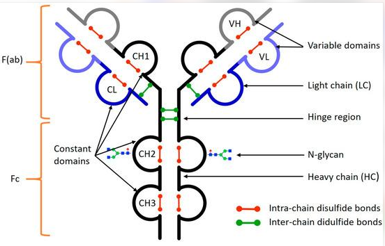

<p align="center"><em>图 12：IgG1κ 四链示意；两条 HC、两条 LC 序列各自相同。</em></p>

| 链 ID | 类型 | 拷贝数 | 主要组成 |
|-------|------|--------|----------|
| HC1 | Heavy Chain | 1 | VH + CH1 + Hinge + CH2 + CH3 |
| HC2 | Heavy Chain | 1 | 同 HC1 |
| LC1 | Light Chain | 1 | VL + CL |
| LC2 | Light Chain | 1 | 同 LC1 |

### 14.2 重链 · IgG1 heavy chain

- **FASTA ID**：`trastuzumab_HC`
- **说明**：VH + IgG1 恒定区（含铰链与 Fc）
- **公开来源**：专利 **SEQ ID NO: 25**（与多项文献 Table B 中完整 HC 一致）

```fasta
>trastuzumab_HC|IgG1|heavy_chain
EVQLVESGGGLVQPGGSLRLSCAASGFNIKDTYIHWVRQAPGKGLEWVARIYPTNGYTRYADSVKGRFTISADTSKNTAYLQMNSLRAEDTAVYYCSRWGGDGFYAMDYWGQGTLVTVSSASTKGPSVFPLAPSSKSTSGGTAALGCLVKDYFPEPVTVSWNSGALTSGVHTFPAVLQSSGLYSLSSVVTVPSSSLGTQTYICNVNHKPSNTKVDKKVEPPKSCDKTHTCPPCPAPELLGGPSVFLFPPKPKDTLMISRTPEVTCVVVDVSHEDPEVKFNWYVDGVEVHNAKTKPREEQYNSTYRVVSVLTVLHQDWLNGKEYKCKVSNKALPAPIEKTISKAKGQPREPQVYTLPPSRDELTKNQVSLTCLVKGFYPSDIAVEWESNGQPENNYKTTPPVLDSDGSFFLYSKLTVDKSRWQQGNVFSCSVMHEALHNHYTQKSLSLSPGK
```

### 14.3 轻链 · Kappa light chain

- **FASTA ID**：`trastuzumab_LC`
- **说明**：VL + Kappa 恒定区

```fasta
>trastuzumab_LC|Kappa|light_chain
DIQMTQSPSSLSASVGDRVTITCRASQDVNTAVAWYQQKPGKAPKLLIYSASFLYSGVPSRFSGSRSGTDFTLTISSLQPEDFATYYCQQHYTTPPTFGQGTKVEIKRTVAAPSVFIFPPSDEQLKSGTASVVCLLNNFYPREAKVQWKVDNALQSGNSQESVTEQDSKDSTYSLSSTLTLSKADYEKHKVYACEVTHQGLSSPVTKSFNRGEC
```

### 14.4 作为算法平台的测试案例

以 Trastuzumab 为 Reference Molecule，可以把平台拆成四层：

| 层 | 内容 |
|----|------|
| Layer 1 · Sequence Intelligence | FASTA、链识别、VH/VL、FR/CDR、IMGT/Kabat |
| Layer 2 · Structural Intelligence | 二硫键映射、结构域注释、糖基化、三维结构 |
| Layer 3 · Molecular Characterization | 氧化、脱酰胺、聚集、电荷变体、序列 QC |
| Layer 4 · Functional Characterization | HER2 结合、亲和力、ADCC、生物学效力 |

| 算法模块 | Trastuzumab 测试目标 |
|----------|----------------------|
| FASTA Parser | 正确读取 HC / LC |
| Chain Classification | 正确区分重链和轻链 |
| Domain Annotation | 定位 VH、VL、CH1、CH2、CH3、CL |
| CDR Annotation | 识别六个 CDR |
| Numbering | 支持 IMGT、Kabat、Chothia |
| Cysteine Analysis | 识别 Cysteine 并预测配对 |
| Glycosylation | 识别 Fc N-糖基化位点 |
| Sequence QC | 检查异常序列和保守位点 |
| PTM Analysis | 识别潜在氧化、脱酰胺热点 |
| Structural Analysis | 结合 PDB 结构进行验证 |

从基因到药物的路径：

1. **Gene / DNA**：编码重链和轻链的基因序列。
2. **Protein Sequence**：翻译成 Heavy Chain 和 Light Chain。
3. **Antibody Folding**：形成 VH、VL、CH、CL 等结构域和二硫键。
4. **Post-Translational Modification**：发生糖基化等翻译后修饰。
5. **Biological Function**：结合 HER2，发挥相应生物学功能。
6. **Manufacturing**：通过 CHO 细胞培养、纯化和制剂生产。
7. **Analytical Characterization**：通过 LC-MS、HPLC、SPR 等技术表征。
8. **Quality & Regulatory**：建立 CQA、工艺控制和质量放行体系。

序列分析练习：

1. **Sequence Annotation**：切分 VH/VL/CDR/FR、恒定区与铰链
2. **Sequence Alignment**：恒定区对 Germline 做 diff，映射 **EU 位点**
3. **Disulfide Inference**：链内/链间半胱氨酸是否符合经典 IgG1 规则
4. **Molecular Topology**：输入 2×HC + 2×LC，确认 **H–L × 2**、化学计量 **2:2**


### 14.5 序列来源（核对用）

| 内容 | 常见出处 |
|------|----------|
| 完整重链氨基酸序列 | 专利 **SEQ ID NO: 25** |
| VH、VL、全长 HC/LC 分表 | 同族专利 / 说明书 **Table B** |
| 交叉引用 | 检索 `Trastuzumab` + `SEQ ID NO: 25` |

> 注册申报与 GMP 批次请以法定文件与内部质控序列为准；本文用于学习与流水线联调的公开参照。临床用药与监测以现行说明书和主治医生判断为准。

---

## 15. 从单一案例到抗体学习矩阵

第 14 节把 Trastuzumab 当作 Reference Molecule，用来打通序列、结构、质量和功能四层。它适合作为第一份标准样本，覆盖不了抗体分析的全部输入。

一组对照样本要同时拉开五件事：结构、抗体来源、IgG 亚型、分子形式、修饰特征。目标是让分析系统碰到陌生输入时，仍能选对模块，而不是把所有序列都当成 IgG1κ。

Trastuzumab 留下的空档：

| 空档 | 单靠 Trastuzumab 验不到什么 |
|------|------------------------------|
| 亚型 | IgG2、IgG4，以及非标准恒定区 |
| 分子形式 | Fab、scFv、VHH，以及没有 Fc 的构建体 |
| 可变区 | 极端 CDR 长度、插入和缺失 |
| 工程与偶联 | Fc 工程化、ADC、异常二硫键 |

商品名、靶点和分子形式用于建立测试标签；氨基酸序列以 IMGT、Thera-SAbDab 或官方序列记录为准，不要从本文手工抄一条 FASTA 当作金标准。

---

## 16. 十二款经典抗体

### 16.1 第一梯队：来源与常规 IgG1

这一组用来固定最常用的注释路径：链识别、VH/VL、FR/CDR、二硫键和 Fc。差别主要在抗体来源，以及糖基化落在 Fc 还是 Fab。

| 抗体 | 商品名 | 靶点 | 分子形式 | 相对 Trastuzumab 的增量 |
|------|--------|------|----------|--------------------------|
| **Rituximab**（利妥昔单抗） | Rituxan / MabThera | CD20 | 嵌合 IgG1κ | 鼠源可变区接人源恒定区，用来对照人源化与嵌合 |
| **Adalimumab**（阿达木单抗） | Humira | TNF-α | 全人源 IgG1κ | 验证全人源序列、CDR、潜在 PTM 与电荷异质性 |
| **Bevacizumab**（贝伐珠单抗） | Avastin | VEGF-A | 人源化 IgG1 | 同一亚型、不同靶点，检查注释是否过拟合 HER2 |
| **Cetuximab**（西妥昔单抗） | Erbitux | EGFR | 嵌合 IgG1 | Fab N-糖基化，不能只在 Fc 找 N-X-S/T |

Cetuximab 是这一梯队里最值得单独做的样本。它提醒糖基化模块：基序可以出现在可变区，占有率和糖型仍要以实验数据为准。

### 16.2 第二梯队：亚型与恒定区

这一组把恒定区从默认 IgG1里拆出来。铰链、链间二硫键和亚型标签都要跟实际序列走。

| 抗体 | 商品名 | 靶点 | 分子形式 | 要验证的差异 |
|------|--------|------|----------|----------------|
| **Nivolumab**（纳武利尤单抗） | Opdivo | PD-1 | 人源 IgG4 | IgG4 铰链与链间二硫键；治疗用 IgG4 常做铰链稳定化，不能默认野生型铰链或 Fab-arm exchange |
| **Pembrolizumab**（帕博利珠单抗） | Keytruda | PD-1 | 人源化 IgG4 | 同一靶点、另一条序列，分开比较 CDR 与 Fc 亚型 |
| **Eculizumab**（依库珠单抗） | Soliris | C5 | 人源化 IgG2/4 杂合 | 恒定区不是单一标准亚型，分类器不能强行收成 IgG1 |
| **Daratumumab**（达雷妥尤单抗） | Darzalex | CD38 | 人源 IgG1κ | 序列注释之后，继续看 Fc 功能、糖型和受体相互作用 |

Eculizumab 用来打破看到抗体就套 IgG1 模板。亚型结论应来自整条恒定区序列和构建体信息。

### 16.3 第三梯队：片段、单域、双特异与 ADC

这一组检查系统是否真能处理非完整 IgG。错在这里通常不是编号偏一位，而是把不存在的结构域补出来。

| 抗体 | 商品名 | 靶点 | 分子形式 | 失败时的典型错误 |
|------|--------|------|----------|------------------|
| **Certolizumab pegol**（赛妥珠单抗） | Cimzia | TNF-α | PEG 化 Fab′ | 给没有 Fc 的片段补上 CH2、CH3 |
| **Caplacizumab**（卡普赛珠单抗） | Cablivi | 血管性血友病因子 | 二价纳米抗体（VHH） | 当成 VH+VL，或当成只有一个结构域 |
| **Blinatumomab**（贝林妥欧单抗） | Blincyto | CD19 × CD3 | BiTE：两个 scFv 经连接肽串联 | 认不出 Linker，或把串联构建体收成 IgG |
| **Trastuzumab deruxtecan**（德曲妥珠单抗） | Enhertu | HER2 | ADC | 只用抗体 FASTA 去报偶联位点和 DAR |

几个边界要写进测试说明：

- Certolizumab pegol 是 PEG 化的 Fab′，没有完整 Fc。铰链可能只剩片段，PEG 是化学修饰，不在氨基酸序列里。
- Caplacizumab 不是传统双链抗体，也不是单体 VHH。它是两个 VHH 连在一起的纳米抗体，编号和结构域排列都要按 VHH 处理。
- Blinatumomab 没有 Fc。要识别的是 scFv、连接肽，以及一条链上的两个抗原结合单元。
- T-DXd 的抗体骨架可以回到 Trastuzumab；连接子、载荷、偶联位点和 DAR 需要 ADC 结构与实验数据。同骨架的 T-DM1 已在第 12 节作为另一种载荷对照。

---

## 17. 八个算法模块与覆盖矩阵

第 14.4 节的四层平台，在样本矩阵里收成八个可回归的模块。

| 模块 | 功能 |
|------|------|
| A. Sequence Analysis | FASTA、序列解析、链识别、长度、分子量 |
| B. Domain Annotation | VH、VL、CH、CL、FR、CDR |
| C. Numbering | IMGT、Kabat、Chothia、AHo |
| D. Structural Analysis | 二硫键、结构域、三维结构、CDR 构象 |
| E. PTM Analysis | 糖基化、氧化、脱酰胺、异构化 |
| F. Sequence QC | 保守位点、异常 Cys、潜在风险、序列完整性 |
| G. Antibody Classification | IgG 亚型、κ/λ、Fab、scFv、VHH、双抗 |
| H. Advanced Characterization | ADC、DAR、抗原结合、亲和力、Fc 功能 |

● 适合作为该模块的主要测试样本。◐ 只能覆盖一部分。— 不作为该模块的测试目标。● 只说明这款抗体适合拿来验这个模块，不说明它覆盖了该模块的全部边界。

| 抗体 | A | B | C | D | E | F | G | H |
|------|---|---|---|---|---|---|---|---|
| Trastuzumab | ● | ● | ● | ● | ● | ● | ● | ◐ |
| Rituximab | ● | ● | ● | ● | ◐ | ● | ● | ◐ |
| Adalimumab | ● | ● | ● | ● | ● | ● | ● | ◐ |
| Bevacizumab | ● | ● | ● | ● | ● | ● | ● | ◐ |
| Cetuximab | ● | ● | ● | ● | ● | ● | ● | ● |
| Nivolumab | ● | ● | ● | ● | ● | ● | ● | ◐ |
| Pembrolizumab | ● | ● | ● | ● | ● | ● | ● | ◐ |
| Eculizumab | ● | ● | ● | ● | ● | ● | ● | ◐ |
| Daratumumab | ● | ● | ● | ● | ● | ● | ● | ● |
| Certolizumab pegol | ● | ◐ | ● | ◐ | ● | ● | ● | ● |
| Caplacizumab | ● | ◐ | ◐ | ◐ | ◐ | ● | ● | ● |
| Blinatumomab | ● | ◐ | ◐ | ◐ | — | ● | ● | ● |
| Trastuzumab deruxtecan | ● | ● | ● | ● | ● | ● | ● | ● |

片段和单域抗体在 B/C/D 上标成 ◐，是因为 VH/VL/FR/CDR 这套完整 IgG 词汇不能原样套上去。VHH 没有 VL；scFv 的结构域中间还有 Linker；Fab′ 没有 CH2/CH3。这些位置应测“正确拒绝”和“正确改用另一套标签”，而不是测一套 IgG1 注释是否跑完。

---

## 18. 补充样本与边界案例

### 18.1 五类补充样本

十二款经典抗体仍把常见输入留在 IgG1 和 κ 附近。下面五类用来补亚型、嵌合对照、检查点抗体的 Fc 设计，以及轻链类型。

| 样本 | 适合补上的测试 | 使用前要核对的点 |
|------|----------------|------------------|
| **Panitumumab** | IgG2 恒定区、IgG2 链间二硫键、亚型分类 | 商品名 Vectibix，靶点 EGFR |
| **Infliximab** | 另一条嵌合 IgG1，对照 Rituximab 的可变区/恒定区组合 | 商品名 Remicade，靶点 TNF-α |
| **Ipilimumab** | CTLA-4 抗体的 Fc 功能与免疫检查点对照 | 不要和 PD-1/PD-L1 抗体合成一个“检查点”类别 |
| **Atezolizumab** | Fc 工程化、效应功能被减弱后的恒定区识别 | 靶点 PD-L1；突变以序列为准，不要凭药名推断位点 |
| **Belimumab** | 轻链类型和序列多样性的候选 | 纳入 κ/λ 测试前，用官方序列记录确认轻链 |

Panitumumab 和 Atezolizumab 优先补进回归集：一个把亚型从 IgG1 拉开，一个把恒定区工程化从野生型 Fc拉开。

### 18.2 边界案例比再增加商品名更重要

商业抗体再多，也大多是长度正常、二硫键完整的治疗分子。编号和分类真正容易出错的是下面这些输入。单独建一个 Edge Case Benchmark。

| 场景 | 要验证的行为 | 推荐对象 |
|------|----------------|----------|
| 超长 HCDR3 | CDR 边界和插入编号 | 长 HCDR3 抗体 |
| 短 HCDR3 | 最短环还能不能定位 | 短 HCDR3 抗体 |
| CDR 插入或缺失 | IMGT 与 Kabat 对同一插入的不同处理 | 不同长度的天然抗体 |
| 非典型半胱氨酸 | 游离 Cys、异常配对，而不是强行配完 | 工程化抗体 |
| IgG2 | 链间二硫键规则切换 | Panitumumab |
| IgG4 | 铰链特征与稳定化突变 | Nivolumab |
| λ 轻链 | 轻链分类和 CL 识别 | 序列已核实的 λ 型抗体 |
| Fab / Fab′ | 不补 CH2、CH3、Fc | Certolizumab pegol |
| VHH | 单域分类，不配一条 VL | Caplacizumab |
| scFv | VH–Linker–VL 或反向排列 | Blinatumomab |
| ADC | 偶联位点与 DAR 不从 FASTA 臆造 | Trastuzumab deruxtecan |
| Fc 工程化 | 恒定区突变被标出来 | Atezolizumab |

编号模块至少要回答五件事：CDR 变长后边界还在不在；出现插入残基时编号是否中断；缺少保守残基时会不会报异常；输入 Fab 或 VHH 时会不会标成完整 IgG；输入 scFv 时能不能把连接肽从可变区里分开。

---

## 19. 三层 Benchmark 与数据来源

三层分开统计，失败才知道是基础注释坏了，还是边界样本本来就没有金标准。

| 层级 | 目的 | 规模 | 样本 |
|------|------|------|------|
| Level 1 · Golden Reference | 基础解析必须正确 | 5–6 | Trastuzumab、Rituximab、Adalimumab、Bevacizumab、Nivolumab、Cetuximab |
| Level 2 · Structural Diversity | 亚型和分子形式 | 6–8 | Panitumumab、Eculizumab、Certolizumab pegol、Caplacizumab、Blinatumomab、Atezolizumab |
| Level 3 · Edge Cases | 鲁棒性、异常检测、失败处理 | 20–50 条以上 | 超长 CDR3、异常 Cys、框架插入或缺失、非典型糖基化基序、不同 Linker |

Level 3 可以用带标注的合成序列做单元测试。合成序列的分数必须和天然抗体、实验结构分开报，不能混进 Level 1 的准确率。

序列不要靠笔记手工收集。参考集直接从下面的库建，并记下 accession 或结构编号。

| 来源 | 优先拿它做什么 |
|------|----------------|
| **IMGT** | 序列、编号、结构域、CDR、基因和等位基因 |
| **SAbDab** | 实验结构、重轻链配对、抗体–抗原复合物、结构编号 |
| **RCSB PDB** | 三维坐标和复合物实验文件 |
| **Thera-SAbDab** | 治疗性抗体的序列、开发状态和结构注释 |
| **NCBI Protein** | FASTA 与 accession |

SAbDab 适合做结构侧验证集：有实验结构、链配对和编号，并且持续更新。IMGT、ANARCI、SAbDab 都是参照，不是绝对真值。不同编号体系对 CDR 边界的定义本来就不同，评测时要写明对齐的是哪一套。

---

## 20. 评价指标与学习顺序

### 20.1 按残基和实验数据评分

肉眼看标出了 CDR不够。区域名相同，边界仍可能差几个残基。

| 模块 | 指标 |
|------|------|
| 链分类 | Accuracy、Precision、Recall、F1 |
| 结构域注释 | 残基级 Precision、Recall、F1 |
| CDR 识别 | 边界准确率、F1 |
| 编号 | 位点准确率、插入处理准确率 |
| 半胱氨酸配对 | Pair Precision、Pair Recall、F1 |
| 糖基化预测 | TPR、FPR、Precision、Recall |
| PTM 热点 | AUROC、AUPRC、F1 |
| 序列 QC | TPR、FPR、假阴性率 |
| 结构预测 | RMSD、TM-score、lDDT |

两条评分规则：

1. CDR 和结构域按残基位置比对，不按区域名称是否出现比对。
2. PTM 和糖基化的 Ground Truth 用实验数据。序列基序只说明潜在位点，不能当成已经发生的修饰。

### 20.2 学习顺序

按依赖关系推进，而不是把十七个药名一次读完。

| 阶段 | 样本顺序 | 这一阶段要站住的能力 |
|------|----------|----------------------|
| Phase 1 · 经典 IgG1 | Trastuzumab → Rituximab → Adalimumab | FASTA、VH/VL、FR/CDR、二硫键、糖基化、QC |
| Phase 2 · 序列与亚型 | Bevacizumab → Cetuximab → Nivolumab → Panitumumab | 不同 CDR、Fab 糖基化、IgG2/IgG4 |
| Phase 3 · 非 IgG 形式 | Certolizumab pegol → Caplacizumab → Blinatumomab | Fab′、VHH、scFv、Linker |
| Phase 4 · 工程化与 ADC | Atezolizumab → Trastuzumab deruxtecan | Fc 突变、偶联、DAR |
| Phase 5 · Benchmark | 20–50 条以上有可靠标注的特殊序列 | 回归测试、分模块准确率、报告 |

### 20.3 平台要长成的三层

第 14.4 节的四层测试，对外可以收成一个 Antibody Intelligence and Characterization Platform：

| 产品层 | 包含的能力 | 对应前文 |
|--------|------------|----------|
| Sequence Intelligence | 解析、编号、CDR、FR、二硫键、QC | Layer 1，以及 Layer 3 中的序列 QC |
| Structural Intelligence | 三维结构、糖基化、结构域、抗原结合界面 | Layer 2 |
| Molecular Characterization | PTM、分子异质性、ADC、质量属性 | Layer 3 与 Layer 4 中需要实验数据的部分 |

Trastuzumab 负责把第一条路径跑通。这一节的矩阵负责证明：路径换一种亚型、一种片段或一种偶联之后，系统知道该停在哪里，而不是继续套 IgG1 模板。
