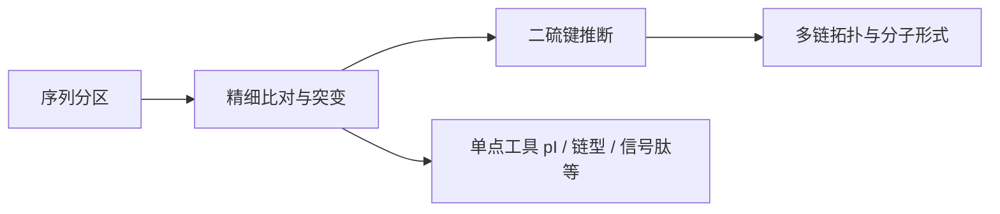

> **范围**：不做全原子折叠或分子动力学；聚焦抗体/融合蛋白的**序列理解**、**多链拓扑推断**，以及少量序列/DNA 物性工具。  
> 相关：[抗体序列理解与注释基础（上篇）](./AntibodyKnowledge1.md) · [抗体与蛋白/DNA 实用工具箱（下篇）](./AntibodyKnowledge2.md) · [抗体与重组蛋白基础](./antibody.md)

---

## 总览

| 层次 | 说明 |
|------|------|
| **主线 1–3** | 几乎共用：**分区 → 比对 → 半胱氨酸配对规则** |
| **主线 4** | 仅在「多条链 + 化学计量」时出现：在区域图上做**组合优化** |
| **支线** | 只用序列或外部成熟模型，**不依赖**结构图 |

---

## 学习顺序（按算法依赖）

1. **分区（一）** → 区段类型与 CDR/FR  
2. **重比对（二）** → 突变与 Fc 编号  
3. **二硫键（三）** → intra / inter 约束  
4. **拓扑（四）** → 多链药物形式推断  
5. **hotspot / Fc 工程 / ADCC（五–七）** → 开发风险与 Fc 语境  
6. **pI、链型、信号肽、DNA、副产物（八–十三）** → 独立或弱依赖支线  

---

## 一、免疫球蛋白序列分区（多源融合注释）

**问题**：一条氨基酸链里，哪些位置是 VH/VL、哪些 CH/CL、哪些是 linker、标签或未知片段？CDR/FR 边界在哪？

### 输入 / 输出

| | 内容 |
|---|------|
| **输入** | 单条蛋白序列 |
| **输出** | 按坐标排列的区段列表；每段有类型（V/C/H/L/T/P/U）、序列片段；可变区带 FR1–4、CDR1–3 坐标 |

**区段类型**：可变 **V**、恒定 **C**、hinge **H**、linker **L**、tag **T**、融合蛋白 **P**、未知 **U**。

### 核心思路（融合，而非单一工具说了算）

| 信息来源 | 算法角色 |
|----------|----------|
| **ANARCI** | Ig/TCR 可变区：germline、可变区起止、链类别（H/K/L 等） |
| **HMMER**（FR / 恒定区 HMM） | Profile HMM 标 FR1–4 或 CH/CL 边界；重叠 hit 按得分与长度过滤 |
| **ANARCI + HMM 合并** | 对齐两套边界，按 Kabat 落 CDR/FR；FR4 可用 BLOSUM62 滑动窗口与库 FR4 校正 |
| **BLASTp**（短肽/全长） | Hinge 物种特异基序、Fc 亚型命名、Uniprot 高相似片段 → 融合蛋白 **P** |
| **启发式 motif** | 常见 linker（G/S 富集、EAAAK 等）、短标签 |
| **区间补集** | 未被任何模型覆盖的残基 → **U** |

### 要点与局限

- 可变区可信度高时类型为 **V**；FR 无法对齐时可能降为 **U**。
- 恒定区从 HMM 名解析物种（人/鼠/兔等）和 CH1/CH2/CH3/CL。
- 这是全项目**共享语义层**：突变、二硫键、拓扑都建立在同一套区段上。
- **局限**：依赖参考 HMM/BLAST；非典型抗体（纳米抗体拼接、FR 大量突变）会增多 U 或错位。

---

## 二、精细重比对与突变 calling

**问题**：在分区基础上，这条链像哪条 germline 亚型？相对参考有多少 indel/替换？Fc 相对 EU 野生型的突变列表是什么？

### 输入 / 输出

| | 内容 |
|---|------|
| **输入** | 上一节的区段图（含 FR 坐标与类型） |
| **输出** | 各 FR/恒定区与参考的比对；可变区 subtype（如 IGHV3-23）；恒定区 **EU 风格**突变表 |

### 核心算法

- 每个 FR 片段向两侧略延伸，在物种 FR 参考库上做**全局比对**（**parasail + BLOSUM62**，cigar / 坐标）。
- **亚型选择**：FR1–3 分别对多参考打分，按总分与种属优先级（通常人源优先）选唯一 germline。
- **恒定区**：与 CH/CL 参考比对 → 逐位 diff → Fc 工程与 ADCC 检索输入。
- **插入缺失**：在比对串上扫描 gap，检查 FR/CL 合法性。

### 要点与局限

- 序列层「精准注释」，**不是** 3D 叠合。
- Fc 突变用 **EU 编号**，与业界 Fc 工程命名对齐。
- **局限**：罕见等位基因未入参考库时，突变 calling 带系统误差。

---

## 三、二硫键推断（规则 + 表驱动配对）

**问题**：半胱氨酸哪些链内/链间配对？是否游离？

### 输入 / 输出

| | 内容 |
|---|------|
| **输入** | 区段图 + 序列 |
| **输出** | 每个 C 的配对对象或「未配」；区分 intra / inter |

### 核心算法

- **表驱动**：按链类型（VH/VK/VL）、结构域（CH1/CH2/CH3）、物种查经典位点（IMGT/文献/内部表）。
- **Hinge**：各 IgG 亚型 hinge core 中的 C 按规则互配。
- **容错**：表定位位点不是 C 时，小窗口内找最近邻 C。
- **不做**能量最小化或二硫键几何；结果约束拓扑模块「哪些结构域应被二硫键连在一起」。

**局限**：非经典 rearrangement、多特异性/化学偶联分子可能不符合 IgG 模板。

---

## 四、多链分子拓扑与形式分类（组合搜索 + 启发式打分）

**问题**：给定多条链及化学计量，如何组装？是 Mab、BsAb、Fc-fusion 还是其它？Fab 内 VH–VL 如何配？

### 输入 / 输出

| | 内容 |
|---|------|
| **输入** | 多链区段图（已分区、比对、二硫键）、可选链比例 |
| **输出** | 分子形式（Mab / BsAb / Fc-fusion / Others）、链间配对、推测二硫键、**卡通拓扑图**（非 3D） |

### 核心算法

**1. 图表示**  
每条链 = 有序 region 节点（V、C、H…），携带序列、电荷粗分类、Fc 突变别名（Knob/Hole）、已知二硫键、候选配对列表。

**2. 配对生成（组合搜索）**  
枚举/递归构造「区域–区域」配对矩阵，满足常识，例如：

- CH1 与 CL → Fab 下半部  
- CH2–CH2、CH3–CH3 同源二聚  
- 同一 Fab 上相邻 VH–VL  
- 可变区与下游恒定区、hinge 衔接  
- 用户链拷贝数限制各链出现次数  
- 局部序列相似性判断两区是否「该配」

**3. 打分选优**（分数越低越好）

- 应配未配 → 高惩罚  
- Knob–Hole 正确互补 → 奖励；双 Knob / 双 Hole → 重罚  
- 配对区电荷互补 → 略奖励  
- 配对顺序错乱、分子裂成多个不连通团 → 极大惩罚  

取得分最优拓扑。

**4. 分子类型规则**  
统计 Fab、Fc、抗原结合区、融合蛋白段等 component，用显式 if 规则归类。

**5. 可视化**  
最优拓扑 → 节点–边图布局（卡通示意）。

### 要点与局限

- **约束满足 + 领域启发式**，不是力场或实验结构。  
- 双抗、Knob-in-Hole、Common LC 靠突变标签 + 打分体现。  
- **局限**：对称分子、非标准 linker、错配链比例时可能多解或 Others。

---

## 五、CDR 理化 hotspot（motif 规则）

**问题**：CDR 里有哪些易发生体内修饰的序列模式？

**算法**：在每个 CDR 肽段上**子串计数**，无机器学习。

| 风险类别 | 典型 motif |
|----------|------------|
| 异构化 | DG、DS、DD、DT、DH |
| 脱酰胺 | NG、NS、NP、NN、NT、NR |
| 氧化 | 单残基 W、M |

**局限**：只提示「可能存在风险」，不预测速率或位点遮挡。

---

## 六、Fc 工程类型识别（词典覆盖）

**问题**：Fc EU 突变对应业界工程名（LALA、YTE、LS、Knob/Hole 等）？

**算法**：

1. 从恒定区比对得到突变集合（EU 编号）。  
2. 与预定义 **突变组合 → 工程名** 词典做集合包含匹配；较长组合优先剥离，避免重复命名。

**局限**：仅覆盖词典内组合；新颖组合只报散在突变。

---

## 七、ADCC 文献对照（突变相似度检索）

**问题**：当前 Fc 突变与文献/库中哪种变体最接近？ADCC 倾向升/降？

**算法**：

- 维护 Fc 变体库（突变组合 ↔ 实验效应）。  
- **相似度**：突变位点重合 + 氨基酸一致（可调权重）。  
- 过滤：库中变体相对查询不能多出查询没有的位点。  
- 映射效应为 increase / decrease / no change（相对 1.0 阈值）。

**局限**：检索类比，非计算 ADCC；库外突变只给「最像」参考。

---

## 八、等电点 pI（多 pKa 表 + 集成回归）

**问题**：整条生物药（多链、多拷贝）的建模 pI？

**算法**：

1. **序列构造**：按化学计量拼接；假设分泌成熟（N 端 Q→E、C 端去 K）。  
2. **特征**：16 种经典 pKa 表（IPC 家族）各算一个 pI → **16 维向量**。  
3. **预测**：四个预训练回归器（线性、SVR、GBDT、贝叶斯岭）各预测 pI，**算术平均**。

**要点**：监督层是「多 pKa 特征 → 实验 pI」的校正，不是单表硬算。

**局限**：糖基化、构象依赖 pKa、非标准氨基酸未建模。

---

## 九、链型分类（逻辑规则）

**问题**：单条链更像 HC、LC、Fc 段还是普通蛋白 Pr？

**算法**：读可变区亚型（IGHV/IGKV/IGLV）与恒定区 CH1/CH2/CH3，在多链上下文中判断：

- CH2+CH3 且 IGHV，或 CH1+IGHV → **HC**  
- 轻链 V + 少量恒定区 → **LC**  
- 仅 CH2/CH3、可变区很少 → **Fc**  
- 其余 → **Pr**

**局限**：依赖上游分区；嵌合/截断链可能误判。

---

## 十、信号肽预测（外部序列模型）

**问题**：成熟蛋白是否带 N 端信号肽？切割位点？

**算法**：调用 **SignalP 4/5**（HMM + NN，以外部程序为准）；输出 C/S/Y 分值、是否 SP、切割位点。

**局限**：物种与网络类型须与参数一致；本项目主要是封装。

---

## 十一、DNA 序列复杂度

**问题**：基因合成序列是否有长重复或不利克隆 pattern？

**算法（重复）**：

- 固定最短 k-mer，扫描 ≥2 次出现位置。  
- 合并相邻/周期一致 repeat；可左右扩展最长一致子串。  
- 另含回文等字符串算法（退火、发夹）。

**局限**：面向 DNA 工程风险，与蛋白可开发性无直接关系。

---

## 十二、副产物与质量分布（组合化学计量 + 序列分析）

**问题**：按投料比多种链，可能组装出哪些主产物/错配/缺链副产物？分子量与部分质量属性？

**算法要点**：

- 按每条链拷贝数枚举（或约束枚举）参与组装的链。  
- 每种组合再走分区/注释流水线，判断是否合理 Ig 样组装。  
- 元素组成矩阵算分子式/分子量（20 种标准氨基酸）。  
- 可批量结合成熟化假设、CDR hotspot 等。

**局限**：枚举依赖与主线相同的拓扑启发式；复杂偶联物可能不全。

---

## 十三、其它小工具（经典公式 / 翻译）

| 能力 | 算法本质 |
|------|----------|
| **翻译** | 密码子表读 DNA/RNA，按 ORF 翻译（标准遗传密码） |
| **DNA 退火温度 Tm** | 引物/短片段 nearest-neighbor 或盐浓度校正公式（随库而定） |

---

## 速查：算法类型归类

| 算法块 | 类型 | 是否 ML |
|--------|------|---------|
| 序列分区 | 多工具融合 + 规则 | 否（HMM 为概率模型，非深度学习） |
| 重比对 | 序列比对 + 投票选参考 | 否 |
| 二硫键 | 位点表 + 邻域搜索 | 否 |
| 分子拓扑 | 组合搜索 + 启发式打分 | 否 |
| CDR hotspot | Motif | 否 |
| Fc 工程名 | 词典集合匹配 | 否 |
| ADCC 对照 | 相似度检索 | 否 |
| pI | 16 特征 + 集成回归 | 是（回归器） |
| 链型 | 规则 | 否 |
| 信号肽 | SignalP | 是（外部） |
| DNA 复杂度 | 字符串 / k-mer | 否 |
| 副产物 | 组合 + 注释流水线 + 分子式 | 部分 |

