| 项目 | 内容 |
|------|------|
| **计算/storage 主线** | MaxCompute（离线数仓）+ Hologres（实时分析/ Serving）+ Flink/DataHub（流） |
| **开发与治理** | DataWorks（集成 / 开发 / 建模 / 质量 / 服务 / 地图） |
| **账号示例** | RAM 用户组 `admin`、`developer` |

## 1. 总体架构

```text
Landing Zone（账号 / 安全 / 网络 / 成本）
        │
        ├── API Gateway、Function Compute、RAM
        │
        └── Alicloud DataPlatform
                ├── DataWorks（开发治理一站式）
                ├── MaxCompute（AI-Native 云数仓，原 ODPS）
                ├── Hologres（实时数仓 / OLAP / Serving）
                ├── Flink、DataHub（流与实时通道）
                ├── OSS（对象存储 / 湖 / 外表）
                └── PAI、Serverless K8s（智能与弹性算力，构建中台）
```

**定位**：企业上云的+ 大数据中台引擎组合，而不是单一产品。

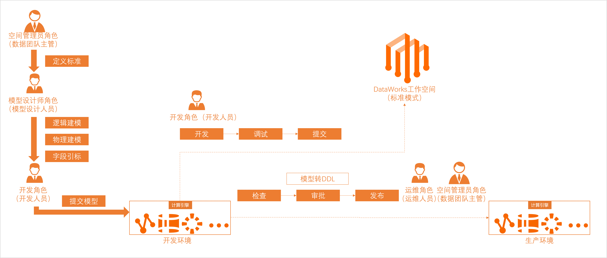

*图 1-1：DataWorks + MaxCompute + Hologres 湖仓一体总览*

---

## 2. Landing Zone 与网络打通

### 2.1 Landing Zone 是什么

**不是单一产品**，而是一套 **解决方案框架**，预先配置：

| 维度 | 内容 |
|------|------|
| **多账号** | 资源目录（Resource Directory）：管理账号 → 成员账号树形结构，生产 / 测试 / 开发隔离与集中管控 |
| **安全基线** | 统一策略、RAM、审计与合规检查 |
| **网络规划** | VPC、网段、互通方式 |
| **财务治理** | 统一费用管理与成本分摊 |

Landing Zone **打通**的首要任务是 **建立混合云 / 多云网络连接**。

### 2.2 专线 vs VPN（选型）

| 特性 | VPN 连接 | 专线连接 |
|------|----------|----------|
| **方式** | 公网加密隧道 | 运营商物理光纤 |
| **优势** | 分钟级部署、成本低、灵活 | 高稳定、超低延迟、高带宽、安全性高 |
| **劣势** | 受公网质量影响，可能抖动 | 部署周期长（数周）、成本高 |
| **适用** | 开发测试、临时连接、混合云备份/灾备 | 核心生产、大数据同步、实时库访问 |

后续落地常配合 **云企业网 CEN**、**PrivateLink**、**NAT 网关** 与安全组规划

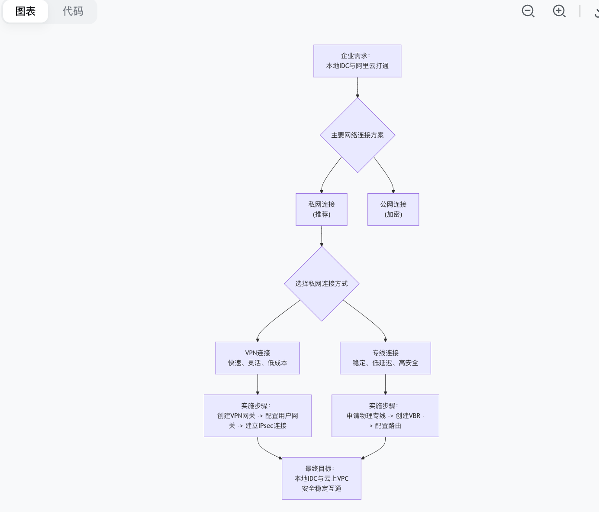

*图 2-1：Landing Zone 打通— 网络选型与连接路径。*

---

## 3. 身份与权限（RAM）

- **用户组（示例）**：`admin`、`developer`。
- **企业登录**：可配置 SSO 登录页
- **MaxCompute 细粒度授权**（对象与行为）：

| 对象/范围 | 管控点 |
|-----------|--------|
| 项目（Project）、Quota、Networklink | 项目级与算力/网络边界 |
| 表、函数、资源、实例 | 项目内对象操作 |
| Tunnel 下载、敏感数据访问、跨项目访问 | 高风险行为单独策略 |

原则：按人员操作范畴 **精细化授权**，而非仅项目级粗粒度角色。

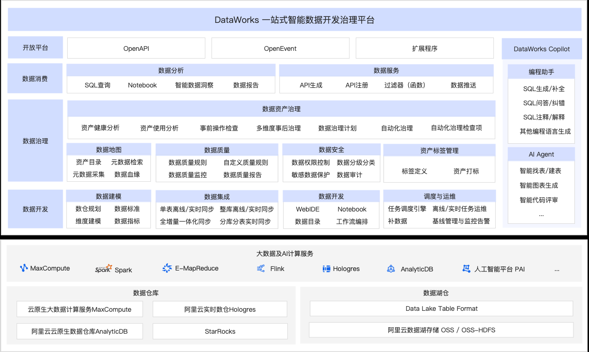

*图 3-1：DataWorks / MaxCompute / Hologres / RAM 等在中台中的位置（含 PAI、API Gateway 等）。*

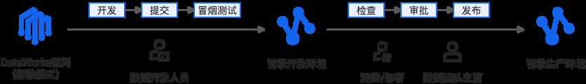

*图 3-2：登录与用户组（*`admin` */* `developer`*）*

---

## 4. MaxCompute（计算与存储）

### 4.1 产品定位

企业级 **SaaS 化智能云数据仓库**（**AI-Native Datawarehouse**，原名 ODPS）。

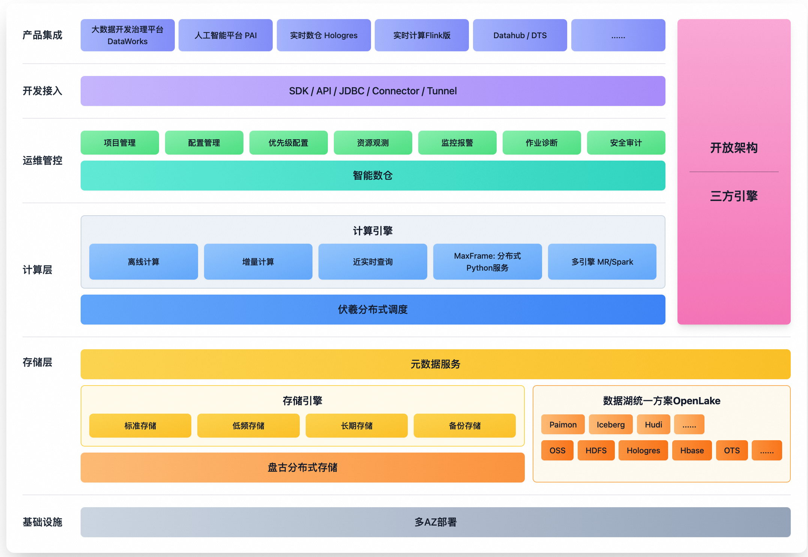

*图 4-1：细粒度权限、CU/Quota、内外部表与 MaxFrame。*

### 4.2 计算资源

- **CU**：1 CU = 1 CPU + 4 GB 内存。
- **Quota**：包年包月计算资源 vs 按量计费，对应不同规格类型。
- **MaxFrame**：镜像等扩展计算形态（见官方文档与 Quota 规划）。

### 4.3 存储模型

| 类型 | 说明 |
|------|------|
| **内部表** | 数据落在 MaxCompute；列类型为 MC 支持的类型 |
| **外部表** | MC **不持有**数据，元数据在 MC，数据在 **OSS / OTS**；可处理非结构化（音视频、基因、气象、地理等） |

读写路径：仓内分析为主；支持 **Tunnel / JDBC** 批量读写；**外部表 + 湖仓一体** 写 OSS 等湖存储。

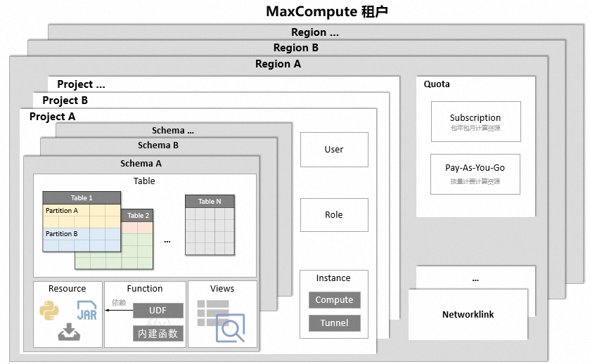

*图 4-2：内部表 vs 外部表（OSS/OTS）与读写路径。*

### 4.4 数据采集（Data Collector）

开源采集插件集合，按通道分为两类：

| 通道 | 插件示例 | 场景 |
|------|----------|------|
| **DataHub（实时）** | Flume、OGG | 实时接入 |
| **Tunnel（批量）** | Sqoop、Kettle、Hive Data Transfer UDTF | 离线批量 |

另：**数据集成** 在 DataWorks 侧统一编排。

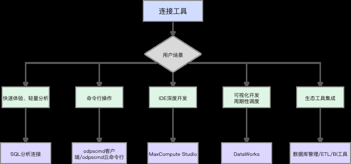

*图 4-3：Flume/OGG（实时）与 Sqoop/Kettle（批量）及 ODS 等分层引入。*

### 4.5 开放存储 Storage API

提供 **高效、低延迟、安全** 的读路径，第三方引擎（Spark on EMR、StarRocks、Presto、PAI 等）可访问 MC 底层存储；部分引擎可通过 **Connector** 直读，简化集成。

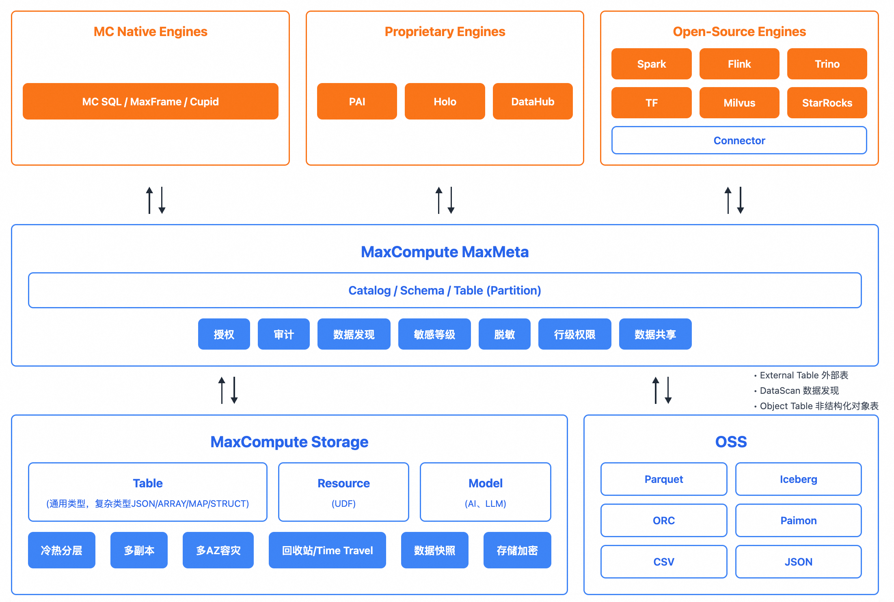

*图 4-4：Spark / StarRocks / Presto / PAI 等通过 Storage API / Connector 访问 MC。*

### 4.6 MaxLake（场景示例）

入湖入仓 + 多引擎联动：例如车联网 GPS → 里程/速度分析 → 即时报表、跨团队脱敏协作、AI 训练等 **一份数据多重价值**。

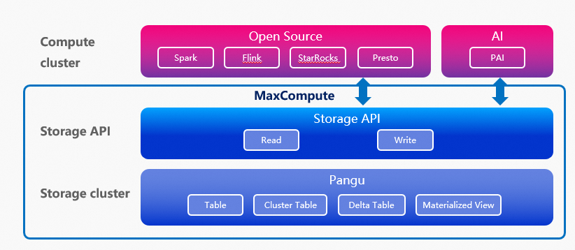

*图 4-5：MaxLake 入湖入仓与 DataWorks 衔接。*

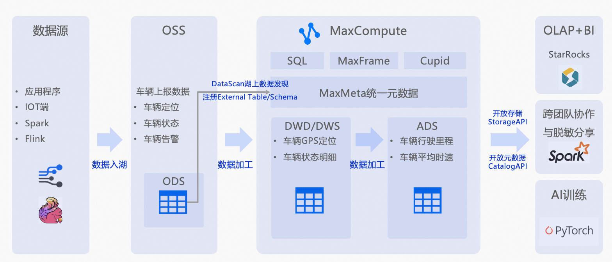

*图 4-6：MaxLake 场景流程（报表 / 协作 / AI 等）。*

---

## 5. 连接与生态工具

按 **场景** 选型，避免一种工具打天下。

| 类别 | 适用场景 | 代表工具 / 入口 |
|------|----------|-----------------|
| **SQL 分析** | 轻量分析、权限管理 | 控制台 **SQL 分析**（推荐 Chrome） |
| **命令行** | 脚本化批处理 | **云 odpscmd**（免安装，有会话/地域限制）vs **本地 odpscmd**（需 JDK 1.8+） |
| **IDE** | Java/Python UDF | **MaxCompute Studio**（IDEA ≥18.2.4 / PyCharm，JDK 1.8+） |
| **一站式** | 集成、调度、服务 | **DataWorks** |
| **库管 GUI** | 表管理 | DBeaver / DataGrip / SQL Workbench |
| **ETL 调度** | EL 到 MC | Kettle、Airflow、Azkaban、Dolphin Scheduler  等 |
| **BI** | 可视化 | Quick BI、FineBI/Report、Tableau、观远、Metabase 等 |

**JDBC 版本**：不同工具对 MaxCompute JDBC 最低版本要求不同（常见 ≥3.0.1 / ≥3.2.8 / ≥3.7.0），上线前对照 [官方连接文档](https://help.aliyun.com/zh/maxcompute/) 锁定驱动。


---

## 6. DataWorks：开发治理一站式

### 6.1 能力全景

基于 MaxCompute / EMR / Hologres 等引擎，覆盖：

```text
数据集成 → 开发 → 建模 → 分析 → 质量 → 服务 → 数据地图 → 开放能力
```

> DataWorks 能力全景图见 **图 3-1**（与 RAM/中台同页）。

### 6.2 开发模式

- **标准模式**：开发 / 生产环境隔离（任务发布与运维规范的基础）。
- **智能数据建模**（四模块）：**数仓规划**、**数据标准**、**维度建模**、**数据指标**。
- **Data Studio**：可视化数据开发、运维与 **任务监控定位**。

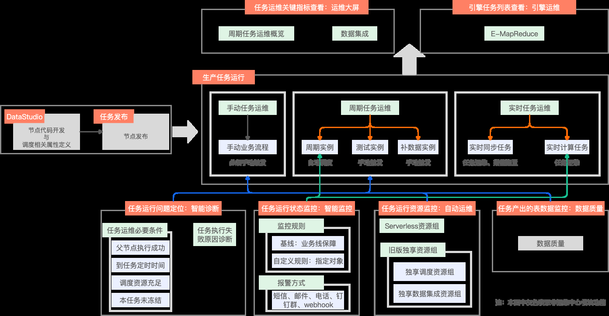

*图 6-1：标准模式、任务监控与 Data Studio 入口。*

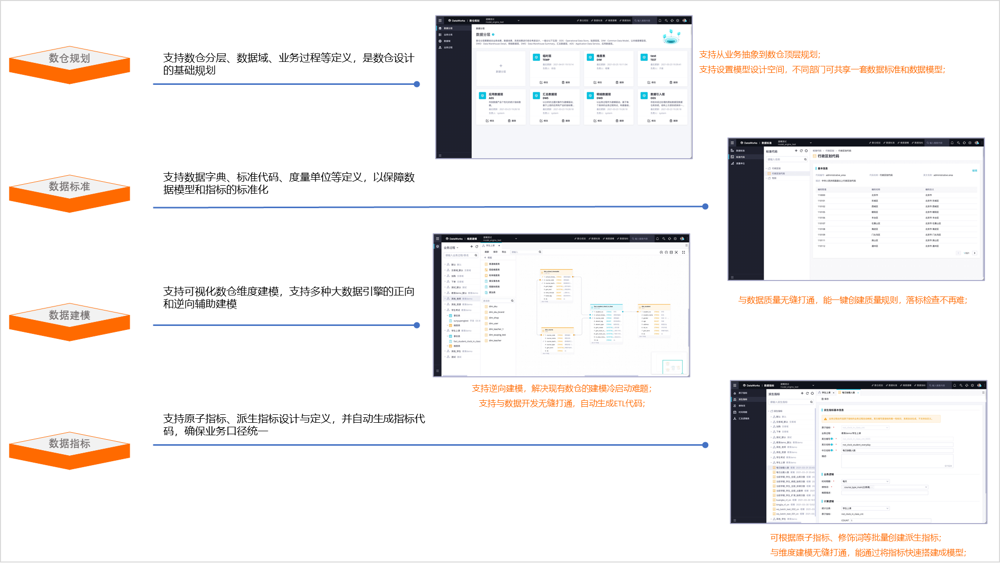

*图 6-2：数仓规划 / 数据标准 / 维度建模 / 数据指标。*

### 6.3 湖仓一体 + 流批融合

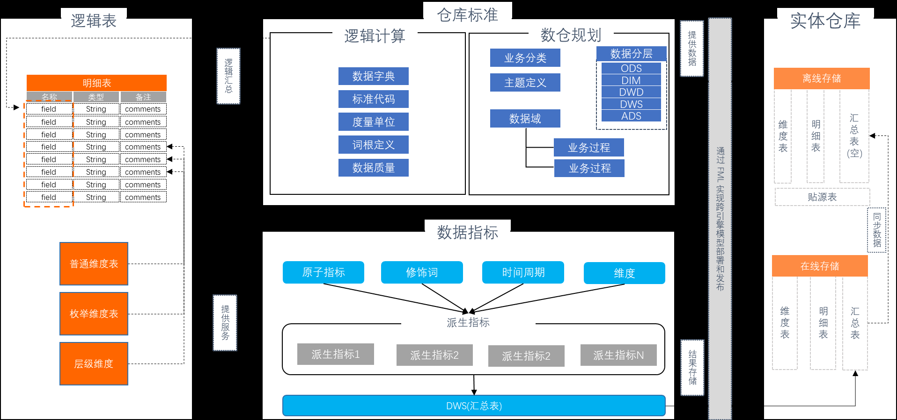

*图 6-3：MaxCompute + Hologres 流批融合定位。*

> 总架构大图见 **图 1-1**。

源幻灯归纳的四条主线：

1. **统一接入与分层**

   Data Integration 接入业务库、日志、Kafka/DataHub 等 → 统一 **ODS → DWD → DWS → ADS**（与 DIM 配合），一份数据服务离线 + 实时。
2. **离线 T+1（基座）**

   DataStudio + MaxCompute SQL 对 TB/PB 历史数据批量 ETL；调度在凌晨自动跑批，支撑画像、ML 特征、宏观分析。
3. **实时 / 准实时**
   - **Flink SQL**：毫秒级流处理（风控、大屏、推荐）。  
   - **Hologres**：对已落盘数据 **秒级即席查询**，业务自助探查，不必等 T+1。
4. **融合分析与统一服务**

   Hologres 加速查询 MaxCompute 数据，实时 + 离线关联；**DataService Studio** 封装 API，供应用、BI、大屏统一出口。

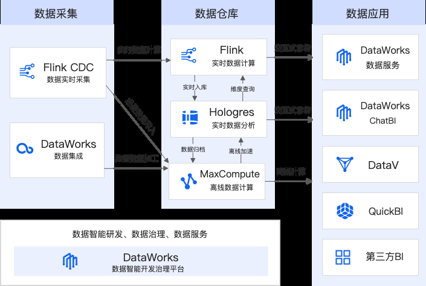

*图 6-4：统一接入、T+1、实时/准实时、融合分析与 API 服务。*

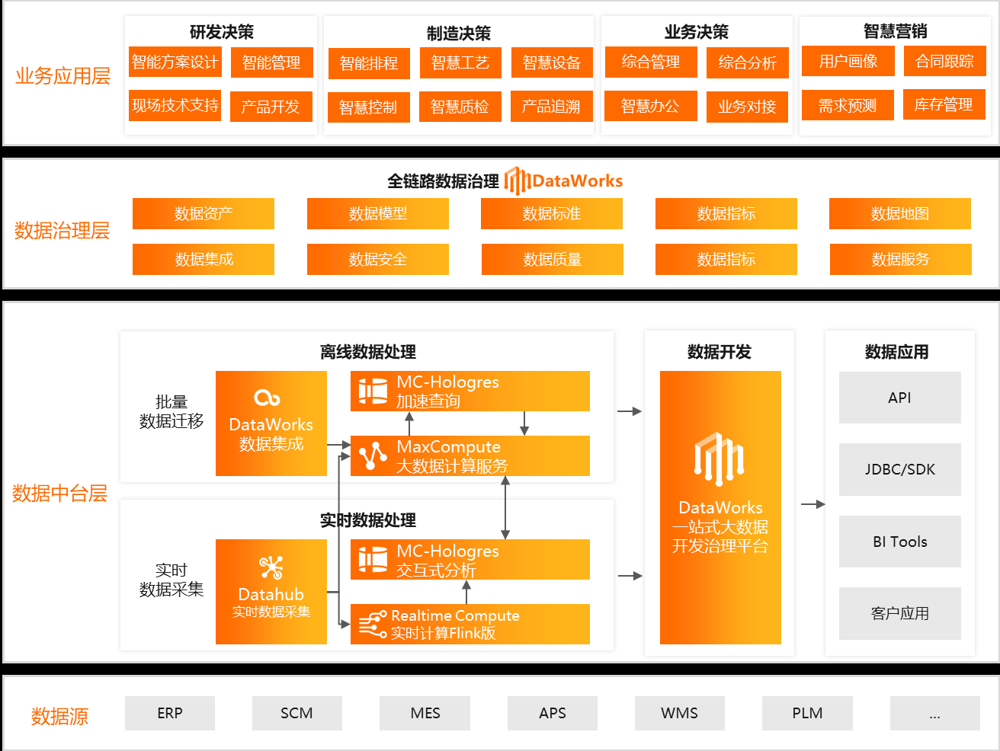

*图 6-5：降本增效 / 时效 / 全民分析 / 创新 + 分层引入。*

### 6.4 核心价值（官方主张，实施时需自行验证 ROI）

- **架构简化 / 降本**：一套存储、一套开发、多套引擎；材料称综合成本可显著下降（源 PDF 写「50%+」，以账单为准）。
- **时效**：T+1 → 分钟 / 秒级。
- **全民分析**：交互式查询减轻「提数」负担。
- **创新**：风控、营销、供应链等数据驱动场景。

### 6.5 默认数仓五层（DataWorks 数仓分层）

| 分层 | 英文 | 职责 |
|------|------|------|
| 数据引入层 | **ODS** | 接收原始数据，表结构与源系统一致，准备区 |
| 公共维度层 | **DIM** | 维度表 / 维度定义，统一分析口径，降低口径不一致风险 |
| 明细数据层 | **DWD** | 业务事件最细粒度事实；可宽表冗余维度，减少关联 |
| 汇总数据层 | **DWS** | 按分析主题构建公共粒度汇总指标 |
| 应用数据层 | **ADS** | 面向产品/报表的个性化指标输出 |

> 五层定义全文见幻灯第 16 页（与 **图 6-5** 衔接）；下图为 Data Studio 相关示意。

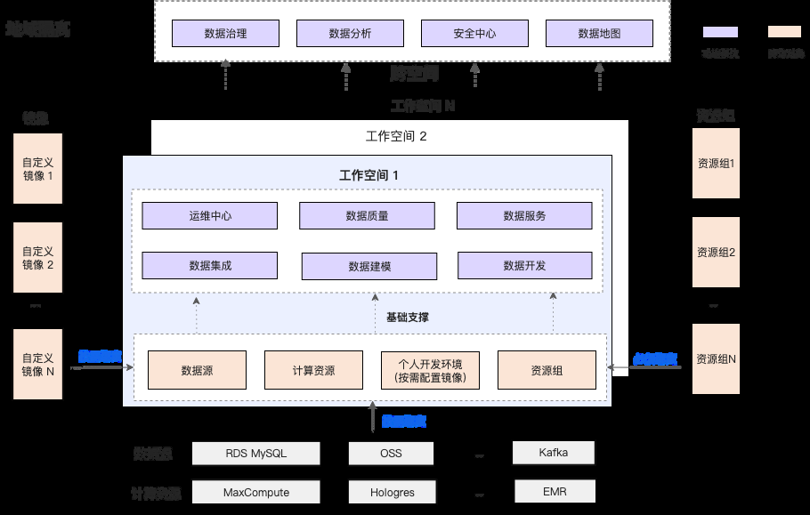

*图 6-6：Data Studio 开发界面。*

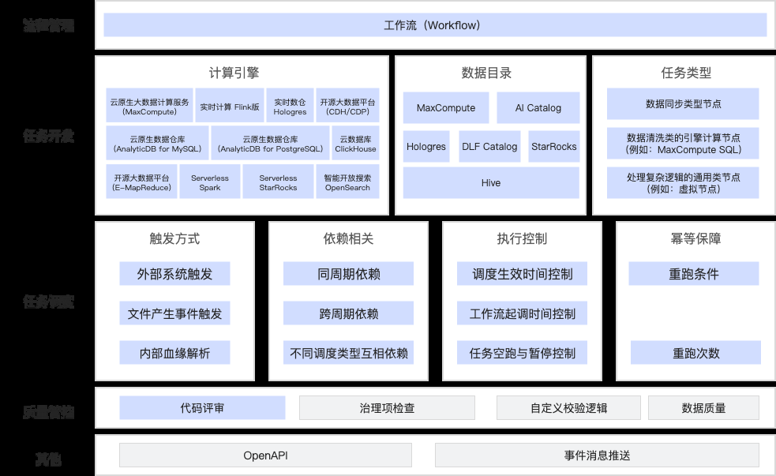

*图 6-7：Data Studio 与运维监控。*

---

## 7. Hologres

- **定位**：一站式 **实时数仓** — 海量实时写入/更新/分析。
- **协议**：标准 SQL（**兼容 PostgreSQL**）。
- **能力**：PB 级 OLAP / 即席分析 + **高并发低延迟 Serving**。
- **融合**：与 MaxCompute、Flink、DataWorks 深度集成，支撑 **离在线一体化**。

选型与表设计（分布键、分区、行列共存、AZ 容灾等）见 §9.3。

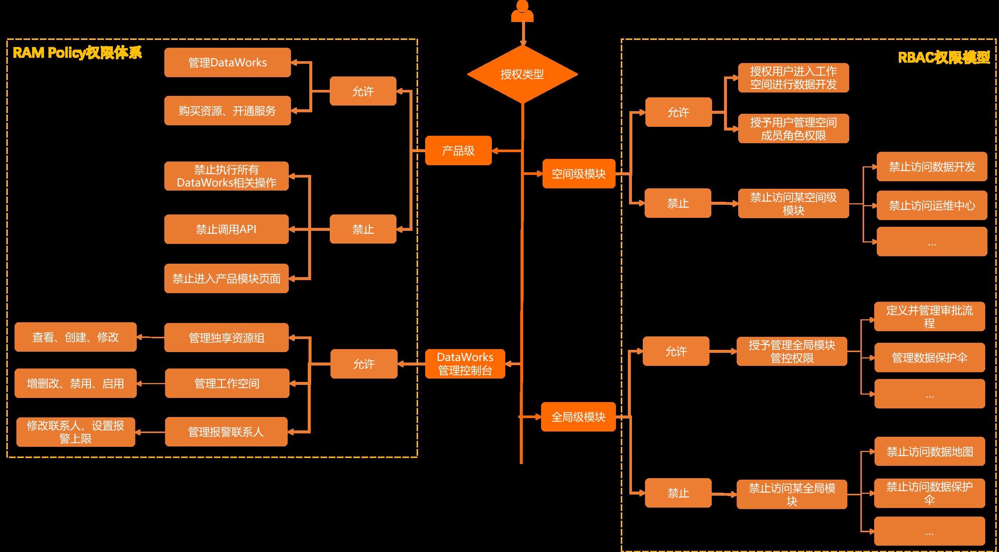

*图 7-1：实时写入/更新/分析，兼容 PG 协议，与 MaxCompute / Flink / DataWorks 集成。*

---

## 8. 与自建数据平台对照


| 维度 | 阿里云方案（本文） | 自建开源底座 |
|------|-------------------|--------------|
| 数仓引擎 | MaxCompute SaaS | Spark + Iceberg/Hudi 等 |
| 实时 | Hologres + Flink | Flink + OLAP 引擎自运维 |
| 治理开发 | DataWorks 全家桶 | Airflow/DolphinScheduler + 自研 Portal |
| landing | Landing Zone + RD | 私有云 / K8s + IAM 自建 |

---

## 9. POC 

**用例矩阵、联调经验、LandZone checklist、性能对照** 

### 0. 平台搭建总览

| 阶段    | 关键动作                                                                | 经验要点                                                                  |
| ----- | ------------------------------------------------------------------- | --------------------------------------------------------------------- |
| 云基座   | **Landing Zone**（RAM/VPC/KMS/OSS 基线）→ 再开 DataWorks/MC               | 未划清共享网络与账号边界时，集成资源组、Flink、Hologres 易出现 **Region/权限** 混配               |
| 账号与网络 | 开通 DataWorks 工作空间 + MaxCompute 项目；与 **On-Prem/IDC** 专线或 VPC 对等          | 流式用例要求 **DataWorks 与 On-Prem 网络联通**；源端 **WAL** 与白名单 |
| 存储与计算 | **MaxCompute**（离线湖仓）+ **Hologres**（实时服务/ADS）+ **OSS**（文件）           | MC 与 **DataHub 项目空间相互独立**，需分别创建                                       |
| 集成与开发 | DataWorks **数据集成**、SQL/PyODPS/MaxFrame、调度工作流                        | 工作空间参数在 **运维中心 → 调度设置 → 工作空间参数** 统一维护                                 |
| 流式    | **Flink**（DataWorks 实时 / Flink CDC）→ Hologres / Kafka / **DataHub** | PostgreSQL CDC 需 **WAL 开启并授权**                                        |
| 数据服务  | **Hologres** 对外查询 + **API 网关**（独享 Serverless 资源组）                   | POC 中阿里 API **QPS 优于腾讯**；鉴权常用 **Token**                    |
| 分层口径  | ODS → DWD → DWS → **ADS** → Hologres 服务层                            | DIM/DWS 命名思想一致，落地表名保持 `ods_` / `dwd_` 前缀                         |

**核心组件关系（批为主链路）**

```text
源（云上 MySQL / HTTP API / PostgreSQL）
    → DataWorks 数据集成
    → MaxCompute（ODS → DWD → DWS → ADS）
    → 同步至 Hologres
    → API 网关数据服务（Token 鉴权）
    → 业务系统 / BI
```

---

### 1. MaxCompute（离线湖仓）

#### 定位

- 阿里云离线数仓引擎（原 ODPS），承载 **大批量批处理** 与标准 **MaxCompute SQL**
- 与 **DataWorks** 深度集成：集成任务、SQL 节点、PyODPS、调度、运维中心

#### 开发与交互

| 方式                 | 说明                                                                         |
| ------------------ | -------------------------------------------------------------------------- |
| **MaxCompute SQL** | DataWorks 数据开发 SQL 节点；DDL/DML/分区表                                          |
| **PyODPS**         | DataWorks **PyODPS 2** 节点，Python 操作 MaxCompute SDK                         |
| **MaxFrame**       | 兼容 **Pandas** 算子，提交后在 MC 集群分布式执行；与 **MC Notebook、DataWorks** 集成，适合探索后转调度任务 |
| **维度建模**           | 方法论：维度模型 / 星型模型；落地需 **数据字典**（字段含义、枚举）                                      |

#### 经验

- 探索阶段用 **MaxFrame / Notebook**，生产逻辑固化为 **SQL 或 PyODPS 节点** 并纳入 **工作流发布**。
- MC **Project** 与 DataHub **Project** 不同名、不同空间，避免混配连接串。
- JDBC 访问 MC 时使用标准 ODPS JDBC URL（**AccessKey 放 KMS/凭据管理，勿写入文档**）。

---

### 2. DataWorks（数据开发与管理）

#### 定位

- 统一 **数据集成、开发、调度、运维、质量（视版本）** 的控制面。

#### 标准批处理流程（对应用例 **CDP-批处理**）

1. 创建 **DataWorks 项目工作空间**（绑定 MaxCompute 项目，如 POC 环境 `dev_poc` 类命名）。
2. 配置 **MySQL**（或其它）数据源。
3. **数据集成**：离线同步至 MC **ODS** 表。
4. 构建 **DWD / DWS / ADS** ETL（SQL / PyODPS）。
5. **ADS → Hologres** 同步，供低延迟查询与数据服务。
6. 建立 **调度工作流** 并发布上线。
7. 基于 Hologres 配置 **API 数据服务**（Token 鉴权）。

**预期**：按计划准时同步；日志与资源可观测；API 可按条件查询。

#### 工作空间与参数

- **运维中心 → 调度设置 → 工作空间参数**：统一 `${bizdate}` 等调度变量，供 SQL/集成任务引用。  
- 发布前在 **运维中心** 查看实例、重跑、补数据。

#### 数据集成类型（POC 覆盖）

| 类型                 | 用例            | 要点                                                          |
| ------------------ | ------------- | ----------------------------------------------------------- |
| **离线 DB → MC**     | 批处理       | 1 万行级 POC：阿里 DI 总耗时约 **62s** 量级            |
| **HTTP API → MC**  | API数据集成      | 配置 **HTTP 数据源**；定时拉 JSON → ODS → DWD → ADS → Hologres → API |
| **PostgreSQL CDC** | 实时 | Flink CDC → PG，秒级；非 MC 主路径                          |
| **CDC + 消息 + 批**   | 全组件测试         | Flink → Kafka/**DataHub** → Hologres → 与 MC 批处理结果对账         |

---

### 3. Hologres（实时数仓 / 服务层）

#### 定位

- 全托管 **HTAP 倾向** 分析引擎，**兼容 PostgreSQL 协议**（JDBC/ODBC/BI）。  
- 在 POC 中作为 **ADS 下游**：承接 MC 同步结果，支撑 **实时查询 + API 数据服务**。

#### 与其它组件分工

| 组件         | 职责                               |
| ---------- | -------------------------------- |
| MaxCompute | 离线大规模 ETL、历史明细与汇总                |
| Hologres   | 低延迟查询、Serving、API 后端             |
| Flink      | 实时写入 Hologres、与 Kafka/DataHub 衔接 |

#### 选型（POC 对比 ClickHouse / Doris）

- **实时 BI、PG 生态、阿里云原生集成** → 优先 Hologres。  
- 深度集成 **Flink、MaxCompute、OSS、DataWorks**；支持物化视图、高并发 OLAP。

#### 同步与服务

- 使用 DataWorks 数据集成或 Flink 将 **ADS 表同步至 Hologres**。  
- API 网关 **独享 Serverless 资源组** 发布服务

---

### 4. 流计算与消息（Flink / DataHub / Kafka）

#### 用例 A：实时同步（流处理）

| 项   | 内容                                                                                         |
| --- | ------------------------------------------------------------------------------------------ |
| 目标  | 验证源表变更 **准实时** 同步至 **PostgreSQL B** 库                                                           |
| 前置  |  **PostgreSQL A 开 WAL** 并授权；PostgreSQL B **白名单**；Flink 资源与网络就绪；DataWorks↔ **专线/VPC** |
| 步骤  | Flink CDC 读源表 → Sink 写 PostgreSQL B → 模拟增删改 → 对账                                                |
| 组件  | DataWorks、Flink CDC、PostgreSQL（源/目标）                                                       |

#### 用例 B：全组件批流混合

1. Flink CDC 读 PostgreSQL 变更 → **Kafka Topic** 或 **DataHub Topic**。
2. Flink 实时计算 **写入 Hologres**。
3. Hologres 再同步 **DataHub** 供下游订阅
4. DataWorks **批处理** 同步同源数据至 MaxCompute，复用 ETL。
5. **批 vs 流结果一致性** 对账。

#### DataHub 要点

- **Project** 与 MaxCompute Project **独立创建**
- **Topic** 为发布订阅最小单元
- 以 **Kafka 协议** 消费 Topic 时需开启 **Shard 水平扩展**

---

### 功能说明 1：POC 用例矩阵

| 分类       | 用例                     | 验证目标                                    | 主要组件                                          |
| -------- | ---------------------- | --------------------------------------- | --------------------------------------------- |
| 批处理      | **CDP-批处理**            | 同步时效、端到端 ETL、API 鉴权与响应、数据集成功能           | DataWorks、MaxCompute、Hologres、API 网关、MySQL    |
| 流处理      | **实时数据同步** | WAL 变更捕获，写入 Davinci，秒级时效                | DataWorks、Flink CDC、PostgreSQL                |
| API 数据集成 | **API-数据集成**           | 第三方 HTTP API 周期入仓，ODS+ADS 联动            | DataWorks、MaxCompute、Hologres、API 网关          |
| 批流混合     | **全组件测试**              | CDC→Kafka/DataHub→Hologres，与 MC 批融合、一致性 | Flink CDC、Kafka/DataHub、MC、Hologres、DataWorks |

---

### 功能说明 2：DB / 表分层命名（MC + Hologres）

| 层级  | 含义          | MaxCompute 表名建议         | Hologres（PG 兼容）         |
| --- | ----------- | ----------------------- | ----------------------- |
| ODS | 近源、结构与源基本一致 | `ods_{system}_{entity}` | `ods_{system}_{entity}` |
| DWD | 清洗、标准化      | `dwd_{domain}_{entity}` | 同左                      |
| DWS | 主题汇总        | `dws_{topic}_{grain}`   | 同左                      |
| ADS | 应用/报表/API   | `ads_{app}_{metric}`    | 同步后供 API 查询             |

- **分区**：MC 按 `ds` / `bizdate` 分区；与 DataWorks 调度参数一致。  
- **数据字典**：字段 COMMENT、枚举值与腾讯侧「元数据业务描述」同等重要，便于 DXY 等 API 字段解析。

---

### 功能说明 3：HTTP API 入仓

1. DataWorks 配置 **HTTP 类型数据源**（Base URL、Header 鉴权）。
2. 创建 **API 数据集成** 任务，Cron 调用接口，解析 JSON。
3. 写入 MC **ODS**；**DWD** 去重、补维度。
4. **ADS → Hologres**；API 网关发布 **Token 鉴权** 服务。

**经验**：外部 API 限流与分页在集成脚本或后置 PyODPS 中实现；失败重试与 **空包** 告警纳入运维中心。

---

### 功能说明 4：API 网关与数据服务

| 对比项        | 阿里云                        | 腾讯                    |
| ---------- | ------------------------------ | ----------------------------- |
| 后端库        | **Hologres**（PG 协议）            | 云 MySQL / WeData 数据源 |
| 资源组        | **独享 Serverless 资源组**          | 独立服务资源组 + 网关 ID               |
| 鉴权         | **Token**                | AppKey/HMAC 应用认证              |
| 压测（1-note） | 5 轮平均 **~98.8 QPS**（100 并发 10） | 5 轮平均 **~70.3 QPS**           |

排障顺序：**Hologres 表数据 → 同步任务实例 → API 定义与 Token → 网关 Serverless 资源组配额**。

---

### 功能说明 5：非结构化与 OSS

- 阿里 POC 用例表以 **DB/API 集成** 为主；文件类入湖归属 **数据着陆区**
  - **OSS** 路径示例：`raw-data/{env}/{domain}/{biz_date}/`  
  - DataWorks 集成 **OSS → MaxCompute**（CSV/Parquet/ORC）  
  - 大文件或半结构化 JSON 可经 **MaxFrame** 探索 Schema 再写 MC 表
- OSS 与 MC/Hologres 的 **RAM 角色** 最小权限 + **KMS** 加密

---

### 功能说明 6：交互式开发（MaxFrame / Notebook）

| 工具              | 用途                   | 生产化               |
| --------------- | -------------------- | ----------------- |
| **MaxFrame**    | Pandas 风格探索、分布式跑在 MC | 转为 DataWorks 调度节点 |
| **PyODPS 2**    | Python 操作 MC 表       | 纳入工作流             |
| **MC Notebook** | 与 MaxFrame 集成        | 探索代码复制到正式节点       |

约定与腾讯 Notebook 一致：**交互环境不直接承担生产 SLA**，发布走 DataWorks **工作流 + 运维中心**。

---

### 功能说明 7：网络与数据源（MySQL / PostgreSQL）

| 数据源                      | POC 场景      | 网络注意                      |
| ------------------------ | ----------- | ------------------------- |
| **云上 MySQL**             | CDP 批处理源    | 与 DataWorks 集成资源网络连通      |
| **PG**        | Flink CDC 源 | **WAL**、账号 REPLICATION 权限 |
| **PG**           | 实时 Sink     | 白名单、Schema 与目标表预建         |
| **内网 IP PG** | 压测/假数据      | 仅 POC 网段可达，**密码不入档**      |


---

### 功能说明 8：Landing Zone（着陆区 / LandZone）

> **① 云着陆区** — 多账号/网络/安全/合规基座；**② 数据着陆区** — 原始数据入湖第一站。阿里 POC 强依赖 **上海 Region**、**DataWorks↔On-Prem 联通** 与 **独立 MC/DataHub 项目空间**。

#### 8.1 云着陆区（Cloud Landing Zone）

在批量开通 **DataWorks、MaxCompute、Hologres、Flink、DataHub、API 网关** 之前完成的**共享基座**。

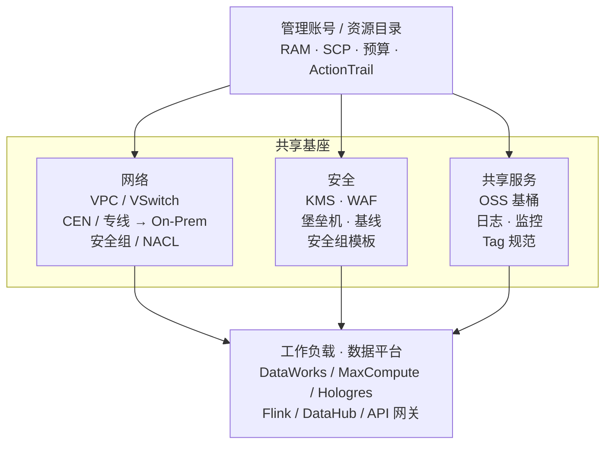

| 模块          | 功能说明                                                                       | A POC 经验                                            |
| ----------- | -------------------------------------------------------------------------- | --------------------------------------------------------- |
| **账号与 RAM** | 资源目录或分账号 dev/prd；**RAM 角色** 供 DataWorks、Flink、MC 任务扮演；禁止人手长期 **AccessKey** | JDBC 中的 AK 仅 POC，**生产必须用角色 + STS**               |
| **网络**      | 同 Region VPC（如 **cn-shanghai**）；**高速通道/云企业网 CEN** 与 **On-Prem/IDC** 互通         | 用例均假设集成/Flink 能触达源与 Sink          |
| **身份**      | 与企业 IdP/SSO 集成（视企业开通方式）；RAM 用户/角色最小权限                                      | 数据源账号与 **read-only** 集成账号分离                               |
| **密钥**      | **KMS** 管理 CMK；OSS **SSE-KMS**；Hologres/MySQL 连接串走 **凭据管理**                | 与腾讯 KMS 章节同原则，**密钥不入 Markdown**                           |
| **审计与合规**   | **ActionTrail**、配置审计、日志服务 SLS；API 网关访问日志                                   | 批流对账、DI 失败与 API Token 异常可关联审计                             |
| **标签**      | 统一 Tag：`Env`、`Project`、`Owner`、`CostCenter`                                | 与 MC 表 `ods_` 前缀、DataWorks **工作空间名**（如 `dev_poc`）一致 |

**推荐搭建顺序**：LandZone（RAM + VPC + 专线 + KMS + OSS 基桶 + 审计）→ DataWorks 工作空间 + MC Project → Hologres → 集成/Flink → API 网关 Serverless 资源组。

#### 8.2 数据着陆区（Data Landing Zone）

**原始数据**进入中台后的第一边界：未清洗前可审计、可重放；结构化之后进入 **MC ODS** 与下游 **Hologres ADS**。

| 要素           | 阿里云落地                                                                                   |
| ------------ | --------------------------------------------------------------------------------------- |
| **文件/非结构化**  | **OSS** 桶前缀 `raw-data/{env}/{domain}/{system}/{biz_date}/`；可选 `processed/` 存清洗后 Parquet |
| **结构化（批）**   | DataWorks **数据集成** 写入 MC **ODS 分区表**（Landing 逻辑层即 ODS）                                  |
| **结构化（流）**   | Flink CDC 可先落 **Hologres/Davinci** 或 **DataHub Topic**，再与 MC 批对账                        |
| **HTTP API** | API 响应先进 MC ODS（或先落 OSS JSON 再解析，视体积）                                             |
| **工作空间**     | **DataWorks 项目**绑定 **MaxCompute Project**；**DataHub Project 单独建**，不可复用 MC 项目名           |
| **权限**       | 着陆区写权限仅 **集成/Flink 服务角色**；分析师从 **DWD/ADS/Hologres** 消费                                  |

```text
源（MySQL / PG / HTTP API / 导出文件）
        │  DI / Flink / 上传 OSS
        ▼
  Data Landing Zone
  · OSS raw-data/（文件原件，KMS）
  · MC ods_* 分区表（结构化近源）
  · 可选：Hologres
        │  DataWorks SQL / PyODPS / Flink
        ▼
  DWD → DWS → ADS → Hologres → API 网关
```

#### 8.3 LandZone 与 POC 用例

| 用例            | 云 LandZone 依赖                         | 数据 LandZone 落点                        |
| ------------- | ------------------------------------- | ------------------------------------- |
| 批处理       | 集成资源组 ↔ 云上 MySQL；MC/Hologres 同 Region | MC **ODS** → … → Hologres             |
| 实时 | VPC/专线、PG 白名单、Flink 资源                |  **PG 表**（实时着陆）                |
| API       | 公网/专线出网、API 鉴权凭据 KMS                  | MC **ODS** JSON 解析                    |
| 全组件           | Kafka/DataHub Topic、Flink 与 MC 并存     | **Topic + MC ODS + Hologres** 多着陆，需对账 |

#### 8.4 LandZone 与组件对照

| LandZone 能力 | 支撑的数据平台能力                                      |
| ----------- | ---------------------------------------------- |
| 专线 + VPC    | DataWorks 连 On-Prem/IDC 库、PG CDC           |
| KMS + RAM   | 数据源、API Token、OSS 加密                           |
| OSS 基桶      | 非结构化、大 JSON、MaxFrame 读路径                       |
| 统一 Region   | MC、Hologres、DataWorks、Flink **必须同区**（ |
| ActionTrail | 集成任务、API 发布、RAM 变更追溯                           |

#### 8.5 上线前 Checklist

> 用于 POC 生产立项对齐。项目实施中的勾选状态建议在项目管理工具维护

| 序号 | 域 | 检查项 | 验收要点 |
| --- | --- | --- | --- |
| 1 | **云 LandZone** | 账号、网络、安全、审计基线就绪 | RAM **角色**（非长期 AK）、VPC/VSwitch、到 **On-Prem** 路由、**KMS**、OSS 基桶、**ActionTrail** |
| 2 | **数据 LandZone** | 着陆路径与命名规范落地 | OSS `raw-data/{env}/…` 前缀、MC **`ods_*` 分区表**、DataWorks 工作空间与 **MC Project 一一绑定** |
| 3 | **消息与流** | DataHub 与 MC 解耦 | **独立 DataHub Project**；批流混合用例提前创建 **Topic**（Kafka 协议消费需开 Shard 扩展） |
| 4 | **环境隔离** | dev / prd 边界清晰 | **MC Project**、DataWorks **工作空间**、**Hologres 实例** 分环境；跨环境引用走发布流程，不手工改生产 |
| 5 | **架构认知** | POC 与生产一致 | 公网、单账号、放宽安全组的 POC **不能** 等同于生产 LandZone；上线前按补齐基座 |

**建议顺序：** 先完成 1 → 2，再开通 3–4 所涉组件，最后用 5 做架构评审

---

### 与腾讯云方案对照

| 能力         | 阿里云                 | 腾讯云                              |
| ---------- | ------------------- | -------------------------------- |
| 离线编排       | DataWorks           | WeData                           |
| 离线计算/湖     | MaxCompute          | DLC                              |
| 实时 Serving | Hologres            | TCHouse-D / 云 MySQL / Hologres 类 |
| 流引擎        | Flink（DataWorks 实时） | Oceanus                          |
| 消息         | DataHub / Kafka     | CKafka                           |
| 对象存储       | OSS                 | COS                              |
| API        | API 网关 + Hologres   | WeData 数据服务 + Kong               |

选型时：**重离线 MC 生态 + PG 协议实时服务** 阿里链路成熟；**WeData+DLC 一体化权限与国内文档** 腾讯链路在生产准则更细。

---

### 监控与运维

- **运维中心**：周期实例、补数据、重跑、告警。  
- **集成/ SQL 日志**：DI 提交时间与 Run 时间分离看（阿里 DI 等待占比较高时需调资源组/并发）。  
- **Flink 实时**：Checkpoint、反压、延迟；CDC 延迟与 WAL 保留。  
- **Hologres**：连接数、慢查询、同步延迟（MC → Holo）。  
- **API 网关**：Serverless 资源组额度、4xx/5xx、Token 过期。

---

### 参考链接

- [DataWorks 文档](https://help.aliyun.com/product/72772.html)
- [MaxCompute 文档](https://help.aliyun.com/product/27797.html)
- [Hologres 文档](https://help.aliyun.com/product/113622.html)
- [实时计算 Flink 版](https://help.aliyun.com/product/110551.html)
- [DataHub 文档](https://help.aliyun.com/product/68346.html)
- [密钥管理服务 KMS](https://help.aliyun.com/product/28933.html)
- [对象存储 OSS](https://help.aliyun.com/product/31815.html)

---


### 附录 A：Hologres / ClickHouse / Doris 对比

| 对比项 | Hologres | ClickHouse | Apache Doris |
| --- | --- | --- | --- |
| 所属公司 | 阿里云 | Yandex（开源） | Apache 基金会（原百度开源） |
| 数据模型 | 行列混存、兼容 PostgreSQL | 列存 | 列存 |
| SQL 兼容性 | 高度兼容 PostgreSQL | 类 SQL，自成一套语法 | MySQL 协议，兼容 MySQL |
| 实时写入能力 | ✅ 强，毫秒级 | ⚠️ 较弱，批式写入更优 | ✅ 支持高吞吐实时写入 |
| 查询性能 | 强（支持索引、物化视图） | 极快（批量分析场景） | 快（支持向量化、MPP） |
| 并发能力 | 高，适合多租户 | 中，单节点高性能 | 高，适合大规模并发分析 |
| 多维分析（OLAP） | ✅ 强 | ✅ 强 | ✅ 强（内建 Rollup / Bitmap） |
| 生态工具 | 阿里云生态（Flink、MaxCompute、OSS 等） | 广泛 BI 支持 | Flink、Spark、MySQL 生态良好 |
| 事务支持 | ✅ 有限支持（轻量事务） | ❌ 基本不支持 | ✅ 有限支持 |
| 分布式扩展性 | 云原生，弹性伸缩 | 支持，但需配置复杂 | ✅ 一体化 MPP 架构 |
| 最佳场景 | 实时数仓、实时 BI、统一 OLAP/OLTP | 高性能报表、日志分析、OLAP | 实时 BI、多维分析、简洁部署数仓 |
| 适合企业类型 | 云上客户，大数据中台 | 高性能日志/分析系统 | 轻量级企业、对实时分析要求高的公司 |

#### A.2 存储模型与数据更新

| 项 | Hologres | ClickHouse | Doris |
| --- | --- | --- | --- |
| 存储类型 | 行列混合 | 列存 | 列存 |
| 数据更新能力 | 支持更新、删除 | 不擅长更新（需替代方式） | ✅ 支持更新、删除 |
| 实时写入 | 毫秒级 | 写入延迟大，通常走批导入 | 支持高并发、实时写入 |

> **小结**：ClickHouse 擅长大批量日志类分析；Hologres 在多租户与高并发 BI 场景更优；Doris/StarRocks 在向量化 MPP 与易部署之间平衡较好。

#### A.3 能力与部署

| 能力 | Hologres | ClickHouse | Doris |
| --- | --- | --- | --- |
| Flink 集成 | ✅ 原生集成 | ✅ 有 connector | ✅ 支持 |
| BI 工具 | ✅ Tableau、QuickBI、Power BI | ✅ Tableau、Grafana | ✅ Superset、QuickBI 等 |
| 数据导入 | MaxCompute/Kafka/Flink/OSS | File、Kafka、JDBC 等 | Flink、Kafka、Broker、StreamLoad |
| 云原生支持 | ✅ 阿里云全托管 | ❌ 需自管部署 | ✅ StarRocks（衍生）可云托管 |
| 部署复杂度 | ✅ 最低（全托管） | 中（多节点/分片） | ✅ 一体化部署简单 |
| 扩展方式 | 弹性伸缩 | 横向扩展、手动分片 | 一键 MPP 扩容（StarRocks 更易） |

#### A.4 场景推荐

| 场景 | 推荐产品 |
| --- | --- |
| 云上实时数仓、PostgreSQL 生态、实时 BI 看板 | ✅ Hologres |
| 高性能批量日志分析、大规模指标查询 | ✅ ClickHouse |
| 轻量实时数仓、企业自建 BI、多维分析 | ✅ Apache Doris / StarRocks |

### 附录 B：Hologres 背景与架构

#### B.1 阿里为什么开发 Hologres？

##### 1. 支撑阿里内部超大规模实时业务

内部业务（电商、支付、物流等）对**实时分析 + 高并发查询**要求极高，典型场景包括：

- **双 11 实时看板**：秒级指标，千万级 QPS 查询
- **推荐 / 用户画像**：实时更新与服务化查询并存
- **广告 / 风控**：交易实时处理 + 快速风险判定
- **运营 BI**：高并发 OLAP、多租户隔离

传统离线数仓（MaxCompute）难以满足实时性；OLTP（MySQL、PolarDB）不擅长大规模分析。因此需要 **HTAP 型**能力：实时写入与实时分析统一平台。

##### 2. 弥合阿里云产品生态的「实时分析」空缺

| 需求 | 阿里云原有方案 | 问题 |
| --- | --- | --- |
| 离线数仓 | MaxCompute | 批处理，延迟高 |
| 实时流处理 | Flink | 擅流计算，历史数据存储弱 |
| OLTP 存储 | PolarDB / RDS | 不擅多维分析、大聚合 |
| 实时查询 + 存储 + 分析 | — | 需要 Hologres 补齐 |

阿里约 **2018 年**启动 Hologres，定位为 **Flink + MaxCompute + BI + OLTP** 的实时交汇层。

##### 3. 对标国际产品、自主可控

| 对标产品 | 特性 | 阿里云对策 |
| --- | --- | --- |
| Google BigQuery | 离线分析 + 实时查询 | MaxCompute + Hologres |
| Snowflake | 存算分离 | Hologres 云原生架构 |
| Amazon Redshift | 云数仓 + BI | PostgreSQL 兼容层 |
| ClickHouse | 超快日志分析 | 大规模离线分析可与 Hologres 组合 |

政企、金融等场景可将 Hologres 作为**云上实时数仓**核心组件之一。

#### B.2 技术选型核心逻辑

| 技术目标 | Hologres 实现方式 |
| --- | --- |
| 实时写入 | 高并发写入；与 Flink、Kafka 集成 |
| 实时查询 | MPP + 索引 + 物化视图 |
| 存算分离 | 云原生弹性伸缩 |
| SQL 标准化 | 兼容 PostgreSQL |
| 多维分析 | OLAP、Bitmap / Rollup |
| 云原生 | 集成 OSS、MaxCompute、DataWorks |

**目标**：打通批流，统一 OLTP/OLAP，实时服务与分析一体化。

#### B.3 架构分层

```text
+--------------------------------------------------------------+
| 上层接口：PostgreSQL 协议；SDK；DataWorks / MaxCompute 接入   |
+--------------------------------------------------------------+
| 查询引擎：MPP；优化器；向量化；Rewrite / Pushdown            |
+--------------------------------------------------------------+
| 存储引擎：行列混存；压缩/分区；物化视图与索引；冷热分层/OSS  |
+--------------------------------------------------------------+
| 数据接入：Flink/Kafka；MC/OSS/RDS/DTS；DataWorks/DataHub    |
+--------------------------------------------------------------+
| 基础设施：弹性调度；托管运维；监控审计                       |
+--------------------------------------------------------------+
```

### 附录 C：产品与概念摘录

#### C.1 MaxFrame

- 自研分布式框架，**兼容 Pandas**，算子提交后在 MaxCompute 集群分布式执行。
- 与 **MaxCompute Notebook、DataWorks** 集成；适合探索后转调度任务（见上文 §4 / §9.1（POC）、功能说明 6）。

#### C.2 MaxCompute SQL

- 类似 ANSI SQL92，面向大规模数仓场景有扩展与限制

#### C.3 PyODPS

- DataWorks **PyODPS 2** 节点，基于 MaxCompute Python SDK

#### C.4 DataHub

- **Project** 与 MaxCompute **Project 相互独立**，需分别创建。
- **Topic** 为发布订阅最小单元。
- 以 **Kafka 协议**消费 Topic 时需开启 **Shard 水平扩展**

#### C.5 DataWorks 工作空间参数

- 路径：**运维中心 → 调度设置 → 工作空间参数**
- JDBC 示例（**勿在文档中保存 AccessKey**）：

`jdbc:odps:https://service.{region}.maxcompute.aliyun.com/api?project={project}&useProjectTimeZone=true`

凭据放 **KMS / 凭据管理**，生产使用 **RAM 角色 + STS**。

#### C.6 维度模型、星型模型、数据字典（关系）

- **维度模型**：建模思想（如 Kimball）
- **星型模型**：维度模型的典型物理实现
- **数据字典**：表/字段级元数据说明

### 附录 D：维度模型 vs 星型模型 vs 数据字典

|  | 维度模型 | 星型模型 | 数据字典 |
| --- | --- | --- | --- |
| 📘 定义 | 事实表 + 维度表的建模方法 | 维度模型的星形表结构实现 | 字段名称、类型、含义、单位等说明 |
| 🧭 作用 | 支撑 OLAP 业务逻辑 | 落地物理表结构 | 治理、开发、沟通标准 |
| 🔍 关注点 | 建模方法 | 表结构设计 | 字段级解释 |

| 对比项 | 维度模型 | 星型模型 | 数据字典 |
| --- | --- | --- | --- |
| 本质 | 建模方法 | 表结构实现 | 字段级文档 |
| 位置 | 方法论层 | 数据库结构层 | 文档/元数据层 |
| 目标 | 支持分析需求 | 实现高效分析结构 | 提供字段说明 |
| 关键要素 | 事实、维度、粒度 | 一事实多维度 | 字段名、类型、含义、来源 |


## 10. 落地扩展清单


### 10. 底层基础与安全（Landing Zone 深化）

- **资源目录**：核心 / 日志 / 安全 / 生产·测试账号划分；跨账号 VPC 互通与共享服务（日志、审计集中账号）。
- **审计与合规**：ActionTrail、CloudConfig；KMS 静态加密（MaxCompute/OSS）；SDDP 分类分级。
- **RAM 深化**：企业 SSO、RAM Role + STS；MaxCompute Label 权限、Package 跨项目授权。
- **网络**：CEN 多 VPC、PrivateLink 访问云服务、NAT 与安全组基线。

### 10. 数据集成与流转

- DataWorks 数据集成（DataX）限流、脏数据策略；SLS 日志源。
- 全量/增量策略（时间戳、binlog）、连接池、任务监控告警。
- Kafka/MQ 缓冲层；Flink Checkpoint/Savepoint 与状态后端。

### 10. 引擎与存储细化

- **MaxCompute**：Quota 隔离与优先级；生命周期、冷热分层、小文件合并；SQL 倾斜与物化视图。
- **Hologres**：规格与读写分离；分布键/分区键；跨 AZ 与备份。
- **数据湖**：OSS 上 Delta/Hudi/Iceberg 与 MaxLake 关系；存储包与归档成本。

### 10. DataWorks 运维

- Git 集成、Code Review、发布审批；基线（Baseline）、告警（钉钉/Webhook）；独享调度/集成资源组。
- **DQC**：空值率、唯一性、行数波动与阻断发布。

### 10. 治理与服务

- 数据地图血缘/影响分析；逻辑→物理建模流程。
- DataService + API Gateway 限流鉴权；FinOps（Tag 分摊、闲置回收）。

### 10. 架构演进

- PAI-Designer/DSW 读 MC/Hologres；FeatureStore。
- 湖仓一体：外表、统一元数据、Storage API 性能验证。
- 同城双活 / 异地灾备（跨 Region 备份、跨地域调度）。

### 10. 组织与规范

- 平台运维 / 开发 / 分析 / 治理角色与 **Data Owner**；内部 SQL/命名规范与新人接入手册。

---

