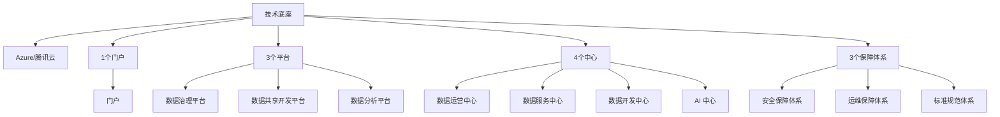

| 项目 | 内容 |
|------|------|
| **来源** | 大数据 / DataPlatform  |
| **技术底座** | Azure / 腾讯云 |
| **架构主张** | One Data, One Service + 湖仓一体 |
| **适用读者** | 数据架构师、平台 Owner、云上选型 |

---

## 1. 为什么先谈架构演进

企业数据平台往往不是从零搭一套，而是在批流并存、报表时效、成本与一致性之间不断妥协。历史上三条主路线——**Lambda**、**Kappa**、**Data Lakehouse（湖仓一体）**——分别对应不同的权衡；理解它们的短板，才更好解释为什么今天越来越多团队把 Table Format（Delta Lake / Hudi / Iceberg）和统一治理放在中心。

---

## 2. 批流架构：Lambda、Kappa 与湖仓一体

### 2.1 Lambda 架构

Lambda 将**批处理层**与**速度层（实时）**并行，再用**服务层**合并对外查询结果。

*图 2-1：Lambda 批流双链路*

### 2.2 Kappa 架构

Kappa 主张**用流处理统一一切**：全链路围绕消息队列（典型为 Kafka）重放与计算，弱化独立批处理层。

*图 2-2：Kappa 以流为核心的统一链路*

### 2.3 Data Lakehouse

湖仓一体在**低成本对象存储**上叠加 **Table Format** 与 **OLAP 引擎**，力图兼顾数据湖的灵活性与数仓的管理、分析能力。

*图 2-3：湖仓一体分层与计算*

### 2.4 企业落地形态（示例）

*图 2-4：从采集到应用的分层示例*

### 2.5 架构短板与湖仓一体的回应

| 架构 | 主要短板 | 湖仓一体如何缓解 |
|------|----------|------------------|
| **Lambda** | 两套代码实现同一需求；集群与存储占用大；离线与实时结果易不一致；批量可能出现 T+1 跑不完；维护成本高 | 并非逐项「专门消灭 Lambda」，但通过**存储统一**、**统一元数据**、**分层上支持 OLAP**，可简化链路、降低重复建设，间接缓解资源与一致性压力 |
| **Kappa** | Kafka 难以承接海量长期存储；不擅长大规模 OLAP；血缘与批流统一治理难；消息流对 update/upsert 支持弱 | **统一湖存储**缓解容量问题；**任一分层可分析**支撑 OLAP；**同一套血缘**；Table Format 支持**增量与 upsert** 类能力 |

---

## 3. 存储与序列化：该放哪一层用什么格式

### 3.1 湖仓表格式（Table Format）

在对象存储之上，用开放表格式管理**快照、分区、Schema 演进与 ACID 语义**：

1. **Delta Lake**
2. **Apache Hudi**
3. **Apache Iceberg**

### 3.2 列式存储（分析侧主力）

- **Parquet**
- **ORC**

### 3.3 二进制序列化（管道与 Schema 演进）

- **Avro**

### 3.4 文本格式（边界接入与轻量交换）

- **JSON**
- **CSV**

选型建议：**入湖与数仓主题层优先列式 + Table Format**；**流式管道与跨版本 Schema** 常用 Avro；**API / 日志对接** 再保留 JSON 等文本格式，并在治理层约束落湖前的清洗规则。

---

## 4. Database 与 Data Warehouse：OLTP 与 OLAP

| 维度 | Database（OLTP） | Data Warehouse（OLAP） |
|------|------------------|-------------------------|
| **数据范围** | 当前状态数据 | 反映历史变化的完整数据 |
| **数据变更** | 频繁增删改查 | 以插入、查询为主，通常不做更新删除 |
| **应用场景** | 面向业务交易过程 | 面向分析决策 |
| **处理特征** | 高频、小批量、高并发、低延迟 | 低频、大批量、高吞吐，可接受一定延迟 |
| **设计理论** | 遵循三范式，减少冗余 | 可违背范式，适度冗余以换查询性能 |
| **建模方法** | ER 实体关系建模 | 范式建模 + 维度建模 |

平台设计中常见做法：**OLTP 库做业务真相源**，经集成进入 **ODS → DWD → DWS → ADS** 等分层，在湖仓或 OLAP 引擎上服务报表与 API。

---

## 5. 总体蓝图：One Data, One Service

建设目标可以概括为：**一套数据资产、一种服务方式对外**。逻辑上拆为「1 个技术底座 + 1 个门户 + 3 个平台 + 4 个中心 + 3 个保障体系」。

*图 5-1：能力域总览*

*图 5-2：平台分层与模块关系（设计原图）*

### 5.1 技术底座

技术底座提供**计算、存储、网络**等基础资源；本方案以 **Azure / 腾讯云** 为主要 IaaS/PaaS 载体，上层平台以托管或半托管大数据产品为主，降低自建运维面。

### 5.2 三个平台

#### 数据治理平台

贯穿接入、处理、使用全生命周期：**数据标准**统一格式与编码；**质量管理**做必填、范围、时效等规则校验；**元数据**记录来源、定义与流向；**安全管控**覆盖加密、权限与审计，降低泄露与越权风险。

#### 数据共享开发平台

面向开发者与业务数据人员：**多源适配与抽取**；**ETL/ELT** 清洗、转换与入湖入仓；**标准化接口** 支撑部门间共享，打破数据孤岛（如市场行为数据支撑产品研发迭代）。

#### 数据分析平台

集成挖掘、机器学习与**可视化自助分析**：关联规则、预测模型与拖拽式图表，让业务人员快速完成区域销售对比、份额结构等决策视图。

### 5.3 四个中心

| 中心 | 职责摘要 |
|------|----------|
| **数据运营中心** | 监控 CPU/内存/IO、任务状态与数据流量；智能预警；备份、归档、生命周期策略 |
| **数据服务中心** | 以 API、订阅等方式对外交付数据产品；鉴权、限流与场景化接口设计 |
| **数据开发中心** | 建模工具、ODS/DWD/DWS/ADS 分层建设；协作开发与版本管理；开发过程对齐治理标准 |
| **AI 中心** | 机器学习 / 深度学习与平台数据闭环，支撑智能化分析与业务应用 |

### 5.4 三个保障体系

- **安全保障**：防火墙、IDS/IPS；传输与存储加密；RBAC；脱敏；应用漏洞扫描与修复。
- **运维保障**：日常巡检、变更、容量与故障处理，保障 SLA。
- **标准规范**：数据标准、技术标准（语言、接口风格）、管理标准（项目、运维、安全流程）。

### 5.5 一个门户

统一入口，按角色裁剪：**业务人员**直达报表与分析；**开发人员**管理任务与协作；**数据管理人员**进入治理与元数据模块。交互上以「少跳转、可检索」为原则。

---

## 6. Azure 与腾讯云：产品能力对照

云上选型时，宜按**批流计算、集成调度、无服务器、BI、实时**五条线对位，而不是逐个 SKU 堆砌。

### 6.1 功能对比（节选）

| 功能/产品 | Azure Databricks | Azure Data Factory (ADF) | Azure Functions | Power BI | 腾讯云 WeData | 腾讯云 DLC | 腾讯云 Oceanus |
|-----------|------------------|--------------------------|-----------------|----------|---------------|------------|----------------|
| **核心功能** | 大数据处理、ML、数据工程 | 数据集成、ETL/ELT 管道 | 无服务器、事件驱动 | 可视化、商业智能 | 开发、集成、治理 | 数据湖计算、分析 | 实时流处理 |
| **适用场景** | 大规模处理、ML 训练、湖分析 | 迁移、管道、调度 | 事件型微任务 | 报表、经营分析 | 开发治理共享 | 湖上 SQL/Spark | Flink 实时 |
| **数据处理** | 批 + 流，Spark / Delta | 批 + 流，多源 | 无（触发为主） | 无（展示为主） | 批 + 流 | 批 + 流，Spark/Flink | 流，Flink |
| **机器学习** | MLflow 等 | 无 | 无 | 无 | 无 | 无 | 无 |
| **可视化** | 有限 | 无 | 无 | 强 | 有限 | 无 | 无 |
| **成本倾向** | 偏高（算力） | 中等（数据量/管道） | 低（按次） | 中等（用户/数据量） | 中等 | 偏高 | 偏高 |

**补充**：在 Databricks 体系上，**Unity Catalog** 可作为跨工作区的统一元数据与权限治理层，与上文「One Data」目标一致，适合作为云上治理锚点。

### 6.2 参考架构图

**腾讯云侧：**

*图 6-1：腾讯云大数据产品组合示意*

**Azure 侧：**

*图 6-2：Azure 大数据产品组合示意*

---

## 7. 小结

1. **架构演进**：Lambda 与 Kappa 各有利弊；**湖仓一体**用开放表格式与统一存储，缓解存储、OLAP、血缘与增量更新等痛点。
2. **格式分层**：Table Format + 列式存储服务分析主路径；Avro / JSON 守住管道与边界。
3. **平台方法论**：**One Data, One Service** 通过门户、三平台、四中心、三保障落地，而不是只买云产品不建治理。
4. **云选型**：Azure 侧常见 **ADF + Databricks + Power BI + Functions**；腾讯云侧常见 **WeData + DLC + Oceanus** 组合，按批流占比与 BI 深度做裁剪。

若与仓库内《自建企业级数据平台架构》系列对照阅读：该系列偏**开源底座 + K8s 私有化**；本文偏**多云托管产品与组织域划分**，二者可互为「同一方法论、不同实现路径」的参照。
