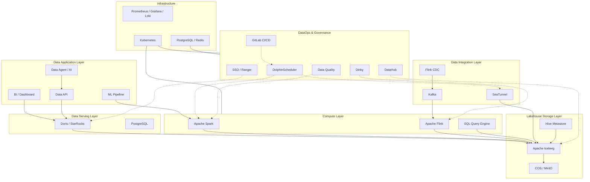
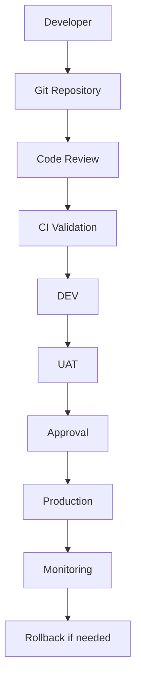

| 项目 | 内容 |
|------|------|
| **文档版本** | V1.0 |
| **建设模式** | 开源组件底座 + 自研企业门户 + 统一治理 |
| **部署模式** | IDC / 私有云 / 混合云 |
| **技术方向** | Lakehouse + DataOps + Data Governance + AI Ready |

---

## 1. 项目背景与建设目标

### 1.1 项目背景

随着企业业务系统、实验数据、生产数据和分析场景持续增长，传统以独立 ETL 工具、数据库和任务调度器为核心的数据处理模式，逐渐面临以下问题：

1. 数据集成方式分散，缺少统一接入标准。
2. 批处理和流处理缺乏统一的数据架构。
3. 数据开发、任务调度、数据资产管理相互独立。
4. 数据质量、数据血缘和权限治理不完善。
5. 数据处理流程缺少标准化的开发、测试和发布机制。
6. 数据平台缺少统一服务接口，难以支持 AI Agent 和 Data Agent。

因此，需要建设一套统一的数据平台，整合数据接入、存储、计算、调度、治理和数据服务能力。

### 1.2 建设目标

建设目标包括：

| 目标 | 具体内容 |
|---|---|
| 统一数据接入 | 支持数据库、API、文件、消息队列等多种数据源 |
| 统一数据存储 | 建立基于 Lakehouse 的统一数据存储体系 |
| 统一计算能力 | 支持批处理、流处理和交互式查询 |
| 统一任务调度 | 统一管理数据开发任务及任务依赖 |
| 统一数据治理 | 元数据、血缘、质量、权限和审计 |
| 统一数据服务 | 提供 SQL、API、BI 和数据产品服务 |
| 统一开发运维 | 建立 CI/CD、环境隔离和监控体系 |
| AI Ready | 为 Data Agent、ML Pipeline 和 AI 应用提供数据基础 |

### 1.3 设计原则

- Open Source First：优先采用成熟开源组件。
- One Capability, One Primary Engine：每种核心能力优先保留一个主选。
- Lakehouse First：统一湖仓数据格式和数据分层。
- API First：各个组件通过标准 API 集成。
- Metadata Driven：以元数据驱动数据开发和治理。
- Cloud Native：支持 Kubernetes 和弹性资源管理。
- Security by Design：权限、审计和安全贯穿全链路。
- AI Ready：架构预留 Agent、MCP 和智能数据分析能力。

---

## 2. 总体架构设计

### 2.1 七层逻辑架构

平台划分为七个逻辑层：

1. Data Application Layer：数据应用层。
2. Data Serving Layer：数据服务层。
3. Compute Layer：计算引擎层。
4. Lakehouse Storage Layer：湖仓存储层。
5. Data Integration Layer：数据集成层。
6. DataOps & Governance Layer：开发治理控制面。
7. Infrastructure Layer：基础设施层。

其中，DataOps & Governance 是横向控制面，负责统一管理其他层的元数据、任务、权限、质量和发布。

### 2.2 架构组件

| 架构层 | 核心组件 | 主要职责 |
|---|---|---|
| Application | BI、Data API、Data Agent、ML | 数据消费和应用 |
| Serving | Doris、PostgreSQL | OLAP、业务查询、API |
| Compute | Spark、Flink | 批处理和流处理 |
| Storage | Iceberg、COS/MinIO | 湖仓数据存储 |
| Catalog | Hive Metastore | 表、Schema、分区元数据 |
| Integration | SeaTunnel、Kafka、Flink CDC | 数据接入和同步 |
| Orchestration | DolphinScheduler | 工作流和任务调度 |
| Stream Management | Dinky | Flink 作业开发和运维 |
| Metadata | DataHub | 数据目录和血缘 |
| Data Quality | Great Expectations | 数据质量校验 |
| Lineage | OpenLineage | 作业运行血缘采集 |
| Security | Ranger、SSO | 数据权限和身份认证 |
| DevOps | GitLab CI/CD | 开发、测试和发布 |
| Infrastructure | Kubernetes | 容器编排和资源管理 |
| Monitoring | Prometheus、Grafana、Loki | 监控和日志 |

### 2.3 总体数据架构



说明：

- DolphinScheduler 负责批任务和工作流编排。
- Dinky 负责 Flink 作业开发、发布及运行管理。
- Spark 负责批量 ETL 和历史数据处理。
- Flink 负责 CDC 和实时流计算。
- Iceberg 负责湖仓表格式和数据管理。
- Doris 负责高性能分析查询和应用服务。
- DataHub 负责数据资产目录和元数据管理。

---

## 3. 核心技术组件选型

### 3.1 数据集成

#### 推荐：Apache SeaTunnel

主要能力：

- 数据库全量同步。
- 增量数据同步。
- 文件数据同步。
- Kafka 数据接入。
- 多种数据源 Connector。
- 批量和流式数据集成。

备选：

| 组件 | 定位 | 建议 |
|---|---|---|
| SeaTunnel | 通用数据集成 | 主选 |
| DataX | 批量数据同步 | 兼容历史任务 |
| Flink CDC | 数据库实时 CDC | 实时场景 |
| Kafka Connect | Kafka 生态连接器 | 已有 Kafka Connect 体系时考虑 |

建议：新建设计以 SeaTunnel 为主，实时 CDC 根据场景采用 Flink CDC。

### 3.2 消息队列

#### 推荐：Apache Kafka

主要职责：

- CDC 数据缓冲。
- 实时数据解耦。
- 消息削峰。
- 多消费者订阅。
- 流计算数据输入。

不建议没有实时需求时一开始就部署 Kafka。

### 3.3 批处理引擎

#### 推荐：Apache Spark

适用场景：

- ODS → DWD。
- DWD → DWS。
- DWS → ADS。
- 大规模历史数据回刷。
- Iceberg Compaction。
- ML 特征加工。

### 3.4 流处理引擎

#### 推荐：Apache Flink

适用场景：

- MySQL CDC。
- 实时数据同步。
- 实时指标计算。
- 实时 Join。
- 实时数据质量检查。

#### Flink 管理平台：Dinky

负责：

- Flink SQL 开发。
- Flink 作业发布。
- 作业状态监控。
- Savepoint 管理。
- 作业生命周期管理。

Dinky 不替代 Flink 本身，也不替代 DolphinScheduler。

### 3.5 湖仓存储

#### 推荐：Apache Iceberg + Object Storage

存储介质：

- 私有化部署：MinIO。
- 混合云部署：COS / OSS。

Iceberg 提供：

- Schema Evolution。
- Partition Evolution。
- Snapshot。
- Time Travel。
- ACID 事务。
- 表级元数据管理。

建议 ODS、DWD、DWS 统一采用 Iceberg。

### 3.6 Catalog

初期建议采用 Hive Metastore。

后续如果需要统一管理多种计算引擎、多种 Catalog 和更复杂的多租户命名空间，再评估 Apache Gravitino。

不建议在第一期同时维护两套 Catalog。

### 3.7 OLAP 查询引擎

推荐在 Apache Doris 和 StarRocks 之间选择一个。

| 对比维度 | Doris | StarRocks |
|---|---|---|
| 实时分析 | 支持 | 支持 |
| MPP 查询 | 支持 | 支持 |
| 高并发 BI | 支持 | 支持 |
| 明细查询 | 支持 | 支持 |
| 湖仓查询 | 支持多种湖表访问方式 | 支持多种湖表访问方式 |
| 数据导入 | 多种导入方式 | 多种导入方式 |
| 选型原则 | 依据现有技术栈和运维经验 | 依据现有技术栈和运维经验 |

最终应通过相同数据集、相同查询和相同硬件进行 POC，重点测试：

1. 并发查询。
2. 聚合查询。
3. 明细查询。
4. Iceberg 外表查询。
5. 数据导入吞吐量。
6. 资源使用和扩展成本。

---

## 4. 数据分层与数据标准

### 4.1 数据分层

采用 ODS → DWD → DWS → ADS 四层模型。

| 分层 | 定位 | 数据内容 | 存储 |
|---|---|---|---|
| Landing | 原始接入区 | 原始文件、原始数据 | COS / MinIO |
| ODS | 操作数据层 | 原始业务数据、CDC | Iceberg |
| DWD | 明细数据层 | 清洗和标准化数据 | Iceberg |
| DWS | 汇总数据层 | 主题域和公共指标 | Iceberg |
| ADS | 应用数据层 | BI、API、业务应用数据集 | Doris / Iceberg |

### 4.2 命名规范

建议统一：

```text
ods_biz_source_table
dwd_domain_entity
dws_domain_subject
ads_business_application
```

例如：

```text
ods_lims_experiment
ods_mes_batch
dwd_cmc_batch
dwd_cmc_process_parameter
dws_cmc_batch_summary
ads_cmc_batch_dashboard
```

### 4.3 元数据标准

每张数据表至少包含：

- table_name
- table_description
- business_domain
- owner
- data_source
- schema_version
- data_layer
- update_frequency
- sensitivity_level
- retention_policy
- upstream_tables
- downstream_tables

每个字段至少包含：

- column_name
- data_type
- description
- unit
- nullable
- sensitivity_level
- business_definition

---

## 5. 数据开发与任务调度

### 5.1 调度架构

统一采用 DolphinScheduler 作为平台级调度中心。

任务类型：

- SeaTunnel 数据同步任务。
- Spark SQL / Spark Application。
- 数据质量校验。
- 数据导出和同步。
- 外部 API 调用。
- 数据对账任务。

Dinky 管理 Flink 长运行作业。

两者职责分离：

| 工具 | 负责内容 |
|---|---|
| DolphinScheduler | 工作流、依赖、补数、定时调度 |
| Dinky | Flink SQL、作业发布、Savepoint |
| GitLab CI/CD | 代码管理、测试、构建和发布 |

### 5.2 任务发布流程



任务发布必须具备：

1. 代码版本。
2. 环境配置。
3. 参数管理。
4. 发布审批。
5. 执行日志。
6. 失败告警。
7. 回滚能力。

---

## 6. DataOps 与数据治理

### 6.1 元数据管理

推荐 DataHub 或 OpenMetadata 作为统一数据资产平台。

主要能力：

- 数据库和数据表注册。
- Schema 管理。
- 数据目录。
- 数据资产搜索。
- 数据负责人管理。
- 数据血缘。
- 标签和分类。
- 数据使用关系。

建议只选择一个作为主元数据平台。

### 6.2 数据血缘

推荐 OpenLineage 作为血缘事件标准。

数据链路：

```text
Spark / Flink / SeaTunnel
          |
          v
    OpenLineage
          |
          v
       DataHub
          |
          v
   Data Lineage UI
```

目标是实现：

- 表级血缘。
- 任务级血缘。
- 上下游依赖。
- 数据影响分析。

字段级血缘需要根据具体引擎和集成能力逐步建设，不应默认认为所有作业都可以自动采集。

### 6.3 数据质量

推荐 Great Expectations 或自研质量规则服务。

核心检查类型：

| 质量维度 | 示例 |
|---|---|
| Completeness | 非空率 |
| Uniqueness | 主键重复率 |
| Validity | 字段值范围 |
| Consistency | 多表数据一致性 |
| Timeliness | 数据延迟 |
| Accuracy | 业务规则校验 |

建议质量规则与数据任务绑定。

例如：

```text
Spark DWD Job
     |
     v
Data Quality Check
     |
     +---- PASS ----> Publish DWD
     |
     +---- FAIL ----> Alert + Stop Downstream
```

### 6.4 数据权限

建议：

- SSO：统一身份认证。
- RBAC：平台功能权限。
- Ranger：兼容引擎的数据权限管理。
- 审计日志：记录用户、资源、操作和时间。

需要针对 Doris、Spark、Flink、Iceberg Catalog 等实际版本验证 Ranger 插件或原生权限能力，不要假设所有组件天然共用一套权限控制。

---

## 7. 统一数据平台 Portal

### 7.1 建设目标

自研统一门户，不重新实现底层开源引擎。

统一入口：

- Data Assets。
- Data Development。
- Workflow。
- Data Quality。
- Data Governance。
- Data Services。
- Monitoring。
- Model & AI。

### 7.2 Portal 技术栈

| 模块 | 推荐技术 |
|---|---|
| Frontend | React + TypeScript |
| Backend | Spring Boot / Go |
| API Gateway | Kong / APISIX |
| Authentication | Keycloak / 企业 SSO |
| Authorization | RBAC + Casbin |
| Metadata | DataHub API |
| Workflow | DolphinScheduler API |
| Flink | Dinky API |
| Database | PostgreSQL |
| Cache | Redis |
| Event | Kafka（按需） |

### 7.3 核心服务模块

```text
data-platform/
├── frontend/
│   ├── data-assets/
│   ├── data-development/
│   ├── workflow/
│   ├── data-quality/
│   ├── governance/
│   └── monitoring/
│
├── backend/
│   ├── identity-service/
│   ├── metadata-service/
│   ├── integration-service/
│   ├── workflow-service/
│   ├── quality-service/
│   ├── governance-service/
│   └── data-service/
│
├── adapters/
│   ├── seatunnel-adapter/
│   ├── spark-adapter/
│   ├── flink-adapter/
│   ├── dinky-adapter/
│   ├── dolphinscheduler-adapter/
│   └── datahub-adapter/
│
└── infrastructure/
    ├── kubernetes/
    ├── monitoring/
    ├── security/
    └── deployment/
```

平台自身的业务数据、用户权限、配置和发布记录存储在 PostgreSQL 中。

底层计算和调度的实际运行状态仍由对应开源组件管理，通过 Adapter 统一接入。

---

## 8. 物理部署架构

### 8.1 资源池划分

建议将基础设施分为三个资源池。

| 资源池 | 组件 | 部署原则 |
|---|---|---|
| Control Plane | Portal、DolphinScheduler、Dinky、DataHub | 高可用、稳定运行 |
| Compute Plane | Spark、Flink、SeaTunnel | 独立资源配额、弹性扩缩 |
| Storage Plane | MinIO、Doris、PostgreSQL | 独立规划存储和 IO |

### 8.2 Kubernetes Namespace

```text
data-platform
│
├── dp-control
│   ├── portal
│   ├── dolphinscheduler
│   ├── dinky
│   └── datahub
│
├── dp-compute
│   ├── spark
│   ├── flink
│   └── seatunnel
│
├── dp-storage
│   ├── doris
│   ├── postgresql
│   └── redis
│
├── dp-monitoring
│   ├── prometheus
│   ├── grafana
│   └── loki
│
└── dp-security
    ├── sso
    └── ranger
```

Namespace 只是逻辑隔离。还需要配套：

- ResourceQuota。
- LimitRange。
- NetworkPolicy。
- ServiceAccount。
- RBAC。
- PodDisruptionBudget。
- 独立节点池和存储策略。

### 8.3 高可用设计

| 组件 | 高可用策略 |
|---|---|
| Portal | 多副本 + Ingress |
| PostgreSQL | 主备或托管高可用 |
| Redis | Sentinel / Cluster |
| DolphinScheduler | Master / Worker 多节点 |
| Flink | JobManager HA + Checkpoint |
| Kafka | 多 Broker + 副本 |
| MinIO | 分布式部署 |
| Doris | FE / BE 高可用 |
| DataHub | 多副本 + 元数据库和搜索后端高可用 |
| Prometheus | 持久化 + 备份 |

具体副本数量应根据 SLA、吞吐量、预算和故障域确定。

---

## 9. 接口与集成规范

### 9.1 统一 API 设计

建议 Portal 对外提供统一 API。

| API | 功能 |
|---|---|
| GET /api/v1/datasets | 查询数据集 |
| GET /api/v1/tables/{id} | 查询表信息 |
| GET /api/v1/lineage/{id} | 查询数据血缘 |
| POST /api/v1/ingestions | 创建数据同步任务 |
| GET /api/v1/jobs | 查询任务 |
| POST /api/v1/jobs/{id}/run | 触发任务 |
| GET /api/v1/executions/{id} | 查询执行状态 |
| POST /api/v1/quality/rules | 创建质量规则 |
| GET /api/v1/quality/results | 查询质量结果 |
| POST /api/v1/releases | 创建发布 |

### 9.2 统一任务模型

建议自研统一任务元数据结构：

```json
{
  "taskId": "task_001",
  "taskName": "ods_to_dwd_batch",
  "taskType": "SPARK",
  "project": "CMC",
  "environment": "DEV",
  "version": "1.0.0",
  "schedule": {
    "type": "CRON",
    "expression": "0 0 2 * * ?"
  },
  "input": [
    "ods_cmc_batch"
  ],
  "output": [
    "dwd_cmc_batch"
  ],
  "owner": "data_team"
}
```

注意：这是平台内部的统一任务描述，不应直接替代各个执行引擎自身的任务定义。

### 9.3 统一执行状态

建议统一为：

```text
CREATED
    |
SUBMITTED
    |
RUNNING
    |
SUCCESS / FAILED / CANCELLED
```

底层各组件状态通过 Adapter 转换为平台统一状态。

---

## 10. AI 与 ML 扩展架构

平台建成后，可以在现有 DataOps 能力之上增加 AI 能力。

### 10.1 Data Agent

Data Agent 主要提供：

- 自然语言查询数据。
- 自动生成 SQL。
- 数据资产搜索。
- 数据血缘解释。
- 数据质量分析。
- 数据异常诊断。

建议架构：

```text
User
 |
 v
Data Agent
 |
 v
Agent Runtime
 |
 +---- Metadata Tool
 |
 +---- SQL Tool
 |
 +---- Lineage Tool
 |
 +---- Data Quality Tool
 |
 +---- Workflow Tool
 |
 v
Data Platform API
```

Agent 不应绕过平台权限直接访问底层数据库。

所有工具调用都应经过统一认证、授权和审计。

### 10.2 ML Platform

可以逐步增加：

- MLflow：实验跟踪和模型注册。
- Kubeflow Pipelines：复杂 Kubernetes ML Pipeline，按需引入。
- Feast：Feature Store，按需引入。
- Model Serving：模型在线服务。

初期不建议把所有 MLOps 组件一起部署，先建立训练、模型注册和部署的基本闭环。

---

## 11. 分阶段实施计划

### Phase 1：基础数据平台

目标：建立可运行的数据湖仓和批处理平台。

建设内容：

- Kubernetes。
- COS / MinIO。
- PostgreSQL。
- Iceberg。
- Hive Metastore。
- SeaTunnel。
- Spark。
- DolphinScheduler。
- Doris。

交付成果：

1. MySQL → ODS。
2. ODS → DWD。
3. DWD → DWS。
4. DWS → Doris。
5. 基础数据调度。
6. 基础监控和告警。

### Phase 2：实时计算和数据治理

目标：建立实时数据链路和治理能力。

建设内容：

- Kafka。
- Flink。
- Dinky。
- DataHub。
- OpenLineage。
- Great Expectations。
- SSO。
- Ranger。

交付成果：

1. 数据库 CDC。
2. 实时数据入湖。
3. 实时指标计算。
4. 数据目录。
5. 数据血缘。
6. 数据质量检查。
7. 数据权限与审计。

### Phase 3：统一门户和智能化平台

目标：建立企业级统一数据管理入口。

建设内容：

- Unified Data Platform Portal。
- 统一任务管理。
- 统一元数据管理。
- CI/CD。
- 数据 API。
- Data Agent。
- MLflow。
- MCP Tools。

交付成果：

1. 统一数据资产门户。
2. 统一任务开发和发布。
3. 统一权限和审计。
4. 统一数据服务。
5. AI 数据分析助手。
6. ML 模型生命周期管理。

---

## 12. 技术风险与待验证事项

| 风险 | 影响 | 解决方案 |
|---|---|---|
| Iceberg 多引擎兼容性 | SQL 和表操作行为可能不同 | Spark/Flink/Doris POC |
| Catalog 兼容性 | 不同引擎元数据访问差异 | 统一 Catalog 选型测试 |
| Flink CDC 一致性 | 可能出现重复或数据缺失 | 检查 Checkpoint、事务和恢复策略 |
| 数据权限不一致 | 越权访问 | 统一身份和权限映射 |
| 血缘采集不完整 | 影响分析不准确 | 统一 OpenLineage 事件标准 |
| 资源竞争 | 作业影响 Portal 和实时任务 | 资源池隔离 |
| 数据质量性能 | 影响数据链路延迟 | 质量规则分级执行 |
| 多组件运维复杂 | 增加维护成本 | 减少重复组件、统一监控 |

---

## 13. 最终技术选型清单

| 类别 | 推荐技术 | 优先级 |
|---|---|---|
| Container Platform | Kubernetes | P0 |
| Object Storage | COS / MinIO | P0 |
| Lakehouse Format | Iceberg | P0 |
| Catalog | Hive Metastore | P0 |
| Batch Compute | Spark | P0 |
| Scheduler | DolphinScheduler | P0 |
| Data Integration | SeaTunnel | P0 |
| OLAP | Doris / StarRocks（二选一） | P0 |
| Streaming | Flink | P1 |
| Message Queue | Kafka | P1 |
| Flink Management | Dinky | P1 |
| Metadata | DataHub / OpenMetadata（二选一） | P1 |
| Lineage | OpenLineage | P1 |
| Data Quality | Great Expectations | P1 |
| Security | SSO + Ranger | P1 |
| DevOps | GitLab CI/CD | P1 |
| Monitoring | Prometheus + Grafana + Loki | P1 |
| ML Platform | MLflow | P2 |
| Feature Store | Feast | P2 |
| AI Agent | LangGraph / MCP | P2 |

---

## 14. 架构决策总结

最终推荐架构：

**Kubernetes + SeaTunnel + DolphinScheduler + Spark + Flink + Kafka + Iceberg + COS/MinIO + Hive Metastore + Doris + DataHub + OpenLineage + Great Expectations。**

核心设计思路：

1. Iceberg 是统一湖仓数据格式。
2. Spark 是批处理主引擎。
3. Flink 是实时处理主引擎。
4. DolphinScheduler 是统一工作流调度中心。
5. SeaTunnel 是通用数据集成主工具。
6. DataHub 是统一数据资产管理入口。
7. OpenLineage 是血缘采集标准。
8. 自研 Portal 是统一数据平台入口。
9. AI Agent 通过平台 API 和 MCP 扩展能力，不直接绕过治理体系。

**最终目标不是部署一组开源组件，而是构建一套统一、可治理、可扩展、可运维，并且能够支持未来 AI 应用的数据基础设施。**
