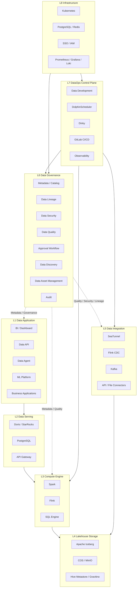
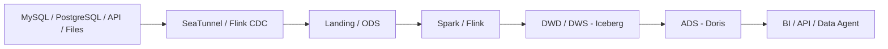
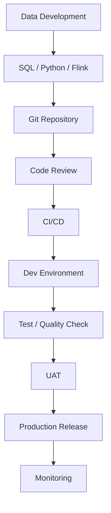
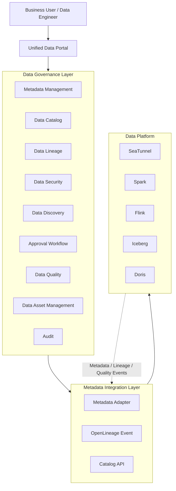
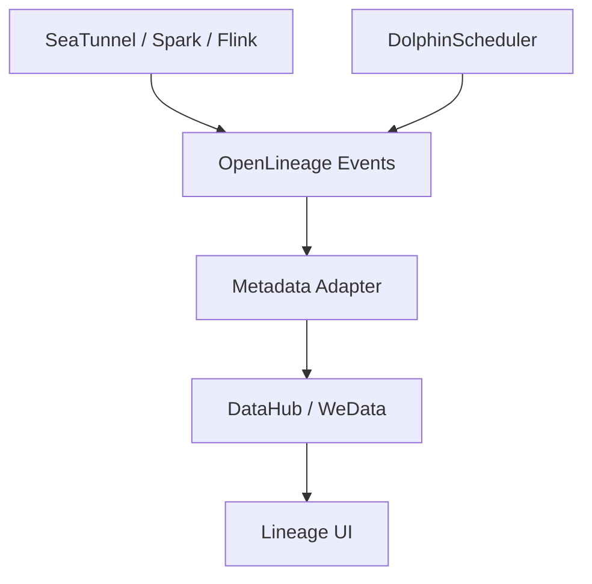
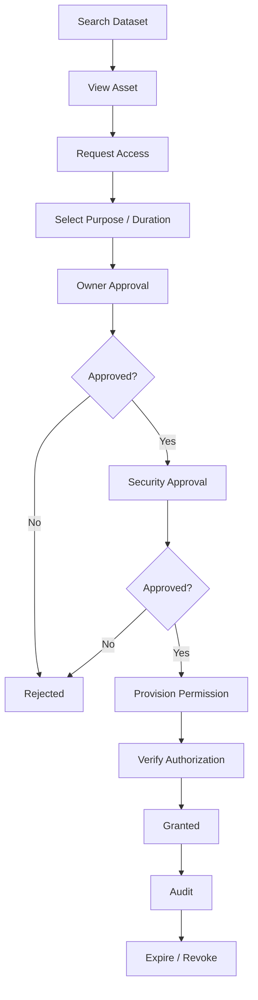
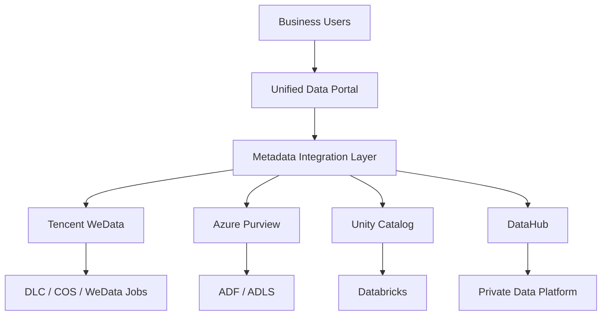
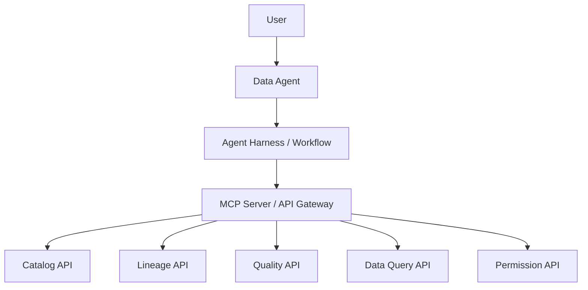

# Enterprise Data Platform Architecture

**版本：** V2.0  
**文档类型：** High-Level Design（**HLD**，高层设计 / 概要设计）  
**建设模式：** 开源组件底座 + 自研统一门户与治理能力  
**部署模式：** Kubernetes / 私有化部署 / 混合云  
**架构目标：** 建设统一的数据接入、存储、计算、治理、开发、服务和 AI 应用平台。

> **HLD 读者预期**：本文描述目标态架构、能力域划分、选型原则、分阶段路线与 POC 验收标准，供立项评审与总体设计对齐使用。组件级部署参数、具体库表与接口契约属于 **LLD（Low-Level Design，详细设计）**，不在本文展开。精要版见 [EnterpriseDataPlatform.md](./EnterpriseDataPlatform.md)；系列术语见 [DataPlatformSeriesOverview.md §0.1](./DataPlatformSeriesOverview.md#01-术语hld--lld--poc--sku)。

---

# 1. 项目背景与建设目标

## 1.1 项目背景

随着企业数据规模、数据来源和业务应用不断增加，传统以数据库、ETL 工具和独立 BI 系统为中心的数据架构，逐渐出现以下问题：

1. **数据孤岛：** 数据分散在不同业务系统、数据库、云平台和文件存储中。
2. **开发链路分散：** 数据集成、计算、调度和任务发布缺少统一管理。
3. **数据资产缺乏统一管理：** 数据表、字段、业务定义、Owner 和使用情况分散。
4. **数据血缘不完整：** 无法准确追踪数据来源、转换过程和下游影响。
5. **数据安全管理不足：** 数据发现、访问申请、审批、授权和审计没有形成闭环。
6. **数据服务能力不足：** 数据资产难以标准化开放给 BI、API 和业务应用。
7. **AI 能力与数据平台脱节：** 数据 Agent、机器学习和智能分析缺少统一的数据基础设施。

因此，需要建设一个统一的企业级数据平台，将数据工程能力与数据治理能力整合起来，并为未来 Data Agent、MLOps 和企业 AI 应用提供统一的数据基础。

## 1.2 建设目标

| 建设方向 | 建设目标 |
|---|---|
| 数据集成 | 统一接入数据库、API、文件、CDC 和云数据源 |
| 数据存储 | 建立统一 Lakehouse 数据存储体系 |
| 数据计算 | 支持批处理、实时计算和交互式分析 |
| 数据开发 | 统一 SQL、Notebook、任务开发和发布 |
| 数据调度 | 统一管理批任务、工作流和任务依赖 |
| 数据治理 | 建立元数据、目录、血缘、质量和安全管理 |
| 数据资产 | 建立统一数据资产目录和数据发现入口 |
| 数据服务 | 支持 BI、数据 API 和数据市场 |
| 数据运营 | 建立数据质量、使用情况和资产健康度监控 |
| AI 扩展 | 支持 Data Agent、MCP、RAG 和机器学习平台 |

## 1.3 建设原则

- **开源优先：** 优先采用成熟开源项目，减少重复造轮子。
- **统一标准：** 统一数据分层、命名规范、元数据模型和接口标准。
- **松耦合：** 集成、计算、存储、治理和服务模块独立演进。
- **治理前置：** 元数据、质量、安全和血缘融入数据开发流程。
- **云原生：** 基于 Kubernetes 建设统一运行环境。
- **可扩展：** 支持未来多云、混合云、AI Agent 和 MLOps。
- **权威系统明确：** 各数据环境保留原生权限和治理权威系统，统一门户负责聚合，不重复建设多个权威来源。

---

# 2. 总体架构设计

## 2.1 总体架构

整体采用分层架构，将平台划分为八个逻辑层。



说明：

- L1–L5 构成数据生产、计算和消费链路。
- L6 是横向治理层，贯穿数据接入、开发、计算和服务。
- L7 是平台开发和运行控制面。
- L8 提供统一基础设施。
- Data Governance 不直接替代底层引擎权限系统，而是通过统一策略和授权接口实现治理闭环。

## 2.2 核心架构分区

建议在部署层面进一步划分三个资源平面。

| 平面 | 主要组件 | 职责 |
|---|---|---|
| Control Plane | Portal、Catalog、Metadata、DolphinScheduler、SSO | 平台管理、任务管理、治理和权限 |
| Compute Plane | Spark、Flink、Doris、SQL Engine | 数据处理、实时计算和查询 |
| Storage Plane | COS / MinIO、Iceberg、Catalog、PostgreSQL | 数据存储、元数据存储和持久化 |

三个平面逻辑隔离，资源和网络策略独立管理。

---

# 3. 技术选型与组件清单

## 3.1 核心技术栈

| 技术领域 | 推荐组件 | 主要职责 | 优先级 |
|---|---|---|---|
| Container Platform | Kubernetes | 容器编排和资源管理 | P0 |
| Data Integration | SeaTunnel | 批量数据集成 | P0 |
| CDC | Flink CDC | 数据库变更捕获 | P1 |
| Message Queue | Kafka | 实时消息解耦 | P1 |
| Batch Compute | Spark | 批处理和离线计算 | P0 |
| Stream Compute | Flink | 实时计算 | P1 |
| Stream Management | Dinky | Flink 作业开发和发布 | P1 |
| Orchestration | DolphinScheduler | 统一工作流调度 | P0 |
| Lakehouse Format | Apache Iceberg | 统一湖仓表格式 | P0 |
| Object Storage | COS / MinIO | 数据文件、Checkpoint 和归档 | P0 |
| Catalog | Hive Metastore | Iceberg Catalog | P0 |
| OLAP | Doris / StarRocks | 交互式分析和数据服务 | P1 |
| Metadata | DataHub / WeData | 元数据和数据目录 | P0 |
| Lineage | OpenLineage | 血缘事件标准 | P1 |
| Data Quality | Great Expectations / WeData | 数据质量检测 | P1 |
| Data Security | SSO / CAM / Ranger / UC | 身份、权限和审计 | P0 |
| Data API | APISIX / Kong | API 网关 | P2 |
| Monitoring | Prometheus + Grafana + Loki | 指标、监控和日志 | P0 |
| CI/CD | GitLab CI/CD | 代码和数据任务发布 | P1 |
| ML Platform | MLflow | 实验、模型和版本管理 | P2 |

## 3.2 选型约束

### 调度引擎

推荐 DolphinScheduler 作为统一批任务调度平台。

Airflow 不作为第二套平台级主调度系统。只有在 Python DAG、ML Pipeline 或特定生态存在明确需求时，才作为局部工具引入。

职责划分：

| 组件 | 负责内容 |
|---|---|
| DolphinScheduler | T+1 批处理、任务依赖、跨系统工作流 |
| Dinky | Flink SQL/JAR 开发、发布、升级和回滚 |
| GitLab CI/CD | 代码审核、构建、部署和版本管理 |

不建议通过 DolphinScheduler 高频启停长期运行的 Flink 作业。

### 数据集成

优先使用 SeaTunnel 作为批量数据集成组件。

- SeaTunnel：数据库、文件、API 和批量同步。
- Flink CDC：实时数据库变更捕获。
- Kafka：实时消息缓冲、解耦和多消费者订阅。
- DataX：已有任务可保留，后续逐步迁移。

### 湖仓存储

推荐 Apache Iceberg 作为统一 Lakehouse 表格式。

- COS / MinIO：底层对象存储。
- Iceberg：ODS、DWD、DWS 数据表。
- Hive Metastore：初期 Catalog。
- Gravitino：未来需要统一多 Catalog 管理时再评估。

初期不建议同时引入 Iceberg、Hudi、Paimon 三种表格式。

### OLAP 引擎

Doris 和 StarRocks 二选一。

主要评估：

- 查询延迟。
- 并发能力。
- 实时导入能力。
- Iceberg 外表和湖仓查询能力。
- 资源消耗。
- 运维成本。
- 与 BI 工具的兼容性。

建议通过真实业务 SQL、并发和数据量进行 POC 后确定。

---

# 4. 数据存储与数据分层设计

## 4.1 数据分层

采用 ODS、DWD、DWS、ADS 四层模型。

| 数据层 | 主要职责 | 存储 | 计算 |
|---|---|---|---|
| Landing | 原始文件和原始数据落地区 | COS / MinIO | SeaTunnel |
| ODS | 原始结构化数据 | Iceberg | SeaTunnel / Spark |
| DWD | 清洗、标准化和明细数据 | Iceberg | Spark |
| DWS | 主题汇总和公共指标 | Iceberg | Spark / Flink |
| ADS | 面向业务和应用的数据集 | Doris | Spark / Flink |
| Serving | API、BI 和业务查询 | Doris / PostgreSQL | SQL / API |

## 4.2 数据链路



## 4.3 存储目录规范

建议对象存储采用统一目录结构。

```text
data-platform/
├── raw-data/
│   ├── dev/
│   ├── uat/
│   └── prd/
├── warehouse/
│   ├── ods/
│   ├── dwd/
│   ├── dws/
│   └── ads/
├── checkpoint/
│   └── flink/
├── archive/
└── temp/
```

数据文件、Iceberg 元数据、Checkpoint 和归档数据应使用独立存储路径和权限策略。

---

# 5. DataOps 与数据开发体系

## 5.1 数据开发流程



开发环境、测试环境和生产环境应进行隔离。

建议统一管理：

- 数据连接。
- SQL 脚本。
- Spark 作业。
- Flink 作业。
- DolphinScheduler 工作流。
- 数据质量规则。
- 数据库 Schema 变更。
- 数据发布记录。

## 5.2 调度体系

DolphinScheduler 作为批任务的统一入口。

典型任务：

| 任务类型 | 示例 |
|---|---|
| 数据同步 | MySQL → ODS |
| 数据处理 | ODS → DWD |
| 数据汇总 | DWD → DWS |
| 数据服务 | DWS → Doris |
| 数据质量 | DWD/DWS 质量检查 |
| 数据对账 | 上下游数据一致性检查 |
| 外部系统 | API、Shell、HTTP 调用 |

Flink 长运行任务由 Dinky 管理，DolphinScheduler 负责必要的依赖编排、批对账和告警联动。

---

# 6. Data Governance 与 Data Catalog

## 6.1 建设目标

数据治理是本次架构升级的核心部分。

需要从单纯的数据开发平台升级为数据资产全生命周期管理平台。

核心能力：

1. Metadata Management：元数据管理。
2. Data Catalog：数据目录。
3. Data Lineage：数据血缘。
4. Data Security：数据安全。
5. Data Discovery：数据发现。
6. Approval Workflow：访问审批。
7. Data Quality：数据质量。
8. Data Asset Management：数据资产运营。
9. Data Audit：访问和变更审计。

## 6.2 治理架构



## 6.3 Metadata Management

建立统一的元数据模型，覆盖技术元数据、业务元数据和管理元数据。

| 元数据类型 | 内容 |
|---|---|
| Technical Metadata | 数据源、数据库、表、字段、类型、Schema |
| Business Metadata | 业务域、业务定义、指标、术语 |
| Operational Metadata | 更新时间、任务状态、运行记录 |
| Governance Metadata | Owner、分类分级、标签、权限策略 |
| Lineage Metadata | 上下游数据关系、字段映射、任务依赖 |

建议自研统一元数据映射层，但不复制 DataHub、OpenMetadata 或 WeData 的内部数据模型。

### 核心实体

| 实体 | 说明 |
|---|---|
| DataSource | 数据源 |
| DataDomain | 业务数据域 |
| Database | 数据库 |
| Dataset | 数据集 / 数据表 |
| Column | 字段 |
| DataPipeline | 数据任务 |
| Lineage | 血缘关系 |
| DataAsset | 数据资产 |
| DataPolicy | 数据策略 |
| AccessRequest | 权限申请 |
| DataQualityRule | 质量规则 |

统一资产 ID 示例：

```text
assetId =
environment + platform + database + schema + table
```

同时保留源系统原始资源 ID，避免多 Catalog 同步时丢失资源映射关系。

## 6.4 Data Catalog

建立企业统一数据目录。

主要功能：

- 数据源注册。
- 数据库和表自动采集。
- Schema 自动更新。
- 数据资产目录树。
- 数据域管理。
- Owner 管理。
- 业务描述。
- 标签和分类分级。
- 资产搜索。
- 数据预览。
- 数据资产认证。

每个数据资产至少需要具备：

```text
Dataset
├── Basic Information
├── Business Definition
├── Schema
├── Owner
├── Domain
├── Tags
├── Classification
├── Lineage
├── Data Quality
├── Access Policy
├── Usage Statistics
└── Access Request
```

## 6.5 Data Lineage

采用 OpenLineage 作为统一血缘事件标准。

血缘建设分三个阶段：

| 阶段 | 建设内容 |
|---|---|
| Phase 1 | 表级血缘 |
| Phase 2 | 任务级血缘 |
| Phase 3 | 字段级血缘 |

数据链路：



OpenLineage 负责标准化血缘事件，不负责完整的元数据持久化和展示。

## 6.6 Data Security

需要将平台权限与数据权限分层。

| 权限类型 | 管理内容 | 推荐方案 |
|---|---|---|
| Platform RBAC | 页面、按钮、项目、操作权限 | Portal + Casbin |
| Data Asset Permission | 资产查看和申请权限 | Catalog + Approval |
| Data Access Permission | 表、行、列访问 | 引擎原生权限 / Ranger |
| Sensitive Data | 敏感分类、脱敏策略 | 原生脱敏 / 数据策略 |
| Audit | 访问记录、权限变更 | 统一审计服务 |

统一身份认证：

```text
Enterprise SSO
      |
      v
Unified Data Portal
      |
      +---- Platform RBAC
      |
      +---- Data Asset Permission
      |
      +---- Approval Workflow
      |
      v
Data Engine Authorization
      |
      +---- Doris
      +---- Iceberg / Catalog
      +---- PostgreSQL
```

需要注意：Ranger 不应被视为所有引擎的通用权限代理。各引擎应优先使用经过验证的原生权限能力，再根据需要集成 Ranger。

## 6.7 Approval Workflow

建立数据访问申请、审批、授权和回收的完整闭环。



申请信息：

- 申请人。
- 数据资产。
- 申请用途。
- 权限类型。
- 使用期限。
- 数据敏感级别。
- 审批人。
- 审批结果。
- 实际授权结果。

必须区分 `APPROVED` 和 `GRANTED`：

审批通过不代表权限已经实际生效。授权服务执行成功并验证后，才允许将申请状态更新为 `GRANTED`。

权限到期后应支持自动回收。

## 6.8 Data Discovery

统一数据搜索入口，支持：

- 表名和字段名。
- 业务描述。
- 业务域。
- Owner。
- 标签。
- 数据敏感级别。
- 更新时间。
- 认证状态。
- 质量状态。

未来可增加语义搜索、自然语言找数和 Data Agent。

## 6.9 Data Quality

数据质量分为三个阶段：

| 阶段 | 质量检查 | 处理 |
|---|---|---|
| Ingestion | Schema、完整性、数据量 | 接入检查 |
| Transformation | 唯一性、范围、业务规则 | ETL 检查 |
| Serving | 新鲜度、准确性、指标一致性 | 发布前检查 |

质量结果需要关联 Data Catalog 中的数据资产，并支持：

- 质量规则管理。
- 质量任务执行。
- 质量评分。
- 告警通知。
- 异常记录。
- 下游任务阻塞。
- 质量趋势分析。

建议先从关键数据表和核心业务指标开始建设，不需要一开始覆盖所有表。

## 6.10 Data Asset Management

数据资产生命周期：

```text
REGISTERED
    |
CLASSIFIED
    |
PUBLISHED
    |
AVAILABLE
    |
ACCESS_REQUESTED
    |
APPROVED
    |
GRANTED
    |
EXPIRED / REVOKED
```

数据资产运营指标：

- 资产总量。
- 已认证资产数量。
- 有 Owner 的资产比例。
- 元数据完整率。
- 血缘覆盖率。
- 质量规则覆盖率。
- 数据访问次数。
- API 订阅数量。
- 过期权限数量。

---

# 7. Data Catalog 产品选型与架构决策

## 7.1 产品选型原则


根据部署环境选择权威治理系统。

| 部署模式 | 权威 Catalog / Governance | 可选统一层 |
|---|---|---|
| 腾讯云为主 | WeData | DataHub |
| Azure + Databricks | Purview + Unity Catalog | DataHub |
| 完全私有化 | DataHub 或 OpenMetadata | 通常不需要 |
| 多云混合 | WeData + Purview / UC | DataHub |

## 7.2 开源产品比较

以下评价来自本项目已有调研记录，属于调研阶段的体验和能力判断，正式选型仍需结合当前版本做 POC。

| 产品 | 优势 | 局限 | 适用场景 |
|---|---|---|---|
| Apache Atlas | Hadoop 生态、分类、血缘和 REST | UI 较旧、业务用户体验一般 | Hadoop 深度集成 |
| DataHub | 社区成熟、搜索、Owner、Tag、Domain、血缘 | 权限和企业审批需增强 | 现代化企业数据目录 |
| OpenMetadata | Catalog、Workflow、Data API 能力较完整 | 功能较多、部署和维护复杂 | 一体化元数据治理 |
| OpenDataDiscovery | Discovery 和 Policy 体验 | 社区和生态需要持续验证 | 数据发现与策略探索 |
| Amundsen | 搜索能力 | 治理能力相对有限 | 轻量数据发现 |
| CKAN | 开放数据门户 | 企业级血缘和治理较弱 | 开放数据发布 |

### 推荐结论

- 腾讯云主栈：优先使用 WeData 的元数据、资产目录和权限申请能力。
- Azure / Databricks：使用 Purview + Unity Catalog。
- 完全私有化：优先评估 DataHub；若需要更完整的 Workflow 和 Data API，可评估 OpenMetadata。
- 跨云：可使用 DataHub 作为只读元数据聚合层。
- 不建议默认引入 Informatica / Collibra 全栈 SaaS，以免与现有云治理体系重复。

## 7.3 多 Catalog + Unified Portal



架构原则：

1. 各环境保留自己的权威 Catalog 和权限系统。
2. Unified Portal 提供统一用户入口。
3. Metadata Integration Layer 负责元数据适配和映射。
4. 跨云聚合默认以只读方式进行。
5. 权限申请由对应环境的权威治理系统或授权服务执行。
6. 不将多个 Catalog 的审批状态和授权状态简单合并为同一个事实来源。

---

# 8. Unified Data Portal 自研平台

## 8.1 建设定位

自研门户不重复实现 Spark、Flink、DolphinScheduler、DataHub 或 WeData 的底层能力。

主要承担统一入口、用户体验、业务流程和跨系统集成。

核心模块：

| 模块 | 功能 |
|---|---|
| Workspace | 项目、团队和工作空间 |
| Data Development | SQL、Notebook、任务入口 |
| Data Pipeline | 工作流和任务管理 |
| Data Assets | 数据目录和资产详情 |
| Data Discovery | 统一搜索 |
| Data Lineage | 血缘展示和影响分析 |
| Data Governance | 分类分级、策略和质量 |
| Access Management | 权限申请、审批和授权 |
| Data Marketplace | 数据资产上架和 API 订阅 |
| Monitoring | 任务、质量和资源监控 |
| Admin | 用户、角色、权限和系统配置 |

## 8.2 Portal 菜单建议

```text
Unified Data Platform
│
├── Workspace
│   ├── Projects
│   └── Teams
│
├── Data Development
│   ├── SQL Editor
│   ├── Notebook
│   └── Job Development
│
├── Data Pipeline
│   ├── Workflow
│   ├── Batch Jobs
│   └── Stream Jobs
│
├── Data Assets
│   ├── Data Sources
│   ├── Databases
│   ├── Tables
│   └── Business Domains
│
├── Data Discovery
│   ├── Global Search
│   ├── Tags
│   └── Recommendations
│
├── Data Governance
│   ├── Metadata
│   ├── Lineage
│   ├── Data Quality
│   ├── Classification
│   └── Data Policies
│
├── Access Management
│   ├── Access Request
│   ├── Approval
│   ├── Permission Management
│   └── Audit
│
├── Data Marketplace
│   ├── Certified Assets
│   ├── Data API
│   └── Subscriptions
│
└── Platform Administration
    ├── Users & Roles
    ├── Connections
    ├── System Configuration
    └── Monitoring
```

## 8.3 自研边界

| 能力 | 是否自研 | 说明 |
|---|---|---|
| 统一门户 | 是 | 统一用户体验 |
| Metadata Adapter | 是 | 连接不同 Catalog |
| 统一资产映射 | 是 | 多云资产 ID 和业务模型 |
| 统一搜索 API | 是 | 聚合搜索接口 |
| 数据权限审批流程 | 是 / 集成 | 复杂企业流程可自研 |
| 权限执行引擎 | 否 | 使用各平台原生权限 |
| 数据计算引擎 | 否 | 复用 Spark / Flink |
| 工作流引擎 | 否 | 复用 DolphinScheduler |
| 元数据底层存储 | 否 | 复用 Catalog 产品 |
| 血缘事件标准 | 否 | 采用 OpenLineage |
| 数据 API 网关 | 否 | 复用 APISIX / Kong |

---

# 9. 数据接口与集成规范

## 9.1 集成架构

通过 API、Connector 和事件总线连接各组件。

| 接口类型 | 用途 |
|---|---|
| REST API | 元数据查询、任务管理、权限申请 |
| JDBC / SQL | 数据库和查询引擎访问 |
| OpenLineage | 血缘事件 |
| Kafka Event | 元数据变更和运行事件 |
| Webhook | 任务状态和审批通知 |
| S3 API | 对象存储访问 |
| OAuth2 / OIDC | 身份认证 |

## 9.2 核心服务

建议拆分以下服务：

```text
platform-gateway
├── identity-service
├── workspace-service
├── metadata-integration-service
├── catalog-service
├── lineage-service
├── data-quality-service
├── governance-service
├── access-request-service
├── authorization-adapter
├── data-marketplace-service
├── data-api-service
└── audit-service
```

初期可以采用模块化单体，随着业务规模增长再逐步拆分微服务，避免过早引入大量服务治理成本。

## 9.3 权限执行流程

```text
Portal
  |
  v
Access Request Service
  |
  v
Approval Workflow
  |
  v
Authorization Adapter
  |
  +---- WeData API
  +---- CAM API
  +---- Unity Catalog API
  +---- Doris / Database API
  |
  v
Authorization Verification
  |
  v
Audit Service
```

授权适配器需要支持：

- 授权。
- 权限查询。
- 权限撤销。
- 授权状态验证。
- 失败重试。
- 幂等处理。
- 操作审计。

---

# 10. 部署架构与资源规划

## 10.1 Kubernetes 部署

建议按职责划分 Namespace。

| Namespace | 组件 |
|---|---|
| platform-system | Gateway、SSO、配置服务 |
| data-governance | Catalog、Metadata、Lineage、Workflow |
| dataops | DolphinScheduler、Dinky、CI/CD |
| data-integration | SeaTunnel、Kafka |
| data-compute | Spark、Flink |
| data-serving | Doris / StarRocks |
| observability | Prometheus、Grafana、Loki |

实际部署时，计算引擎可以使用独立集群或专用资源池，不强制所有组件都运行在同一个 Kubernetes 集群。

## 10.2 高可用设计

| 组件 | 高可用策略 |
|---|---|
| Kubernetes | 多节点控制面和工作节点 |
| Gateway | 多副本部署 |
| PostgreSQL | 主备、备份和恢复演练 |
| Redis | 高可用部署，明确缓存与持久化边界 |
| Kafka | 多 Broker、Replication |
| DolphinScheduler | 多 Master / Worker |
| Spark | 按任务资源隔离和失败重试 |
| Flink | HA、Checkpoint、Savepoint |
| Doris | 按部署模式规划 FE / BE 或 CN 高可用 |
| Object Storage | MinIO Erasure Coding 或云对象存储 |
| Catalog | 多副本、元数据库备份 |
| Monitoring | 独立监控和告警 |

## 10.3 环境隔离

建议至少建设：

- DEV：开发与功能验证。
- UAT：集成测试与用户验收。
- PRD：生产运行。

生产环境应独立配置：

- 账号和权限。
- 数据源连接。
- 存储 Bucket。
- Catalog。
- 计算资源。
- 密钥和凭据。
- 审计策略。

---

# 11. 安全与合规设计

安全能力贯穿整个数据平台。

主要建设内容：

1. 统一身份认证：接入企业 SSO。
2. RBAC：按用户、角色和项目管理平台功能权限。
3. 数据分类分级：按照企业数据管理规范识别敏感数据。
4. 行列级权限：根据底层引擎能力实施。
5. 数据脱敏：支持静态和动态脱敏。
6. 访问审批：申请、审批、授权和回收。
7. 操作审计：记录查询、导出、授权和配置变更。
8. 密钥管理：避免在代码和配置中明文存储凭据。

国内场景需结合 GB/T 35273、个人信息保护、数据安全和等级保护等适用要求进行合规评估。具体控制项以企业法务、安全和合规部门确认为准。

---

# 12. AI / ML 扩展架构

平台建设应预留 AI Agent 和机器学习能力。

## 12.1 Data Agent

Data Agent 可以基于统一数据资产和服务接口实现：

- 自然语言找数。
- 数据表和字段解释。
- 数据血缘查询。
- 数据质量分析。
- SQL 生成。
- 数据分析和报告生成。
- 数据 API 推荐。
- 权限申请辅助。

建议通过 MCP 或标准 API 暴露平台能力。



安全原则：

- Agent 使用用户身份或受控服务身份。
- 工具调用遵循现有 RBAC 和数据访问策略。
- 不允许 Agent 绕过审批直接获取敏感数据。
- 高风险操作需要人工确认。
- 所有工具调用保留审计记录。

## 12.2 MLOps

未来增加 MLflow，形成完整机器学习生命周期。

```text
Data Platform
      |
      v
Feature Engineering
      |
      v
MLflow Experiment Tracking
      |
      v
Model Training
      |
      v
Model Registry
      |
      v
Model Deployment
      |
      v
Model Monitoring
```

支持传统机器学习、深度学习和模型服务。

---

# 13. 实施路线图

建议分四个阶段实施。

## Phase 1：基础数据平台

**目标：** 建立基础数据湖仓和数据工程能力。

建设内容：

- Kubernetes。
- PostgreSQL / Redis。
- COS / MinIO。
- Iceberg + Hive Metastore。
- SeaTunnel。
- DolphinScheduler。
- Spark。
- 基础监控。
- ODS / DWD / DWS / ADS 分层规范。

交付物：

- 数据接入链路。
- 数据存储规范。
- 批处理计算能力。
- 统一任务调度。
- 基础运维监控。

## Phase 2：实时计算与数据治理基础

**目标：** 建立实时处理、数据目录和质量能力。

建设内容：

- Kafka。
- Flink。
- Dinky。
- Doris / StarRocks。
- Data Catalog。
- Metadata Adapter。
- OpenLineage。
- Data Quality。

交付物：

- 实时数据接入。
- 统一数据目录。
- 表级和任务级血缘。
- 质量规则和质量报告。
- 数据查询服务。

## Phase 3：统一治理和数据资产运营

**目标：** 建立数据使用和安全治理闭环。

建设内容：

- Unified Data Portal。
- SSO / RBAC。
- 数据分类分级。
- 权限申请。
- 审批流程。
- 自动授权和回收。
- 统一审计。
- 数据资产上架。

交付物：

- 数据发现入口。
- 数据资产详情。
- 权限申请和审批。
- 数据授权闭环。
- 数据资产运营看板。

## Phase 4：AI 和智能化数据平台

**目标：** 建设 AI Ready Data Platform。

建设内容：

- Data Agent。
- MCP Server。
- Semantic Search。
- 自然语言找数。
- SQL Agent。
- MLflow。
- 模型服务。
- 数据质量智能分析。

交付物：

- 智能数据助手。
- AI 数据分析能力。
- 模型生命周期管理。
- 面向 AI 应用的数据服务接口。

## 13.1 阶段优先级

| 阶段 | 核心成果 | 优先级 |
|---|---|---|
| Phase 1 | 数据接入、湖仓、批计算和调度 | P0 |
| Phase 2 | 实时计算、Catalog、Lineage、Quality | P1 |
| Phase 3 | 权限治理、审批、统一门户 | P1 |
| Phase 4 | Data Agent、MCP、MLOps | P2 |

---

# 14. POC 与验收标准

正式建设前，需要对关键组件进行 POC。

## 14.1 数据计算 POC

- Spark 批处理性能。
- Flink CDC 延迟。
- Iceberg 写入和查询。
- Doris / StarRocks 并发查询。
- 数据量增长时的资源表现。
- 故障恢复和任务重试。

## 14.2 数据治理 POC

- 是否能自动采集数据库和数据平台元数据。
- 是否支持关键字、标签和业务域搜索。
- 是否支持业务描述和 Owner 管理。
- 是否支持集成任务和 ETL 血缘。
- 是否支持字段级血缘。
- 是否支持敏感数据分类。
- 是否能对接企业 SSO / CAM。
- 是否支持业务审批和多级审批。
- 是否支持质量规则绑定 Pipeline。
- 质量失败是否能够阻塞下游任务。
- API 数据服务是否复用同一份资产元数据。
- 跨云 Catalog 的同步是否保留源系统资源标识。

## 14.3 开源产品 POC

重点验证：

- DataHub / OpenMetadata 的实际部署复杂度。
- 元数据采集器的完整度。
- 数据目录的业务可用性。
- 血缘展示与导出能力。
- SSO 和权限集成。
- Elasticsearch、图数据库或其他依赖的运维成本。
- 中英文业务术语适配。
- API 和审批流程二次开发成本。

---

# 15. 风险与应对策略

| 风险 | 影响 | 应对措施 |
|---|---|---|
| 组件过多 | 运维复杂度上升 | 按阶段建设，控制组件数量 |
| 调度体系重复 | 任务管理混乱 | DolphinScheduler 统一批调度 |
| 多 Catalog 数据不一致 | 资产信息冲突 | 明确权威来源，统一资产映射 |
| 血缘采集不完整 | 影响分析不准确 | 先表级，再任务级和字段级 |
| 权限系统割裂 | 授权不可控 | 审批与授权分离，适配原生权限 |
| 开源二开成本高 | 项目延期 | 优先验证 Connector 和 SSO |
| 质量规则覆盖不足 | 数据可信度下降 | 优先关键数据和核心指标 |
| 计算资源争抢 | 任务运行不稳定 | 资源池隔离和配额控制 |
| AI Agent 越权 | 数据安全风险 | 身份传递、权限校验和审计 |

---

# 16. 最终推荐架构与技术栈

综合数据工程、数据治理、云原生和 AI 扩展需求，最终推荐以下技术体系。

| 架构领域 | 推荐技术 |
|---|---|
| Container Platform | Kubernetes |
| Data Integration | SeaTunnel |
| CDC | Flink CDC |
| Message Queue | Kafka |
| Batch Compute | Spark |
| Stream Compute | Flink |
| Stream Job Management | Dinky |
| Workflow Orchestration | DolphinScheduler |
| Lakehouse Format | Iceberg |
| Object Storage | COS / MinIO |
| Catalog | Hive Metastore |
| OLAP | Doris / StarRocks（二选一） |
| Metadata & Catalog | WeData / DataHub / OpenMetadata（按环境选择） |
| Lineage | OpenLineage |
| Data Quality | WeData / Great Expectations |
| Security | Enterprise SSO / CAM / UC / Ranger（按环境组合） |
| API Gateway | APISIX / Kong |
| Portal | 自研 Unified Data Portal |
| CI/CD | GitLab CI/CD |
| Monitoring | Prometheus / Grafana / Loki |
| AI Agent | LangGraph / MCP / Agent Harness |
| MLOps | MLflow |

## 16.1 最终架构决策

本方案的核心不是把所有开源组件都部署一遍，而是明确平台的职责边界。

**第一，数据工程底座采用成熟开源组件。**

SeaTunnel、Spark、Flink、Iceberg、DolphinScheduler 等负责数据集成、计算、存储和调度。

**第二，数据治理优先复用已有云平台能力。**

腾讯云环境优先使用 WeData；Azure / Databricks 环境采用 Purview + Unity Catalog；完全私有化环境再评估 DataHub 或 OpenMetadata。

**第三，自研统一门户和治理流程。**

重点建设 Metadata Integration、统一资产模型、Access Workflow、Data Marketplace 和 Unified Data Portal，而不是重新开发完整的计算引擎或 Catalog。

**第四，数据权限必须由权威系统执行。**

统一门户负责申请和流程管理，授权适配器调用底层平台接口，完成授权验证、到期回收和审计。

**第五，为 AI Agent 和 MLOps 预留标准接口。**

通过 API、MCP、元数据和统一权限体系，将数据平台能力开放给未来的智能应用。

---

# 17. 总结

最终建设一套以 Lakehouse 为数据底座、以 DataOps 为工程管理体系、以 Data Governance 为治理核心、以 Unified Portal 为统一入口、以 AI Agent 为智能应用扩展的企业级数据平台。

整体形成以下能力闭环：

```text
Data Integration
       |
       v
Data Storage & Lakehouse
       |
       v
Data Compute & Processing
       |
       v
DataOps & Orchestration
       |
       v
Metadata & Data Governance
       |
       v
Data Catalog & Discovery
       |
       v
Access Request & Approval
       |
       v
Data Serving & Marketplace
       |
       v
BI / Data API / Data Agent / ML
```

**最终建设定位：**

从传统的数据集成和数据计算平台，升级为集数据工程、数据治理、数据资产运营、数据服务和 AI 应用于一体的 Enterprise Data Platform。

