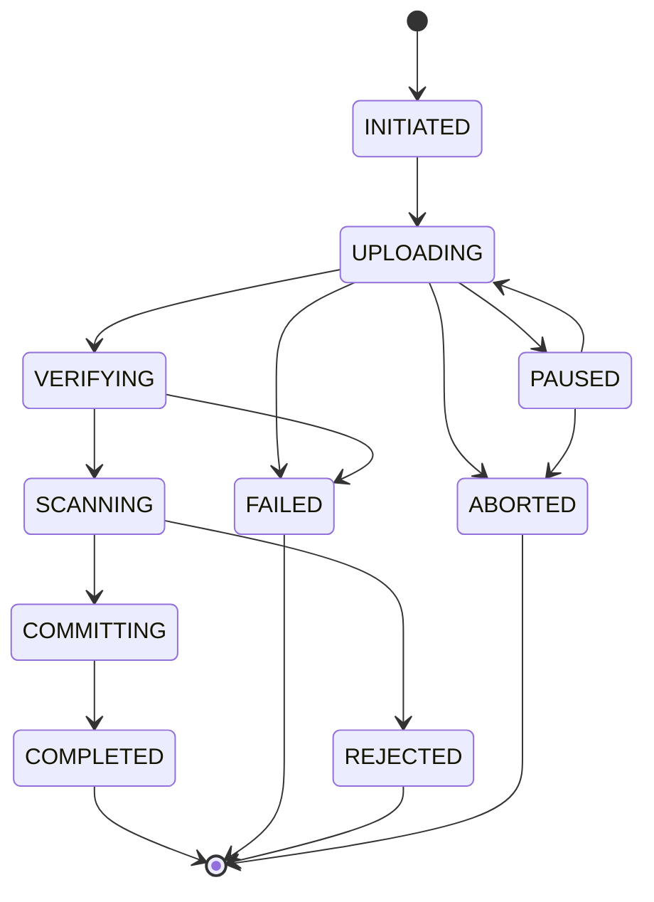
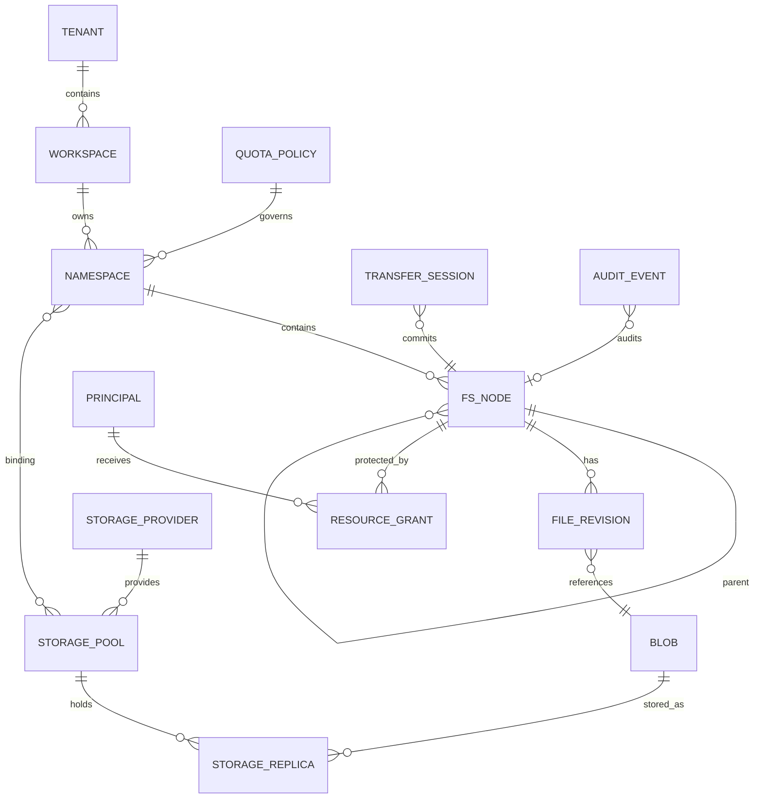
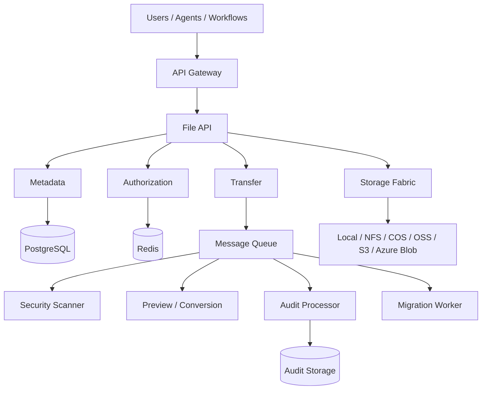

> **系列**：产品定位见 [SparkOps Agent · 产品说明](/blog/product/spark_ops_agent/spark_ops_agent_product/)；控制面技术实现见 [SparkOps Agent · 技术方案](/blog/product/spark_ops_agent/spark_ops_agent_tech/)。本篇是文件系统的下一代架构设计。

| 项目 | 内容 |
|------|------|
| **产品名称** | SparkOps Agent |
| **模块名称** | Enterprise Unified File Infrastructure（企业级统一文件基础设施） |
| **源码仓库** | [github.com/boyang167/SparkOpsAgent](https://github.com/boyang167/SparkOpsAgent) |
| **许可证** | Apache License 2.0 |
| **文档版本** | v1.0 |
| **发布日期** | 2026-11-15 |
| **文档类型** | 架构设计说明书 |
| **适用读者** | 架构师、平台研发、存储与安全负责人 |
| **定位** | 独立基础设施模块，服务于 Agent、Workflow、Knowledge、Data Platform |

---
文件系统是一个独立的基础设施模块

Filse as a Resource (将文件提升为平台一级资源（First-Class Resource）。)

不只是一个路径，而是具有：
  - 唯一身份。
  - 资源所有权。
  - 版本历史。
  - 生命周期。
  - 权限策略。
  - 访问记录。
  - 业务关联关系。


Feature:
1. 统一存储抽象： 屏蔽本地存储，NFS，COS，Azure Blos ,OSS 等底层存储差异
2. 多租户资源隔离： 支持Tenant，Workspace, User 多层级的文件资源管理和权限控制
3. 统一文件访问： 为系统内部的Agent, Workflow,Knowledge base, Project 等模块提供统一的文件访问接口
4. 存储资源治理： 管理存储配额，生命周期，文件版本，审计和回收
5. 高性能文件传输： 支持浏览器上传，分片上传，断电续传,SFTP , 服务端导入

File Management Portal 
  1. File Management 
    上传，下载，移动，复制，搜索
  2. 目录管理
    目录树，虚拟目录，挂载目录
  3. 权限管理
    Tenant, Workspace,User ,Role ,ACL
  4. 存储管理
    Local, NFSm COS, OSS , Azure 
  5. 文件传输
    分片，断电续传，SFTP, 批量导入
  6. 文件版本
    版本历史，恢复，文件校验
  7. 审计管理
    操作日志，访问日志，审计追踪
  8. 配额管理
    容量，文件数量，上传限制
  9. 生命周期
    归档，过期，回收站，自动清理
  10. 开放接口
    Rest API ,SDK ,内部服务集成


这是用户直接使用的功能层。
功能	详细需求	优先级
文件上传	单文件、多文件、文件夹上传	P0
文件下载	单文件、批量下载、打包下载	P0
目录创建	新建、嵌套目录、目录树	P0
文件移动	跨目录移动	P0
文件复制	同存储、跨存储复制	P0
文件重命名	文件和目录重命名	P0
文件删除	软删除、永久删除	P0
文件搜索	文件名、类型、路径、创建人	P0
文件预览	PDF、图片、文本、Office	P1
文件分享	内部用户、Workspace、临时分享链接	P1
批量操作	批量移动、删除、下载	P1
文件收藏	收藏、最近访问、最近修改	P2

建议增加几个基础能力：
- 文件类型识别：MIME Type、扩展名、文件大小。
- 文件完整性：MD5 / SHA-256。
- 文件唯一标识：每个文件拥有全局唯一 file_id。
- 文件夹唯一标识：目录使用 folder_id，而不是仅靠路径识别。
- 文件元数据：创建人、修改人、创建时间、修改时间、来源、所属租户等。
- 并发控制：避免多人同时修改造成数据覆盖。


                 Enterprise Applications
                           │
       ┌───────────────────┼──────────────────┐
       │                   │                  │
    Agent              Workflow           Knowledge
       │                   │                  │
       └───────────────────┼──────────────────┘
                           │
                 Unified File API
                           │
              Unified File Infrastructure
                           │
      ┌────────────────────┼────────────────────┐
      │                    │                    │
  Control Plane       Data Plane          Governance Plane
      │                    │                    │
  Namespace            Transfer             IAM / Policy
  Metadata              Storage I/O          Audit
  Mount                 Preview              Quota
  Placement             Gateway              Lifecycle
      │                    │                    │
      └────────────────────┼────────────────────┘
                           │
                  Storage Abstraction
                           │
      ┌────────────┬───────┼──────────┬────────────┐
      │            │       │          │            │
    Local         NFS     COS        OSS       Azure/S3


1. Control Plane：控制面
负责管理文件系统的逻辑资源。
- Namespace：文件和目录空间。
- Metadata：文件元数据、目录结构、版本。
- Mount Manager：逻辑路径与存储映射。
- Storage Registry：存储资源注册。
- Placement Engine：文件存储位置选择。
- Resource Manager：租户和 Workspace 资源管理。

2. Data Plane：数据面
负责实际文件数据的传输和操作。
- Upload Engine
- Download Engine
- Multipart Transfer
- Storage Gateway
- SFTP Gateway
- File Preview
- File Conversion
- Checksum Verification

3. Governance Plane：治理面
负责企业级资源治理。
- IAM / RBAC / ABAC
- Resource ACL
- Storage Quota
- Audit
- Data Classification
- Lifecycle Policy
- Retention Policy
- Security Scan


Storage Fabric:
  Storage Pool : Default
    系统默认存储池： Local FileSystem
  Storage Pool : Enterprise Shared
    企业共享存储池：NFS + Tencent Cos 
  Storage Pool: Archve
    长期归档存储池： Cos ,oss 

Scope	Storage Pool	策略
System	Default	系统默认
Tenant A	Enterprise Shared	企业共享
Workspace A	High Performance	高性能存储
Workspace B	Archive	归档存储
User A	Default	个人空间


## 修订记录

| 版本 | 日期 | 说明 |
|------|------|------|
| v1.0 | 2026-11-15 | 首版：整理统一文件基础设施架构设计 |

---


## 摘要

文件系统是独立的基础设施，不是某个业务模块的附属功能。Agent Platform、Data Platform、Workflow Platform、Knowledge Platform 都通过同一套 **Unified File API** 使用文件。

它有四个核心特征：

| 特征 | 含义 |
|------|------|
| **Storage Agnostic** | 底层存储无关，可接入任意存储后端 |
| **Multi-Tenant Native** | 原生支持租户、工作区、用户、服务账号和 Agent |
| **Policy-Driven** | 权限、存储路由、生命周期、配额全部由策略驱动 |
| **Agent-Native** | 文件是 Agent、Workflow 和数据任务可调用的统一资源 |

三条不可退让的约束：

1. 业务系统只通过统一 File API 访问文件，不直接操作物理路径。
2. 不同存储后端的差异收敛在 Storage Fabric，不泄漏到业务层。
3. Agent 与 Workflow 每次访问都携带明确的授权上下文，不继承用户的全部权限。

---

## 1. 文档目的与阅读路径

本文回答文件系统 **怎么拆、对象怎么建模、存储和权限怎么编排、第一版做到哪**。产品说明回答平台做什么；技术方案回答现有控制面怎么搭。本文是文件系统模块的目标架构。

| 读者 | 建议章节 |
|------|----------|
| 产品 / 业务 | 摘要 · §2 · §13 · §14 |
| 架构师 | §3–§6 · §10 · §15 |
| 后端 | §6–§11 |
| 安全 / 合规 | §7–§8 · §11.1–§11.3 · §13.4 |
| SRE | §12 · §11.5 · §16 |

---

## 2. 借鉴什么

值得借鉴的是不同领域里已经成熟的设计思想，而不是把网盘、对象存储和分布式文件系统堆在一起。

| 参考对象 | 借鉴的设计思想 |
|----------|----------------|
| Google Drive | 文件、目录、共享、权限协作 |
| Amazon S3 | 对象存储、版本、生命周期 |
| MinIO | S3 API、对象存储抽象 |
| JuiceFS | 元数据与底层存储分离、文件系统语义 |
| Ceph | 分布式存储与统一存储接口 |
| Kubernetes CSI | 存储资源编排与挂载抽象 |
| OpenDAL | 统一多后端存储访问抽象 |

传统网盘把「文件管理」直接落到某一个 Storage Provider。目标架构把应用、统一 API、三平面和存储抽象分开。

```text
Enterprise Applications
          │
   ┌──────┼──────────┐
   │      │          │
 Agent  Workflow  Knowledge
   │      │          │
   └──────┼──────────┘
          │
   Unified File API
          │
Unified File Infrastructure
          │
   ┌──────┼──────────────┐
   │      │              │
Control  Data      Governance
 Plane   Plane         Plane
   │      │              │
   └──────┼──────────────┘
          │
  Storage Abstraction
          │
 Local · NFS · COS · OSS · Azure/S3
```

同一套设施同时服务：

- AI Agent Platform
- Data Platform
- Workflow Platform
- Knowledge Platform

---

## 3. 三个 Plane

三个 Plane 解耦，可以独立扩展和部署。

### 3.1 Control Plane（控制面）

管理文件系统的逻辑资源。

| 组件 | 职责 |
|------|------|
| Namespace | 文件和目录空间 |
| Metadata | 文件元数据、目录结构、版本 |
| Mount Manager | 逻辑路径与存储映射 |
| Storage Registry | 存储资源注册 |
| Placement Engine | 选择文件的存储位置 |
| Resource Manager | 租户与 Workspace 的资源管理 |

### 3.2 Data Plane（数据面）

负责文件数据的传输和操作。

- Upload Engine、Download Engine
- Multipart Transfer
- Storage Gateway、SFTP Gateway
- File Preview、File Conversion
- Checksum Verification

### 3.3 Governance Plane（治理面）

负责企业级资源治理。IAM 在这里是 Identity and Access Management。

- IAM / RBAC / ABAC
- Resource ACL
- Storage Quota
- Audit
- Data Classification
- Lifecycle Policy、Retention Policy
- Security Scan

---

## 4. 从 File 到 Namespace + Object

传统文件系统把文件、目录和物理路径绑在一起。跨存储迁移、权限隔离和版本管理都会缠在同一条路径上。

拆成三层，每层有独立生命周期。同时把两类路径分开：

| 路径 | 谁使用 | 例子 |
|------|--------|------|
| **Virtual Path（逻辑路径）** | 用户、Agent、业务模块 | `/tenant-a/workspace-01/project/data.csv` |
| **Physical Path（物理路径）** | Storage Fabric、Provider | `cos://company-data/objects/ab/cd/xxxx` |

元数据与文件内容分离，逻辑文件系统与物理存储解耦，权限控制与文件访问走同一套授权。

### 4.1 三层资源模型

**Layer 1 · Namespace** 是用户看到的文件空间。它负责目录树、文件名、逻辑路径和权限继承。

```text
/tenant-a/workspace-01/project/data.csv
```

**Layer 2 · File Object** 是系统内部的文件资源。它负责文件身份、版本、元数据和内容完整性。

```text
file_id:  file-001
version:  3
size:     1024 MB
checksum: sha256:xxxx
```

**Layer 3 · Storage Object** 是底层真实数据对象。它负责物理存储、读取、复制、迁移和持久化。

```text
provider: Tencent COS
bucket:   company-data
key:      objects/ab/cd/xxxx
```

把文件从 Workspace A 移到 Workspace B 时：

| 层 | 发生什么 |
|----|----------|
| Namespace | 改变目录关系 |
| File Object | 可以保持不变 |
| Storage Object | 不一定移动 |

两个 Workspace 使用不同存储后端时，物理位置由异步数据迁移完成。

### 4.2 Content-Addressed Storage

Blob 按内容寻址：

```text
Blob ID = SHA256(File Content)

File A ──┐
         ├── Blob SHA256: abc123
File B ──┘
```

同一 Blob 可以被多个文件引用，从而支持去重、版本复用、完整性校验、复制优化和存储成本优化。

去重域默认按 **Tenant** 隔离。跨租户共享 Blob 会形成「这份内容是否存在」的侧信道。只有明确授权的共享存储域，才考虑跨 Workspace 复用。

---

## 5. Storage Fabric

Storage Provider 从简单 Adapter 升级为 **Storage Fabric**：它既连接存储，也决定文件应该放在哪里。

### 5.1 Provider 与 Pool 分离

| 概念 | 含义 |
|------|------|
| **Storage Provider** | 底层存储连接，如 Local、NFS、COS |
| **Storage Pool** | 面向业务提供的存储资源池 |

```text
Storage Fabric
├── Pool: Default            系统默认池      Local Filesystem
├── Pool: Enterprise Shared  企业共享池      NFS + Tencent COS
└── Pool: Archive            长期归档池      COS / OSS / Azure Archive
```

业务绑定 Storage Pool，不直接绑定 COS 或 NFS。

| Scope | Storage Pool | 策略 |
|-------|--------------|------|
| System | Default | 系统默认 |
| Tenant A | Enterprise Shared | 企业共享 |
| Workspace A | High Performance | 高性能存储 |
| Workspace B | Archive | 归档存储 |
| User A | Default | 个人空间 |

### 5.2 Placement Engine

Placement Engine 按策略选择存储位置。Placement Policy 与 IAM Policy 分开：存储位置选择和访问授权使用两套策略，不混进同一个引擎。

```yaml
placement_policy:
  name: workspace-storage-policy
  rules:
    - condition:
        scope: workspace
        workspace_type: production
      target_pool: enterprise-shared
    - condition:
        file_type: temporary
      target_pool: default
    - condition:
        retention_days: ">365"
      target_pool: archive
  fallback:
    target_pool: default
```

后续可按这些维度选择存储：租户、Workspace 类型、文件大小、文件类型、访问频率、地域、数据分类与合规要求。

### 5.3 两种访问模式

NFS 和 Local 具备 POSIX 语义。COS、OSS、Azure Blob 是对象存储。不把所有存储都模拟成 Linux 文件系统。

| 模式 | 适用 | 说明 |
|------|------|------|
| **Virtual Mount** | 所有业务模块 | 统一逻辑目录，对象存储的主模式 |
| **POSIX Mount** | 特定计算任务 | Local、NFS，或支持 POSIX 的对象存储文件网关 |

Spark、Python、模型训练等需要 POSIX 语义时，走独立 File Gateway，而不是让所有业务依赖宿主机挂载。

---

## 6. 权限：RBAC + ABAC + ReBAC

企业文件系统的一次访问，要同时看角色、上下文和主体与资源的关系。

| 模型 | 解决的问题 | 示例 |
|------|------------|------|
| **RBAC** | 用户具有什么角色 | Workspace Editor |
| **ABAC** | 当前上下文是否满足条件 | 只能访问指定数据等级 |
| **ReBAC** | 用户与资源是什么关系 | Workspace Member |

### 6.1 统一授权请求

每次访问抽象成 subject、action、resource、context：

```json
{
  "subject": {
    "id": "agent-001",
    "type": "AGENT",
    "tenant_id": "tenant-001",
    "workspace_id": "workspace-001"
  },
  "action": "file.read",
  "resource": {
    "id": "file-001",
    "type": "FILE",
    "classification": "INTERNAL"
  },
  "context": {
    "source": "workflow",
    "run_id": "run-001"
  }
}
```

授权引擎返回可解释的决策：

```json
{
  "decision": "ALLOW",
  "reason": "WORKSPACE_PERMISSION_GRANTED",
  "policy_id": "policy-001"
}
```

授权能力包括：

- 默认 Deny
- Tenant Boundary 强制隔离
- 权限继承与显式拒绝
- 临时授权和有效期
- Agent / Service Account 独立身份
- 文件敏感等级与访问策略
- 权限变更即时生效
- 授权决策可解释、可审计

第一版自研权限模型和授权接口，业务不直接依赖某一个策略产品。后续再接入 OpenFGA（关系授权）或 OPA（上下文属性与策略决策）。二者不必在第一版同时部署。

### 6.2 Agent Identity

访问链是：Human User → Agent → Workflow Run → File Access。

Agent 使用 **Delegated Access + Capability Token**。用户授权 Agent 在特定范围内执行任务。Token 包含：

- Tenant ID、Workspace ID
- Agent ID、Run ID
- Resource Scope、Allowed Actions
- Expiration、Audience

即使发生提示词注入，Agent 也不能超出这份授权去访问文件。

---

## 7. Transfer Platform

传输是独立子系统。浏览器、SFTP、CLI、SDK 和服务端导入，最终都创建同一个 **Transfer Session**。

```text
Browser / SFTP / CLI / SDK / Server Import / API
                    │
            Transfer Session
                    │
     Authorization · Quota Reservation
     Multipart · Checksum · Malware Scan
                    │
                 Commit
                    │
              File Object
```

### 7.1 上传状态机



两个约束：

- 上传完成不等于文件可用。校验和安全检查通过之后，文件才对用户可见。
- 失败的上传不留下用户可见的半成品。临时对象与最终提交分开，上传过程与文件可见性隔离。

### 7.2 大文件直传

```text
Browser
  → File API：创建 Transfer Session，签发 Signed URL
  → 客户端直传 COS / OSS / S3
  → Complete Callback
  → Verify & Commit
```

API Server 不转发大文件字节。直传支持断点续传、并发分片，并降低 API 带宽压力，上传服务可以单独扩展。

SFTP 使用独立 Gateway。文件先进入隔离的 Landing Zone，再经统一 Transfer Session 提交。SFTP 用户不直接操作生产存储目录。

---

## 8. 数据模型

Namespace、File、Blob、Storage、Transfer、Policy 分开建模。

### 8.1 核心关系



### 8.2 核心表

| 表名 | 作用 | 关键字段 |
|------|------|----------|
| `fs_namespace` | 逻辑文件空间 | id, tenant_id, workspace_id, owner_id |
| `fs_node` | 文件和目录统一节点 | id, namespace_id, parent_id, node_type, name |
| `fs_file_revision` | 文件版本 | id, node_id, version, blob_id |
| `fs_blob` | 文件内容对象 | id, checksum, size, content_type |
| `fs_storage_provider` | 存储连接 | id, provider_type, endpoint |
| `fs_storage_pool` | 存储资源池 | id, name, placement_policy |
| `fs_storage_replica` | 物理数据位置 | blob_id, storage_id, object_key |
| `fs_mount` | 逻辑挂载 | namespace_id, mount_path, pool_id |
| `fs_principal` | 用户、Agent、服务账号 | id, principal_type |
| `fs_policy` | 权限策略 | id, policy_type, policy_config |
| `fs_resource_grant` | 资源授权 | principal_id, resource_id, actions |
| `fs_transfer_session` | 上传任务 | id, status, chunk_info |
| `fs_quota_policy` | 配额策略 | scope_type, scope_id, max_bytes |
| `fs_audit_event` | 审计事件 | actor_id, action, resource_id |

### 8.3 统一节点 `fs_node`

文件和目录都是 Node。内容和版本仍然单独管理。

```text
fs_node
├── id
├── namespace_id
├── parent_id
├── node_type       FILE / DIRECTORY
├── name
├── owner_id
├── created_at
├── updated_at
└── deleted_at
```

统一节点之后，权限、遍历、搜索、移动、删除、审计和标签可以走同一套操作。

### 8.4 Blob 不是 File

一个 Blob 可以被多个 File Revision 引用。

```text
File A
├── Revision 1 ── Blob X
└── Revision 2 ── Blob Y

File B
└── Revision 1 ── Blob X
```

版本、复制和去重因此不必重复保存内容。Blob 需要引用计数、删除标记和 GC。删除 File 不直接删除 Blob；没有任何有效引用，并且过了安全回收周期之后，才允许物理删除。

---

## 9. 五个必须先解决的工程问题

这五件事决定系统是演示，还是能进生产。

### 9.1 一致性：Metadata 与 Storage

典型故障有两种：对象已经写到 COS，PostgreSQL 写元数据失败，用户看不到文件，桶里留下孤儿对象；或者元数据已创建，物理文件不存在。

用 **File Commit Protocol** 把准备、校验和提交分开。PostgreSQL 事务不能保证 COS 与数据库的跨系统原子性。

```text
Prepare
  ├── Create Temporary Object
  ├── Reserve Quota
  └── Create Pending Metadata
        │
      Verify
  ├── Checksum
  ├── Size
  └── Security Scan
        │
      Commit
  ├── Finalize Storage Object
  ├── Update Metadata
  ├── Commit Quota
  └── Publish Event
```

配套机制：状态机、Transactional Outbox、异步事件、幂等处理、定期一致性对账、孤儿对象 GC。

### 9.2 移动不是一律 Copy + Delete

不同后端的移动语义不同。统一的 Move Operation 按场景分支。

| 场景 | 处理方式 |
|------|----------|
| 同一 Namespace 内移动 | 修改 `parent_id` |
| 跨 Namespace、同一存储 | 权限检查后修改归属和引用 |
| 跨 Storage Pool | 异步复制、校验、切换引用、回收旧对象 |
| 跨 Tenant | 默认禁止；必须走显式授权的数据转移流程 |

底层 Blob 可以共享，不因此允许直接改文件所属租户。

### 9.3 配额要并发预占

租户配额 100 GB 时，两个用户同时上传 60 GB。若只在结束时检查，会超额。

```text
Available Quota
    → Reserve Quota
    → Upload
    → Verify Actual Size
    → Commit 或 Release Reservation
```

配额字段：

| 字段 | 含义 |
|------|------|
| Max / Used / Reserved Bytes | 容量上限、已用、预占 |
| Max / Used Files | 文件数上限与已用 |
| Max Single File Size | 单文件上限 |
| Transfer Rate Limit | 传输速率限制 |

预占必须有超时，失败必须释放。

### 9.4 搜索分层

元数据搜索和全文搜索分开。Qdrant 只为 Knowledge 和 Agent 提供语义检索，不是文件系统的元数据主库。

| 搜索类型 | 技术 |
|----------|------|
| 文件名、路径、类型 | PostgreSQL |
| 标签、结构化元数据 | PostgreSQL JSONB |
| 文档全文、语义搜索 | OpenSearch / Qdrant |

### 9.5 高可用与灾难恢复

| 数据 | 策略 |
|------|------|
| PostgreSQL Metadata | HA、备份、PITR |
| File Blob | 对象存储持久化、版本控制、跨区域复制 |
| Audit Event | 独立持久化；不随普通文件一起删除 |

同时建设：Storage Health Check、Provider Failover、Backup Verification、Recovery Workflow、Data Integrity Scan、Storage Migration Job。

故障切换不等于自动切到另一个存储池。只有经过验证的完整副本才能提升为可读写副本，否则会产生丢失或版本分叉。

---

## 10. 技术栈

以 Kubernetes 为部署基础。服务按模块划分，需要时再拆进程。第一版采用 **Go + PostgreSQL + Redis + OpenDAL + COS/NFS**，不引入复杂的分布式存储系统。

| 层 | 选择 | 职责 |
|----|------|------|
| Frontend | React / Next.js / TypeScript | File Explorer、Storage Console、Transfer Center |
| API Gateway | Kong / Nginx | 统一入口、鉴权、限流 |
| Core Backend | Go + Python | Go 负责文件服务与高并发 IO；Python 负责扫描、转换、AI 扩展 |
| Metadata | PostgreSQL | Namespace、Node、Revision、Policy、Quota |
| Cache | Redis | 授权缓存、上传状态、配额预占协调 |
| Event Bus | Kafka / RabbitMQ | 异步任务、审计事件、存储迁移 |
| Storage Abstraction | OpenDAL + Custom Adapter | 统一存储访问，并补企业级能力 |
| Authorization | 第一版自研；后续 OpenFGA / OPA | 关系授权与策略决策 |
| Shared / Local | Local FS / NFS | 本地和共享文件 |
| Object Storage | COS / OSS / S3 / Azure | 对象存储与大文件直传 |
| Observability | OpenTelemetry + Prometheus + Grafana | Metrics、Tracing、Logging |

选型边界：

- **OpenDAL** 适合做多后端访问抽象。它不替代文件系统的元数据、权限和挂载管理。
- **OpenFGA** 适合复杂资源关系。**OPA** 适合上下文属性与策略决策。第一版二选一或都先不部署。
- **Go** 承担高并发文件 API、传输控制和存储操作。
- **Python** 承担文件解析、病毒扫描编排、文档转换和 AI 工具集成。

---

## 11. Kubernetes 部署

系统设计为可独立部署的基础设施。数据库和消息队列优先复用已有企业设施。



| Workload | 部署方式 | 扩缩容依据 |
|----------|----------|------------|
| File API | Deployment | QPS |
| Metadata Service | Deployment | 请求量 |
| Authorization | Deployment | 授权请求量 |
| Transfer Service | Deployment | 并发上传数 |
| Storage Gateway | Deployment / DaemonSet | IO 负载 |
| SFTP Gateway | Deployment | 连接数 |
| Async Worker | Deployment | Queue Length |
| Preview Worker | Deployment | CPU / Memory |
| Migration Worker | Deployment | 迁移任务量 |

---

## 12. 产品差异化

这四项让文件系统成为企业 AI 平台的基础设施，而不是另一套网盘。

### 12.1 File as a Resource

文件是平台一级资源：唯一身份、所有权、版本、生命周期、权限策略、访问记录、业务关联。

```text
File Resource
├── Tenant
├── Workspace
├── Project
├── Agent Run
├── Workflow Execution
└── Knowledge Base
```

### 12.2 File Event

文件变化产生事件，其他系统订阅。数据库变更与事件发布用 Outbox 对齐。

事件：`FILE_CREATED`、`FILE_UPDATED`、`FILE_DELETED`、`FILE_MOVED`、`FILE_UPLOADED`、`FILE_VERSION_CREATED`、`FILE_PERMISSION_CHANGED`。

```text
File Uploaded
├── Knowledge Base  → 文档解析
├── Agent           → 文件分析
├── Workflow        → 触发流程
├── Data Platform   → 数据集注册
└── Audit           → 记录事件
```

### 12.3 Unified Artifact

Agent、Workflow、训练和数据处理的结果统一登记为 Artifact。

```text
Workflow Run
├── Input          input.xlsx · config.json
├── Intermediate   cleaned_data.csv · model.pkl
└── Output         report.pdf · result.json
```

每个 Artifact 关联：Source Run ID、Producer Agent、Version、Input Reference、Creation Time、Checksum、Access Policy。文件系统同时成为 AI 平台的产物库。

### 12.4 Data Governance

可以逐步接入，不进入第一版 MVP：

- 分类：Public / Internal / Confidential / Restricted
- 血缘：从哪里产生，被哪些任务使用
- 保留：不同等级不同保留策略
- 敏感数据检测：PII、个人信息、机密数据
- 访问风险：异常下载、批量访问
- 合规审计：谁在什么时间、以什么方式访问了什么文件

---

## 13. 实施优先级

先把架构内核做对，再开放高级能力。

| 版本 | 主题 | 范围 |
|------|------|------|
| **V1.0** Core Infrastructure | 文件系统内核 | Namespace / File / Directory；Tenant / Workspace / User；RBAC + ACL；Local / NFS / COS；上传、下载、断点续传；Metadata / Audit / Quota；REST API |
| **V1.5** Storage Fabric | 存储编排与治理 | Storage Pool、Placement Policy、Mount Manager、文件版本、回收站、存储迁移、生命周期 |
| **V2.0** Enterprise File Platform | 企业级能力 | ABAC / ReBAC、SFTP Gateway、共享、安全扫描、File Event Bus、Artifact、数据治理 |
| **V3.0** Agent-Native Storage | Agent 的统一资源底座 | Agent File Tools、MCP File Server、Workflow Artifact、语义搜索、数据血缘、智能放置 |

---

## 14. 架构决策

| 决策 | 选择 |
|------|------|
| 产品定位 | Unified File Infrastructure |
| 架构模式 | Control Plane + Data Plane + Governance Plane |
| 文件模型 | Namespace + Node + Revision + Blob |
| 路径 | Virtual Path + Physical Path；对外 `file_id` + 逻辑路径 |
| 存储架构 | Storage Fabric + Storage Pool + Provider |
| 权限模型 | RBAC + ABAC + ReBAC |
| 多租户 | Tenant Boundary + Workspace Isolation |
| 传输 | Transfer Session + Direct Upload |
| 数据库 | PostgreSQL |
| 缓存 | Redis |
| 存储抽象 | OpenDAL + Custom Adapter |
| 异步 | Message Queue + Worker |
| 部署 | Kubernetes |
| 平台集成 | REST API + SDK + MCP + Event |

---

## 15. 下一步：先写设计，再写代码

进入编码之前，先完成五份工程设计。其中 Architecture、Data Model、IAM、Storage Fabric 是进入开发的门槛。

| 设计文档 | 交付物 |
|----------|--------|
| 01. Architecture Design | 系统架构、模块边界、部署架构 |
| 02. Data Model Design | PostgreSQL DDL、ER、索引 |
| 03. IAM & Policy Design | RBAC、ABAC、ReBAC、授权流程 |
| 04. Storage & Transfer Design | Provider 接口、状态机、上传协议 |
| 05. API & SDK Design | REST API、OpenAPI、SDK、MCP |

建议目录：

```text
unified-file-infrastructure/
├── docs/
│   ├── 01-architecture.md
│   ├── 02-data-model.md
│   ├── 03-iam-policy.md
│   ├── 04-storage-fabric.md
│   ├── 05-transfer-engine.md
│   ├── 06-api-design.md
│   └── 07-deployment.md
├── services/
│   ├── file-api/
│   ├── metadata/
│   ├── authorization/
│   ├── transfer/
│   ├── storage/
│   └── workers/
├── adapters/
│   ├── local/
│   ├── nfs/
│   ├── cos/
│   ├── oss/
│   ├── s3/
│   └── azure/
├── sdk/
│   ├── python/
│   ├── java/
│   ├── go/
│   └── typescript/
├── frontend/
│   ├── file-explorer/
│   ├── storage-console/
│   └── transfer-center/
├── deploy/
│   ├── docker/
│   └── helm/
└── tests/
    ├── integration/
    ├── security/
    ├── performance/
    └── consistency/
```

---

## 16. 术语表

| 术语 | 含义 |
|------|------|
| Namespace | 用户可见的逻辑文件空间 |
| Virtual Path | 逻辑路径，业务与用户使用 |
| Physical Path | 物理路径，只在 Storage Fabric 内使用 |
| File Object / `file_id` | 文件的稳定身份，与当前路径解耦 |
| `fs_node` | 文件与目录的统一节点 |
| Revision | 文件的一次已提交版本 |
| Blob | 按 SHA256 寻址的内容对象 |
| Storage Object | 某个 Provider 上的物理对象 |
| Replica | Blob 在某个 Pool 上的一份副本 |
| Storage Provider | 具体存储连接 |
| Storage Pool | 面向业务的存储资源池 |
| Storage Fabric | 连接存储并决定放置位置的编排层 |
| Placement Policy | 选择目标 Pool 的策略，与 IAM 策略分开 |
| Virtual Mount | 面向全部业务的逻辑目录 |
| POSIX Mount | 面向计算任务的文件系统语义挂载 |
| Principal | 用户、Agent 或服务账号 |
| Capability Token | 发给 Agent 的短期、限范围授权 |
| Transfer Session | 一次上传或导入的统一任务 |
| Landing Zone | SFTP 等入口使用的隔离暂存区 |
| Outbox | 与元数据变更同事务写出、再异步发布的事件 |
| Artifact | 一次 Agent 或 Workflow 运行产生的输入、中间结果或输出 |
| IAM | Identity and Access Management |


逻辑文件系统与物理存储解耦：
上层是租户/工作区/用户可理解的命名空间与目录树；
中间是文件对象（节点、版本、blob）；
底层是 Provider 上的存储对象。
放置、配额、权限、生命周期由策略驱动，传输经独立数据面网关完成
flowchart TB
  subgraph apps [消费方]
    Web[Web 文件中心]
    Agent[Agent / Workflow / Knowledge]
  end
  subgraph api [统一文件 API]
    WS["/api/v1/workspaces/:wsId/*"]
    Gov["/api/v1/filesystem/*"]
    Int["内部: Gateway / SFTP"]
  end
  subgraph planes [三 Plane — 产品/逻辑划分]
    CP[Control Plane]
    DP[Data Plane]
    GP[Governance Plane]
  end
  subgraph domain [领域核心]
    NS[Namespace + Node 树]
    FO[File: Revision + Blob]
    SO[Storage: Provider + Replica]
  end
  subgraph fabric [Storage Fabric]
    PE[Placement Engine]
    Pool[Pool + Binding]
    RC[Runtime Catalog]
  end
  subgraph backends [物理后端]
    Local[LOCAL]
    S3[S3 兼容]
    NFS[NFS 规划中]
  end
  apps --> api
  api --> planes
  CP --> NS
  CP --> PE
  DP --> SO
  GP --> NS
  PE --> Pool
  Pool --> RC
  RC --> backends
  FO --> SO
  NS --> FO

设计文档概念	实现重心（后端包）
Control Plane
Namespace、Metadata、Mount/Binding、Provider/Pool、Placement
Data Plane
Transfer、Gateway 8082、Multipart、Verify/Commit、Preview
Governance Plane
Resource 授权、Grant/共享审批、Quota、Audit、分类
前端用 DATA / CONTROL / GOVERNANCE 三个 Plane 路由（/files/data|control|governance），与上表一一对应，不是三套独立服务，而是同一 filesystem 模块按职责划分的界面与 API 分组。

