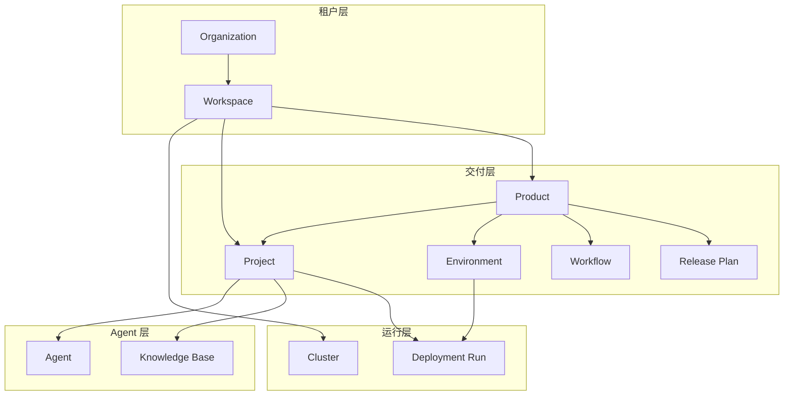
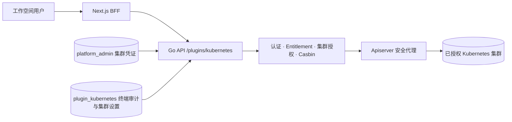
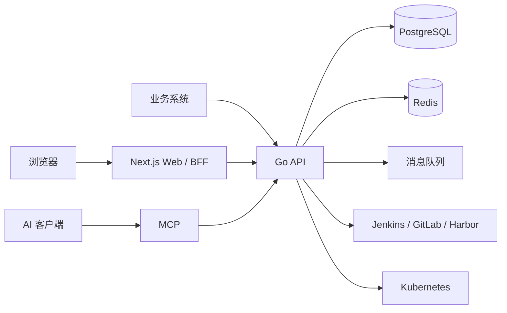

> **系列**：本篇为产品说明；技术实现见 [SparkOps Agent · 技术方案](/blog/product/spark_ops_agent/spark_ops_agent_tech/)。

| 项目 | 内容 |
|------|------|
| **产品名称** | SparkOps Agent |
| **源码仓库** | [github.com/boyang167/SparkOpsAgent](https://github.com/boyang167/SparkOpsAgent) |
| **许可证** | Apache License 2.0 |
| **文档版本** | v1.1 |
| **发布日期** | 2026-10-28 |
| **文档类型** | 产品设计说明书 |
| **适用读者** | 业务负责人、架构师、交付与运维负责人 |


---

## 修订记录

| 版本 | 日期 | 作者 | 说明 |
|------|------|------|------|
| v1.0 | 2026-10-27 | SparkOps 产品组 | 首版：基于当前开源能力与路线图整理 |
| v1.1 | 2026-10-28 | SparkOps 产品组 | 增补 Kubernetes 插件产品说明：定位、能力、权限与边界 |

---

## 摘要（Executive Summary）

**SparkOps Agent** 是面向企业的 **AI Agent 与软件交付统一控制面**。它将可治理的多租户协作 Agent 与知识库运行，从构建到 Kubernetes 的持续交付，放在同一套组织—工作空间体系下，并通过 **REST / OpenAPI、MCP、Webhook** 与现有 DevOps 与 AI 工具链对接。

**核心价值**：减少 AI 助手试点与生产发布流程之间的割裂；让权限、审计、环境与发布窗口在同一平台可配置、可观测、可集成。发布之后，可在 **Kubernetes 插件**中继续治理已授权集群，而不必另发一份管理员 kubeconfig。

**典型应用场景**：金融/政企/大型互联网团队中，同时存在平台工程、应用研发、SRE 与 AI 应用团队，需要在私有化或专有云环境中统一治理项目、集群、Agent 与发布节奏。

---

## 1. 文档目的与阅读指引

### 1.1 目的

- 说明 **产品定位、边界、能力架构与演进方向**
- 本文偏 **为什么做、做什么、做到哪**

---

## 2. 背景与问题

### 2.1 行业背景

- **AI Agent 落地加速**：团队希望在 IDE、运维台、业务系统中嵌入 Agent，但缺乏与企业身份、审计、数据边界一致的运行平面。
- **交付链路仍碎片化**：代码在 Git、构建在 Jenkins、镜像在 Harbor、运行在 Kubernetes，审批与发布窗口往往散落在工单或脚本中。
- **多租户与合规要求提升**：组织内多事业部、多环境、多集群并存，需要统一 **隔离、授权、留痕**，而非每个项目一套 kubeconfig 与共享账号。

### 2.2 痛点（Problem Statement）

| 痛点 | 表现 | SparkOps 应对方向 |
|------|------|-------------------|
| AI 与交付两张皮 | Agent 对话与发布流程无关联，知识库与运行环境割裂 | 项目级 Agent + 知识库 + 部署同工作空间治理 |
| 权限粒度不足 | 仅菜单可见性，无法对齐 API 与项目 ACL | 四层作用域 + 角色打包菜单/按钮/API/功能码 |
| 多集群发布复杂 | 单项目单集群思维，缺少产品级环境与发布计划 | Product / Environment / Release Plan / 工作流编排 |
| 集成成本高 | 各系统各自对接 Jenkins、K8s API | OpenAPI + MCP + Webhook 统一出口 |
| 私有化与可控 | 公有 SaaS 无法满足数据与网络边界 | 可 Docker / Helm 私有化部署，驱动可 mock 演示 |

---

## 3. 产品愿景与定位

### 3.1 愿景

> **让企业在自有边界内，安全、可审计地运行 Agent，并与可持续的软件交付节奏对齐。**

### 3.2 产品定位

| 维度 | 定位 |
|------|------|
| **品类** | 企业级 Agent 控制面 + 持续交付控制面（Control Plane） |
| **不是** | 通用低代码平台、单一 Chatbot SaaS、替代 Jenkins/GitLab 的 CI 引擎 |
| **是** | 多租户治理层、编排与观测层、对外集成层 |
| **开源策略** | Apache 2.0，源码公开于 [GitHub](https://github.com/boyang167/SparkOpsAgent)，可二次开发与私有化部署 |

### 3.3 差异化要点（Why SparkOps）

1. **统一租户模型**：组织 → 工作空间 → 项目 / 产品，与 Agent、集群、发布同一套成员与角色。
2. **Agent 可运营**：版本发布、知识库、流式对话、MCP 工具调用，而非仅静态 Prompt。
3. **交付可闭环**：Jenkins 构建 → 部署 Run → K8s 工作负载 / 日志 / 终端，状态可订阅（含 SSE）；发布之后由 Kubernetes 插件继续做全集群运维。
4. **三种集成面**：业务系统 REST、AI 客户端 MCP、事件 Webhook。
5. **企业身份与审计**：本地账号、OIDC、LDAP；关键操作审计与站内通知。

---

## 4. 目标用户与角色

### 4.1 用户画像

| 角色 | 关注点 | 主要使用能力 |
|------|--------|--------------|
| **平台超级管理员** | 全局账号、组织、集群、插件 | 平台运营中心 |
| **组织 / 工作空间管理员** | 成员、角色、菜单策略、模块开通 | 管理控制台、Entitlement |
| **应用研发** | 项目配置、构建、部署、Agent 调试 | 项目工作台、Agent、知识库 |
| **发布 / 运维** | 环境、发布计划、集群运维、审批 | 产品、工作流、运行实例、Kubernetes 插件 |
| **安全 / 合规** | 权限模型、审计、SSO | 权限设计、审计日志、SSO 配置 |
| **集成开发** | API、MCP、Webhook | OpenAPI、工作空间 Token |

### 4.2 控制台分层（体验入口）

| 控制台 | 典型路径 | 说明 |
|--------|----------|------|
| 业务控制台 | `/dashboard/workplace` | 日常工作：项目、产品、Agent |
| 管理控制台 | `/admin/*` | 工作空间治理：成员、角色、菜单 |
| 平台运营中心 | `/platform/*` | 跨租户：账号、组织、集群（超管） |

---

## 5. 产品范围与边界

### 5.1 In Scope（当前产品承诺能力）

- 多租户：组织、工作空间、成员、项目级 ACL
- Agent：草稿/发布、知识库、对话与运行记录
- 交付：Jenkins 构建、部署 Run、项目 Webhook、定时任务（CronJob）
- 产品交付（v2）：产品容器、环境、产品工作流、发布计划、迭代（Sprint）与工作项
- 运行：集群注册、工作空间授权、项目级运行实例；Kubernetes 插件提供全集群资源治理、终端与诊断（见第 8 章）
- 治理：RBAC、菜单/按钮、API 策略（Casbin）、审计、站内通知
- 集成：OpenAPI、MCP、Webhook；SSO（OIDC / LDAP 可配置）
- 部署：Docker Compose 演示、Helm 生产导向安装

### 5.2 Out of Scope / 非目标（需客户自行或第三方补齐）

- 替代 Jenkins / GitLab 成为唯一 CI 引擎（平台 **编排与触发**，不取代流水线引擎本身）
- 全栈 APM / 日志平台（可对接，内置以项目/运行为主）
- 公有云多区域 SaaS 托管（当前以 **私有化/客户环境部署** 为主）
- Delivery Center 全量 Fleet DAG（见仓库 `spec/delivery-center-design.md`，属演进规划）
- 多集群联邦调度（如 Karmada）。Kubernetes 插件面向已授权的独立集群；跨集群分波发布见 Delivery Center 规划

### 5.3 模块开通（Entitlement）

工作空间可按模块开关能力，与角色正交，便于分阶段上线：

| 模块 | 典型能力 |
|------|----------|
| `agent` | 项目、模板中心 |
| `knowledge` | 知识库 |
| `delivery` | 产品、发布计划、工作流、密钥等 |
| `k8s` | 运行实例、定时构建 |
| `plugin:kubernetes` | Kubernetes 控制台（第 8 章）。需已启用，且工作空间至少授权一个集群 |
| `observability` | 监控概览、日志查询 |
| `mcp` | MCP 集成 |

---

## 6. 核心概念与领域模型

### 6.1 概念层次

```text
Organization（组织）
  └── Workspace（工作空间）
        ├── Project（项目）          ← 单个可部署应用，可独立存在
        ├── Product（产品，可选）     ← 多项目交付容器
        │     ├── Environment（环境）
        │     ├── Product Workflow（产品工作流）
        │     ├── Release Plan（发布计划）
        │     └── Sprint / Work Item（迭代治理）
        ├── Agent / Knowledge（Agent 与知识）
        └── Cluster 授权与插件（如 Kubernetes）
```

**设计原则（Product v2）**：**Project 独立优先**——`product_id` 为空时项目行为与单应用交付一致；仅当需要统一环境、工作流与发布窗口时，才将多个 Project 归入 Product。

### 6.2 概念定义

| 概念 | 一句话定义 |
|------|------------|
| 组织 | 租户边界，可包含多个工作空间 |
| 工作空间 | 日常协作与资源隔离单元；菜单、项目、产品均归属当前空间 |
| 项目 | 绑定 Git / 构建 / 部署 / Agent 的可部署单元 |
| 产品 | 可选组合层：多项目 + 环境 + 工作流 + 发布计划 |
| 环境 | 产品级运行环境（如 dev/uat/prod），绑定集群与命名空间策略 |
| 发布计划 | 跨项目的发布窗口、审批与执行任务 |
| 工作流 | 构建、部署、审批等步骤编排（分项目级与产品级） |
| 集群 | 平台登记的 Kubernetes 集群；授权到工作空间后，项目部署与插件才可使用 |
| Kubernetes 插件 | 在已授权集群上做资源治理、终端审计与生态扩展的运维控制台 |

### 6.3 领域关系示意



---

## 7. 功能架构

### 7.1 能力地图

| 域 | 能力模块 | 用户可感知价值 |
|----|----------|----------------|
| **身份与访问** | 注册登录、SSO、API Token、四层 RBAC | 谁能在哪一层做什么，可审计 |
| **协作与资源** | 组织/空间/成员/项目成员 | 资源隔离与协作边界清晰 |
| **Agent 运营** | Agent 版本、知识库、对话、MCP | AI 能力可发布、可复用、可集成 |
| **持续交付** | 构建、部署 Run、Webhook、CronJob | 从代码到集群可追踪 |
| **产品化交付** | 产品、环境、发布计划、迭代 | 多项目、多环境、有节奏地上线 |
| **Kubernetes 运维** | 集群授权、项目运行实例、Kubernetes 插件控制台 | 发布后按项目看 Pod，或在插件中治理整个已授权集群 |
| **平台治理** | 审计、通知、公告、统计、插件框架 | 企业级可管可控 |
| **开放集成** | OpenAPI、MCP、Webhook | 嵌入现有 toolchain 与 AI 客户端 |

### 7.2 关键用户旅程

#### 旅程 A：单项目快速上线（PoC → 生产）

1. 管理员创建工作空间并授权成员。  
2. 研发创建 **Project**，配置 Git 与 Jenkins/集群凭据。  
3. 触发构建与部署，在界面或 SSE 中跟踪 `queued → … → succeeded`。  
4. 在运行实例或 Kubernetes 插件中查看工作负载与日志；插件中的终端与变更需治理管理员。  

#### 旅程 B：多项目产品发布

1. 创建 **Product**，将多个 Project 可选归属。  
2. 配置 **Environment**（dev/uat/prod）与集群绑定。  
3. 使用 **Product Workflow** 编排 build → deploy；或通过 **Release Plan** 设定窗口与审批。  
4. 执行发布并在审计与通知中留痕。  

#### 旅程 C：Agent 赋能研发/运维

1. 在项目中创建 **Agent**，绑定 **Knowledge Base**。  
2. 对话调试后发布版本；外部通过 **MCP** 调用平台工具。  
3. 运行记录与消息在工作空间内可追溯。  

#### 旅程 D：发布后的集群排障

1. 登记集群并授权给目标工作空间，启用 Kubernetes 插件。  
2. 研发按旅程 A / B 完成构建与部署。  
3. 运维在插件中选择同一集群，核对工作负载、事件与日志。  
4. 治理管理员在授权范围内进入终端或修改资源；会话进入终端审计。  

旅程 D 的能力边界、权限与菜单见第 8 章。

---

## 8. Kubernetes 插件

Kubernetes 插件（模块开关 `plugin:kubernetes`）是工作空间内的**全集群运维控制台**。集群凭证由平台统一托管；插件只使用已经登记、并且已经授权给当前工作空间的集群，不另建一套 kubeconfig 账本。

逐步操作见 SparkOps 仓库 `docs/用户使用手册.md` 第 9 章；角色与 API 对照见 `docs/privilege_k8s.md`。

### 8.0 插件在控制面中的位置



浏览器不直连 kube-apiserver；凭证只保存在平台集群目录，插件通过工作空间授权决定「能看见哪些集群」。

### 8.1 定位与分工

应用经项目发布到集群之后，排障和资源治理需要另一层入口。插件承担这一层，并与项目运行实例并存。

| 维度 | 项目运行实例 | Kubernetes 插件 |
|------|----------------|-----------------|
| 视角 | 单个项目这次部署产生的 Pod | 已授权集群上的命名空间与集群级资源 |
| 典型用户 | 应用研发、发布值班 | 运维、平台管理员，以及需要进集群排障的治理角色 |
| 开通条件 | 工作空间开通 `k8s` | 开通 `plugin:kubernetes`，且工作空间已授权至少一个集群 |
| 不做的事 | 不浏览与本项目无关的集群资源 | 不替代 Jenkins 构建、部署 Run 与发布计划 |

**使用原则**：项目仍是交付单元；插件是授权集群上的运维平面。未写入工作空间授权的集群，对当前空间不可见，代理请求直接拒绝。

### 8.2 能力范围

侧栏入口为 **Kubernetes**（路径前缀 `/plugins/kubernetes`）。进入具体资源页之前，先选定已授权集群。

| 分组 | 用户可完成的事 |
|------|----------------|
| 集群管理 | 查看已授权集群与连通性。治理管理员可维护集群登记，为成员签发个人 kubeconfig，并绑定集群角色 |
| 节点与命名空间 | 查看节点状态与调度信息；管理 Namespace |
| 工作负载 | Deployment、StatefulSet、DaemonSet、Job、CronJob、Pod 等的列表、YAML 与变更 |
| 网络与网关 | Service、Ingress，以及 Gateway API |
| 配置与存储 | ConfigMap、Secret、PV/PVC。Secret 仅治理管理员可见、可改 |
| 访问控制 | 查看并治理集群内 RBAC 资源 |
| 终端与审计 | Pod 日志、终端、容器文件；终端会话可回放，供内审追溯 |
| 运维与生态 | 应用诊断（含 Arthas）、CloudTTY、节点终端（NodeTTY）、AI Chat、Velero 备份；OpenKruise、Kruise Rollouts、KubeBlocks、KubeVela / Velaux |

列表、详情与日志对工作空间成员开放；创建、变更、删除、终端、文件、诊断和签发凭证仅治理管理员可执行。目标集群未安装对应 CRD 时，菜单仍然保留，页面展示上游返回的错误。

### 8.3 开通路径

1. 平台超级管理员在运营中心登记集群，或由具备密钥写权限的管理员在工作空间注册集群。  
2. 将该集群授权给目标工作空间。未授权则列表不可见，项目也不可选。  
3. 在管理控制台启用 Kubernetes 插件，并确认工作空间成员能看到 **Kubernetes** 菜单。  
4. 进入控制台，选择集群后再操作命名空间与资源。  

Prometheus、Velaux、对话模型等地址按集群单独配置，分别用于监控、Velaux 与 AI Chat。未配置时这三项不可用，资源列表与日志仍然可用。

### 8.4 权限与安全

判定仍遵循第 9 章的 AND 链（认证、成员关系、功能码、接口策略、模块开关），并增加一道资源门禁：**集群必须已授权给当前工作空间**。

| 能力 | 工作空间成员 | 治理管理员（`governance:admin`） |
|------|----------------|----------------------------------|
| 已授权集群的列表、详情、日志与监控查询 | 可用 | 可用 |
| 创建、变更、删除资源，编辑 YAML | — | 可用 |
| Pod 终端、文件上传、在容器内执行命令 | — | 可用 |
| 应用诊断、CloudTTY、NodeTTY | — | 可用 |
| 修改 Prometheus、Velaux、模型等集群设置 | — | 可用 |
| 为成员签发 kubeconfig、绑定 ClusterRole | — | 可用 |

讲清四点：

- **控制台访问**和**个人 kubeconfig** 是两套授权。个人凭证方便本地 `kubectl`，不扩大、也不代替控制台里的读写边界。  
- 浏览器经 BFF 访问插件。集群证书留在平台，不作为主路径下发到前端。  
- **NodeTTY** 以特权方式进入节点，只给治理管理员，用于主机级排障，不是日常发布手段。宣讲和交付清单里应单独标出这一风险。  
- 终端审计与平台操作日志不记录 kubeconfig 或证书原文。

### 8.5 边界

- **编排发布，不取代流水线**。构建、部署 Run、发布计划仍在交付域；插件不是第二套 CI。  
- **保留按项目看 Pod 的入口**。研发不必为了看自己的实例而进入全集群视图。  
- **不做多集群联邦**。Karmada 一类调度不在本插件范围；跨集群分波与 Promote 见 Delivery Center 路线图。  
- **生态以目标集群实装为准**。OpenKruise、Velero、KubeVela 等入口，依赖集群已安装对应组件；监控与 Velaux 还依赖可访问的服务地址。  


1. 集群是平台资产，工作空间只能使用授权给自己的那一部分。  
2. 多数成员可以查看资源和日志；变更、终端和节点级操作收在治理管理员。  
3. 从一次部署到进入 Pod 排障，可以留在 SparkOps 内完成，不必共享一份管理员 kubeconfig。  

---

## 9. 权限、安全与合规设计（摘要）

完整说明见仓库内 `docs/privilege_design.md`。

### 9.1 作用域（纵轴）

```text
Platform → Organization → Workspace → Project
```

- 平台：**Super Admin**（系统级，非工作空间 Role 替代）。  
- 组织：固定角色 owner / admin / member。  
- 工作空间：可配置 Role，为权限打包枢纽。  
- 项目：lead / member / viewer 等项目 ACL。  

### 9.2 权限面（横轴）

Role 可打包：**功能权限码**（后端主闸）、**菜单**、**按钮**、**API path+method**（Casbin）、**数据策略**（已建模，查询侧逐步强化）。

**判定原则（AND）**：认证 → 作用域成员关系 → 功能码 → API 策略（若配置）→ Entitlement 模块开关。菜单/按钮仅改善体验，**不能替代**后端鉴权。

### 9.3 安全与合规要点

- 支持 OIDC、LDAP 与企业本地账号；Token 黑名单与 API Token 分空间授权。  
- 敏感配置（密钥、kubeconfig、Jenkins 凭据）工作空间级托管，不写死在前端。  
- 审计日志记录关键操作；适合作为等保、内审的辅助证据链（需结合客户 SIEM 对接）。  
- Kubernetes 插件的终端会话可回放（`plugin_kubernetes.records`），与平台操作日志互补；详见第 8.4 节与 `docs/privilege_k8s.md`。

---

## 10. 系统架构

### 10.1 逻辑架构



### 10.2 技术组件

| 组件 | 技术选型 | 职责 |
|------|----------|------|
| API | Go（Gin）、模块化单体、DDD 分层 | 业务逻辑、鉴权、集成适配 |
| Web | Next.js App Router、BFF | 界面、会话、对 API 的统一代理 |
| 数据 | PostgreSQL、Redis | 事务数据、缓存与会话 |
| 消息 | 内存（演示）/ RabbitMQ（生产） | 事务外盒、异步事件 |
| 插件 | 插件框架 + Kubernetes 插件等 | 扩展菜单、API 与领域能力 |

### 10.3 集成架构原则

- **浏览器不直连 Go API**：经 BFF，便于 Cookie / CSRF 与统一错误处理。  
- **AI 客户端走 MCP**：与工作空间 Token 绑定，工具能力可审计。  
- **业务系统走 OpenAPI**：与 Jenkins Webhook、项目 Webhook 形成「拉 + 推」组合。  
- **Kubernetes 插件走同一 BFF**：资源请求由 API 代理到已授权集群的 apiserver，浏览器不直连 kube-apiserver。  

---

## 11. 部署与运维形态

| 形态 | 适用场景 | 说明 |
|------|----------|------|
| Docker Compose | 本地演示、PoC | 可 mock 构建/运行驱动，降低环境门槛 |
| 源码 + 脚本 | 开发联调 | PostgreSQL + Redis + 前后端 dev |
| Helm Chart | 客户 K8s 生产 | 见 `deployments/helm/sparkops/` |

**生产建议**：`APP_ENV=production`，消息驱动使用 AMQP，项目上配置真实 Jenkins 与 K8s 凭据；禁用演示默认口令。

---

## 12. 产品成熟度与路线图

### 12.1 已具备（As-Is，可演示 / 可试点）

- 多租户与 RBAC、菜单与 API 策略、审计与通知  
- 项目构建与部署 Run、项目运行实例，以及 Kubernetes 插件（原生资源、终端审计、诊断，以及 OpenKruise / Velero / KubeVela 等生态入口）  
- Agent、知识库、对话与 MCP  
- Product v2 主干：产品、环境、发布计划、产品工作流、Sprint 等（持续迭代中）  
- SSO 运行时配置、事务性事件（Outbox）等企业化能力  

### 12.2 演进中 / 规划（To-Be）

| 方向 | 说明 | 参考 |
|------|------|------|
| Delivery Center | 多集群 Fleet、Pipeline DAG、分波发布与 Promote | `spec/delivery-center-design.md` |
| 数据权限强制执行 | 行/列策略在查询链路透传 | `docs/privilege_design.md` |
| 可观测增强 | 与 metrics/logging/trace 深度集成 | `spec/architecture.md` |
| 插件市场 | 第三方插件生命周期与治理 | `spec/plugin-sdk.md` |


---

## 13. 成功指标（建议）

内部推广时，可选用以下可量化指标：

| 类别 | 指标示例 |
|------|----------|
| 效率 | 从提交到部署成功平均时长（MTTR 部署侧）；发布计划按时完成率 |
| 治理 | 100% 生产变更关联审计记录；特权账号操作可追溯 |
| Adoption | 工作空间内活跃项目数、Agent 对话/运行次数、MCP 调用量 |
| 稳定 | 部署 Run 失败率、构建失败重试成功率 |
| 安全 | SSO 覆盖率；API Token 轮换策略执行率 |

---

## 14. 竞品与对标

| 对标类型 | 代表 | SparkOps 关系 |
|----------|------|----------------|
| 云原生持续交付 | Zadig 等 | Product/Environment/Workflow 概念可参考；SparkOps 强调 **Agent + 同一控制面** |
| AI 开发平台 | 各类 Agent SaaS | SparkOps 强调 **私有化、RBAC、与交付链路一体** |
| 内部平台 | 自建 Jenkins + 脚本 | SparkOps 提供 **统一 UI、权限、审计与集成协议** |


---

## 15. 术语表

| 术语 | 英文 | 含义 |
|------|------|------|
| 控制面 | Control Plane | 配置、权限、编排、审计，不直接运行业务负载 |
| 工作空间 | Workspace | 资源与协作隔离单元 |
| 部署 Run | Deployment Run | 一次构建/部署执行实例及状态机 |
| BFF | Backend for Frontend | 面向浏览器的服务端聚合层 |
| MCP | Model Context Protocol | AI 客户端调用工具与资源的开放协议 |
| Entitlement | — | 工作空间级模块开关 |
| Kubernetes 插件 | Kubernetes Plugin | 工作空间级全集群运维控制台，与项目运行实例互补 |
| 治理管理员 | governance admin | 具备 `governance:admin` 的工作空间角色，可执行集群写操作、终端与诊断 |

---


