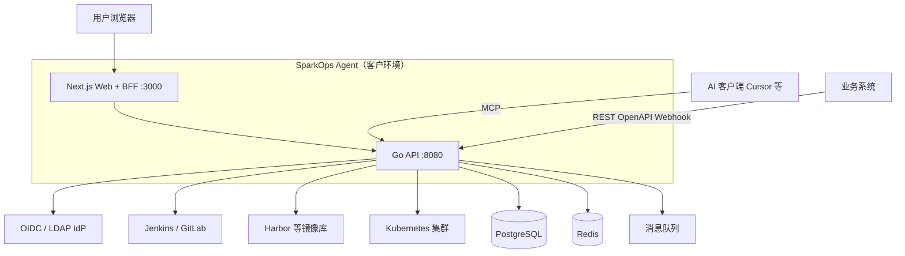
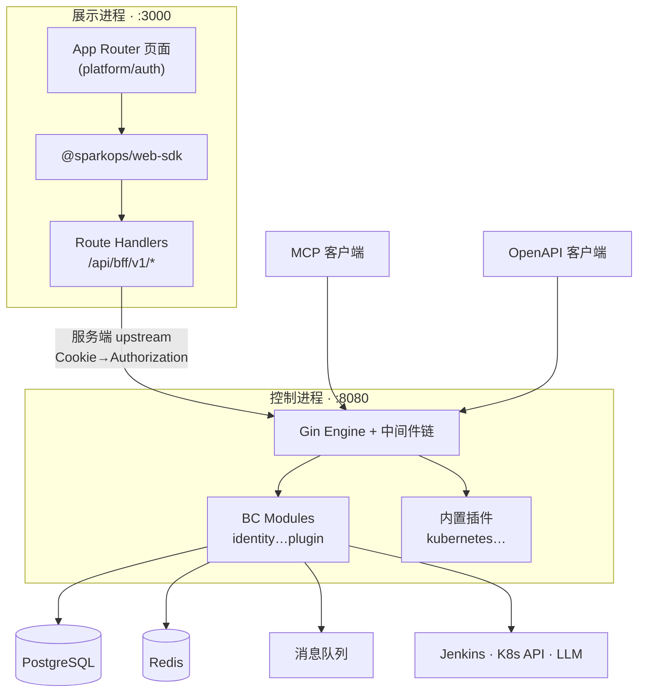
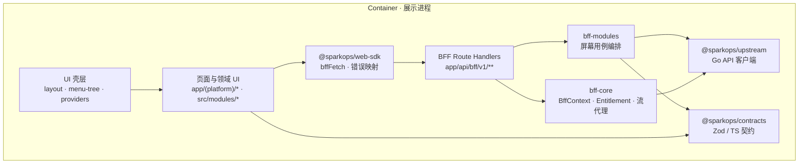
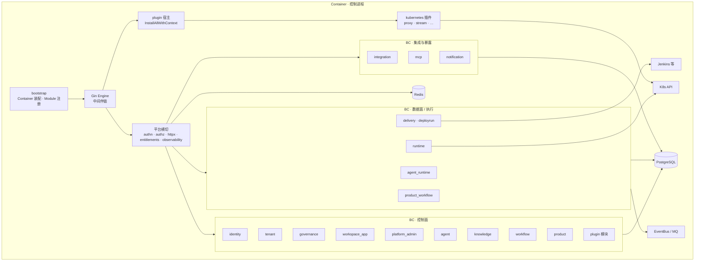
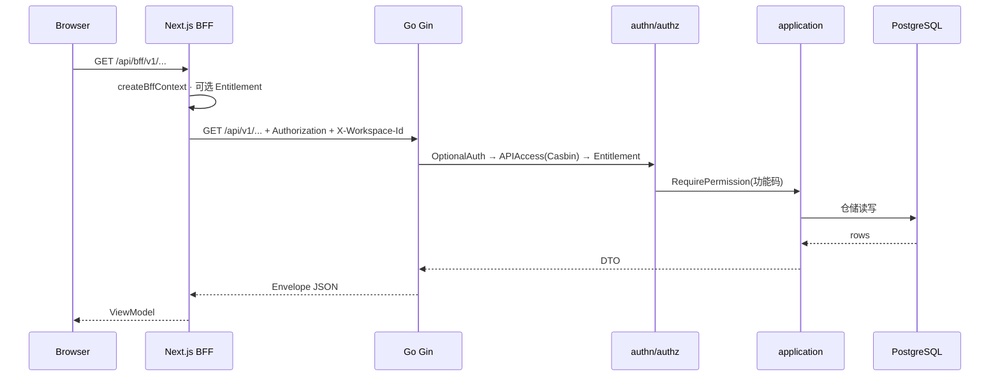
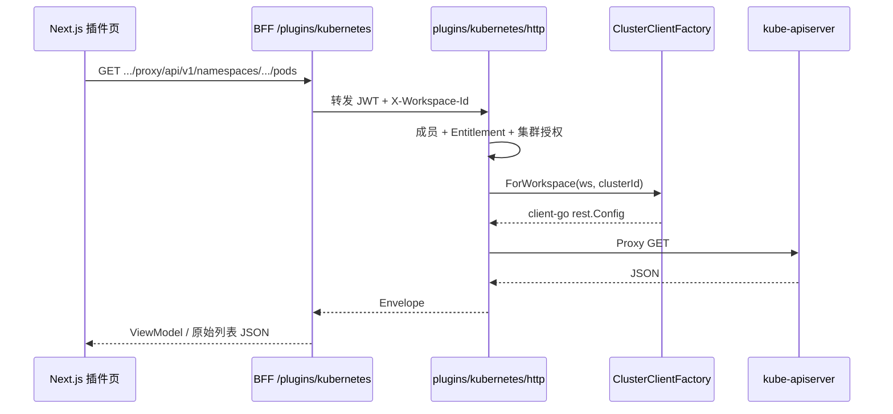
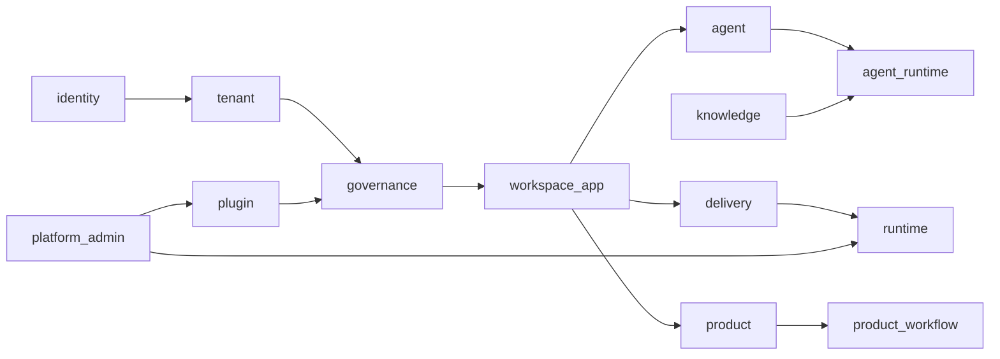

> **系列**：产品定位与用户旅程见 [SparkOps Agent · 产品说明](/blog/product/spark_ops_agent/spark_ops_agent_product/)。


| 项目 | 内容 |
|------|------|
| **产品名称** | SparkOps Agent |
| **源码仓库** | [github.com/boyang167/SparkOpsAgent](https://github.com/boyang167/SparkOpsAgent) |
| **许可证** | Apache License 2.0 |
| **文档版本** | v1.3 |
| **发布日期** | 2026-10-28 |
| **文档类型** | 技术架构说明书（架构评审 / 投标 / 研发 onboarding） |
| **适用读者** | 架构师、后端/前端负责人、SRE、安全与集成工程师 |


---

## 修订记录

| 版本 | 日期 | 说明 |
|------|------|------|
| v1.0 | 2026-10-27 | 首版：对齐当前 Go + Next.js 实现与 spec 规范 |


---

## 摘要

SparkOps Agent 采用 **Go 模块化单体控制面 + Next.js BFF 展示面** 的双进程架构：控制面承载多租户、权限与各领域用例；展示面以 **BFF 按屏幕聚合 Upstream**，浏览器 **仅访问 `/api/bff/v1`**，不直连 Go API（MCP / OpenAPI 集成客户端除外）。

**后端**：按限界上下文（BC）划分 `internal/modules/*`，单 BC 内 **interface → application → domain ← infrastructure** 四层；跨 BC 经 **Port、ACL、领域事件** 协作。对外 REST 统一 **Envelope** 与 `/api/v1/{bc}/...` 路由约定。

**前端**：Next.js App Router 分 `(auth)` / `(platform)` 路由组；**Route Handler** 薄封装 + **`packages/bff-modules`** 用例编排 + **`@sparkops/web-sdk`** 浏览器 SDK；契约由 **`@sparkops/contracts`（Zod/TS）** 贯穿 BFF 与 UI。

持久化以 **PostgreSQL（按 BC 分 schema）** 为主，**Redis** 用于缓存与会话类能力；异步路径支持 **内存 EventBus（开发）** 与 **RabbitMQ + 事务 Outbox（生产）**。设计强调租户上下文显式传递（`X-Workspace-Id`、JWT claim）、可替换基础设施（mock/真实 Jenkins、K8s）与插件化扩展。

---

## 1. 文档目的

- 说明 **技术分层、模块边界、关键链路与部署拓扑**，支撑架构评审与二次开发。
- 与产品设计文档分工：产品文档回答「做什么」；本文回答「怎么搭、怎么跑、怎么扩展」。
- 详细规范以仓库 `spec/` 为准；本文是 **对外可读的浓缩版**。

### 1.1 阅读路径（按角色）

| 读者 | 建议章节 |
|------|----------|
| 架构师 / 评审 | §2 原则 · §3 Context/Container/Component · §4–5 · §7 数据 · §11 安全 |
| 后端研发 | §5.3–5.7 · §6 请求链 · §7–8 · §10 插件 · [greenfield-go-ddd.md](../spec/greenfield-go-ddd.md) |
| 前端研发 | §5.1 · §5.8–5.10 · §14 · [frontend-architecture.md](../spec/frontend-architecture.md) |
| SRE / 集成 | §9 集成 · §12 部署 · §13 可观测 |
| 安全 | §11 · [privilege_design.md](./privilege_design.md) · [privilege_k8s.md](./privilege_k8s.md) |

| 深度参考 | 路径 |
|----------|------|
| Go DDD 与 BC 划分 | [spec/greenfield-go-ddd.md](../spec/greenfield-go-ddd.md) |
| 前端与 BFF | [spec/frontend-architecture.md](../spec/frontend-architecture.md) |
| 插件契约 | [spec/plugin-sdk.md](../spec/plugin-sdk.md) |
| Kubernetes 插件详设 | [superpowers/specs/2026-08-30-kubernetes-plugin-design.md](./superpowers/specs/2026-08-30-kubernetes-plugin-design.md) |
| K8s 授权与角色 | [privilege_k8s.md](./privilege_k8s.md) |
| 交付中心演进 | [spec/delivery-center-design.md](../spec/delivery-center-design.md) |
| OpenAPI | [backend/api/openapi/openapi.yaml](../backend/api/openapi/openapi.yaml) |
| 数据 ER | [diagrams/sparkops-er-diagram.drawio](./diagrams/sparkops-er-diagram.drawio) |

---

## 2. 架构原则

| 原则 | 说明 |
|------|------|
| **模块化单体** | 单进程部署，按限界上下文（BC）划分 `internal/modules/*`，降低运维复杂度 |
| **实用 DDD** | 聚合 + 仓储接口 + 领域事件；不默认引入 CQRS / Event Sourcing |
| **BC 隔离** | `domain` 不依赖 `infrastructure`；跨 BC 通过 **Port / ACL / 领域事件** 协作 |
| **API 单一版本** | 对外 REST 以 `/api/v1/{bc}/...` 为主；OpenAPI 为集成契约 |
| **租户内建** | Organization → Workspace → Project/Product 写入模型与鉴权链，非 Cookie 补丁 |
| **BFF 聚合** | 页面用例导向的 API 由 Next.js BFF 编排，避免前端瀑布请求 BC |
| **可替换基础设施** | 消息驱动、K8s 客户端、LLM 网关等通过配置与接口切换（mock / 真实） |
| **演进式复杂化** | 模块过大再拆；Delivery Center 等新 BC 与现有 `DeploymentRun` 并存过渡 |

---

## 3. 系统上下文（C4 · Context）



**边界说明**：SparkOps 不替代 CI 引擎与 K8s 控制面，而是 **编排、授权、审计与 UI** 层。

### 3.1 容器视图（C4 · Container）



同一 Helm Release 通常部署 **Web Pod** 与 **API Pod** 各一或多副本；BFF 与 Go API 之间走集群内 Service，不对浏览器暴露 `:8080`（推荐）。

### 3.2 组件视图（C4 · Component）

**Component（组件）** 是 C4 的第三层：在 **某个 Container 内部**，把系统拆成若干 **职责清晰、可单独说明的主要部件**。它既不是 React 里的 UI 组件，也不是 Docker Container。

| C4 层级 | SparkOps 文档对应 | 粒度示例 |
|---------|-------------------|----------|
| Context | §3 | 「SparkOps」与 Jenkins、K8s、用户的关系 |
| Container | §3.1 | Next.js 进程 vs Go API 进程 |
| **Component** | **§3.2** | BFF、web-sdk、identity BC、platform/authn |
| Code | §5.3、§5.6、[greenfield-go-ddd.md](../spec/greenfield-go-ddd.md) | Handler、聚合、仓储实现 |

下文两个 Container 各一张组件图；**BC 级组件**与 §5.2 模块表一一对应；**BC 内部的 interface/application/domain/infrastructure** 属于 Code 层，不在 C4 图里逐块展开。

#### 3.2.1 展示进程（Next.js :3000）组件



| 组件 | 职责 | 主要代码位置 |
|------|------|----------------|
| **UI 壳层** | 登录态、工作空间切换、侧栏菜单（含插件菜单）、Entitlement 门控 | `app/(platform)/layout.tsx`、`src/components/layout/` |
| **页面与领域 UI** | 按 BC/功能划分的页面、表格、表单、hooks | `app/(platform)/**`、`src/modules/{bc}/` |
| **web-sdk** | 浏览器唯一 HTTP 出口；Cookie 会话；`X-Workspace-Id` | `packages/web-sdk/` |
| **BFF Route** | HTTP 入口、薄适配、流式/SSE 转发 | `app/api/bff/v1/**/route.ts` |
| **bff-modules** | 多 upstream 聚合、DTO→ViewModel | `packages/bff-modules/src/` |
| **bff-core** | 创建上下文、模块开关缓存、Kubernetes 插件代理等 | `packages/bff-core/` |
| **upstream** | 服务端调用 Go `/api/v1`（禁止被 Client 引用） | `packages/upstream/` |
| **contracts** | BFF 与 UI 共享的类型与校验 | `packages/contracts/` |

**依赖规则（组件级）**：`Pages → web-sdk → BFF Route → (bff-modules | bff-core) → upstream → Go API`；`contracts` 为横切契约，不参与运行时调用链。

#### 3.2.2 控制进程（Go API :8080）组件



| 组件分组 | 包含 BC / 部件 | 职责摘要 |
|----------|----------------|----------|
| **bootstrap** | `internal/bootstrap` | 配置、DB/Redis、消息、K8s 工厂、模块与插件注册顺序 |
| **平台横切** | `internal/platform/*` | 认证鉴权、Envelope、租户头、Entitlement 中间件、日志指标、Postgres/Redis 封装 |
| **租户与权限** | identity, tenant, governance | 成员与会话、组织/工作空间、角色/菜单/Casbin |
| **应用与交付定义** | workspace_app, product, agent, knowledge, workflow | 项目/密钥、产品/环境/发布、Agent/知识库/项目工作流 |
| **平台资产** | platform_admin, plugin（模块） | 集群目录、工作区集群绑定、插件安装与 workspace_bindings |
| **执行与运行时** | delivery, deployrun, runtime, agent_runtime, product_workflow | 构建/部署 Run、K8s 运行、对话 SSE、产品工作流引擎 |
| **对外集成** | integration, mcp, notification | LLM 网关、MCP 工具、站内通知 |
| **plugin 宿主 + 内置插件** | `platform/plugin`、`internal/plugins/*` | manifest 路由、PluginContext 注入；kubernetes 等为独立组件 |

各 **BC 组件**在代码上对应 `internal/modules/{bc}/`，内部再按 **interface / application / domain / infrastructure** 四层组织（见 §5.3、§5.6），该四层属于 **C4 Code**，用于研发实现而非对外容器图。

#### 3.2.3 组件与章节的对应关系

| 想了解… | 建议阅读 |
|---------|----------|
| 两个部署进程如何分工 | §3.1 Container |
| 前端包与 BFF 如何拆分 | §3.2.1 · §5.8–5.10 · §14 |
| Go 模块列表与 DDD 分层 | §3.2.2 · §5.2 · §5.5–5.7 |
| 请求在中间件与 BC 间如何流动 | §6 |
| Kubernetes 插件内部子组件 | §10 |
| BC 间依赖（协作方向） | §19 附录 |

---

## 4. 逻辑架构：控制面与数据面

```text
┌─────────────────────────────────────────────────────────────┐
│ Control Plane（定义、配置、治理）                              │
│  identity · tenant · governance · workspace_app · product   │
│  agent · workflow · knowledge · plugin · platform_admin     │
└────────────────────────────┬────────────────────────────────┘
                             │ 命令 / 事件
┌────────────────────────────▼────────────────────────────────┐
│ Data Plane（执行、运行时）                                     │
│  agent_runtime（对话/SSE）· delivery/deployrun · runtime(K8s) │
│  product_workflow engine · Jenkins executor                  │
└─────────────────────────────────────────────────────────────┘
```

| 平面 | 职责 | 代表模块 |
|------|------|----------|
| **控制面** | 元数据、权限、编排定义、集群注册 | governance, product, agent |
| **数据面** | 运行实例、构建/部署状态机、流式输出 | agent_runtime, delivery/deployrun, runtime |

---

## 5. 应用架构总览

### 5.1 三层协作（浏览器路径）

```text
┌──────────────────────────────────────────────────────────────┐
│ Layer 1 · Presentation                                      │
│  fronted/apps/web/app/(platform)/*  ·  src/modules/*        │
│  仅调用 @sparkops/web-sdk → /api/bff/v1/*                    │
└────────────────────────────┬─────────────────────────────────┘
                             │
┌────────────────────────────▼─────────────────────────────────┐
│ Layer 2 · BFF（Next.js Route Handlers）                       │
│  app/api/bff/v1/*  ·  packages/bff-modules/*                 │
│  编排 upstream · DTO→ViewModel · SSE/WS 代理                  │
└────────────────────────────┬─────────────────────────────────┘
                             │ 服务端 only
┌────────────────────────────▼─────────────────────────────────┐
│ Layer 3 · Upstream API（Go Gin）                              │
│  /api/v1/*  ·  OpenAPI  ·  MCP HTTP                           │
└──────────────────────────────────────────────────────────────┘
```

**硬性约束**（见 [frontend-architecture.md](../spec/frontend-architecture.md)）：

- 浏览器 **禁止** 直连 Go API URL。
- BFF **禁止** 写业务规则与直连 DB；归属判定在 Go `domain`。
- JWT 建议 **httpOnly Cookie**，由 BFF 转发 `Authorization` / 工作空间头。

### 5.2 后端模块化单体

入口：`backend/cmd/server` → `internal/bootstrap/app.go` 组装容器并注册模块。

**已注册业务模块**（需 PostgreSQL 可用）：

| 模块 | BC 职责 |
|------|---------|
| `identity` | 成员、登录、SSO 配置、API Token |
| `tenant` | 组织、工作空间、成员关系 |
| `governance` | 角色、绑定、菜单、API 策略（Casbin） |
| `workspace_app` | 项目、模板、密钥、项目成员 |
| `platform_admin` | 集群信息、工作空间集群绑定、系统配置 |
| `runtime` | K8s 部署、工作负载、终端等 |
| `delivery` | 构建、CronJob、Webhook |
| `delivery/deployrun` | 部署 Run 状态机、环境同步快照 |
| `product` | 产品、环境、发布计划、迭代工作项 |
| `product_workflow` | 产品工作流模板与运行引擎 |
| `sprint_process` | 迭代流程模板 |
| `agent` | Agent 与版本 |
| `workflow` | 项目级工作流 |
| `knowledge` | 知识库与文档 |
| `notification` | 站内通知 |
| `integration` | 模型/集成网关 |
| `agent_runtime` | 对话、消息、Run、SSE |
| `mcp` | MCP 工具暴露 |
| `plugin` | 插件安装、工作空间绑定、manifest |

**平台横切能力**（`internal/platform/*`）：`config`、`authn`、`authz`、`httpx`、`postgres`、`redis`、`messaging`、`observability`、`entitlements`、`operationlog`、`plugin` 宿主等。

### 5.3 单 BC 内部分层（DDD 四层）

```text
interface/http     →  解析 HTTP，调用 application
application        →  command / query / subscriber（用例）
domain             →  model · event · repository 接口 · 领域错误
infrastructure     →  persistence(GORM) · acl · 外部 adapter
```

依赖方向：`interface → application → domain ← infrastructure`；**禁止** domain 引用 infrastructure 或其他 BC 的 domain。

### 5.4 统一 API 契约（Envelope）

Go 与 BFF 对外 JSON 采用统一 **Envelope**，实现见 `platform/httpx/response.go` 与 `@sparkops/contracts`：

| 字段 | 成功 | 失败 |
|------|------|------|
| `code` | `0` | `1` |
| `message` | `"ok"` | 人类可读说明 |
| `data` | 业务 DTO / 列表 | 常含 `error_code`（机器可读，如 `TENANT_WORKSPACE_REQUIRED`） |
| `trace_id` | 全链路追踪 ID | 同左 |

**约定**：

- HTTP 状态码表达传输语义（401/403/404/502）；业务成败以 `code` 与 `data.error_code` 为准。
- 领域错误在 `application` 映射为 `httpx.HandleError` / 带码 `Fail`；BFF 将 upstream Envelope 转为 `@sparkops/BffError` 供 UI 统一 toast/边界组件处理。
- OpenAPI 文档与集成客户端以 **Go `/api/v1`** 为契约源；浏览器页面 **不依赖** OpenAPI 生成客户端直连 Go。

### 5.5 后端启动与依赖注入

入口 `cmd/server` → `bootstrap.Run` → 组装 `appctx.Container` 并注册模块（`bootstrap/app.go`）。

```text
loadConfig → PostgreSQL / Redis → AutoMigrate
    → messaging.NewFromConfig（EventBus + 可选 Outbox/Operations）
    → K8sFactory（runtime/插件共用凭证源）
    → Container{ DB, Redis, Logger, Engine, Transactor, EventBus, … }
    → 各 Module.Register(c)   # 挂载路由、注入 Checker、订阅事件
    → 全局中间件（Auth / Casbin / Entitlement / PluginMember）
    → sparkplugin.InstallAllWithContext(PluginContext)
    → msgFactory.Start → HTTP Listen
```

| Container 字段 | 用途 |
|----------------|------|
| `DB` + `Transactor` | GORM 与显式事务边界（单 BC 写路径） |
| `EventBus` / `EventRegistry` | 领域内发布 + 跨 BC 订阅 |
| `PermissionChecker` / `PolicyEngine` | 功能码与 Casbin API 策略 |
| `WorkspaceMemberChecker` | 工作区成员关系（插件 API 复用） |
| `K8sFactory` | 按 cluster_info 构建 client-go（runtime + 插件 Port） |

无数据库时仅启动健康检查骨架；**业务模块全部跳过**，便于纯前端或探活场景。

### 5.6 模块注册与 HTTP 路由约定

每个 BC 实现 `appctx.Module`：`Name()` + `Register(*Container) error`。典型步骤：

1. 在 `Register` 内构造 **infrastructure 仓储** 与 **application command/query**。
2. `interface/http` 注册 Gin 路由组，前缀与 OpenAPI 一致，例如：
   - `/api/v1/workspaces/:wsId/projects`
   - `/api/v1/workspaces/:wsId/products/:productId/...`
   - `/api/v1/admin/...`（平台超管）
3. Handler 解析 path/query/body → 调用 application → `httpx.OK` / `httpx.Fail`。
4. 需要工作空间作用域的路由组挂载 `httpx.RequireWorkspace()`，并读取 **`X-Workspace-Id`**（与 JWT 成员 ID 联合判定）。

**标准目录**（单 BC，见 [greenfield-go-ddd.md](../spec/greenfield-go-ddd.md) §六）：

```text
internal/modules/{bc}/
├── module.go
├── interface/http/          # routes · handlers · dto
├── application/command|query|subscriber/
├── domain/model|event|repository/
└── infrastructure/persistence|acl|{external}/
```

### 5.7 跨 BC 协作模式

| 模式 | 适用 | 示例 |
|------|------|------|
| **Port（接口）** | 同步读/校验，需稳定契约 | workspace_app 通过 governance Port 校验权限 |
| **ACL** | 翻译外部 BC 模型，防泄漏 | `platform_admin/infrastructure/acl` → 插件 ClusterCredentialSource |
| **领域事件** | 异步、最终一致 | 构建完成 → notification；部署完成 → product 回写 |
| **共享 kernel** | 仅 ID、枚举等值类型 | `internal/shared/kernel` 中的 WorkspaceID、ProjectID |

**禁止**：BC-A 的 `application` import BC-B 的 `infrastructure` 或 `domain/model` 具体类型。集成 Jenkins/Git/K8s 仅出现在 **本 BC 的 infrastructure** 或 **platform** 适配层。

### 5.8 前端应用结构（Next.js App Router）

主应用 `fronted/apps/web`：

```text
app/
├── (auth)/                    # 登录、注册、SSO 回调
├── (platform)/                # 业务 / 管理 / 平台运营壳层
│   ├── layout.tsx             # 侧栏、工作空间上下文、Entitlement 门控
│   ├── admin/                 # 管理控制台 /admin/*
│   ├── platform/              # 平台运营 /platform/*
│   ├── plugins/{id}/          # 插件页面（如 kubernetes）
│   └── …                      # 项目、产品、Agent 等业务路由
└── api/bff/v1/                # ★ 仅服务端：BFF Route Handlers

src/
├── modules/{bc}/              # 展示层：组件、hooks、领域 UI 模块
├── components/                # 跨模块布局、设计系统封装
└── server/                    # RSC loaders / Server Actions（可选直调 bff-modules）
```

**路由组策略**：

- **`(platform)`** 承载需登录的工作台；布局层注入当前工作空间、菜单树（含插件动态菜单）、权限按钮。
- **菜单与 Entitlement**：侧栏由治理菜单 + 模块开关 + 插件 manifest 合并；后端为鉴权主闸，前端仅做体验层隐藏。
- **插件页面** 与核心 BC 页面相同约束：数据经 BFF，不引入 `@sparkops/upstream` 到 Client Component。

### 5.9 BFF 设计模式

BFF 分 **薄 Route** 与 **厚用例** 两层：

| 层 | 位置 | 职责 |
|----|------|------|
| Route Handler | `app/api/bff/v1/**/route.ts` | 解析 `NextRequest`、创建 `BffContext`、调用 bff-modules、返回 `NextResponse` |
| 用例模块 | `packages/bff-modules/src/{bc}/` | 编排多个 upstream 调用、字段裁剪、合并列表、屏幕级 ViewModel |
| Upstream 客户端 | `packages/upstream/` | 仅 Node 侧 HTTP；带 `Authorization`、`X-Workspace-Id`、超时与 Envelope 解析 |
| 核心 | `packages/bff-core/` | `createBffContext`、Entitlement 缓存、流式 `upstreamRawFetch`、Kubernetes 插件代理 |

**`createBffContext`（摘要）**：

- 从 Cookie 读取 `sparkops_token` → 转发为 upstream `Authorization`。
- 从 Cookie/Header 解析 `sparkops_workspace_id` → `X-Workspace-Id`。
- 构造分 BC 的 typed upstream（identity、workspace、delivery、runtime、product、governance、kubernetesPlugin 等）。
- 可选：BFF 路径映射到 Entitlement 模块（`bffPathToApiPath`），在到达 Go 前拒绝未开通模块。

**Route 形态**：

- **资源型**：`workspaces/[wsId]/projects/[projectId]/route.ts` — REST 一一对应 upstream，便于缓存与权限边界清晰。
- **聚合型**：单 route 内调用 bff-modules 组合函数（如项目详情 = project + governance + delivery 摘要）。
- **Catch-all 代理**：`plugins/kubernetes/[...path]` — 原样转发 query/body/stream，避免为每个 GVK 手写 BFF。
- **流式**：`stream/chat`、`stream/terminal` 等 — SSE/WebSocket 升级前解析 Envelope 错误，再 pipe upstream 字节流。

BFF **不得**连接 PostgreSQL 或实现归属/审批等领域规则；若需多步写操作，应调用 Go 已封装的事务性 command API。

### 5.10 展示层与数据获取

| 方式 | 场景 | 说明 |
|------|------|------|
| **Client + web-sdk** | 交互密集列表、表单、轮询 | `bffFetch('/workspaces/...')`，`credentials: 'include'`，自动带工作空间头 |
| **RSC + loader** | 首屏 SEO/少闪烁、只读聚合 | Server Component 内 import bff-modules 或 internal fetch BFF（同进程，避免浏览器环） |
| **Server Actions** | 表单提交、简单 mutation | 仍应委托 bff-modules → upstream command |
| **SSE / 流** | Agent Chat、构建日志、Pod 日志 | 专用 BFF stream route；Client 使用 `EventSource` 或封装 hook |

**状态与缓存**：

- 服务端 Entitlement 可在 bff-core 短 TTL 缓存，减少每请求 governance 读取。
- UI 层推荐 React Query（或等价）管理 BFF 资源 key；mutation 后 invalidate 工作空间/项目维度 key。
- 契约类型从 `@sparkops/contracts` 导入，避免手写与 Go DTO 漂移。

**错误与空态**：统一消费 `BffError`（含 `errorCode`、HTTP status）；网络中断映射为 `BFF_NETWORK_ERROR`，与 Go upstream 502 区分展示。

---

## 6. 典型请求链路

### 6.1 已认证业务 API（工作空间 scoped）



### 6.2 Gin 中间件链（摘要）

启动顺序见 `bootstrap/app.go`：

1. **RequestLog / Metrics**（可观测）
2. 各 **Module.Register** 挂载路由与模块级中间件
3. **OptionalAuth**（JWT）
4. **APIAccessMiddleware**（Casbin，工作区 API 策略已配置时）
5. **Entitlements**（模块开关，如 `delivery`、`k8s`、`plugin:kubernetes`）
6. **RequireMemberForPluginAPIs**
7. **插件路由** `sparkplugin.InstallAllWithContext`（Kubernetes 插件在路由组内再校验工作区成员与写权限）

工作空间 API 通常要求 **`X-Workspace-Id`** 且当前用户为 `workspace_members` 成员；平台路由 `/api/v1/admin/*` 走 Super Admin。

### 6.3 流式场景（Agent Chat / 部署日志 / K8s 插件）

- 浏览器 → BFF **SSE 代理**（如 `/api/bff/v1/.../stream`）。
- BFF → Go **SSE** 端点，保持鉴权头与工作空间上下文。
- BFF 侧对错误 Envelope 先解析，再进入流模式（见前端架构规范）。
- **Kubernetes 插件**：Pod 日志、Exec、诊断 WebSocket、Chat 查询等经 `app/api/bff/v1/plugins/kubernetes/[...path]/route.ts` 透传 upstream（`proxyKubernetesPluginRequest`），与平台 runtime 终端路径并列，不绕过 BFF。

---

## 7. 数据架构

### 7.1 PostgreSQL：按 BC 分 schema

表不在 `public` 默认 schema，而分散在例如：

| Schema | 示例表 |
|--------|--------|
| `identity` | members, api_tokens, sso_configs |
| `tenant` | organizations, workspaces, workspace_members |
| `governance` | roles, role_bindings, menus, casbin_rule |
| `workspace_app` | projects, templates, secrets |
| `product` | products, release_plans, environments, sprints |
| `delivery` | builds, deployment_runs, cronjobs |
| `agent` / `agent_runtime` | agents, conversations, runs |
| `plugin` | plugins, workspace_bindings |
| `plugin_kubernetes` | cluster_settings, records, diagnosis, cluster_user_grants |
| `platform_admin` | cluster_info, workspace_clusters（插件只读消费，不复制 kubeconfig） |

**演进方式**：

- 顺序 SQL：`backend/migrations/*.up.sql`（生产推荐 `go run ./cmd/migrate`）。
- 开发/空库：`AutoMigrate`（`bootstrap/migrate.go`）补充 GORM 模型表。
- ER 全览：[sparkops-er-diagram.drawio](./diagrams/sparkops-er-diagram.drawio)。

### 7.2 Redis

- 会话、缓存、限流等（具体 key 策略见各模块实现）。
- 健康检查：`httpx.RegisterReadiness` 探测 DB + Redis。

### 7.3 事务与一致性

- 单 BC 内写路径：**GORM + 显式 Transactor**（`platform/postgres`）。
- 跨 BC：**领域事件 + 消息总线**；生产环境 **Transactional Outbox / Inbox**（`platform.event_outbox` 等，见迁移 `000070`）。
- `messaging.Driver=amqp` 时启动校验 Outbox schema（`validateMessagingBootstrap`）。

---

## 8. 消息与事件架构

```text
┌─────────────┐     publish      ┌──────────────┐
│ application │ ───────────────► │ EventBus     │
└─────────────┘                  │ (memory/amqp)│
                                 └──────┬───────┘
                                        │ dispatch
                                 ┌──────▼───────┐
                                 │ subscribers  │
                                 │ (各 BC)      │
                                 └──────────────┘
```

| 模式 | 配置 | 适用 |
|------|------|------|
| 内存驱动 | 默认/local mock | 开发、Compose 演示 |
| AMQP | `messaging.driver: amqp` | 生产、多实例 API |

**典型订阅**：构建完成 → 更新需求/工作项；项目审核 → 通知；部署完成 → 产品域回写等（`application/subscriber`）。

**Operation Outbox**：长耗时运维操作（如卸载、流水线禁用）异步执行与审计（`operationlog`）。

---

## 9. 集成架构

| 集成对象 | 接入方式 | 代码锚点（示例） |
|----------|----------|------------------|
| **Jenkins** | REST + Pipeline 渲染 | `delivery/infrastructure/jenkins` |
| **GitLab** | API + 仓库树 | `workspace_app/infrastructure/git` |
| **Kubernetes（项目运行）** | client-go；按项目/部署 Run 观测 | `runtime/infrastructure/k8s` |
| **Kubernetes（插件控制台）** | apiserver 安全 Proxy + 专项 HTTP | `internal/plugins/kubernetes/*` |
| **Harbor / 镜像** | 项目凭据 + 构建参数 | delivery + workspace secrets |
| **LLM** | integration 模块配置 | `modules/integration` |
| **OIDC / LDAP** | identity 认证链 | `identity/infrastructure/auth` |
| **OpenAPI 消费者** | `/api/v1` + Token | `backend/api/openapi` |
| **MCP** | HTTP 工具注册 | `modules/mcp` |
| **Webhook** | 项目级 outbound / inbound | `delivery/project_webhooks` |

**驱动抽象**：

- `DELIVERY_DRIVER=mock`：本地无 Jenkins 演示构建/部署状态机。
- `RUNTIME_DRIVER=mock`：无真实集群演示运行态。

---

## 10. 插件架构

插件采用 **SparkOps 契约**（非 GVA 五件套），见 [plugin-sdk.md](../spec/plugin-sdk.md)。

```text
plugin.yaml（菜单/API/entitlement）
    │
    ├── backend/plugin.go  → sparkplugin.Register · RegisterWithContext
    ├── frontend/pages     → app/(platform)/plugins/{id}/*
    └── BFF catch-all      → app/api/bff/v1/plugins/{id}/[...path]
```

**安装与治理**：

- 表：`plugin.plugins`、`plugin.workspace_bindings`。
- 路由前缀：`/api/v1/plugins/{id}`；菜单 `/plugins/{id}`。
- 鉴权链：JWT → 工作空间成员 → Entitlement `plugin:{id}` → Casbin（manifest 可声明 `ANY` 前缀规则）→ 插件内写权限（如 `governance:admin`）。
- 内置插件通过 `internal/plugins` blank import 注册；`kubernetes` 同时作为 **Bundled** 种子（`plugin.yaml` embed + `RegisterBundled`）。

产品能力与边界见 [SparkOps产品设计文档](./SparkOps产品设计文档.md) 第 8 章；下文聚焦 **Kubernetes 插件** 实现架构。

### 10.1 定位：插件 vs `runtime` BC

| 维度 | `modules/runtime` | `internal/plugins/kubernetes` |
|------|-------------------|-------------------------------|
| 触发场景 | 项目部署 Run、运行实例、按项目看 Pod | 工作空间已授权集群上的全量资源运维 |
| API 前缀 | `/api/v1/.../runtime`、工作空间 k8s 项目 API | `/api/v1/plugins/kubernetes` |
| Entitlement | `k8s` | `plugin:kubernetes`（`plugin.workspace_bindings`） |
| 集群凭证 | 读 `platform_admin.cluster_info` + `workspace_clusters` | 同上，经 `PluginContext.ClusterClientFactory.ForWorkspace` |
| 数据落库 | delivery/runtime 相关表 | `plugin_kubernetes.*`（设置、审计、诊断、成员 kubeconfig 元数据） |

二者 **不互相 import domain**；插件禁止直接引用 `modules/runtime` 内部包，仅通过平台注入的 Port（client 工厂、成员校验、DB、审计）工作。

### 10.2 后端模块结构

代码根：`backend/internal/plugins/kubernetes/`。

```text
plugin.go / plugin.yaml          # manifest、Bundled 描述
http/                            # Gin 路由、集群 CRUD、write_guard
proxy/                           # apiserver 反向代理（分页/多 NS/脱敏）
stream/ · terminal/ · files/     # 日志、Exec、容器文件
tty/ · diagnosis/ · velaux/ · chat/ · metrics/
records/                         # 终端会话录像
schema/                          # GORM 模型与 AutoMigrate
rbac/                            # 成员 SA / ClusterRole 绑定（签发 kubeconfig）
```

实现 `ContextPlugin`：`RegisterWithContext(engine, PluginContext)` 注入 Logger、DB、Audit、**ClusterClientFactory**、**WorkspaceMemberAuthorizer**。旧式 `Register(engine)` 仍保留用于无 Context 的降级注册。

**ClusterClientFactory** 契约（见插件详设）：仅当 `workspace_clusters` 存在授权时返回 `kubernetes.Interface` / `dynamic.Interface` / `rest.Config`；否则 403，不泄漏其它工作区集群 ID。

### 10.3 路由与 BFF

**Upstream 固定前缀**：`/api/v1/plugins/kubernetes`（`http/router.go`）。

| 类别 | 示例路径 | 说明 |
|------|----------|------|
| 就绪 | `GET /ready` | 健康探测 |
| 集群 | `GET /clusters`、`PUT .../settings` | 列表（已授权）、Prometheus/Velaux/LLM 覆盖 |
| 成员凭证 | `.../users`、`.../kubeconfig` | `cluster_user_grants` + 集群内 SA |
| Proxy | `ANY .../proxy/*path` | 转发 kube-apiserver（资源 CRUD 主路径） |
| 指标 | `POST .../metrics` | Prometheus 查询（manifest 标记 `read_only`） |
| 运行时 | `.../pods/.../logs`、`.../exec`、`.../files` | 流式；写文件/Exec 走 write guard |
| 审计 | `GET|DELETE /records` | 终端录像 |
| 扩展 | `.../cloudtty`、`.../nodetty`、`.../diagnosis/*`、`.../velaux/*`、`.../chat/query` | 专项适配器 |

**BFF**：`fronted/apps/web/app/api/bff/v1/plugins/kubernetes/[...path]/route.ts` 将所有 HTTP 方法代理至 Go API，复用 `createBffContext` 与会话 Cookie。**浏览器 SDK** 应走 `/api/bff/v1/plugins/kubernetes/...`，禁止配置直连 `:8080`。

**前端**：

- 页面：`app/(platform)/plugins/kubernetes/**`
- 资源目录：`src/modules/plugins/kubernetes/catalog.ts`（GVK、列定义、是否 namespaced）
- 通用列表/YAML + 专项页（集群、终端、Velaux、备份等）

### 10.4 Apiserver Proxy 行为

`proxy/handler.go` 在授权 client 之上实现与历史 GVA 控制台对齐的行为要点：

- 将 `*path` 映射到 apiserver REST；支持 discovery 缓存、多 Namespace 聚合列表。
- 对敏感响应字段 **redaction**；错误体规范化，502 时不回显证书或 token。
- 写方法（POST/PUT/PATCH/DELETE）与非只读专项接口在 Gin 层经 **write_guard** 要求 `governance:admin`（或超管）；GET/HEAD 代理对工作区成员开放（仍需集群授权）。

Casbin：enable 插件时把 `plugin.yaml` 中 `method: ANY` 且以 `/*` 结尾的前缀策略写入 governance，避免为每个 GVK 手工维护上百条 API 规则。

### 10.5 鉴权链（插件 API）

在全局中间件（§6.2）之后，Kubernetes 路由组额外执行：

1. `httpx.RequireWorkspace()` + `X-Workspace-Id`
2. `requireWorkspaceMember`（PluginContext 注入的 Authorizer）
3. 写操作 / Exec / 文件 / 诊断 / settings / 用户签发 → `requireGovernanceAdmin`（功能码 `governance:admin`）
4. `ClusterClientFactory.ForWorkspace(wsID, clusterID)` — **硬门禁**

Entitlement：`plugin:kubernetes` 未启用时返回 `ENTITLEMENT_MODULE_DISABLED`（403）。

角色与菜单对照见 [privilege_k8s.md](./privilege_k8s.md)。

### 10.6 数据模型（`plugin_kubernetes` schema）

| 表 | 用途 |
|----|------|
| `cluster_settings` | 每工作区+集群：Prometheus、Velaux、LLM 连接信息（**不含** kubeconfig） |
| `cluster_user_grants` | 成员 ↔ 集群 SA / Role 绑定，用于签发个人 kubeconfig |
| `records` | 终端会话元数据与录像 blob / 对象路径 |
| `diagnosis` | Arthas 等诊断会话状态与过期时间 |

迁移：插件 `schema/migrate.go` 随平台 AutoMigrate 注册；**卸载插件不 DROP** 业务表（与详设一致）。

平台侧 **`platform_admin.cluster_info`** 存集群连接凭证；**`workspace_clusters`** 存工作空间授权。插件 UI 不以「粘贴 kubeconfig」为主路径，缺失凭证时在 API 层返回可行动错误，引导至平台/工作空间集群管理页。

### 10.7 实时与外部集成

| 能力 | 实现要点 |
|------|----------|
| Pod 日志 / Exec | `stream/` + BFF 流式代理；终端 ticket 可选（`terminal/`） |
| 容器文件 | multipart 上传/下载；审计日志对 multipart 记 `[multipart omitted]` |
| CloudTTY / NodeTTY | `tty/`；NodeTTY 创建特权 Pod，失败路径清理临时资源 |
| Arthas | 内置 `resource/arthas-bin.tar`；`diagnosis/` 管理安装与 WS 代理 |
| Velaux | HTTP 反向代理至集群 settings 中的 Velaux 基址 |
| AI Chat | `chat/query` SSE；模型地址来自 `cluster_settings` 或平台 LLM 配置 |

缺 CRD 时 Proxy 返回上游 404/错误，前端按 Envelope 展示；菜单仍由 manifest 注册，便于「集群未装组件」与「平台无功能」区分。

### 10.8 请求序列（资源列表）



### 10.9 交付形态与测试

- **Bundled**：仓库内置即可用；`go test ./internal/plugins/kubernetes/...` 覆盖 manifest、Proxy 契约、授权矩阵。
- **ZIP 通道**：manifest 与 `InspectZip` 规则见 plugin-sdk；kubernetes 包体积含 `arthas-bin.tar`，安装器放宽条目上限（详设约定）。
- **CI**：默认不依赖真实集群；fake client / httptest 验证 Proxy 与 write_guard。

---

## 11. 安全架构

| 层级 | 机制 |
|------|------|
| **认证** | JWT（本地/OIDC/LDAP）；API Token；插件 API 成员校验 |
| **平台** | `system_role_bindings.super_admin` → `/api/v1/admin/*` |
| **组织** | `organization_members` 角色 owner/admin/member |
| **工作空间** | RBAC 功能码 + 可选 Casbin API 策略 + Entitlement |
| **项目** | `project_members` ACL |
| **审计** | `platform.audit_logs`、`platform.operation_records`；敏感字段中间件脱敏 |
| **K8s 插件终端** | `plugin_kubernetes.records` 会话回放；与平台操作日志互补（见 [privilege_k8s.md](./privilege_k8s.md)） |
| **密钥** | `workspace_app.secrets`；禁止将 kubeconfig/Token 提交仓库 |

详细权限模型见 [privilege_design.md](./privilege_design.md)。

---

## 12. 部署架构

### 12.1 组件拓扑（生产参考）

```text
                    ┌─────────────┐
  Ingress ─────────►│  Web Pod    │  Next.js standalone
                    └──────┬──────┘
                           │
                    ┌──────▼──────┐
                    │  API Pod    │  Go server（可水平扩展）
                    └──┬───┬───┬──┘
                       │   │   │
              PostgreSQL Redis RabbitMQ
                       │
              Jenkins / K8s API（集群外）
```

### 12.2 交付物

| 方式 | 路径 | 说明 |
|------|------|------|
| Docker Compose | 仓库根 `make docker-up` | 含 PG/Redis/RabbitMQ，mock 驱动 |
| 镜像构建 | `backend/deployments/docker`、`fronted/deployments/docker` | API / Web 镜像 |
| Helm | `deployments/helm/sparkops/` | K8s 安装与配置 |

**生产检查项**：

- `APP_ENV=production`，修改默认 JWT/DB 口令。
- `messaging.driver: amqp`，配置 RabbitMQ。
- 配置真实 Jenkins、集群凭据；关闭 mock 驱动。
- Ingress TLS、网络策略限制 API 仅 BFF 可达（推荐）。

---

## 13. 可观测性

| 能力 | 实现 |
|------|------|
| 请求日志 | zap + `RequestLogMiddleware` |
| HTTP 指标 | `MetricsMiddleware`（Prometheus 友好） |
| 应用日志 | `platform.app_logs`（可选入库） |
| 健康检查 | readiness：DB、Redis |
| 分布式追踪 | 架构预留；深度对接见 [architecture.md](../spec/architecture.md) 路线图 |

---

## 14. 前端 Monorepo 与工程约束

Monorepo 根目录 `fronted/`（pnpm workspace）。分层细节见 **§5.8–§5.10**；此处给出包职责与依赖方向。

```text
fronted/
├── apps/web/                      # Next.js 主应用（页面 + BFF Route）
├── packages/
│   ├── contracts/                 # Zod schema + TS 类型（BFF 响应 / 表单）
│   ├── bff-core/                  # BffContext、Entitlement、流式代理、fail() 辅助
│   ├── bff-modules/               # 按 BC 的屏幕用例（identity…product…plugins）
│   ├── upstream/                  # Go /api/v1  typed client（禁止浏览器 import）
│   └── web-sdk/                   # bffFetch、仅 /api/bff/v1 前缀
└── pnpm-workspace.yaml
```

| 包 | 可依赖 | 禁止 |
|----|--------|------|
| `web-sdk` | `contracts` | `upstream`、`bff-modules`、Go URL |
| `bff-modules` | `upstream`、`bff-core`、`contracts` | React、浏览器 API |
| `apps/web` 展示层 | `web-sdk`、`contracts`、UI 库 | `upstream` 进入 Client Component |
| `apps/web` Route | `bff-modules`、`bff-core` | 直连 DB |

**BFF 模块与 BC 对齐**（`bff-modules/src/`）：`identity`、`tenant`、`workspace`、`governance`、`delivery`、`runtime`、`product`、`agent`、`knowledge`、`workflow`、`cluster`、`platform`、`mcp`、`plugins` 等；新增屏幕用例时优先扩展对应 BC 包，再在 `app/api/bff/v1` 增加薄 route。

**质量门禁**：`pnpm lint` / `pnpm test`；Route 与 bff-modules 单元测试；禁止在 `eslint` 边界外从 Client 引用 upstream（可通过 eslint import 规则或 CI grep 守护）。

---

## 15. 仓库目录（技术视角）

源码见 [github.com/boyang167/SparkOpsAgent](https://github.com/boyang167/SparkOpsAgent)。下文路径均相对该仓库根目录。

| 路径 | 说明 |
|------|------|
| `backend/cmd/server` | API 进程入口 |
| `backend/cmd/migrate` · `seed` | 顺序迁移与演示数据 |
| `backend/internal/bootstrap/` | 启动、AutoMigrate、模块注册顺序 |
| `backend/internal/modules/` | 各 BC 实现（§5.6） |
| `backend/internal/platform/` | authn/authz、httpx、postgres、redis、messaging、plugin 宿主 |
| `backend/internal/plugins/` | 内置插件（如 kubernetes） |
| `backend/migrations/` | 生产推荐 SQL 迁移 |
| `backend/api/openapi/` | 集成契约 |
| `fronted/` | Next.js monorepo（§14） |
| `spec/` | 架构与设计规范（权威细则） |
| `docs/` | 产品/用户/架构说明 |
| `deployments/helm/sparkops/` | Helm Chart |
| `plugins/` | 插件 ZIP 示例与历史资产 |

**后端与前端物理分离、逻辑对齐**：同一 BC 名在 `internal/modules/{bc}` 与 `bff-modules/src/{bc}` 间一一对应，便于 onboarding 时按领域纵向阅读代码。

---

## 16. 本地开发与质量门禁

```bash
# 后端
cd backend && go run ./cmd/migrate && go run ./cmd/seed && go run ./cmd/server

# 前端
cd fronted && pnpm install && pnpm dev

# 测试
make test / make backend-test / make frontend-test
```

- OpenAPI UI：`http://localhost:8080/api/docs`
- Web：`http://localhost:3000` · BFF：`/api/bff/v1/*`

---

## 17. 演进方向（技术）

| 方向 | 说明 | 参考 |
|------|------|------|
| **Delivery Center** | Pipeline DAG、Fleet、分波发布；与 `DeploymentRun` 映射共存 | [delivery-center-design.md](../spec/delivery-center-design.md) |
| **数据权限强制** | 行/列策略注入查询链 | privilege_design |
| **插件市场** | 安装包校验、版本与回滚增强 | plugin-sdk |
| **多实例 API** | 依赖 AMQP Outbox、无 sticky session 的 SSE 策略 | messaging persistence |

宣讲或评审时，应区分 **已上线代码路径** 与 **spec 中的目标架构**。

---

## 18. 术语表

| 术语 | 含义 |
|------|------|
| BC | Bounded Context，限界上下文 |
| BFF | Backend for Frontend |
| ACL | Anti-Corruption Layer，防腐层 |
| Outbox | 事务 Outbox，保证 DB 与消息一致 |
| Entitlement | 工作空间模块开关 |
| deployrun | 部署 Run 子域，状态机与事件流 |
| plugin:kubernetes | Kubernetes 插件模块开关；与工作区 `plugin.workspace_bindings` 绑定 |
| ClusterClientFactory | 插件注入端口：按工作区授权构建 client-go 客户端 |
| Envelope | 统一 JSON 响应包装（`code` / `message` / `data` / `trace_id`） |
| ViewModel | BFF 面向屏幕裁剪后的 DTO，可与 Go 领域 DTO 字段不同 |
| C4 Component | 容器内部的主要结构部件（如 bff-modules、identity BC）；不同于 Docker 容器或 React 组件 |

---

## 19. 附录：BC 依赖关系（简图）



箭头表示 **常见读依赖 / 事件协作方向**，非 Go import 图；跨 BC 调用应经 **port 或 ACL**。其中 `platform_admin` → **Kubernetes 插件** 为只读集群目录与 `workspace_clusters`；插件 → **governance** 为菜单/API 策略绑定。

---

